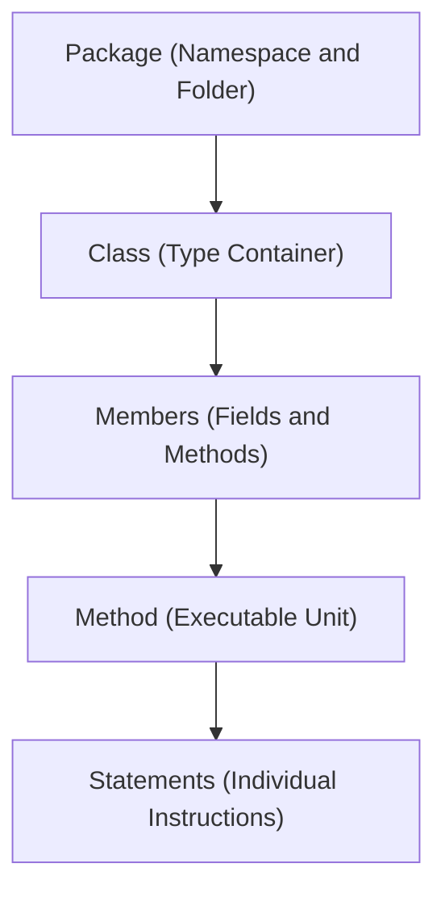
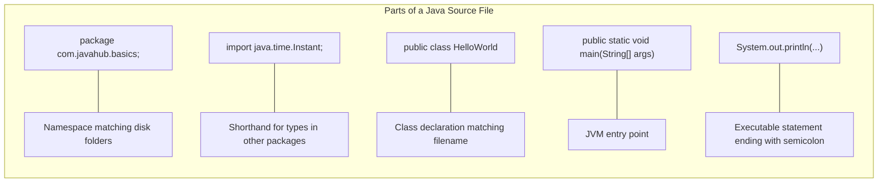
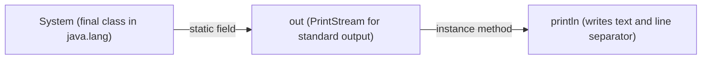
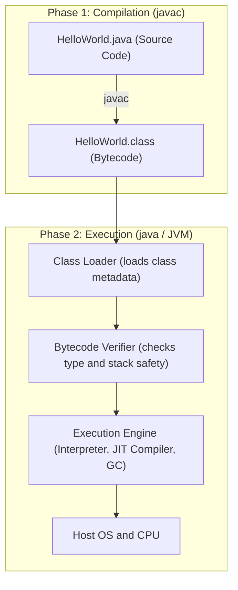

If you have written Python or JavaScript before, your first Java program can look surprisingly verbose. Printing a single line in Python takes one statement:

```python
print("Hello, World!")
```

In standard Java, printing that same message looks like this:

```java
package com.javahub.basics;

public class HelloWorld {
    public static void main(String[] args) {
        System.out.println("Hello, World!");
    }
}
```

At first glance, `package`, `public`, `class`, `static`, `void`, and `String[] args` look like unnecessary ceremony. None of them are random, though. Java was built for large, long-lived applications maintained by teams, where strict structure prevents naming collisions and catches mistakes at compile time rather than in production.

Once you understand what each line tells the compiler and the JVM, this structure stops feeling intimidating and starts reading like a clear blueprint.

---

## How Java Organizes Code

Java organizes every program into a strict hierarchy from folders on disk down to individual statements:



In standard Java source files, executable statements cannot sit loosely at the top of a file. Statements live inside methods, methods live inside a class (or interface/record/enum), and classes are grouped into packages.

---

## Line-by-Line Walkthrough of `HelloWorld.java`

Let's break down every part of a typical Java file from top to bottom.



### The `package` Declaration

```java
package com.javahub.basics;
```

A package is a namespace that groups related classes and prevents name clashes. Suppose an e-commerce system has two different `Order` classes: one for customer checkout and another for warehouse shipping. Placing them in separate packages keeps them distinct:

- `com.mycompany.store.Order`
- `com.mycompany.warehouse.Order`

Package names follow two rules you will rely on everywhere:

1. **Folder mapping:** By convention and standard compiler layout, packages match directory paths on disk. A class declaring `package com.javahub.basics;` belongs inside `com/javahub/basics/HelloWorld.java`.
2. **Reverse domain naming:** Teams usually start package names with their reversed domain name (such as `org.apache...` or `com.company...`) so libraries published by different organizations do not collide.

The `package` statement, when present, must be the very first non-comment line in the file. (For tiny single-file experiments, you can omit it, which puts the class in the unnamed default package; real projects always use named packages.)

### `import` Statements

```java
import java.time.Instant;
import java.util.List;
```

Java automatically imports one package for you in every file: `java.lang`. That is why you can use `String`, `System`, `Math`, and `Integer` without importing them.

For classes in any other package (such as `java.time` or `java.util`), you add an `import` statement right below the `package` line.

> [!NOTE]
> **Imports do not copy code into your program.**
> Unlike `#include` in C or C++, a Java `import` is simply a compile-time shorthand. Writing `import java.time.Instant;` tells the compiler that whenever you write `Instant`, you mean `java.time.Instant`. It has no runtime cost and does not increase the size of your `.class` file.

You can also use a wildcard import (`import java.util.*;`) to make all public types in a package visible by short name. Most teams prefer explicit imports because they make it obvious at a glance where every type comes from, and IDEs manage them automatically.

### The Class Declaration

```java
public class HelloWorld {
    // Fields and methods go here
}
```

- `public` is an access modifier meaning code in other packages can see and use this class.
- `class` declares a blueprint that holds data (fields) and behavior (methods).
- `HelloWorld` is the class name. Java convention uses **PascalCase** (capitalizing the first letter of each word, like `OrderService` or `BankAccount`).

> [!CAUTION]
> **Filename rule:** If a `.java` file contains a `public` class, the filename must match that class name exactly, including capitalization. `public class HelloWorld` must live in `HelloWorld.java`. You can place additional non-public helper classes in the same file, though in practice most developers keep one top-level class per file.

### The `main` Method

```java
public static void main(String[] args) {
    // Program execution starts here
}
```

When you launch a Java application with `java HelloWorld`, the JVM looks for this specific method signature as its starting point. If a modifier or parameter type is wrong, the file may still compile, but launching it produces:

```text
Error: Main method not found in class HelloWorld, please define the main method as:
   public static void main(String[] args)
```

Each keyword in the signature serves a concrete purpose:

- **`public`:** The JVM invokes `main` from outside your class and package, so it must be publicly accessible.
- **`static`:** Normally, calling a method requires creating an object with `new` first. At startup, no instance of `HelloWorld` exists yet, and the JVM would not know which constructor arguments to pass if one were required. Marking `main` as `static` attaches it to the class itself so the JVM can call `HelloWorld.main(...)` directly.
- **`void`:** Unlike C or C++ where `main` returns an integer exit status, Java's `main` returns nothing. When a program needs to report a non-zero exit code to the operating system, it calls `System.exit(1)` explicitly.
- **`String[] args`:** An array holding command-line arguments passed after the class name. For example, running:

```bash
java HelloWorld --env=prod --port=8080
```

populates `args[0]` with `"--env=prod"` and `args[1]` with `"--port=8080"`. If no arguments are passed, `args` is an empty array of length `0` (never `null`).

Java also accepts varargs syntax for the parameter: `public static void main(String... args)`. To the JVM, `String...` compiles to `String[]`, so both signatures are identical in bytecode.

### What `System.out.println(...)` Is Doing

```java
System.out.println("Hello, World!");
```

Even this familiar print line demonstrates how Java classes and objects work together:



- `System` is a utility class in `java.lang` providing access to standard input, output, error streams, and system properties.
- `out` is a `public static final` field on `System` holding a pre-configured `java.io.PrintStream` connected to your console's standard output.
- `println(...)` is a method on that `PrintStream` object that prints the argument followed by a newline. (Use `System.out.print(...)` if you want to stay on the same line.)

---

## Statements, Semicolons, and Blocks

Java is a free-form language. Unlike Python, indentation does not define program structure (though clean indentation is essential for humans reading the code). Instead, the compiler relies on **semicolons** and **curly braces**.

### Statements and Semicolons (`;`)

A **statement** is a complete instruction: declaring a variable, assigning a value, calling a method, or returning a result. Every simple statement ends with a semicolon `;`.

Because the compiler uses semicolons rather than line breaks to find where one statement ends and the next begins, you can split a long statement across multiple lines for readability:

```java
int totalCents = basePriceCents
        + shippingCents
        - discountCents;
```

### Blocks (`{}`)

Curly braces group zero or more statements into a **block**. Classes, methods, `if` statements, and loops all use blocks. Blocks also define **scope**: a local variable declared inside `{ ... }` only exists until the matching closing `}`.

### The Empty-Statement Semicolon Pitfall

A standalone semicolon `;` is a valid "empty statement" in Java that does nothing. Putting one accidentally right after an `if` or `for` header compiles without error, yet completely changes what your program does:

```java
boolean isAuthorized = false;

// Bug: the semicolon ends the if statement immediately!
if (isAuthorized);
{
    System.out.println("Accessing sensitive report...");
}
```

Because of that stray semicolon, the `if` statement runs an empty body when `isAuthorized` is true, and then the `{ ... }` block runs unconditionally every time. Most IDEs warn you when they spot an empty control-flow body, so pay attention to those yellow squiggly lines.

---

## Comments: Single-Line, Multi-Line, and Javadoc

The compiler ignores comments completely; they do not appear in `.class` bytecode. Good comments explain *why* a piece of code makes a non-obvious decision rather than repeating *what* the syntax already says.

Java supports three comment forms:

### Single-Line Comments (`//`)

Everything from `//` to the end of the line is ignored. Use these for short notes inside a method.

```java
// Round up to the nearest cent to match the billing provider's rule
long taxCents = (long) Math.ceil(subtotalCents * 0.0825);
```

### Multi-Line (Block) Comments (`/* ... */`)

Everything between `/*` and `*/` is ignored, even across multiple lines. These cannot be nested inside one another.

```java
/*
 * Retry up to three times because the upstream inventory service
 * occasionally drops idle connections during nightly maintenance.
 */
int maxRetries = 3;
```

### Javadoc Comments (`/** ... */`)

Javadoc comments start with a slash and **two** asterisks (`/**`) and sit directly above a class, interface, field, or method declaration. They support structured tags like `@param`, `@return`, and `@throws`:

```java
/**
 * Calculates the discounted price in cents.
 *
 * @param priceCents original item price in cents; must be non-negative
 * @param discountPercent discount percentage from 0 to 100
 * @return final price in cents after applying the discount
 * @throws IllegalArgumentException if priceCents is negative or discountPercent is out of range
 */
public static long applyDiscount(long priceCents, int discountPercent) {
    if (priceCents < 0 || discountPercent < 0 || discountPercent > 100) {
        throw new IllegalArgumentException("Invalid price or discount");
    }
    return priceCents - (priceCents * discountPercent / 100);
}
```

IDEs render Javadoc comments automatically when you hover over a method call, and the JDK's `javadoc` command generates browseable HTML API documentation directly from them:

```bash
javadoc -d docs src/com/javahub/basics/HelloWorld.java
```

---

## Compilation Process and Bytecode

Running a packaged Java program from the terminal makes the two-step lifecycle concrete.



### Compiling and Running with Packages

Suppose your project directory looks like this:

```text
my-project/
└── src/
    └── com/
        └── javahub/
            └── basics/
                └── HelloWorld.java
```

From `my-project/`, compile into a separate `out` folder using `-d`:

```bash
javac -d out src/com/javahub/basics/HelloWorld.java
```

The `-d out` option tells `javac` to mirror the `package` structure inside `out/`:

```text
out/
└── com/
    └── javahub/
        └── basics/
            └── HelloWorld.class
```

Now launch the JVM with `-cp` (classpath) pointing to `out` and pass the **fully qualified class name**:

```bash
java -cp out com.javahub.basics.HelloWorld
```

Output:

```text
Hello, World!
```

Two details trip beginners up here:
- `-cp out` points to the **root** of the package tree (`out`), not `out/com/javahub/basics`.
- You pass `com.javahub.basics.HelloWorld` with dots, not slashes and not `.class`.

### Inspecting the Generated Bytecode with `javap`

If you disassemble `HelloWorld.class` with `javap -c -p`:

```bash
javap -c -p out/com/javahub/basics/HelloWorld.class
```

you will see the bytecode instructions the JVM executes:

```text
Compiled from "HelloWorld.java"
public class com.javahub.basics.HelloWorld {
  public com.javahub.basics.HelloWorld();
    Code:
       0: aload_0
       1: invokespecial #1                  // Method java/lang/Object."<init>":()V
       4: return

  public static void main(java.lang.String[]);
    Code:
       0: getstatic     #7                  // Field java/lang/System.out:Ljava/io/PrintStream;
       3: ldc           #13                 // String Hello, World!
       5: invokevirtual #15                 // Method java/io/PrintStream.println:(Ljava/lang/String;)V
       8: return
}
```

Two interesting things stand out immediately:

1. **Synthesized default constructor:** Even though we never wrote a constructor in `HelloWorld.java`, `javac` generated a no-argument constructor `HelloWorld()` that calls `Object`'s constructor.
2. **How `main` runs:** `getstatic` pushes `System.out` onto the operand stack, `ldc` loads the string constant `"Hello, World!"` from the class constant pool, `invokevirtual` calls `PrintStream.println(String)`, and `return` exits the method.

---

## Modern Java Note: Instance `main` Methods and Compact Source Files

The Java team recognized that explaining `public static void main(String[] args)` on day one adds friction for new learners. Starting in **Java 21**, the language began introducing a streamlined syntax through preview JEPs:

- **Java 21 (JEP 445, Preview):** *Unnamed Classes and Instance Main Methods*. Required `--enable-preview` and allowed writing:

```java
// Java 21 preview (run with: java --enable-preview --source 21 Hello.java)
void main() {
    System.out.println("Hello, World!");
}
```

- **Java 22–24 (JEP 463, JEP 477, JEP 495):** Refined across three additional preview rounds (still requiring `--enable-preview`), experimenting with implicitly declared classes and simpler console I/O helpers.
- **Java 25 (JEP 512, Finalized):** Finalized as **Compact Source Files and Instance Main Methods**, allowing beginners and small scripts to run without `--enable-preview` using the standard `java.lang.IO` class:

```java
// Finalized in Java 25 (JEP 512)
void main() {
    IO.println("Hello, World!");
}
```

Behind the scenes, the compiler still wraps your code in a class and invokes your `main` method. Even with this simpler on-ramp available in Java 25+, you still need to know the standard `package`, `public class`, and `public static void main(String[] args)` form because virtually every multi-file codebase, library, and production service uses it.

---

## Practical Questions

### Why does `main` have to be `static` in standard Java?

Because the JVM needs to call `main` before any instance of your class exists. Making it `static` lets the JVM invoke `ClassName.main(args)` directly on the class without having to guess which constructor to run or how to supply constructor arguments. (In Java 25's instance `main` feature, the JVM only creates an instance if the class has an accessible no-argument constructor.)

### Can a single `.java` file contain more than one class?

Yes. You can declare multiple top-level classes in the same `.java` file, as long as at most one of them is `public` and the filename matches that `public` class. When you compile the file with `javac`, the compiler generates a separate `.class` file for each class defined inside it.

### Can you overload the `main` method?

Yes. Java allows you to define additional methods named `main` with different parameter lists, such as `public static void main(int count)`. They are ordinary methods that your code can call, but the JVM launcher still looks specifically for `main(String[] args)` (or `String... args`) when starting the program.

### What does the Bytecode Verifier check before executing a `.class` file?

Before the Execution Engine runs bytecode, the Bytecode Verifier checks that the `.class` file is structurally valid and follows JVM type and memory rules. It confirms that instructions do not overflow or underflow the operand stack, that local variables are initialized before use, that method calls match expected parameter types, and that bytecode does not bypass access controls or forge object references.
