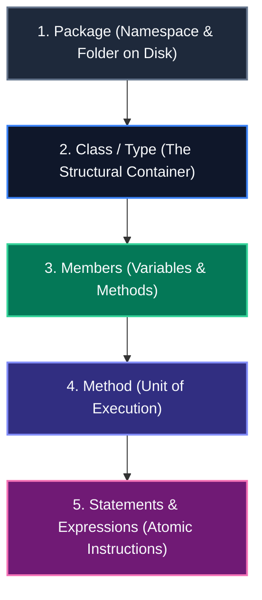
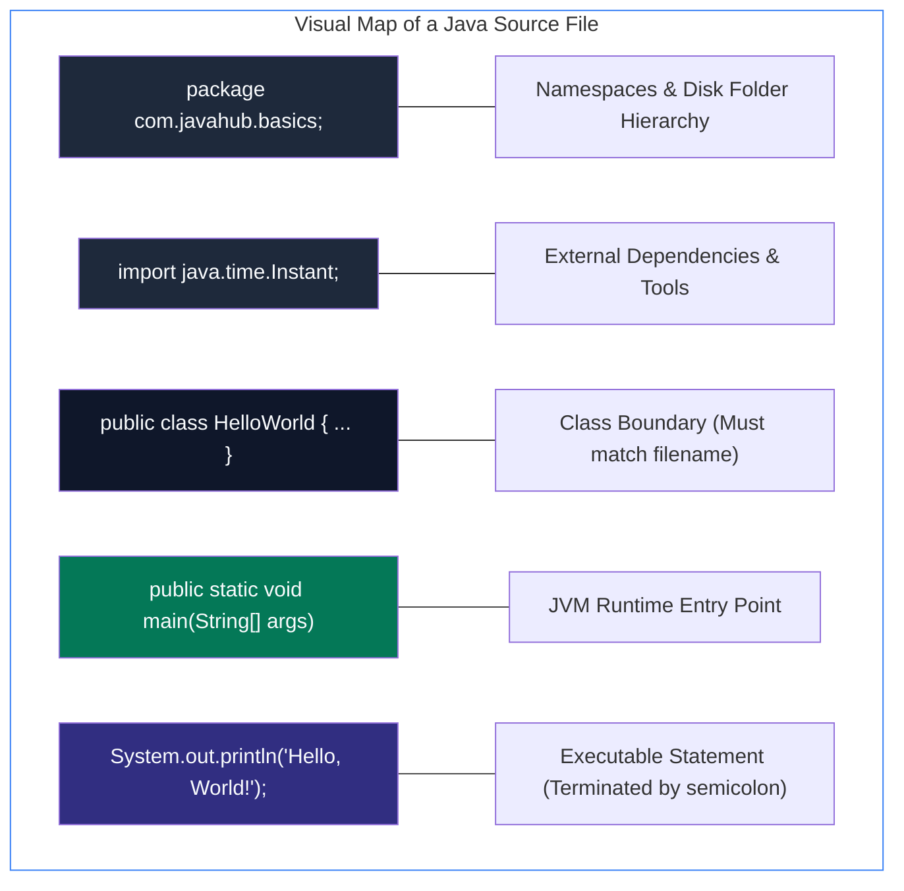
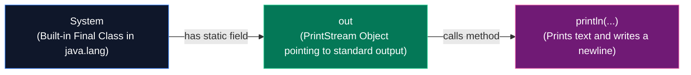
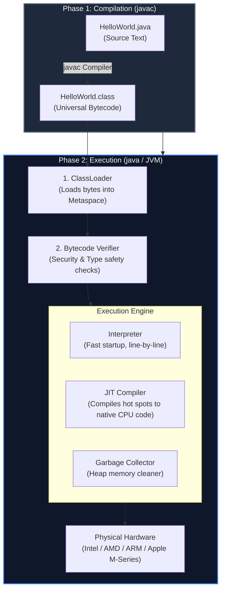

If you come from Python, JavaScript, or Ruby, your first encounter with Java can feel like walking into a Victorian legal courtroom. 

In Python, printing text to your screen takes a single, joyful line:
```python
print("Hello, World!")
```

In Java, to achieve that exact same feat, you are greeted with what looks like an intimidating wall of incantations:

```java
package com.javahub.basics;

public class HelloWorld {
    public static void main(String[] args) {
        System.out.println("Hello, World!");
    }
}
```

Why does a language need packages, classes, access modifiers, static keywords, and a mysterious string array just to spit out eleven letters of ASCII text?

The short answer: **Java doesn't design for scripts; it designs for systems.** 

Every single word in that boilerplate is a structural pillar engineered to help teams of thousands build multi-million-line codebases without collapsing under chaotic naming collisions or runtime type bugs. 

Once you deconstruct this structure piece by piece, you will stop seeing ceremony and start seeing deliberate engineering. Let's break down the anatomy of a Java program down to its atomic particles.

---

## The Structural Blueprint

Before writing code, let's look at the architectural hierarchy of how Java code is organized. Java is strictly hierarchical:



In Java, **code cannot float in the void**. There is no concept of a "naked" global function or an isolated script line outside of a class. Everything belongs to a type, every type lives in a file, and every file lives in a package.

---

## Anatomy of the File: Dissecting `HelloWorld.java`

Let’s take our program apart line by line, from top to bottom.



### The Package Declaration
```java
package com.javahub.basics;
```

Think of a package as a unique postal address for your class. 

If you are building an e-commerce platform, you might have an `Order` class representing a customer shopping cart. But your warehouse integration team might also have an `Order` class representing a shipping pallet. How does Java avoid confusing the two? 

Through packages:
- `com.mycompany.store.Order`
- `com.mycompany.warehouse.Order`

#### The Hard Disk Law
In Java, package names are not arbitrary strings—**they strictly mirror physical folders on your drive**. 
If your class declares `package com.javahub.basics;`, that file **must** physically reside inside `com/javahub/basics/` on disk. 

By convention, enterprise Java packages use the reverse domain name of the organization (e.g., `com.google...`, `org.apache...`, `io.github...`) to guarantee global uniqueness across open-source libraries worldwide.

---

### Imports: Bringing Tools into Your Workshop
```java
import java.time.Instant;
import java.util.*;
```

By default, Java only automatically makes one package available to your code: `java.lang` (which contains essentials like `System`, `String`, `Math`, and primitive wrappers). 

If you want to use anything else—like dates, collections, or networking libraries—you must tell the compiler where to find them using an `import` statement.

> [!NOTE]
> **Imports do NOT bloat your binary!**
> Coming from C/C++, you might fear that importing a package copies code like `#include <header.h>`. In Java, an `import` statement is purely a **syntactic convenience for the compiler**. Writing `import java.time.Instant;` simply tells the compiler: *"Whenever I write `Instant`, I mean `java.time.Instant`."* It has zero runtime performance or binary size penalty.

You can also use wildcard imports (`import java.util.*;`), which tell the compiler to look in that package if it encounters an unrecognized type. However, production guidelines favor explicit imports so readers always know where a class originates.

---

### The Class Declaration: The Mold for Everything
```java
public class HelloWorld {
    // Body of the class
}
```

Every program unit in Java is defined inside a type—most commonly a `class`.

- `public`: An **access modifier**. It tells Java that this class can be referenced and instantiated by code in any other package.
- `class`: The keyword that declares a blueprint for state and behavior.
- `HelloWorld`: The identifier (name) of the class. By convention, class names use **PascalCase** (capitalizing the first letter of every word: `OrderService`, `PaymentGateway`).

> [!CAUTION]
> **The Golden File-Naming Rule:**
> If a file contains a `public class HelloWorld`, the file on disk **must be named exactly `HelloWorld.java`**—case-sensitive! 
> You can have multiple helper classes in a single `.java` file, but **only one** can be marked `public`, and its name must dictate the filename. Why? Because when the Java compiler searches for a class, this 1-to-1 mapping allows it to locate files instantly without scanning millions of files across your hard drive.

---

### The Iconic `main` Method: The JVM Entry Point
```java
public static void main(String[] args)
```

This is the most famous method signature in software engineering. If you get even one letter or modifier wrong, the compiler might compile your file, but the JVM will flatly refuse to run it, complaining:

```text
Error: Main method not found in class HelloWorld, please define the main method as:
   public static void main(String[] args)
```

Why is every keyword here mandatory? Let's dissect the JVM's perspective:

#### `public`
When you open a terminal and run `java HelloWorld`, the JVM runs as an independent external process. It needs to invoke `main()` from outside the package. If `main` were `private` or `protected`, the JVM security model would block execution with an access violation.

#### `static`
This is where beginners often get confused. In Object-Oriented Programming, to call a method on a class, you usually need to create an object first using `new`:
```java
HelloWorld myApp = new HelloWorld();
myApp.run();
```
*Catch-22:* If `main()` were not static, the JVM would have to create an instance of `HelloWorld` to call it. But how would the JVM know which constructor to call? What if that constructor needed parameters? 
By marking `main` as `static`, the method belongs to the class itself, not any particular instance. The JVM can directly invoke `HelloWorld.main()` without needing to allocate an object on the heap first.

#### `void`
In C and C++, `main()` returns an integer (e.g., `return 0;`) representing the process exit code. 
In Java, `main()` returns `void` (nothing). If your Java application needs to signal an error code to the operating system shell, it calls `System.exit(1)` explicitly.

#### `String[] args`
This array collects any **command-line arguments** passed when launching the application:
```bash
java HelloWorld --env=prod --port=8080
```
Inside your program:
- `args[0]` will equal `"--env=prod"`
- `args[1]` will equal `"--port=8080"`

> [!TIP]
> **Fun Fact: Modern Varargs Syntax**
> Because Java arrays and varargs are interchangeable in method parameters, this is also 100% valid syntax for the entry point:
> ```java
> public static void main(String... args) { ... }
> ```
> Try it! The JVM accepts `String... args` without batting an eye.

---

### The Executable Statement: `System.out.println()`
```java
System.out.println("Hello, World!");
```

Even this single line is a masterclass in object interaction:



1. `System`: A built-in standard class in `java.lang` that exposes low-level system facilities.
2. `out`: A `public static final` field inside `System`. It is an already-instantiated object of type `java.io.PrintStream`, connected to the operating system's standard output stream (stdout).
3. `println(...)`: An instance method on `PrintStream` that prints your text to the console, followed by an OS-specific line break (`\n` or `\r\n`).

---

## Statements, Blocks, and the Tyranny of the Semicolon

Java is a **free-form, statement-based language**. Unlike Python, where indentation controls flow, Java uses punctuation:

### Semicolons (`;`)
Every standalone instruction (variable declaration, assignment, method invocation, object instantiation) must terminate with a semicolon. 

The Java compiler does not care about whitespace, carriage returns, or tabs. You could technically write your entire program on one continuous horizontal line of text, and Java wouldn’t flinch:
```java
public class Hello{public static void main(String[] a){System.out.println("Hi");}}
```
The semicolon is the unambiguous stop sign that tells the compiler’s lexical scanner: *"This instruction is complete; parse the next one."*

### Blocks (`{}`)
Curly braces define **lexical scope**. Any variables declared between `{` and `}` are born when execution enters the block and die when execution leaves the block.

> [!CAUTION]
> **The Lethal Semicolon Bug**
> A classic beginner trap is accidentally placing a semicolon directly after a control statement:
> ```java
> boolean isAuthorized = false;
> 
> if (isAuthorized); // <-- DEADLY SEMICOLON!
> {
>     System.out.println("Accessing top-secret vault...");
> }
> ```
> In Java, a semicolon alone is a valid "empty statement." The compiler reads this as: *"If `isAuthorized` is true, do nothing. Then proceed to run the block below unconditionally."* The vault opens! Never put a semicolon after an `if`, `while`, or `for` loop header.

---

## Comments: Leaving Breadcrumbs for Humans

Code tells the machine *what* to do; comments explain to human engineers *why* you did it. Java provides three distinct comment styles:

### Single-Line Comments
```java
// Calculate compound interest after tax deduction
double netTotal = principal * Math.pow(1 + rate, time);
```
Everything from `//` to the end of that specific physical line is ignored by the compiler.

### Multi-Line (Block) Comments
```java
/*
 * Temporary workaround for upstream gateway timeout.
 * See Jira Ticket: SEC-4029.
 * TODO: Remove once v2 client is deployed.
 */
```
Delimited by `/*` and `*/`. Useful for disabling chunks of code during debugging or writing multi-line explanations.

### Javadoc Comments: Professional Documentation
```java
/**
 * Processes a customer refund against the original payment provider.
 *
 * @param transactionId the unique UUID generated during checkout
 * @param amountInCents the monetary amount to refund, represented in minor units
 * @return true if the banking provider acknowledged the ledger reversal
 * @throws PaymentGatewayException if network timeouts occur during the handshake
 */
public boolean processRefund(String transactionId, long amountInCents) throws PaymentGatewayException {
    // ...
}
```
Javadoc comments begin with `/**` (two asterisks). 
When you hover over this method in IntelliJ IDEA or VS Code, your editor parses these tags to show interactive documentation tooltips. Furthermore, the JDK’s `javadoc` tool can scan your codebase and compile this into full HTML documentation websites just like the official Oracle Java API docs!

---

## The Compilation-to-Execution Pipeline

Now that you know what the code looks like, what actually happens when you run it? 

Let's step through the two-phase lifecycle that gives Java its "Write Once, Run Anywhere" power:



### Let's Do It in the Terminal!
Let's see this in action without relying on an IDE button:

1. Create a folder named `src/com/javahub/basics` and place `HelloWorld.java` inside.
2. Open your terminal at the root of your project:

```bash
# Compile the Java source code into bytecode
javac -d out src/com/javahub/basics/HelloWorld.java
```
Notice the `-d out` flag: this tells `javac` to place the generated `.class` files into a separate `out` directory while automatically preserving the package folder structure.

Look inside `out`:
```text
out/
└── com/
    └── javahub/
        └── basics/
            └── HelloWorld.class
```

3. Run the compiled bytecode using the Java Virtual Machine:
```bash
# -cp specifies the classpath (where to search for root package folders)
java -cp out com.javahub.basics.HelloWorld
```

Output:
```text
Hello, World!
```

---

## Peeking Under the Hood: Disassembling the Bytecode

What does `HelloWorld.class` actually look like? If you open it in Notepad, you will see raw binary gibberish starting with the hex characters `CA FE BA BE` (the legendary "magic number" James Gosling assigned to Java class files).

To read it, we use the disassembler that ships with your JDK: `javap`.

Run this command:
```bash
javap -c -p out/com/javahub/basics/HelloWorld.class
```

Here is the disassembled bytecode output:

```text
Compiled from "HelloWorld.java"
public class com.javahub.basics.HelloWorld {
  // 1. The Hidden Constructor injected by the compiler!
  public com.javahub.basics.HelloWorld();
    Code:
       0: aload_0
       1: invokespecial #1                  // Method java/lang/Object."<init>":()V
       4: return

  // 2. The Main Method
  public static void main(java.lang.String[]);
    Code:
       0: getstatic     #7                  // Field java/lang/System.out:Ljava/io/PrintStream;
       3: ldc           #13                 // String Hello, World!
       5: invokevirtual #15                 // Method java/io/PrintStream.println:(Ljava/lang/String;)V
       8: return
}
```

Look at what this reveals about the JVM:

1. **The Automatic Constructor**: You didn't write a constructor in `HelloWorld`, yet one exists! Java automatically synthesized a default constructor `HelloWorld()` that invokes `Object.<init>` to initialize memory.
2. **The Execution Stack**:
   - `getstatic #7`: Loads the static reference `System.out` onto the JVM operand stack.
   - `ldc #13`: "Load Constant"—pushes the String literal `"Hello, World!"` from the class Constant Pool onto the stack.
   - `invokevirtual #15`: Dynamically calls the `println` method on the `System.out` object.
   - `return`: Cleanly terminates the stack frame.

---

## Evolution Note: Java 21+ and Unnamed Classes

If you are starting Java today, you might ask: *"Is Java ever going to make this simpler for beginners?"*

Yes! In **Java 21, 22, and 23**, Java introduced **Instance Main Methods and Unnamed Classes** (JEP 445 / 463 / 477). 

In modern Java, you can write:
```java
// In a file named Hello.java
void main() {
    println("Hello, Modern Java!");
}
```
No `public class`, no `static`, no `String[] args`, and no `System.out`. 

The compiler automatically wraps your code inside an unnamed class behind the scenes. 
However, **every enterprise framework, backend microservice, and production codebase uses the standard structure we just explored.** Understanding the complete anatomy gives you total mastery over how real systems are built.

---

## 🎯 Senior Engineer Interview Questions

### Why must the `main` method be declared as `static`?
> **Answer:** The `main` method must be `static` so that the JVM can execute it without having to instantiate an object of the hosting class first. If it were an instance method, the JVM would face a chicken-and-egg dilemma: it wouldn't know which constructor to invoke or how to satisfy dependencies needed to build the instance before starting the program.

### Can you have multiple classes in a single `.java` file?
> **Answer:** Yes, but with one strict constraint: **only one class can be declared `public`**, and its name must match the `.java` filename. The file can contain any number of non-public (package-private) classes. When compiled with `javac`, each class in the file generates its own independent `.class` bytecode file.

### Can you overload the `main` method in Java?
> **Answer:** Absolutely! You can declare:
> ```java
> public static void main(String[] args) { ... }
> public static void main(int[] numbers) { ... }
> public static void main(String greeting) { ... }
> ```
> Java's method overloading rules apply normally. However, **only** `public static void main(String[] args)` (or `String... args`) will be recognized by the JVM launcher as the application entry point. All other overloaded versions behave as ordinary methods that must be explicitly called by your code.

### What is the purpose of the Bytecode Verifier in the JVM?
> **Answer:** The Bytecode Verifier is a core security component that inspects `.class` files before execution. It ensures that the bytecode does not violate Java language safety invariants: checking that stack overflows/underflows cannot occur, parameters match types, local variable access is legal, and private memory cannot be directly accessed via illegal pointer arithmetic. This prevents malicious bytecode from crashing or compromising the host machine.
