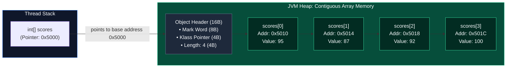
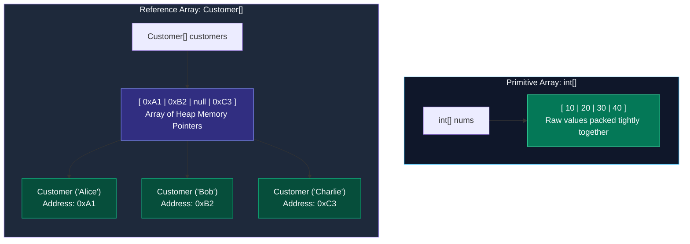
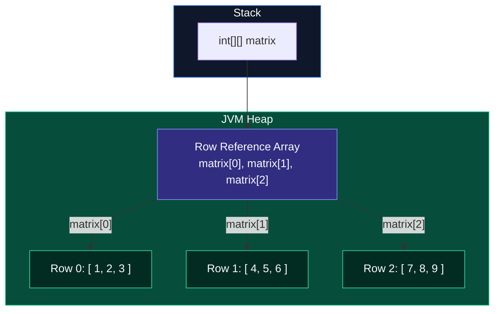

Before diving into complex Object-Oriented hierarchies, trees, graphs, or dynamic collections, you must understand the bedrock upon which all computer memory is built: **the Array**.

Every high-throughput data structure you will encounter in enterprise Java—whether it's the internal storage of `ArrayList`, the circular buffer of a high-speed LMAX Disruptor, or the underlying buffer of a network socket—is powered by an array.

Why? Because an array represents the most fundamental hardware reality of computer science: **a contiguous, unbroken sequence of memory bytes**.

Let's explore how Java manages arrays on the Heap, why accessing an array element takes constant time, how CPU hardware caches interact with your loops, and why 2D arrays in Java are fundamentally different from C or C++.

---

## Memory Layout: The Magic of Contiguous Allocation

Beginners often memorize that looking up an element in an array by its index takes `O(1)` constant time. But *why*? 

When you allocate an array in Java, the JVM requests a single, unbroken chunk of address space from the operating system:



Because the memory addresses are strictly consecutive, the CPU doesn't have to search through memory to find `scores[3]`. It calculates the physical memory address using simple arithmetic:

```text
Target Address = Base Address + (Index * Size of Data Type)
```

For an `int` array starting at byte address `0x5010`:
- `scores[0]` -> `0x5010 + (0 * 4) = 0x5010`
- `scores[1]` -> `0x5010 + (1 * 4) = 0x5014`
- `scores[3]` -> `0x5010 + (3 * 4) = 0x501C`

Whether your array has four elements or four million elements, calculating that offset takes a single CPU clock cycle. That is what true `O(1)` random access means.

---

## In Java, Every Array is a First-Class Object

Here is a detail that catches developers coming from C/C++ by surprise: **In Java, arrays are full objects allocated on the Heap**.

Even an array of primitives like `int[]` is a reference type that inherits directly from `java.lang.Object`!

Because an array is an object, it carries an internal **Object Header**:
1. **Mark Word (8 bytes on 64-bit JVM):** Stores identity hash code, locking flags, and garbage collection aging bits.
2. **Klass Pointer (4 bytes with Compressed OOPs):** Points to the class metadata in Metaspace (`[I` for `int[]`).
3. **Array Length (4 bytes):** Stores the fixed size of the array.

> [!NOTE]
> **Why are Array Lengths Capped at 2.14 Billion?**
> Look at the length field in the object header: it is a signed 32-bit `int`. This means an array's length can never exceed `Integer.MAX_VALUE` (2^31 - 1, or 2,147,483,647). You cannot create an array indexed by a 64-bit `long`.

---

## 1D Arrays: Syntax and Initialization

Java provides three primary syntax forms for instantiating an array:

### 1. Dynamic Allocation with Default Values
When you declare an array with a specific size, Java allocates the heap memory immediately and wipes every slot to its type's default value:
- Numeric types (`int`, `double`, `byte`, etc.) -> `0`
- `boolean` -> `false`
- Reference types (Objects, Strings) -> `null`

```java
// Allocate space for 5 bank balances (all initially 0.0)
double[] balances = new double[5];

balances[0] = 1500.50;
balances[1] = 275.00;
// balances[2], balances[3], balances[4] remain 0.0
```

### 2. Array Literals (Inline Initialization)
When you already know the elements upfront:

```java
// Anonymous array literal:
String[] supportedCurrencies = {"USD", "EUR", "GBP", "JPY"};

// Explicit syntax (useful when passing arrays into method arguments):
processCurrencies(new String[] {"USD", "CAD"});
```

> [!WARNING]
> **The Zero-Indexed Reality & Bounds Checking:**
> An array of size 4 has valid indices from `0` to `3`. If you attempt to access `supportedCurrencies[4]`, Java will immediately halt execution and throw:
> ```text
> Exception in thread "main" java.lang.ArrayIndexOutOfBoundsException: Index 4 out of bounds for length 4
> ```
> Unlike C, which silently reads garbage data from neighboring memory when you overrun an array buffer, Java enforces strict bounds checks on every read and write for security.

---

## Primitive Arrays vs. Reference Arrays

One of the most critical architectural distinctions in Java is how memory behaves for arrays of primitives versus arrays of objects:



### Primitive Arrays: Cache Line Bliss
In an `int[]`, the 32-bit integer values sit right next to each other in physical RAM. 
When the CPU reads `nums[0]`, its hardware prefetcher loads an entire **64-byte L1 Cache Line**, automatically pulling `nums[1]` through `nums[15]` into ultra-fast CPU cache before your code even asks for them!

### Reference Arrays: The Pointer Pointer
In a `Customer[]` array, **the objects do not sit inside the array**. 
The array holds a list of 64-bit pointers (references). Each pointer points to a completely separate object scattered randomly across the JVM Heap. Iterating over an array of objects can cause frequent **CPU cache misses** because memory must jump across addresses to fetch each object's fields.

---

## Multidimensional Arrays: The "Array of Arrays"

In languages like C or Fortran, a 2D matrix is stored as a single, contiguous linear chunk of memory where rows are laid out end-to-end.

Java takes a completely different path: **Java has no true multidimensional arrays.** 
In Java, a 2D array is simply a **1D array that holds references to other 1D arrays**.



### Jagged (Ragged) Arrays
Because each row is an independent array object, **the rows do not need to be the same length**:

```java
// Allocate a jagged triangle array:
int[][] triangle = new int[3][];
triangle[0] = new int[1]; // Row 0 has 1 column
triangle[1] = new int[2]; // Row 1 has 2 columns
triangle[2] = new int[3]; // Row 2 has 3 columns

triangle[0][0] = 1;
triangle[1][0] = 2; triangle[1][1] = 3;
triangle[2][0] = 4; triangle[2][1] = 5; triangle[2][2] = 6;
```

### Hardware Impact: Row-Major vs. Column-Major Traversal
Because rows are stored sequentially, iterating across rows is vastly faster than iterating down columns:

```java
int[][] matrix = new int[5000][5000];

// ✅ FAST (Row-Major): Hits contiguous cache lines
for (int row = 0; row < matrix.length; row++) {
    for (int col = 0; col < matrix[row].length; col++) {
        matrix[row][col] = 1;
    }
}

// ❌ SLOW (Column-Major): Hops between disconnected memory blocks on every iteration!
for (int col = 0; col < 5000; col++) {
    for (int row = 0; row < matrix.length; row++) {
        matrix[row][col] = 1;
    }
}
```
In benchmarks, row-major traversal in Java can be **up to 5x to 10x faster** on large matrices purely due to CPU hardware caching!

---

## High-Performance Copying: `System.arraycopy`

When you need to copy an array, resizing it or slicing it, never write a manual `for` loop copying elements one by one.

Java provides a native JVM intrinsic: **`System.arraycopy()`**.

```java
int[] source = { 10, 20, 30, 40, 50 };
int[] destination = new int[5];

// Syntax: (src, srcPos, dest, destPos, length)
System.arraycopy(source, 0, destination, 0, source.length);
```

`System.arraycopy` is a **native C/assembly routine** inside the JVM that translates directly into a raw CPU `memcpy` or `memmove` SIMD instruction. It copies millions of bytes in a fraction of a millisecond.

Convenience methods like `Arrays.copyOf()` call `System.arraycopy` under the hood:

```java
// Resizing an array (creates a new array of size 10 and copies elements):
int[] expanded = Arrays.copyOf(source, 10);
```

---

## The Essential `java.util.Arrays` Toolkit

Raw arrays lack convenient object methods like `.toString()` or `.sort()`. Java provides the `java.util.Arrays` utility class to fill this gap:

```java
import java.util.Arrays;

int[] numbers = { 42, 12, 88, 5, 23 };

// 1. Printing Arrays (System.out.println(numbers) just prints '[I@1a2b3c')
System.out.println(Arrays.toString(numbers)); // "[42, 12, 88, 5, 23]"

// 2. Sorting (Uses Dual-Pivot Quicksort for primitives, O(n log n))
Arrays.sort(numbers);
System.out.println(Arrays.toString(numbers)); // "[5, 12, 23, 42, 88]"

// 3. Binary Search (Requires sorted array!)
int index = Arrays.binarySearch(numbers, 42); // returns 3

// 4. Equality Check (Deep value comparison vs pointer identity)
int[] a = { 1, 2, 3 };
int[] b = { 1, 2, 3 };
System.out.println(a == b);             // FALSE! Different heap addresses
System.out.println(Arrays.equals(a, b)); // TRUE! Same elements

// 5. Printing 2D Matrices
int[][] grid = { {1, 2}, {3, 4} };
System.out.println(Arrays.deepToString(grid)); // "[[1, 2], [3, 4]]"
```

---

## Summary & Mental Model Checkpoint

1. **Contiguous Memory**: Arrays allocate unbroken memory blocks on the Heap, enabling instant `O(1)` random access arithmetic.
2. **First-Class Objects**: Arrays are objects with standard headers (Mark Word + Klass Pointer + 4-byte `length`).
3. **Primitive vs Reference**: Primitive arrays store raw bits side-by-side; reference arrays store 64-bit pointers to scattered heap objects.
4. **Arrays of Arrays**: 2D matrices in Java are not flat grids; they are parent arrays holding pointers to independent row arrays (enabling jagged shapes).
5. **Fast Copies**: Always use `System.arraycopy` or `Arrays.copyOf` for hardware-accelerated memory copying.
6. **Immutable Length**: Once allocated on the Heap, an array's length can never grow or shrink. Dynamic resizing requires allocating a new array and copying elements.

---

## 🎯 Senior Engineer Interview Questions

### Why does printing an array directly with `System.out.println(myArray)` output something like `[I@5f184fc6`?
> **Answer:** Arrays in Java are objects that inherit directly from `java.lang.Object`, but they do not override the default `toString()` implementation. The default `Object.toString()` returns the class name plus `@` and the unsigned hexadecimal representation of the object's identity hash code. In Java's internal JVM type signature, `[` indicates a 1D array, and `I` denotes primitive `int`. Thus, `[I` means "array of int". To print human-readable contents, you must use `Arrays.toString(array)` or `Arrays.deepToString(matrix)`.

### How does `System.arraycopy()` achieve significantly higher performance than a standard Java `for` loop?
> **Answer:** A manual Java `for` loop executes bytecode instructions that repeatedly perform bounds-checking, index incrementing, and individual element assignment through the JVM interpreter or JIT. In contrast, `System.arraycopy()` is a **JVM intrinsic method** implemented in native C++ and hand-tuned assembly. It checks bounds once up-front and delegates directly to the host CPU's vectorized memory copy operations (such as `memcpy` using SIMD AVX registers), moving wide blocks of cache lines simultaneously.

### What is the difference between `Arrays.equals()` and `Arrays.deepEquals()`?
> **Answer:** `Arrays.equals()` compares two 1D arrays for element-by-element equality using `equals()` (or `==` for primitives). If passed a multidimensional array (an array of arrays), `Arrays.equals()` will only compare the memory references of the nested row arrays, not their nested elements. `Arrays.deepEquals()` performs recursive traversal through arbitrarily nested arrays, ensuring complete value equality across multidimensional structures.

### What algorithm does `Arrays.sort()` use for primitive arrays versus object arrays? Why the difference?
> **Answer:** For primitive arrays, `Arrays.sort()` uses Vladimir Yaroslavskiy's **Dual-Pivot Quicksort**. It is an in-place `O(n log n)` algorithm with high cache efficiency, but it is **unstable** (it does not preserve the relative order of identical elements). For object arrays, `Arrays.sort()` uses **TimSort** (an adaptive, stable hybrid of MergeSort and InsertionSort). Stability is mandatory for objects so that secondary sorting keys (e.g. sorting by name after sorting by age) do not scramble previous sort order.
