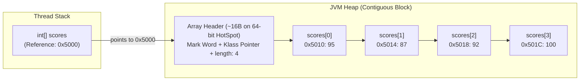
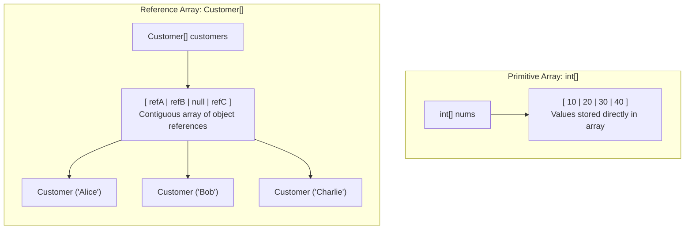
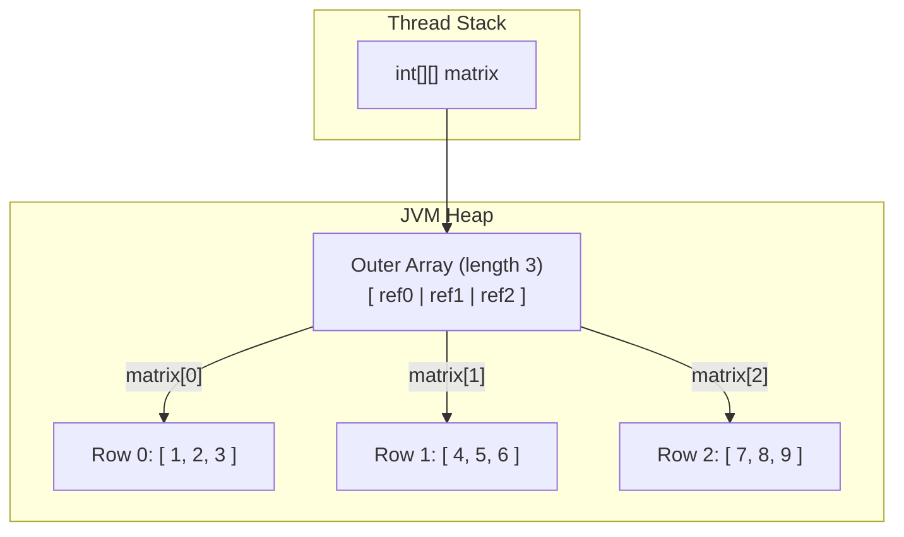

Almost every collection and buffer in Java rests on top of a plain array. `ArrayList` stores its elements in an `Object[]`, `String` stores its characters in a `byte[]` (since Java 9), and I/O streams read and write chunks through `byte[]` buffers. Understanding how arrays work in memory makes all of those higher-level tools easier to reason about.

An array is a fixed-size container that stores elements of a single type in one contiguous block of memory. Once an array is created, its length never changes. If you need more room, you allocate a larger array and copy the existing elements over.

---

## Memory Layout and Constant-Time Indexing

When you create a 1D array, the JVM allocates one unbroken block of heap memory large enough to hold the array's object header followed by all of its elements side by side.



Because every element has the exact same size in bytes and sits right next to its neighbors, looking up `scores[i]` does not require scanning through the array. The runtime computes the element's address directly with a single offset calculation:

```text
elementAddress = elementsStartAddress + (index * elementSizeInBytes)
```

For an `int[]` whose element data starts at `0x5010` (each `int` is 4 bytes):
- `scores[0]` is at `0x5010 + (0 * 4) = 0x5010`
- `scores[1]` is at `0x5010 + (1 * 4) = 0x5014`
- `scores[3]` is at `0x5010 + (3 * 4) = 0x501C`

Whether the array holds 4 integers or 4 million integers, that address calculation takes the same constant time: `O(1)`.

### Arrays Are Objects on the Heap

Unlike C or C++, where an array can decay into a raw pointer on the stack, every Java array is a full object allocated on the Heap (unless the JIT compiler optimizes a short-lived local array away via escape analysis). Even a primitive array like `int[]` inherits directly from `java.lang.Object`.

On a typical 64-bit HotSpot JVM with Compressed OOPs enabled (the default for heaps under roughly 32 GB), an array object starts with a 16-byte header:
- **Mark Word (8 bytes):** Holds lock state, identity hash code, and garbage collection metadata.
- **Compressed Klass Pointer (4 bytes):** Points to the runtime class metadata (for example, `[I` for `int[]`).
- **Length field (4 bytes):** Stores the fixed element count as a signed 32-bit `int`.

> [!NOTE]
> Because the length is a signed 32-bit `int`, Java arrays cannot be indexed with a `long` and can never exceed `Integer.MAX_VALUE` (2,147,483,647) elements. In practice, HotSpot caps maximum array length slightly lower (around `Integer.MAX_VALUE - 8`, depending on the VM build) to leave room for header words.

---

## 1D Arrays: Declaration, Initialization, and Copying

Java supports two main ways to create a 1D array: allocating by size with default values, or initializing inline with known values.

### Allocating by Size (Default Values)

When you allocate with `new Type[size]`, Java immediately initializes every slot to the default zero value for that type:
- Numeric primitives (`byte`, `short`, `int`, `long`, `float`, `double`) default to `0` or `0.0`
- `char` defaults to `'\u0000'`
- `boolean` defaults to `false`
- Reference types (`String`, custom classes, nested arrays) default to `null`

```java
// Preferred Java style: brackets next to the type
double[] balances = new double[5]; // All 5 slots start at 0.0

balances[0] = 1500.50;
balances[1] = 275.00;
System.out.println("Array length: " + balances.length); // 5 (field, not a method)
```

Notice two common beginner mix-ups:
- Array length is a `final` field (`balances.length`), not a method (`balances.length()` is for `String`, and `size()` is for collections like `List`).
- Java also accepts C-style brackets after the variable name (`double balances[]`), but putting brackets next to the type (`double[] balances`) makes it clear that the variable's type is "array of `double`".

### Inline Initialization (Array Literals)

When you already know the values at creation time, you can list them inside curly braces:

```java
// Shorthand literal (only allowed at the point of declaration)
String[] currencies = {"USD", "EUR", "GBP", "JPY"};

// Anonymous array expression (works anywhere, including method calls or reassignment)
processCurrencies(new String[] {"USD", "CAD"});
currencies = new String[] {"CHF", "AUD"};
```

### Primitive Arrays vs. Reference Arrays in Memory

A subtle but important distinction separates `int[]` from `Customer[]`.



In a primitive array like `int[]`, the raw 32-bit integers sit directly inside the contiguous array block. When the CPU reads `nums[0]`, it loads a full cache line (typically 64 bytes on modern x86/ARM CPUs), bringing the next several integers into L1 cache at the same time.

In a reference array like `Customer[]`, the array itself stores only object references (typically 4 bytes each with Compressed OOPs, or 8 bytes on larger heaps without Compressed OOPs). The `Customer` objects themselves live elsewhere on the Heap. The references are contiguous, so iterating the reference array is fast, but following each reference to read fields on the `Customer` objects may jump to scattered heap locations and trigger more CPU cache misses.

### Copying and Resizing Arrays

Because an array's size is fixed, growing an array means creating a new array and copying elements into it. Instead of writing a manual loop, use `Arrays.copyOf` (or `System.arraycopy` for partial ranges):

```java
import java.util.Arrays;

int[] source = {10, 20, 30, 40, 50};

// Create a larger array (new slots are zero-filled)
int[] expanded = Arrays.copyOf(source, 8);
// [10, 20, 30, 40, 50, 0, 0, 0]

// Copy a subrange [from, to) -> to is exclusive
int[] slice = Arrays.copyOfRange(source, 1, 4);
// [20, 30, 40]

// Low-level copy into an existing destination array
int[] destination = new int[5];
System.arraycopy(source, 0, destination, 0, source.length);
```

`Arrays.copyOf` delegates to `System.arraycopy` under the hood. In HotSpot, `System.arraycopy` is implemented as a JVM intrinsic: it validates array bounds and types up front, then copies blocks of memory using optimized native routines instead of stepping through Java bytecode one element at a time.

> [!NOTE]
> Both `System.arraycopy` and `Arrays.copyOf` perform a **shallow copy** on reference arrays. They copy the object references into the new array, not clones of the objects themselves. Modifying a mutable object via `copy[0]` is still visible through `original[0]`.

---

## Handling `ArrayIndexOutOfBoundsException`

Arrays in Java are **zero-indexed**. An array of length `n` has valid indices from `0` through `n - 1`. Any access with an index `< 0` or `>= array.length` throws `ArrayIndexOutOfBoundsException` at runtime.

```java
String[] currencies = {"USD", "EUR", "GBP", "JPY"}; // length = 4, valid indices: 0..3

String first = currencies[0]; // "USD"
String last = currencies[currencies.length - 1]; // "JPY"
String invalid = currencies[4]; // Throws ArrayIndexOutOfBoundsException
```

Modern JVMs (Java 11+) print a helpful message showing both the bad index and the actual array length:

```text
Exception in thread "main" java.lang.ArrayIndexOutOfBoundsException: Index 4 out of bounds for length 4
```

Unlike C or C++, where reading past the end of an array silently reads unrelated memory or corrupts neighboring variables, Java checks bounds on every array access (though the JIT compiler can often prove a loop's bounds are safe and hoist or eliminate redundant checks).

Four bugs cause the vast majority of `ArrayIndexOutOfBoundsException` failures:

1. **Off-by-one loop conditions:** Writing `i <= arr.length` instead of `i < arr.length`.
2. **Accessing index `0` on an empty array:** `new int[0]` is valid, has length `0`, and has *no* valid indices. Check `if (arr.length > 0)` before reading `arr[0]`.
3. **Negative indices:** Passing `-1` directly into `arr[index]` after a failed search (such as `Arrays.binarySearch` or `String.indexOf`) without checking whether the result is `< 0`.
4. **Assuming rectangular rows in a 2D array:** Using `matrix[0].length` in the inner loop when another row is shorter. Always use `matrix[row].length`.

---

## 2D and Multidimensional Arrays

In C or Fortran, a 2D array like `int matrix[3][3]` is laid out as one flat contiguous block of 9 integers. Java works differently: **Java has no true flat multidimensional arrays.** A 2D array in Java (`int[][]`) is a 1D array whose elements are references to other 1D arrays.



### Rectangular 2D Arrays

When every row has the same number of columns, you can allocate the outer array and all row arrays in one expression, or use nested array literals:

```java
// 3 rows, 4 columns (all elements initialized to 0)
int[][] seats = new int[3][4];

// Inline 2D literal
int[][] grid = {
    {1, 2, 3},
    {4, 5, 6},
    {7, 8, 9}
};

// Standard traversal
for (int row = 0; row < grid.length; row++) {
    for (int col = 0; col < grid[row].length; col++) {
        System.out.print(grid[row][col] + " ");
    }
    System.out.println();
}
```

Here `grid.length` is the number of rows (`3`), and `grid[row].length` is the number of columns in that specific row (`3`).

### Jagged (Ragged) Arrays

Because each row is an independent `int[]` object on the Heap, rows do not have to be the same length:

```java
// Allocate only the outer array of 3 row references (initially all null)
int[][] triangle = new int[3][];

triangle[0] = new int[1]; // Row 0 has 1 slot
triangle[1] = new int[2]; // Row 1 has 2 slots
triangle[2] = new int[3]; // Row 2 has 3 slots

triangle[0][0] = 1;
triangle[1][0] = 2;
triangle[1][1] = 3;
triangle[2][0] = 4;
triangle[2][1] = 5;
triangle[2][2] = 6;
```

Watch out for `null` rows when allocating jagged arrays. Right after `int[][] triangle = new int[3][];`, `triangle[0]` is `null`. Accessing `triangle[0][0]` before assigning `new int[...]` to `triangle[0]` throws a `NullPointerException`, not an `ArrayIndexOutOfBoundsException`.

### Row-Major vs. Column-Major Traversal

Even though Java's rows are separate heap objects, the elements *within* each row are contiguous in memory. That makes traversal order matter on large matrices:

```java
int size = 4000;
int[][] matrix = new int[size][size];

// Row-major: walks sequentially through each row's contiguous memory
long sumRowMajor = 0;
for (int row = 0; row < matrix.length; row++) {
    for (int col = 0; col < matrix[row].length; col++) {
        sumRowMajor += matrix[row][col];
    }
}

// Column-major: jumps to a different row array on every single inner step
long sumColMajor = 0;
for (int col = 0; col < size; col++) {
    for (int row = 0; row < matrix.length; row++) {
        sumColMajor += matrix[row][col];
    }
}
```

In the row-major loop, the inner loop steps through `matrix[row][0]`, `matrix[row][1]`, `matrix[row][2]`, and so on. Each cache line fetched from RAM holds multiple consecutive `int` values, so most reads hit L1 cache and the CPU hardware prefetcher can predict the next address easily.

In the column-major loop, every iteration of the inner loop dereferences a different row pointer (`matrix[0]`, `matrix[1]`, `matrix[2]`, ...), jumping across memory and touching only 4 bytes out of each 64-byte cache line before moving on. On large matrices that exceed CPU cache capacity, row-major traversal is often several times faster than column-major traversal simply because it works with the hardware cache instead of against it.

---

## The `java.util.Arrays` Utility Class

Plain arrays do not override `toString()` or `equals()`, and they have no built-in `.sort()` method. Instead, the standard library puts those operations as static helper methods in `java.util.Arrays`.

### Printing: `toString` and `deepToString`

Printing an array directly calls `Object.toString()`, which outputs the JVM's internal type descriptor and an unsigned hex hash code:

```java
import java.util.Arrays;

int[] numbers = {42, 12, 88, 5, 23};
System.out.println(numbers);                  // e.g. "[I@5f184fc6"
System.out.println(Arrays.toString(numbers)); // "[42, 12, 88, 5, 23]"

int[][] grid = {{1, 2}, {3, 4}};
System.out.println(Arrays.toString(grid));     // "[[I@..., [I@...]" (row hashes!)
System.out.println(Arrays.deepToString(grid)); // "[[1, 2], [3, 4]]"
```

Use `Arrays.toString` for 1D arrays and `Arrays.deepToString` whenever an array contains nested arrays.

### Sorting and Searching: `sort` and `binarySearch`

`Arrays.sort` sorts an array **in place** in ascending order (or sorts a subrange `[fromIndex, toIndex)` where `toIndex` is exclusive).

```java
int[] numbers = {42, 12, 88, 5, 23};
Arrays.sort(numbers);
System.out.println(Arrays.toString(numbers)); // "[5, 12, 23, 42, 88]"

// binarySearch REQUIRES the array to be sorted first!
int foundIdx = Arrays.binarySearch(numbers, 42); // 3
int missingIdx = Arrays.binarySearch(numbers, 30); // -4
```

Two important details about `binarySearch`:
- If you call `Arrays.binarySearch` on an unsorted array, it does *not* throw an exception; it silently returns an undefined result.
- When the target is not found, `binarySearch` returns `-(insertionPoint) - 1`. In the example above, `30` would be inserted at index `3` to keep the array sorted, so the method returns `-(3) - 1 = -4`. That guarantees any non-negative return value means "found", and any negative value means "not found".

For sorting algorithms, the JDK intentionally picks two different strategies:
- **Primitive arrays (`int[]`, `double[]`, etc.):** Uses Dual-Pivot Quicksort, which runs in `O(n log n)` average time with very low memory overhead. It is *unstable*, which does not matter for primitives because two equal `5`s are indistinguishable.
- **Object arrays (`String[]`, `Order[]`, etc.):** Uses TimSort, a *stable* hybrid of merge sort and insertion sort. Stability guarantees that equal elements keep their original relative order, which matters when sorting records by multiple keys (for example, sorting by last name and then by department).

### Comparing Arrays: `equals` and `deepEquals`

Using `==` or `a.equals(b)` on two arrays only checks whether both variables reference the exact same array object on the Heap. To compare contents, use `Arrays.equals` for 1D arrays and `Arrays.deepEquals` for 2D or nested arrays:

```java
int[] a = {1, 2, 3};
int[] b = {1, 2, 3};

System.out.println(a == b);             // false (two distinct objects)
System.out.println(a.equals(b));        // false (Object.equals checks reference identity)
System.out.println(Arrays.equals(a, b)); // true (same length and matching elements)

int[][] m1 = {{1, 2}, {3, 4}};
int[][] m2 = {{1, 2}, {3, 4}};

System.out.println(Arrays.equals(m1, m2));     // false (compares row references with ==)
System.out.println(Arrays.deepEquals(m1, m2)); // true (recursively compares nested elements)
```

### Filling Arrays: `fill`

`Arrays.fill` sets every slot (or a subrange `[fromIndex, toIndex)`) to a single value:

```java
int[] scores = new int[5];
Arrays.fill(scores, -1); // [-1, -1, -1, -1, -1]

// Fill only indices 1 and 2 (index 3 is exclusive)
Arrays.fill(scores, 1, 3, 100); // [-1, 100, 100, -1, -1]
```

> [!WARNING]
> Be careful calling `Arrays.fill` with mutable objects or nested arrays:
> ```java
> int[][] board = new int[3][];
> Arrays.fill(board, new int[3]); // Bug: all 3 rows point to the SAME int[3]!
> board[0][0] = 9;
> // board[1][0] and board[2][0] are now 9 too!
> ```
> `Arrays.fill` copies the *same reference* into every slot. To initialize separate rows or separate mutable objects, use a `for` loop (or `Arrays.setAll(board, i -> new int[3])`).

---

## Summary

- A 1D array is a fixed-length heap object storing elements contiguously, enabling `O(1)` random access by index.
- Primitive arrays hold raw values directly in contiguous memory; reference arrays hold object references pointing to objects elsewhere on the Heap.
- Valid indices run from `0` to `array.length - 1`; any out-of-range access throws `ArrayIndexOutOfBoundsException`.
- A 2D array in Java is an array of references to row arrays, which allows jagged shapes and makes row-major traversal significantly more cache-friendly than column-major traversal.
- Use `java.util.Arrays` (`toString`, `deepToString`, `sort`, `binarySearch`, `copyOf`, `equals`, `deepEquals`, `fill`) instead of hand-rolling common array operations.

---

## Interview Questions

### Why does printing an array with `System.out.println(myArray)` output something like `[I@5f184fc6`?
Arrays inherit directly from `java.lang.Object` and do not override `toString()`. `Object.toString()` prints the class name, `@`, and the unsigned hex identity hash code. In JVM type descriptors, `[` denotes a 1D array and `I` denotes primitive `int`, so `[I` means `int[]`. Use `Arrays.toString(myArray)` for 1D arrays or `Arrays.deepToString(matrix)` for multidimensional arrays.

### What is the difference between `Arrays.equals()` and `Arrays.deepEquals()`?
`Arrays.equals()` checks element-by-element equality on a single dimension. If you pass it two `int[][]` arrays, it compares each `row` reference with `equals()` (which for arrays is just reference identity `==`), returning `false` unless both outer arrays share the exact same row instances. `Arrays.deepEquals()` recursively inspects nested arrays so multidimensional structures are compared by their actual element values.

### Why does `Arrays.sort()` use Dual-Pivot Quicksort for primitives and TimSort for objects?
For primitive types, equal values are completely interchangeable (one `42` is identical to another `42`), so sort stability does not matter and Dual-Pivot Quicksort offers fast `O(n log n)` in-place sorting with low memory overhead. For object arrays, equal objects according to a comparator may differ in other fields, so `Arrays.sort()` uses TimSort to guarantee a stable sort that preserves the original relative order of equal elements.

### Why is `Arrays.fill(matrix, new int[4])` usually a bug?
Because `new int[4]` is evaluated once before `Arrays.fill` is called, creating a single 4-element array on the Heap. `Arrays.fill` then writes that same reference into every row slot of `matrix`. Modifying `matrix[0][0]` therefore modifies `matrix[1][0]`, `matrix[2][0]`, and so on. Allocate each row independently inside a loop or with `Arrays.setAll(matrix, row -> new int[4])`.
