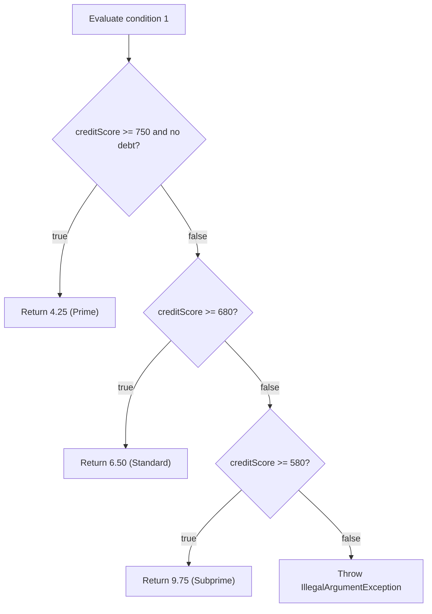
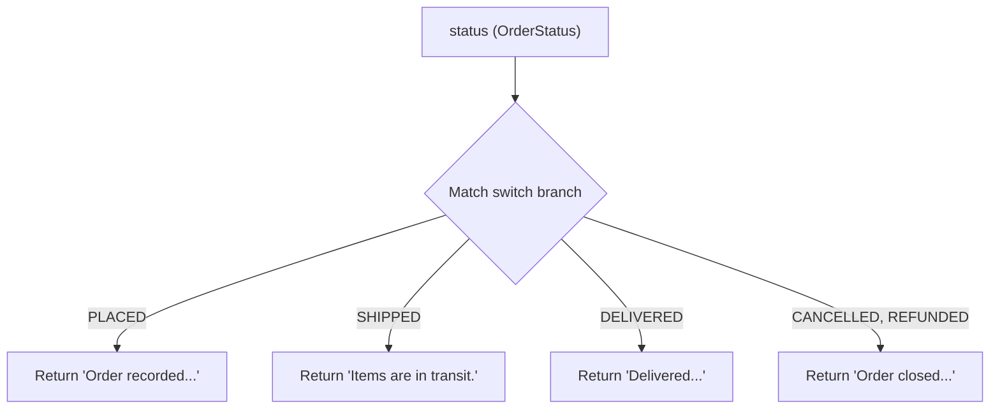
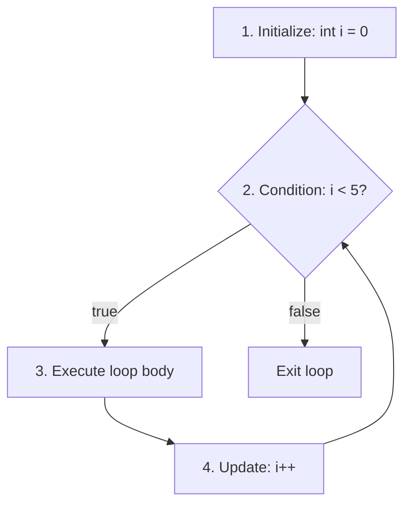

A Java program starts at `main` and runs top to bottom, one statement after another. Real programs rarely follow a single straight line. They have to validate user input, apply pricing rules, retry failed network calls, and scan through collections of data. Control flow statements are how you express those decisions and repetitions.

One rule applies across all branching and looping in Java: every condition must evaluate strictly to a `boolean` (`true` or `false`). Unlike C, JavaScript, or Python, Java has no concept of "truthy" or "falsy" values. Writing `if (1)` or `if (username)` is a compile-time error. That strictness prevents a whole class of bugs where a number or string accidentally controls a branch.

---

## Conditional Branching with `if` and `else`

The `if` statement runs a block of code only when its condition is `true`. Adding `else` provides a fallback path, and chaining `else if` lets you test several conditions in order.



Conditions in an `if / else if / else` ladder are checked from top to bottom. As soon as one condition matches, Java executes that block and skips every remaining branch in the chain.

```java
public double calculateLoanInterest(int creditScore, boolean hasExistingDebt) {
    if (creditScore >= 750 && !hasExistingDebt) {
        return 4.25; // Tier 1: Prime borrower
    } else if (creditScore >= 680) {
        return 6.50; // Tier 2: Standard borrower
    } else if (creditScore >= 580) {
        return 9.75; // Tier 3: Subprime borrower
    } else {
        throw new IllegalArgumentException(
            "Loan rejected: credit score below minimum threshold."
        );
    }
}
```

Notice the order of the thresholds: `750`, then `680`, then `580`. If you checked `creditScore >= 580` first, a borrower with a score of `780` would match the first branch and get the `9.75` rate. Ordering conditions from most specific to most general avoids shadowed branches.

### Short-Circuit Evaluation (`&&` and `||`)

When combining conditions with `&&` (logical AND) or `||` (logical OR), Java evaluates from left to right and stops as soon as the final result is already known:

- With `&&`, if the left side is `false`, the whole expression cannot be `true`, so Java never evaluates the right side.
- With `||`, if the left side is `true`, the whole expression is already `true`, so Java never evaluates the right side.

Developers rely on this every day to guard operations that would otherwise throw an exception:

```java
// Safe: if user is null, user.isActive() is never called
if (user != null && user.isActive()) {
    processOrder(user);
}

// Safe: if count is 0, total / count is never evaluated
if (count > 0 && (total / count) >= 50) {
    applyBulkDiscount();
}

// Bug: single '&' evaluates BOTH sides even when user is null
if (user != null & user.isActive()) {
    processOrder(user); // Throws NullPointerException if user is null
}
```

> [!TIP]
> Use `&&` and `||` for boolean conditions. Single `&` and `|` do not short-circuit and are normally reserved for bitwise operations on integer types.

### Common `if` / `else` Pitfalls

Three small syntax mistakes show up often in beginner and production Java code alike:

1. **Omitting curly braces.** Java allows a single-statement `if` without braces, which makes it easy to accidentally run a second line unconditionally:

```java
// Bug: only the first line belongs to the if block
if (isAdmin)
    grantAccess();
    logAdminAudit(); // Runs for EVERY user, even non-admins!
```

Always wrapping `if` and `else` bodies in `{ ... }` prevents this bug and also eliminates the "dangling `else`" ambiguity in nested `if` statements.

2. **Assignment inside a boolean condition.** Writing `if (count = 5)` will not compile in Java because `count = 5` evaluates to an `int`, not a `boolean`. However, if the variable is already a `boolean`, the assignment compiles cleanly and silently overwrites the variable:

```java
boolean isVerified = false;

// Bug: assigns true to isVerified instead of comparing
if (isVerified = true) {
    allowWithdrawal(); // Always runs!
}

// Clear and safe: test the boolean directly
if (isVerified) {
    allowWithdrawal();
}
```

3. **Comparing objects with `==`.** For primitives (`int`, `double`, `boolean`), `==` compares values. For `String` and other objects, `==` checks whether two references point to the same object in memory. Use `.equals(...)` for string content comparison:

```java
if ("ADMIN".equals(role)) {
    openControlPanel();
}
```

Putting the constant `"ADMIN"` on the left also avoids a `NullPointerException` if `role` happens to be `null`.

---

## The Ternary Operator

When an `if / else` block only picks between two values for a single expression, the ternary operator (`? :`) expresses the same logic inline:

```java
// Standard if-else
double discount;
if (isPremiumMember) {
    discount = 0.20;
} else {
    discount = 0.05;
}

// Ternary expression
double discount = isPremiumMember ? 0.20 : 0.05;
```

The syntax is `condition ? expressionIfTrue : expressionIfFalse`.

Keep two rules in mind when using it:

- **It is an expression, not a statement.** Both branches must produce a value that can be assigned to the target type. You cannot place `void` method calls like `System.out.println(...)` inside a ternary operator.
- **Avoid nesting ternaries.** Writing `a ? b : c ? d : e` forces every future reader to mentally trace operator precedence. Once you have more than two outcomes, switch to an `if / else if` block or a `switch` expression.

---

## Modern `switch` Expressions (Java 14+)

When you are comparing a single value against several fixed candidates, a long `if / else if` ladder becomes repetitive. That is what `switch` is designed for.

### Classic `switch` Statements and the Fall-Through Bug

Java originally inherited its `switch` statement from C. In the classic `colon` (`:`) form, matching a `case` starts executing statements from that label downward and keeps going into the next case until it hits a `break` or the end of the block.

```java
int day = 1;
String label;

switch (day) {
    case 1:
        label = "Monday";
        // Missing break! Execution falls through into case 2.
    case 2:
        label = "Tuesday";
        break;
    default:
        label = "Other";
        break;
}
// label is now "Tuesday", not "Monday"
```

Forgetting a single `break;` is one of the oldest sources of bugs in C-style languages. Because the code still compiles without error, silent fall-through can easily slip into production.

### Arrow Syntax (`->`) and Return Values

Java 14 finalized **Switch Expressions** (JEP 361), which fix the ergonomics of `switch` in three major ways:

- Arrow labels (`case X -> ...`) execute only the code to the right of the arrow. There is no fall-through and no `break` needed.
- Multiple constants can share one branch using commas (`case CANCELLED, REFUNDED -> ...`).
- The entire `switch` produces a value directly, so you can return it or assign it to a variable.

```java
public enum OrderStatus {
    PLACED, SHIPPED, DELIVERED, CANCELLED, REFUNDED
}

public String getStatusDescription(OrderStatus status) {
    return switch (status) {
        case PLACED -> "Order recorded and awaiting packaging.";
        case SHIPPED -> "Items are in transit.";
        case DELIVERED -> "Delivered to the shipping address.";
        case CANCELLED, REFUNDED -> "Order closed and payment reversed.";
    };
}
```



Notice there is no `default` branch in `getStatusDescription`. A `switch` *expression* must be **exhaustive**: the compiler verifies that every possible input produces a value. Because `OrderStatus` is an `enum` and all five constants are handled, the compiler accepts it. If someone later adds `ON_HOLD` to `OrderStatus`, the compiler will immediately flag this `switch` as incomplete instead of letting a silent default hide the missing case.

For types with an open set of values (like `int` or `String`), the compiler requires a `default` branch in a switch expression.

### Multi-Statement Branches with `yield`

When a branch needs to run multiple statements (logging, validation, intermediate calculations) before producing its result, wrap the branch in curly braces `{ ... }` and use the `yield` keyword:

```java
String message = switch (statusCode) {
    case 200 -> "OK";
    case 404 -> "Not Found";
    case 500 -> {
        alertOpsTeam(statusCode);
        logError("Upstream service returned HTTP 500");
        yield "Internal Server Error";
    }
    default -> "Unexpected Status: " + statusCode;
};
```

Do not confuse `yield` with `return`: `return` exits the enclosing method, and the compiler does not allow `return` inside a `switch` expression. `yield` hands a value back to the `switch` expression itself.

### Pattern Matching in `switch` (Java 21 LTS)

Classic `switch` only accepted `byte`, `short`, `char`, `int` (plus their wrapper classes), `enum`, and `String`. Java 21 finalized **Pattern Matching for `switch`** (JEP 441), allowing a `switch` to match on object types, handle `null` directly as a case, and attach boolean guards with `when`:

```java
public String formatValue(Object obj) {
    return switch (obj) {
        case null -> "Value is null";
        case Integer i when i < 0 -> "Negative integer: " + i;
        case Integer i -> "Non-negative integer: " + i;
        case String s when s.isBlank() -> "Blank string";
        case String s -> "Text: " + s.trim();
        default -> "Other type: " + obj.getClass().getSimpleName();
    };
}
```

Just like `if / else if` ladders, more specific guarded patterns (`case Integer i when i < 0`) must come before unguarded patterns (`case Integer i`). If you reverse them, the compiler reports an error because the first pattern dominates the second.

---

## Iterative Loops: `for`, `while`, and `do-while`

Loops repeat a block of code while a condition holds. Java has three classic loops (`for`, `while`, `do-while`) plus the enhanced `for-each` loop. Choosing the right one makes your intent obvious to anyone reading the code.

### The Classic `for` Loop

Use a standard `for` loop when you need an explicit index, want to iterate backward, or need to step by something other than 1.

```java
//   1. Init    2. Condition  4. Update
for (int i = 0; i < 5;        i++) {
    // 3. Body
    System.out.println("Processing batch: " + i);
}
```

Here is the exact sequence the JVM follows on every cycle:



A few details worth remembering:

- The initialization (`int i = 0`) runs once before the first check. The variable `i` is scoped strictly to the loop and does not exist after the closing brace.
- The condition is checked *before* each iteration. If it is `false` on entry (for example, `for (int i = 5; i < 5; i++)`), the body never executes.
- Watch out for **off-by-one errors**. Arrays and lists are zero-indexed, so an array of length 5 has valid indices `0, 1, 2, 3, 4`. Writing `i <= items.length` instead of `i < items.length` reads one slot past the end and throws `ArrayIndexOutOfBoundsException`.

### The `while` Loop

Use `while` when you do not know ahead of time how many iterations will be needed, such as reading lines from a file, draining a queue, or retrying a network handshake.

```java
int retries = 0;
boolean connected = false;

while (!connected && retries < 3) {
    connected = attemptNetworkHandshake();
    retries++;
}
```

Because `while` checks its condition *before* entering the body, it runs **zero or more times**. If `connected` is already `true` before the loop begins, `attemptNetworkHandshake()` is never called.

The most common `while` bug is forgetting to update the variable that controls termination (for instance, omitting `retries++` when the handshake keeps failing), which traps the thread in an infinite loop.

### The `do-while` Loop

A `do-while` loop evaluates its condition *after* running the body, so the body is guaranteed to execute **at least once**. That fits interactive prompts, menu loops, or any work that must happen before you can inspect the result.

```java
int selection;
do {
    selection = readMenuSelection();
    handleSelection(selection);
} while (selection != EXIT_OPTION);
```

Notice the semicolon after `while (selection != EXIT_OPTION);`. Unlike `while` and `for`, `do-while` requires that trailing semicolon.

---

## The Enhanced `for-each` Loop

Introduced in Java 5, the enhanced `for` loop (often called `for-each`) visits every element of an array or any `Iterable` collection (`List`, `Set`, `Queue`) without asking you to manage an index variable:

```java
String[] paymentProviders = {"Stripe", "Adyen", "PayPal"};

for (String provider : paymentProviders) {
    System.out.println("Checking health of " + provider);
}
```

For standard traversal, `for-each` is usually the clearest choice because off-by-one index mistakes are impossible. However, it has three important limits you should know upfront:

1. **No index access.** If you need the element's position (or want to compare `items[i]` with `items[i + 1]`), use a classic `for` loop.
2. **Reassigning the loop variable does not change the array.** The loop variable holds a copy of the element value (or object reference):

```java
int[] scores = {10, 20, 30};

for (int score : scores) {
    score = score * 2; // Only modifies the local copy 'score'
}
// scores is still {10, 20, 30}
```

To overwrite elements in an array, use an indexed `for` loop (`scores[i] = scores[i] * 2`).

3. **Do not add or remove elements from a `Collection` inside `for-each`.** For a `List` or `Set`, the compiler translates a `for-each` loop into an `Iterator`:

```java
// What the compiler generates for a List<String>
for (Iterator<String> it = names.iterator(); it.hasNext(); ) {
    String name = it.next();
    // loop body
}
```

Standard collections like `ArrayList` track structural changes using an internal modification counter. Calling `names.remove(name)` directly inside the `for-each` loop causes the iterator to detect an unexpected modification on the next call to `next()` and throw `ConcurrentModificationException`.

To remove matching items safely, use `removeIf` (Java 8+) or an explicit `Iterator`:

```java
// Cleanest option in modern Java
names.removeIf(name -> name.startsWith("test_"));

// Alternative using an explicit Iterator
Iterator<String> it = names.iterator();
while (it.hasNext()) {
    if (it.next().startsWith("test_")) {
        it.remove(); // Safe: updates the iterator's expected modification count
    }
}
```

---

## Flow Disruption: `break`, `continue`, and Labels

Sometimes you need to stop a loop early once you find what you were looking for, or skip individual records that fail validation.

- **`break`** exits the innermost enclosing loop (or `switch`) immediately and resumes execution at the first statement after it.
- **`continue`** skips the remainder of the current iteration and jumps to the next cycle of the innermost loop.

```java
for (int i = 0; i < transactions.length; i++) {
    if (transactions[i] == null) {
        continue; // Skip blank entries and move to i++
    }
    if (transactions[i].isFlaggedFraud()) {
        haltBatchProcessing(transactions[i]);
        break; // Stop scanning immediately
    }
    process(transactions[i]);
}
```

Watch out for `continue` inside a `while` loop. In a `for` loop, `continue` still runs the update step (`i++`). In a `while` loop, `continue` jumps straight back to the `while (...)` condition check. If the counter increment sits *below* the `continue`, the counter never changes and the loop runs forever:

```java
int i = 0;
while (i < items.length) {
    if (items[i] == null) {
        i++; // Must advance before continuing!
        continue;
    }
    process(items[i]);
    i++;
}
```

### Labeled `break` and `continue` for Nested Loops

When you have a loop inside another loop, an unqualified `break` only exits the *inner* loop. If you want to exit both loops at once (or skip to the next iteration of the outer loop), you can attach a label to the outer loop:

```java
int[][] matrix = {
    { 1,  2,  3 },
    { 4, 99,  6 },
    { 7,  8,  9 }
};

int target = 99;
int foundRow = -1;
int foundCol = -1;

search:
for (int row = 0; row < matrix.length; row++) {
    for (int col = 0; col < matrix[row].length; col++) {
        if (matrix[row][col] == target) {
            foundRow = row;
            foundCol = col;
            break search; // Exits both loops immediately
        }
    }
}
```

You can also use `continue outerLabel;` to skip the rest of an inner loop and jump straight to the next iteration of the outer loop:

```java
nextRow:
for (int row = 0; row < matrix.length; row++) {
    for (int col = 0; col < matrix[row].length; col++) {
        if (matrix[row][col] < 0) {
            // Disqualify this entire row and move to row + 1
            continue nextRow;
        }
    }
    approveRow(row);
}
```

> [!NOTE]
> Labeled `break` and `continue` are clean when used sparingly, though in larger methods extracting the nested loop into a helper method and using `return` is often even easier to read.

---

## How Branches Interact with Modern Hardware

At this stage of learning Java, your first priority is writing clear, correct control flow. Still, it helps to know one interesting fact about how CPUs run your `if` statements.

Modern processors do not wait for one instruction to finish before starting the next; they overlap many instructions in a pipeline. When the CPU hits a branch like `if (data[i] >= 128)`, it guesses which path will be taken using a **branch predictor** so the pipeline stays full. When the guess is right, execution flows smoothly. When the guess is wrong, the CPU has to discard the speculatively fetched instructions and reload the pipeline, losing roughly a dozen or more clock cycles.

In tight loops over millions of elements, predictable branches (such as data that is sorted or mostly takes one path) can run noticeably faster than unpredictable random branches. You rarely need to restructure normal application code for this, since HotSpot JIT and business logic clarity matter far more than micro-optimizing branches, but it is a useful mental model to keep in the back of your mind when you eventually profile hot loops.

---

## Summary

- Java requires strict `boolean` conditions in every `if`, ternary, `while`, `do-while`, and `for` check.
- Use short-circuit operators (`&&`, `||`) to guard null checks and expensive conditions.
- Prefer modern `switch` expressions with `->` (Java 14+) to avoid fall-through bugs, use `yield` for multi-line blocks, and rely on compiler exhaustiveness for enums and sealed types.
- Pick `for-each` for simple traversal, classic `for` when you need indices or in-place array updates, `while` for 0+ iterations, and `do-while` when the body must run at least once.
- Use `break`, `continue`, and labeled loops to exit or skip nested iterations cleanly, and never remove elements from a `Collection` directly inside a `for-each` loop.

---

## Interview Questions

### Why does removing an item from a `List` inside an enhanced `for-each` loop throw `ConcurrentModificationException`?
The compiler rewrites a `for-each` loop over a `Collection` into calls to `iterator()`, `hasNext()`, and `next()`. Standard collections like `ArrayList` keep an internal modification counter (`modCount`), and the iterator records the expected count when it is created. Calling `list.remove(...)` directly changes `modCount` without updating the iterator, so the next `it.next()` call detects the mismatch and throws `ConcurrentModificationException`. Use `list.removeIf(...)` or call `it.remove()` on an explicit `Iterator` instead.

### What is the difference between a classic `switch` statement and a Java 14+ `switch` expression?
A classic `switch` statement uses `case X:` labels that fall through into the next case unless you write `break`, and it cannot return a value directly. A `switch` expression uses `case X ->` labels with no fall-through, can return a value directly (or from a block using `yield`), supports comma-separated case constants, and is checked by the compiler for exhaustiveness so every possible input produces a result.

### What is the difference between `break`, `continue`, and `return` inside a loop?
`break` exits the innermost enclosing loop (or the target labeled loop) and resumes at the statement right after it. `continue` skips the rest of the current iteration and moves to the next iteration (running the update expression in a `for` loop, or re-evaluating the condition in `while` and `do-while`). `return` exits the entire enclosing method immediately, terminating all active loops in that method.

### Does Java have a `goto` statement?
No. `goto` is a reserved keyword in Java, so you cannot use it as a variable or method name, but it has no implementation and causes a compile-time error if used. Java intentionally left out unrestricted jumps and instead provides structured labeled `break` and labeled `continue` statements for nested loops.
