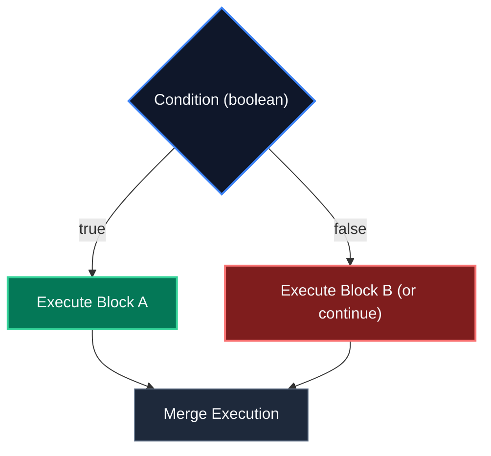
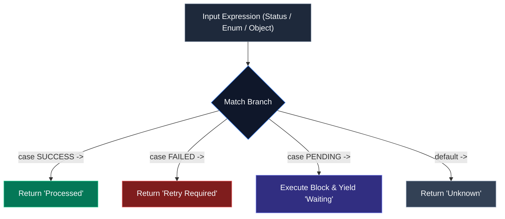
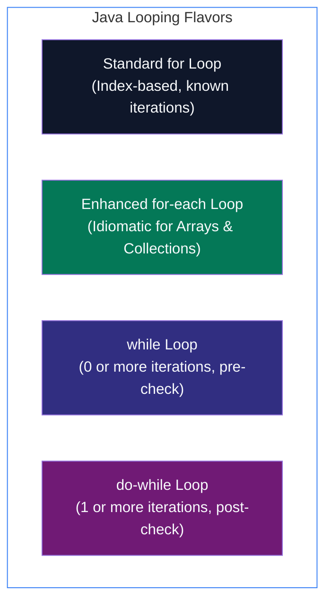
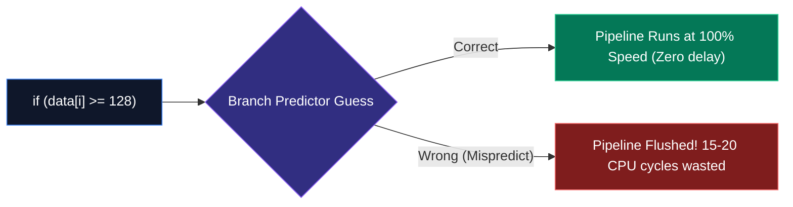

Without control flow, a program is nothing more than a static script running blindly down a straight line. It does the same thing on sunny days, rainy days, when bank accounts have a million dollars, or when servers are on fire.

**Control flow is where software becomes intelligent.** It is how your application reacts to user inputs, evaluates business rules, handles failures, and navigates infinite data streams.

In Java, control flow is governed by a bedrock principle of zero ambiguity: **conditions must strictly evaluate to a boolean (`true` or `false`)**. There are no "truthy" numbers, non-empty strings, or undefined truth states like in JavaScript or Python. `if (1)` will not compile.

Let's explore how Java controls the paths of execution, from classic `if/else` ladders to modern Java 21 pattern-matching `switch` expressions, and peek into how modern CPUs actually predict your code's branches.

---

## Conditional Branching: The `if-else` Ladder

The simplest fork in the road is the `if` statement. When you write an `if-else` block, you are asking the JVM to test an assertion and execute code conditionally.



Here is a realistic business example:

```java
public double calculateLoanInterest(int creditScore, boolean hasExistingDebt) {
    if (creditScore >= 750 && !hasExistingDebt) {
        return 4.25; // Tier 1: Prime borrower
    } else if (creditScore >= 680) {
        return 6.50; // Tier 2: Standard borrower
    } else if (creditScore >= 580) {
        return 9.75; // Tier 3: Subprime borrower
    } else {
        throw new IllegalArgumentException("Loan rejected: credit score below minimum underwriting threshold.");
    }
}
```

### The Power of Short-Circuit Evaluation
Notice the operator `&&` in `creditScore >= 750 && !hasExistingDebt`. 

Java evaluates boolean operators lazily from left to right:
- **`&&` (Conditional AND):** If the left operand is `false`, Java will **never evaluate the right operand**. Why bother? The overall condition can never be true!
- **`||` (Conditional OR):** If the left operand is `true`, Java immediately stops evaluating because the condition is already guaranteed to be true.

This behavior is your shield against `NullPointerException`s:

```java
// ✅ SAFE: If 'user' is null, user.isActive() is never evaluated!
if (user != null && user.isActive()) {
    processOrder(user);
}

// ❌ DANGEROUS: Single '&' evaluates BOTH sides unconditionally!
// If 'user' is null, this will crash your production server with a NullPointerException!
if (user != null & user.isActive()) { ... }
```

> [!TIP]
> Always use `&&` and `||` for logical conditions. Reserve `&` and `|` for low-level bitwise manipulation of integers.

---

## The Ternary Operator: Inline Decisions

When an `if-else` statement does nothing more than choose which value to assign to a single variable, expanding it into six lines of braces creates visual clutter:

```java
// Verbose:
double discount;
if (isPremiumMember) {
    discount = 0.20;
} else {
    discount = 0.05;
}

// Elegant & Readable:
double discount = isPremiumMember ? 0.20 : 0.05;
```

The syntax follows: `condition ? expressionIfTrue : expressionIfFalse`. 

> [!CAUTION]
> **Avoid Nested Ternaries!**
> While ternary operators are clean for simple two-way decisions, chaining them (`a ? b : c ? d : e ? f : g`) turns your code into an unreadable puzzle. If you have more than two branches, use an `if-else` block or a modern `switch`.

---

## Modern Switch Expressions (Java 14 to Java 21)

Historically, Java’s `switch` statement was inherited directly from C in the 1970s. It was notoriously clunky, forced you to manually write `break;` after every branch, and if you accidentally forgot one, execution silently "fell through" into the next case, causing legendary software defects.

Java 14 threw that legacy away and introduced **Switch Expressions**. Java 21 went even further by adding **Pattern Matching and Record Deconstruction**.



### The Modern Arrow (`->`) Syntax
With arrow syntax, **there is zero fall-through**. You never need `break;`, multiple matching values can be grouped with commas, and the entire switch can directly return a value into a variable:

```java
public enum OrderStatus { PLACED, SHIPPED, DELIVERED, CANCELLED, REFUNDED }

public String getStatusDescription(OrderStatus status) {
    return switch (status) {
        case PLACED -> "Your order has been recorded and is awaiting packaging.";
        case SHIPPED -> "Your items are on the delivery truck.";
        case DELIVERED -> "Delivered to your doorstep.";
        case CANCELLED, REFUNDED -> "Order terminated; balance reversed.";
        // No 'default' required if the enum cases are exhaustively covered!
    };
}
```

### Multi-Line Cases with the `yield` Keyword
If a branch needs to log metrics, perform calculations, or run multiple statements before returning a result, wrap the branch in braces and use `yield`:

```java
String result = switch (statusCode) {
    case 200 -> "OK";
    case 404 -> "Not Found";
    case 500 -> {
        alertOpsTeam(statusCode);
        logger.error("Critical infrastructure error detected");
        yield "Internal Server Error"; // Yields value out of this switch branch
    }
    default -> "Unknown Code";
};
```

### Java 21+: Pattern Matching in Switch
In modern Java (Java 21 LTS), switch expressions can evaluate arbitrary objects, match types, extract variables, and test guards (`when`):

```java
public String formatValue(Object obj) {
    return switch (obj) {
        case null -> "Value is null";
        case Integer i when i < 0 -> "Negative integer: " + i;
        case Integer i -> "Positive integer: " + i;
        case String s when s.isBlank() -> "Blank string";
        case String s -> "Text: " + s.toUpperCase();
        case List<?> list -> "List containing " + list.size() + " items";
        default -> "Unsupported type: " + obj.getClass().getSimpleName();
    };
}
```
No manual casting, no messy `instanceof` cascades—just clean, compile-time verified pattern matching.

---

## Iteration Mechanics: The 4 Loops of Java

When you need to repeat an operation across items or until a condition changes, Java offers four distinct looping structures:



### 1. The Classic `for` Loop
Best when you need the index counter or need to step by custom intervals:

```java
//  [1. Init]     ; [2. Condition] ; [4. Step]
for (int i = 0; i < 5; i++) {
    // 3. Loop Body
    System.out.println("Processing chunk: " + i);
}
```
**Execution Order:**
1. Initialize counter `i = 0`.
2. Check condition `i < 5`. If `true`, enter body. If `false`, terminate.
3. Execute the loop body.
4. Apply the increment `i++`, then loop back to step 2.

### 2. The Enhanced `for-each` Loop
Introduced in Java 5, this is the most idiomatic way to iterate over arrays and `Iterable` collections (like `ArrayList`, `HashSet`). It eliminates off-by-one index bugs:

```java
String[] paymentProviders = {"Stripe", "Adyen", "PayPal"};

for (String provider : paymentProviders) {
    System.out.println("Pinging health of " + provider);
}
```

> [!NOTE]
> **Under the Hood:**
> When you use a `for-each` loop on a Collection (like a `List`), the Java compiler actually translates it into an `Iterator`:
> ```java
> for (Iterator<String> it = list.iterator(); it.hasNext(); ) {
>     String item = it.next();
>     // ...
> }
> ```
> This is why attempting to remove items directly from a list inside a `for-each` loop throws a **`ConcurrentModificationException`**. If you need to remove items while iterating, use the iterator's own `it.remove()` method or `list.removeIf(...)`!

### 3. The `while` Loop
Evaluates the condition **before** entering the body. If the condition is false on arrival, it runs **zero times**:

```java
int retries = 0;
boolean isConnected = false;

while (!isConnected && retries < 3) {
    isConnected = attemptNetworkHandshake();
    retries++;
}
```

### 4. The `do-while` Loop
Evaluates the condition **after** executing the block. It is guaranteed to run **at least once**, making it ideal for interactive menus, user prompts, or initial token acquisitions:

```java
int userInput;
do {
    userInput = readConsoleInput();
    processMenuSelection(userInput);
} while (userInput != EXIT_CODE);
```

---

## Flow Disruption: `break`, `continue`, and Labeled Loops

Sometimes you need to abort a loop early or skip specific problematic items:

- **`break`**: Immediately halts the loop and jumps past the closing brace `}`.
- **`continue`**: Skips the remaining lines of the *current iteration* and jumps straight to the next cycle.

### Breaking Nested Loops with Labels
What happens if you have a loop inside a loop, and finding your target item means you want to stop **both** loops immediately? 

Without labels, you are forced to maintain clumsy boolean flags (`boolean found = false;`). Java solves this cleanly with **Labeled Breaks**:

```java
int[][] matrix = {
    { 1,  2,  3 },
    { 4, 99,  6 },
    { 7,  8,  9 }
};

int target = 99;
boolean found = false;

searchBlock: // This is a label!
for (int row = 0; row < matrix.length; row++) {
    for (int col = 0; col < matrix[row].length; col++) {
        if (matrix[row][col] == target) {
            System.out.println("Target found at [" + row + ", " + col + "]");
            found = true;
            break searchBlock; // Breaks BOTH the inner AND outer loop immediately!
        }
    }
}
```

---

## Senior Engineering: How CPUs Execute Your Loops

Have you ever wondered why software engineers obsess over the order of `if` statements? 

Modern CPUs do not execute instructions one by one like a turtle. They use high-speed **instruction pipelining**. When a CPU encounters an `if` condition, it cannot afford to wait dozens of clock cycles for memory to fetch the boolean value. 

Instead, the CPU **guesses** which branch you will take using its on-chip **Branch Predictor**:
- If the CPU guesses correctly, execution continues at maximum speed with zero pause.
- If the CPU guesses wrong (a branch misprediction), the pipeline must be flushed, discarding half-computed instructions and costing 15 to 20 clock cycles!



In a famous StackOverflow experiment, iterating over a sorted array of numbers and running `if (data[i] >= 128)` was **over three times faster** than running the exact same loop over an unsorted array! Why? Because with sorted data, the branch predictor guessed `false` for the first half and `true` for the second half, achieving nearly 100% prediction accuracy.

Writing predictable, cleanly structured control flow isn't just about clean code—it directly impacts hardware execution.

---

## Summary & Mental Model Checkpoint

1. **Strict Booleans**: No truthy/falsy shortcuts. Conditions must resolve strictly to `true` or `false`.
2. **Short-Circuit Protection**: Use `&&` and `||` to prevent null pointer evaluation crashes.
3. **Modern Switch**: Use Java 14+ arrow syntax (`->`) to avoid fall-through bugs, and Java 21 pattern matching to eliminate casting.
4. **Choose the Right Loop**:
   - `for-each` for standard reading of arrays/collections.
   - Traditional `for` when you need index manipulation.
   - `while` for 0+ cycles; `do-while` when the first run is guaranteed.
5. **Labels for Nested Breakouts**: Use labeled statements (`myLabel: for (...)`) instead of awkward boolean flags.
6. **Concurrent Modification**: Never call `list.remove()` inside an enhanced `for-each` loop; use `Iterator.remove()` or `removeIf()`.

---

## 🎯 Senior Engineer Interview Questions

### What happens if you modify a `Collection` inside an enhanced `for-each` loop? Why?
> **Answer:** It throws a `ConcurrentModificationException`. Under the hood, the enhanced `for-each` loop compiles into an `Iterator`. The collection maintains a modification counter (`modCount`). When the iterator's `next()` method is invoked, it checks if `expectedModCount == modCount`. If you modify the underlying collection directly via `list.remove()` or `list.add()`, `modCount` changes, triggering a fail-fast exception on the next loop cycle. To safely mutate, use the iterator's own `it.remove()` method or Java 8's `Collection.removeIf()`.

### How does Java's modern Switch Expression (Java 14+) enforce exhaustiveness?
> **Answer:** Unlike the legacy switch statement which silently ignored missing cases, a switch *expression* that produces a value must be **exhaustive** at compile time—every possible input value must map to a result. For `enum` types or `sealed` class hierarchies, if you omit a case, the compiler will refuse to compile until either the missing case is added or a `default` branch is provided.

### Explain the difference between `break`, `continue`, and `return` inside a loop.
> **Answer:** `break` immediately terminates the innermost enclosing loop (or the specifically labeled loop) and transfers control to the statement directly following that loop. `continue` skips the remainder of the current iteration's body and jumps directly to the loop's condition evaluation (or increment step in a `for` loop). `return` immediately exits the entire hosting method, terminating all loops and returning control (and optionally a value) back to the caller.

### Does Java support `goto`?
> **Answer:** `goto` is a reserved keyword in Java, but it is not implemented and has no functional syntax (using it causes a compile-time error). Java intentionally excluded arbitrary `goto` jumps to prevent unmaintainable "spaghetti code." Instead, Java provides **labeled breaks and continues**, which allow structured jumping specifically out of nested loops and blocks without arbitrary instruction redirection.
