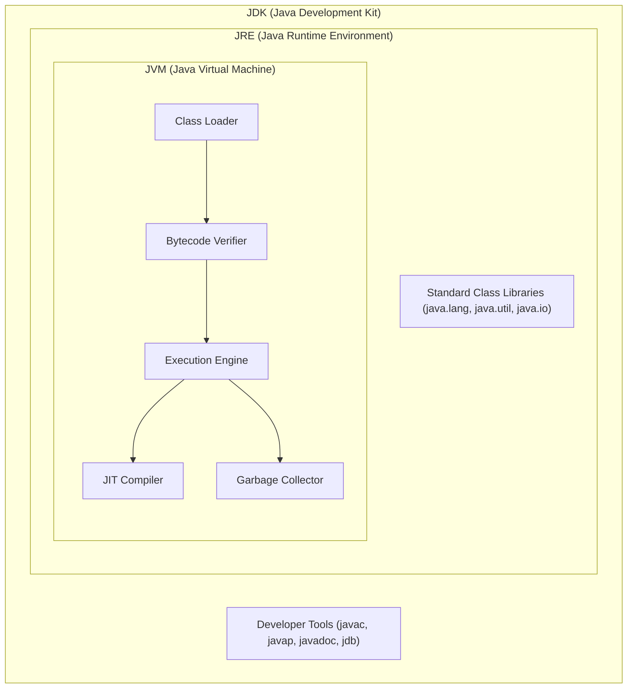
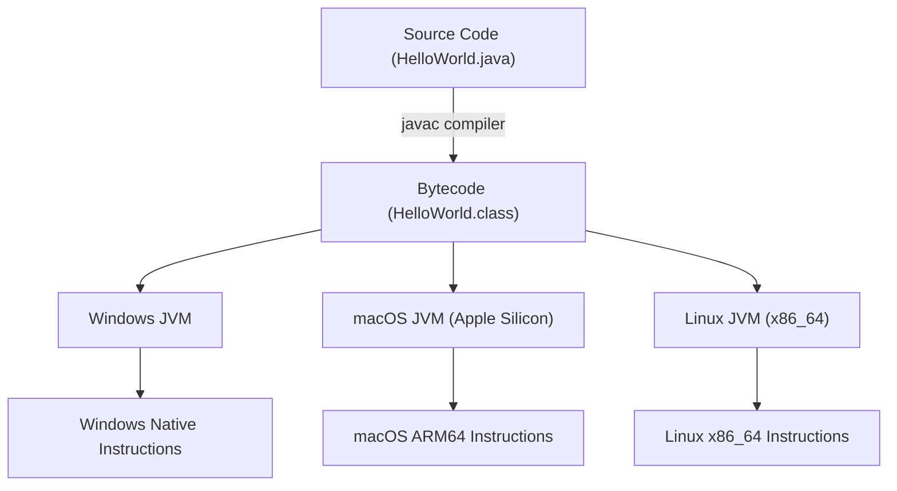
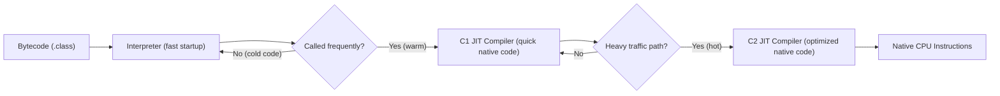
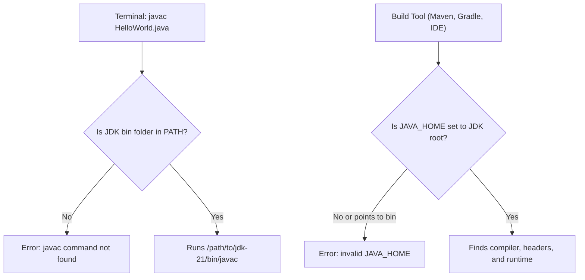

When you set up Java for the first time, it is common to run into an error before writing a single line of code:

```text
'javac' is not recognized as an internal or external command, operable program or batch file.
```

Unlike a scripting language where you install one interpreter and run files directly, Java splits development and execution across a small set of tools: a compiler, a virtual machine, and a standard library. That extra layer can feel confusing on day one, but it exists for a practical reason. Java was built so you can compile your program once and run the resulting file on Windows, macOS, or Linux without rewriting platform-specific code.

Once you understand how those pieces relate, installing Java, wiring up an IDE, and running code from the terminal become straightforward.

---

## JDK, JRE, and JVM: How the Pieces Fit Together

Almost every Java installation guide mentions three acronyms: **JVM**, **JRE**, and **JDK**. They are nested layers rather than competing downloads.



Here is what each layer is responsible for:

- **JVM (Java Virtual Machine):** The runtime engine that loads compiled `.class` files, verifies that they are safe to run, executes their instructions, and manages memory through garbage collection. Each operating system and CPU architecture has its own JVM implementation (for example, Windows x86_64 or macOS ARM64).
- **JRE (Java Runtime Environment):** The JVM combined with the Java Standard Class Library (`String`, `List`, `HashMap`, file I/O, networking, and so on). If you only want to *run* a compiled Java application, the runtime environment is what executes it.
- **JDK (Java Development Kit):** Everything in the JRE plus the developer tools you need to *build* Java programs. That includes `javac` (the compiler), `javadoc` (the documentation generator), `javap` (the bytecode disassembler), `jar` (the packaging tool), and `jdb` (the command-line debugger).

> [!IMPORTANT]
> **Always install a JDK when you are writing Java code.** Since Java 11, OpenJDK vendors stopped shipping separate standalone JRE installers for most desktop use cases anyway. Installing a modern JDK gives you both the runtime and the compiler in one package.

---

## Write Once, Run Anywhere

Before Java appeared in 1995, compiling a C or C++ program produced native machine instructions tied directly to one operating system and processor. A binary compiled for Windows on Intel x86 would not run on a Mac or a Linux server without recompiling and often adjusting OS-specific system calls.

Java introduced an intermediate step called **bytecode**.



The workflow has two phases:

1. You write source code in a `.java` file and compile it with `javac`. Instead of generating Windows or macOS machine code, `javac` outputs platform-independent bytecode inside a `.class` file.
2. When you run the program, the JVM installed on that machine reads the bytecode and translates it into native CPU instructions for the host operating system and processor.

Because the `.class` file is identical across platforms, you can compile an application on a MacBook and deploy the resulting `.jar` archive straight to a Linux container in production.

### What Bytecode Actually Looks Like

"Bytecode" sounds abstract until you look at a small class. Take this simple method:

```java
public class Calculator {
    public int add(int a, int b) {
        return a + b;
    }
}
```

When you run `javac Calculator.java`, the compiler creates `Calculator.class`. Every valid `.class` file begins with the same four hexadecimal bytes:

```text
CA FE BA BE 00 00 00 41 ...
```

Those first four bytes (`0xCAFEBABE`) act as a file signature. When the JVM loads a class file, it checks for that signature immediately and throws a `ClassFormatError` if the file is malformed or not a valid class file.

You do not need a hex editor to inspect bytecode. The JDK includes `javap`, a disassembler that prints readable JVM instructions:

```bash
javap -c Calculator.class
```

Output:

```text
public int add(int, int);
  Code:
     0: iload_1         // Push int parameter 'a' onto the operand stack
     1: iload_2         // Push int parameter 'b' onto the operand stack
     2: iadd            // Pop both ints, add them, push the sum
     3: ireturn         // Return the int on top of the stack
```

The JVM works as a stack-based virtual machine. Rather than operating directly on named hardware registers, bytecode pushes values onto an operand stack, applies operations like `iadd`, and returns the result.

### How the JIT Compiler Keeps Java Fast

Early JVMs interpreted bytecode one instruction at a time, which made Java noticeably slower than compiled C or C++. Modern JVMs such as HotSpot (the default OpenJDK JVM) solve this using **Just-In-Time (JIT) compilation** with tiered compilation.



When a Java program starts, HotSpot begins by interpreting bytecode so startup stays quick. In the background, it profiles which methods and loops run frequently. Once a method crosses a call threshold, the **C1** compiler compiles it into native machine code quickly. If that method stays busy, the **C2** compiler recompiles it with heavier optimizations such as method inlining, loop unrolling, and escape analysis.

Keep in mind that C1 and C2 tiered compilation is a HotSpot JVM implementation detail rather than a requirement of the Java Language Specification. Other JVMs (such as GraalVM or Eclipse OpenJ9) use different JIT compilers, though they follow the same general idea: interpret cold code, compile hot code to native instructions.

---

## Installing Java

Java is developed in the open under the **OpenJDK** project. Several organizations build, test, and distribute free, production-ready JDK builds from OpenJDK source code:

| Distribution | Maintainer | Good Fit For |
| :--- | :--- | :--- |
| **Eclipse Adoptium (Temurin)** | Eclipse Foundation | General development and production. Vendor-neutral, widely adopted, and TCK-verified. |
| **Amazon Corretto** | Amazon Web Services | Teams deploying on AWS or standardizing on Amazon-supported Linux/Windows builds. |
| **Azul Zulu** | Azul Systems | Broad platform and architecture coverage, including Apple Silicon and older platforms. |

> [!TIP]
> **Which version should you install?**
> Pick a **Long-Term Support (LTS)** release. **Java 21 LTS** is the most widely used modern baseline across companies, frameworks, and libraries (and **Java 25 LTS** is the next LTS release after it). Feature releases arrive every six months, which is useful for trying new language features, while LTS releases receive years of security patches.

### Installing on macOS and Linux with SDKMAN

If you work on macOS or Linux, **SDKMAN!** makes it easy to install Java and switch between versions per project without manually editing system directories:

```bash
# Install SDKMAN
curl -s "https://get.sdkman.io" | bash
source "$HOME/.sdkman/bin/sdkman-init.sh"

# List available Java builds (look for Temurin 'tem' or Corretto 'amzn')
sdk list java

# Install Eclipse Temurin Java 21 LTS (replace with the current patch version from sdk list)
sdk install java 21.0.5-tem

# Confirm the active version
java -version
javac -version
```

You can also download native `.pkg` or `.tar.gz` installers directly from [adoptium.net](https://adoptium.net/) or the Amazon Corretto downloads page if you prefer not to use a version manager.

### Installing on Windows

On Windows, you can install a JDK cleanly via `winget` in PowerShell, or download the `.msi` installer from Adoptium or Amazon Corretto:

```powershell
# Option 1: Install Eclipse Temurin 21 LTS
winget install EclipseAdoptium.Temurin.21.JDK

# Option 2: Install Amazon Corretto 21 LTS
winget install Amazon.Corretto.21
```

If you use the Adoptium `.msi` graphical installer, make sure the options **"Add to PATH"** and **"Set JAVA_HOME variable"** are enabled during the installation wizard.

---

## Environment Variables: `PATH` and `JAVA_HOME`

Most setup headaches come from two operating system environment variables: `PATH` and `JAVA_HOME`. They serve different jobs.



### `PATH`

`PATH` is the list of directories your shell searches when you type a command like `java` or `javac`. For your terminal to recognize Java commands, the JDK's `bin` directory must be on `PATH` (for example, `C:\Program Files\Eclipse Adoptium\jdk-21.0.5.11-hotspot\bin` on Windows, or `$HOME/.sdkman/candidates/java/current/bin` on macOS/Linux).

### `JAVA_HOME`

`JAVA_HOME` is read by other tools rather than by your shell directly. Maven, Gradle, application servers, and some IDEs check `JAVA_HOME` to locate the JDK installation.

One rule prevents a very common mistake: **`JAVA_HOME` must point to the root JDK folder, never the `bin` subfolder.**

```text
Correct (Windows):   C:\Program Files\Amazon Corretto\jdk21.0.5_11
Incorrect (Windows): C:\Program Files\Amazon Corretto\jdk21.0.5_11\bin

Correct (macOS):     /Library/Java/JavaVirtualMachines/temurin-21.jdk/Contents/Home
Incorrect (macOS):   /Library/Java/JavaVirtualMachines/temurin-21.jdk/Contents/Home/bin
```

After changing environment variables, always open a **new** terminal window. Already-open shells keep the old environment values until restarted.

---

## Understanding the Command Line (`javac` and `java`)

Even though you will spend most of your time inside an IDE, knowing how to compile and run a file from the terminal helps whenever a build breaks, a classpath goes wrong, or you need to debug something on a remote server.

### Verify the Installation

Open a fresh terminal and run:

```bash
java -version
javac -version
```

Both commands should succeed and print matching major versions (for example, `21.x.x`). If `java -version` works but `javac -version` fails, you likely have only a JRE on your `PATH`, or `PATH` is pointing to an older Java installation ahead of your new JDK. On Windows you can diagnose this with `where java` and `where javac`; on macOS/Linux use `which java` and `which javac`.

### Write a Small Source File

Create a folder called `hello-java`, and inside it create a file named `HelloWorld.java`:

```java
public class HelloWorld {
    public static void main(String[] args) {
        System.out.println("Hello from the JVM!");
    }
}
```

Make sure the filename matches the `public class` name (`HelloWorld.java`), including capitalization.

### Compile to Bytecode

From the `hello-java` directory, run the compiler:

```bash
javac HelloWorld.java
```

If there are no syntax or type errors, `javac` exits silently and writes a new file named `HelloWorld.class` into the same directory.

### Run the Compiled Class

Launch the JVM and pass the **class name**, not the `.class` filename:

```bash
java HelloWorld
```

Output:

```text
Hello from the JVM!
```

> [!CAUTION]
> Running `java HelloWorld.class` will fail with `Could not find or load main class HelloWorld.class`. The `java` launcher expects a fully qualified class name (`HelloWorld`), not a filename on disk.

### Running Single Source Files Directly

Since Java 11, you can also run a single `.java` file directly without invoking `javac` yourself:

```bash
java HelloWorld.java
```

The launcher compiles the file in memory and executes it immediately without leaving a `.class` file behind. This is handy for quick experiments and small scripts. For real projects with multiple packages and dependencies, you still compile to `.class` files (typically through Maven, Gradle, or your IDE).

---

## Setting Up an IDE (IntelliJ IDEA or Eclipse)

A text editor and a terminal are great for learning how `javac` and `java` work, but real Java projects have dozens or hundreds of files, third-party libraries, and unit tests. An **Integrated Development Environment (IDE)** handles compilation as you type, flags errors immediately, refactors code safely across files, and provides a visual debugger.

The two most widely used Java IDEs are **IntelliJ IDEA** and **Eclipse**.

### IntelliJ IDEA (Recommended for Most Developers)

JetBrains offers **IntelliJ IDEA Community Edition** (free and open source, covering core Java, Maven, Gradle, and JUnit) and **IntelliJ IDEA Ultimate** (paid, adding built-in support for Spring Boot, databases, profiling, and web frameworks). Community Edition is more than enough for learning Java from scratch.

#### Creating Your First Project and Configuring the JDK

1. Download and install IntelliJ IDEA from JetBrains (or install it through the JetBrains Toolbox app).
2. Click **New Project**.
3. Give the project a name (for example, `java-fundamentals`), select **Java** as the language, and pick **IntelliJ** as the build system while you are learning basics (you will move to Maven or Gradle later).
4. In the **JDK** dropdown, select the JDK 21 installation IntelliJ detected on your machine. If it is not listed, click **Add JDK...** to browse to your JDK root folder, or choose **Download JDK...** to let IntelliJ download Eclipse Temurin or Amazon Corretto automatically.
5. Click **Create**.

If you ever need to change the JDK later, open **File > Project Structure > Project** (shortcut: `Ctrl+Alt+Shift+S` on Windows/Linux, `Cmd+;` on macOS) and update the **SDK** and **Language level** fields.

#### Understanding the Project Layout

IntelliJ creates a clean folder layout:

```text
java-fundamentals/
├── .idea/              # IDE settings (do not commit to Git)
├── out/                # Compiled .class files generated automatically
└── src/                # Your .java source files live here
    └── Main.java
```

Right-click `src`, choose **New > Java Class**, enter a name like `Greeting`, and write a `main` method. Typing `main` and pressing `Tab` expands the full `public static void main(String[] args)` method; typing `sout` and pressing `Tab` expands `System.out.println()`.

#### Running and Debugging in IntelliJ

- **Run:** Click the green play icon in the left gutter next to `main` (or press `Shift+F10` on Windows/Linux, `Ctrl+R` on macOS). IntelliJ compiles any modified files into `out/` and launches the JVM in the bottom **Run** console.
- **Debug:** Click in the left margin next to a line number to place a red **breakpoint**. Then click the green gutter icon and choose **Debug** (instead of Run). Execution pauses right before that line, letting you inspect variable values in the **Variables** pane and step through code line by line (**Step Over** `F8`, **Step Into** `F7`, **Resume** `F9`).

### Eclipse IDE

**Eclipse IDE for Java Developers** is completely free, open source, and still widely used in enterprise teams and universities.

#### Setting Up a Workspace and JDK

1. Download the Eclipse Installer from [eclipse.org](https://www.eclipse.org/) and choose **Eclipse IDE for Java Developers**.
2. On startup, Eclipse asks you to pick a **Workspace** directory. A workspace is simply a parent folder that holds multiple related projects and your IDE preferences.
3. Verify your JDK under **Window > Preferences** (or **Eclipse > Settings** on macOS) **> Java > Installed JREs**. Click **Add... > Standard VM**, point **JRE home** to your JDK 21 root folder, check the box next to it, and click **Apply and Close**.

#### Creating, Running, and Debugging a Project in Eclipse

1. Go to **File > New > Java Project**, name it `JavaFundamentals`, verify that the Execution Environment matches **JavaSE-21**, and click **Finish** (you can uncheck creating `module-info.java` while learning basics).
2. Expand the project in the **Package Explorer**, right-click `src`, and choose **New > Class**. Enter a class name and check the box for `public static void main(String[] args)`.
3. Click the green **Run** button on the toolbar (or right-click the editor and select **Run As > Java Application**). Eclipse compiles Java files incrementally every time you save (`Ctrl+S` / `Cmd+S`), placing `.class` files in the project's `bin/` directory.
4. To debug, double-click the left margin next to a line to toggle a breakpoint, then click the **Debug** icon (the small bug button) or choose **Debug As > Java Application**. Eclipse switches to the **Debug Perspective**, where you can inspect variables and step through code (`F6` to Step Over, `F5` to Step Into, `F8` to Resume).

---

## Practical Questions

### What happens if you try to compile a Java program on a machine that only has a JRE?

Compilation fails because `javac` is part of the JDK, not the JRE. A JRE only includes the JVM and standard libraries needed to execute already-compiled `.class` or `.jar` files. To compile `.java` source code, you need a JDK installed.

### Why did `java -version` work in my terminal, while `javac -version` failed?

This usually means your system `PATH` contains a directory with a standalone JRE (or an older Oracle auto-updated runtime shim), or `PATH` does not include your JDK's `bin` folder. Check which binary your shell is finding by running `where java` (Windows) or `which java` (macOS/Linux), and make sure your JDK's `bin` directory appears first in `PATH`.

### Why should `JAVA_HOME` point to the JDK root directory instead of the `bin` folder?

Tools like Maven and Gradle append relative paths such as `bin/javac` and `lib` directly onto `JAVA_HOME`. If `JAVA_HOME` already ends in `bin`, those tools end up looking for `.../bin/bin/javac` and fail to start.

### If I already have IntelliJ IDEA or Eclipse, why bother learning `javac` and `java` on the command line?

IDEs hide compilation flags, output directories, and classpath configuration behind a Play button. That is convenient during normal coding, but when a CI pipeline fails, a Docker container refuses to boot, or a library conflict appears at runtime, knowing how `javac` and `java` actually locate and execute `.class` files lets you diagnose the problem directly instead of guessing.
