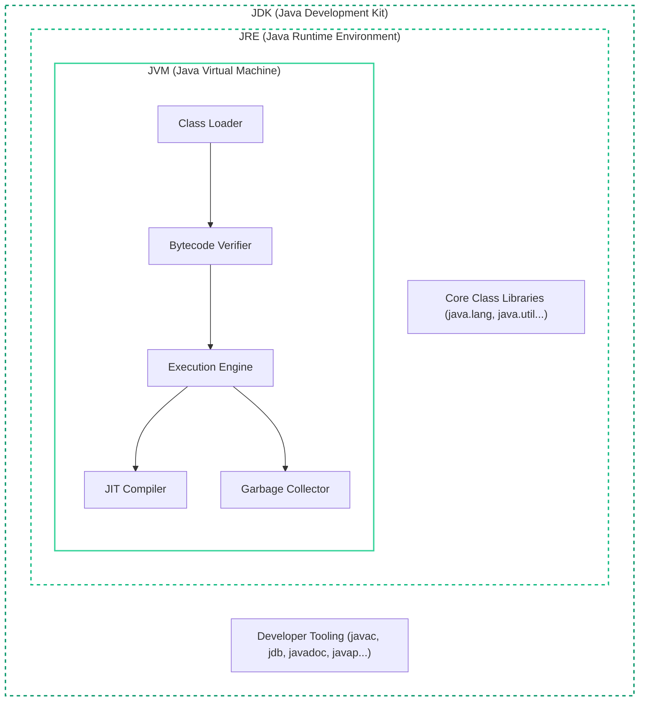
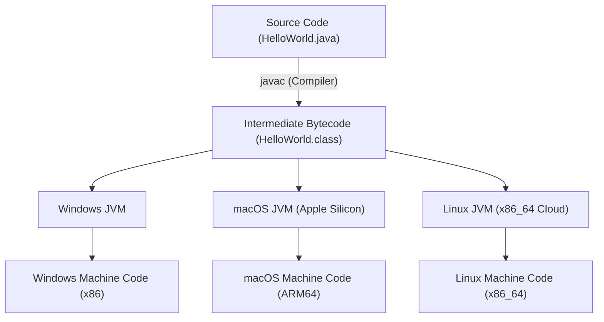
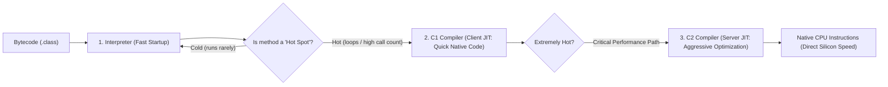
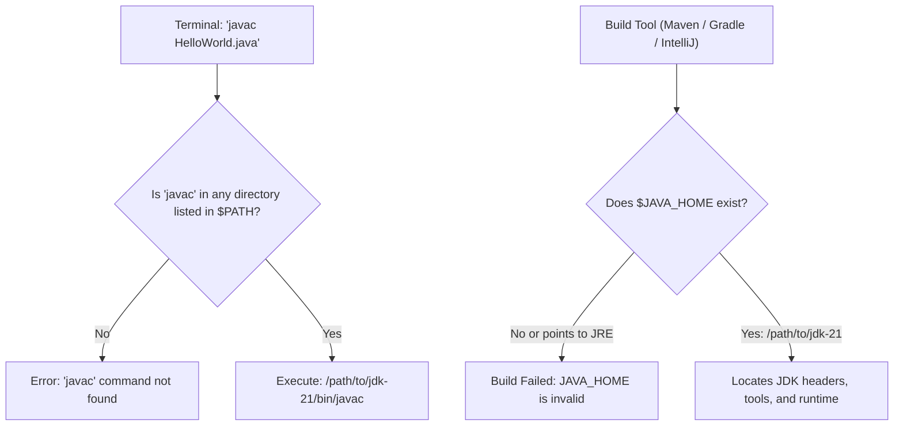

Every developer remembers the first time they tried to get Java running on their machine. You download an installer, open a terminal, type `javac`, and get hit with:

```text
'javac' is not recognized as an internal or external command, operable program or batch file.
```

You pause and wonder: *Why on earth does a platform powering global banking, Android phones, mission-critical microservices, and NASA rovers feel so complicated before you’ve even written your first curly brace?*

The answer lies in Java’s bold design philosophy. Unlike languages like Python that ship as a simple script interpreter, or C++ that compiles straight into raw x86 machine instructions for one specific processor, Java chose a radical architectural middle ground: **a virtual computer running on top of your physical machine.**

Once you understand why this architecture exists, the tools stop feeling like arbitrary hurdles and start feeling like an engineering superpower. Let's unpack the machine behind the language.

---

## The Holy Trinity: JDK, JRE, and JVM

If you've searched for "how to install Java," you've probably been bombarded with acronyms: **JVM**, **JRE**, and **JDK**. They are frequently conflated, but mixing them up is a dead giveaway that a developer doesn't understand their runtime environment.

Here is the exact architectural relationship between them:



To cement this in your head, imagine running an artisan bakery:

- **The JVM (Java Virtual Machine) is the Oven.** It doesn’t know who wrote the recipe or where the ingredients came from. Its only job is to take prepared dough and bake it consistently into bread.
- **The JRE (Java Runtime Environment) is the Kitchen.** It includes the oven (JVM) *plus* the pre-packaged pantry of ingredients (the Java Standard Class Library: `String`, `ArrayList`, `HashMap`, networking utilities). If you are a customer who just wants to run a pre-packaged program, the kitchen is all you need.
- **The JDK (Java Development Kit) is the Master Chef's Toolkit.** It includes the entire kitchen and oven (JRE + JVM), *plus* the professional chef utensils: the compiler (`javac`) that turns raw recipe ideas into dough, the debugger (`jdb`), the disassembler (`javap`), and documentation generators (`javadoc`). 

> [!IMPORTANT]
> **As a developer, you always install the JDK.** Without the JDK, you lack `javac` (the Java Compiler) and cannot turn `.java` source code into executable bytecode. (Note: Since Java 11, Oracle and the OpenJDK community stopped distributing standalone JRE installers for end-users anyway; installing a modern JDK gives you everything you need in one clean package).

---

## The "Write Once, Run Anywhere" Promise

In the early 1990s, software was brittle. If you wrote a game or a spreadsheet in C for Windows x86, you couldn’t simply copy the `.exe` file to a Mac with a PowerPC chip or a Unix Sun Solaris workstation. You had to rewrite OS-specific API calls, adjust for 32-bit vs. 64-bit pointer sizes, handle memory alignment quirks, and recompile from scratch.

James Gosling and the Sun Microsystems team envisioned a different world: **Write Once, Run Anywhere (WORA)**.



How does this work under the hood?
1. You write human-readable Java code in a text file named `HelloWorld.java`.
2. You run the `javac` compiler. It does **not** output native x86 machine instructions. Instead, it outputs universal, platform-agnostic **Bytecode** stored in a `HelloWorld.class` file.
3. Every operating system has its own custom-built JVM (a Windows JVM, a macOS ARM64 JVM, a Linux x86_64 JVM).
4. The local JVM takes that identical, universal bytecode and translates it into native CPU instructions on the fly.

Your bytecode doesn’t know what chip it is running on; the JVM handles the messy real-world hardware translation.

---

## Deep Dive: Peeking Under the Hood at Bytecode

You will hear developers throw around the word "bytecode" all day. But what does it actually look like?

Let’s write the simplest Java class imaginable:

```java
public class Calculator {
    public int add(int a, int b) {
        return a + b;
    }
}
```

When you compile this with `javac Calculator.java`, you get `Calculator.class`. If you open that file in a raw hexadecimal viewer, the very first 4 bytes will look familiar to computer science historians:

```text
CA FE BA BE 00 00 00 41 00 13 07 00 ...
```

### The `0xCAFEBABE` Magic Number

Every valid compiled Java `.class` file in the world begins with the exact same 4-byte hexadecimal signature: **`CA FE BA BE`** ("Café Babe"). 

Back in the early 1990s, James Gosling and his team were looking for an obscure, recognizable 32-bit hex word to identify compiled Java binaries. Inspired by a local café in Silicon Valley, they chose `CAFEBABE`. When the JVM ClassLoader reads any file, the very first thing it checks is whether the file starts with `0xCAFEBABE`. If it doesn't, it immediately throws a `ClassFormatError` and refuses to touch it.

### Reading Real Bytecode with `javap`

You don't need a hex editor to see bytecode. The JDK ships with a built-in disassembler tool called `javap`. If you run:

```bash
javap -c Calculator.class
```

You will see the actual assembly instructions of the Java Virtual Machine:

```text
public int add(int, int);
  Code:
     0: iload_1         // Push integer parameter 1 onto the operand stack
     1: iload_2         // Push integer parameter 2 onto the operand stack
     2: iadd            // Pop both integers, add them, push result
     3: ireturn         // Return the integer at the top of the stack
```

Notice how clean that is. The JVM is a **stack-based virtual machine**. It loads local variables onto an internal operand stack, performs operations (like `iadd`), and returns the top of the stack. Seeing this demystifies the JVM: it is simply an elegant software processor executing instructions.

---

## Why Java Isn't Slow: The JIT Compiler

In 1996, Java had a reputation for being sluggish. Early JVMs were pure **interpreters**: the JVM would read bytecode instruction `0: iload_1`, translate it to native machine code, execute it, read instruction `1: iload_2`, translate it, and so on.

Interpreting bytecode line-by-line in a loop is inherently slower than running pre-compiled C or Rust code directly on the CPU.

Modern JVMs solved this with an engineering marvel called the **Just-In-Time (JIT) Compiler** and **Tiered Compilation**:



Here is how the modern JVM operates:
1. **Instant Startup**: When your application boots, the JVM starts interpreting bytecode immediately. It doesn't waste time doing slow ahead-of-time compilation for code that might only run once.
2. **Profiling Hot Spots**: As your program runs, the JVM execution engine keeps internal counters for every method and loop. If a method is called tens of thousands of times (a "Hot Spot"), the JVM flags it.
3. **C1 (Client) Compilation**: The JVM compiles that hot method directly into native CPU instructions on a background thread. Subsequent calls bypass the interpreter.
4. **C2 (Server) Optimization**: If that code continues to be pounded under heavy load (like in a high-traffic payment processing service), the **C2 compiler** steps in. It performs aggressive hardware-level optimizations: **method inlining**, **loop unrolling**, **dead-code elimination**, and **escape analysis** (allocating temporary objects in CPU registers instead of the Heap).

The result? Once a Java server warms up, its critical paths run at native C++ speeds, while retaining memory safety and garbage collection.

---

## Setting Up Your Development Environment

Now that you understand the machinery, let’s configure your system properly.

### Which JDK Distribution Should You Choose?

Java is defined by an open specification (**OpenJDK**). While Oracle maintains a build, several enterprise vendors provide free, battle-tested, Long-Term Support (LTS) distributions:

| Distribution | Provider | Why Engineers Use It |
| :--- | :--- | :--- |
| **Eclipse Adoptium (Temurin)** | Eclipse Foundation | The gold standard community distribution; vendor-neutral and verified against the official TCK (Technology Compatibility Kit). |
| **Amazon Corretto** | Amazon Web Services | The default choice if you deploy to AWS or run production microservices on Linux. |
| **Azul Zulu** | Azul Systems | Renowned for exceptional multi-platform support, especially on Apple Silicon and embedded hardware. |

> [!TIP]
> **Which Java version should you install?**
> Always pick the latest **Long-Term Support (LTS)** release for serious work (currently **Java 21 LTS** or **Java 17 LTS**). Non-LTS releases (like Java 22 or 23) arrive every six months and are great for testing bleeding-edge features, but enterprise production systems standardize on LTS releases.

### Installing Java the Modern Way

#### For macOS & Linux: Use `SDKMAN!`
Do not manually drag folders into `/Library/Java`. Professional JVM engineers manage their Java versions using **SDKMAN!**:

```bash
# 1. Install SDKMAN
curl -s "https://get.sdkman.io" | bash
source "$HOME/.sdkman/bin/sdkman-init.sh"

# 2. Install the latest Eclipse Temurin Java 21 LTS
sdk install java 21.0.2-tem

# 3. Verify it is active
java -version
```

#### For Windows: Use Windows Package Manager (`winget`)
Open PowerShell as Administrator:

```powershell
# Install Amazon Corretto 21 LTS
winget install Amazon.Corretto.21

# Or install Eclipse Temurin 21 LTS
winget install EclipseAdoptium.Temurin.21.JDK
```

---

## The Environment Variables That Trip Everyone Up

Even with an installer, every new Java developer eventually faces the dreaded environment variable trap. Understanding how your OS locates binaries will save you hours of debugging.



### 1. The `PATH` Variable
`PATH` is a list of directory paths that your operating system searches whenever you type a command into your terminal.
- When you type `javac`, your operating system checks each folder in `PATH` sequentially.
- If the `bin` directory of your JDK (e.g., `C:\Program Files\Eclipse Adoptium\jdk-21\bin` or `/opt/homebrew/opt/openjdk@21/bin`) is not listed in `PATH`, your shell has no idea what `javac` is.

### 2. The `JAVA_HOME` Variable
Unlike `PATH`, `JAVA_HOME` is not meant for your terminal command prompt; it is meant for **developer tools**. Build systems like Maven, Gradle, Android Studio, and IntelliJ IDEA inspect `$JAVA_HOME` to determine which JDK installation to compile against.

- **The Golden Rule**: `JAVA_HOME` must point to the **root** folder of your JDK, **never** the `bin` directory.
  - ✅ Correct: `C:\Program Files\Amazon Corretto\jdk21.0.2_13`
  - ❌ Incorrect: `C:\Program Files\Amazon Corretto\jdk21.0.2_13\bin`

---

## Hands-On Verification: From Raw Terminal to Running Code

Before launching a 2-gigabyte IDE like IntelliJ IDEA, every software engineer should experience the foundational ritual of compiling and executing a Java file by hand.

### Step 1: Verify Your Terminal Sees the JDK
Open a brand-new terminal window (environment variables do not refresh in already-open shells) and run:

```bash
java -version
javac -version
```

Both should return version `21.x.x` (or your chosen LTS release).

### Step 2: Write the Source Code
Create a new directory and create a file named `HelloWorld.java`:

```java
public class HelloWorld {
    public static void main(String[] args) {
        System.out.println("JVM is alive and running!");
    }
}
```

### Step 3: Compile to Bytecode
Run the compiler:

```bash
javac HelloWorld.java
```

Inspect your folder. Notice that a new file has appeared: `HelloWorld.class`. That is your compiled bytecode!

### Step 4: Run the Bytecode on the JVM
Execute the class using the `java` launcher:

```bash
java HelloWorld
```

> [!CAUTION]
> Notice that you run `java HelloWorld`, **not** `java HelloWorld.class`. You pass the name of the *class* to the JVM, not the filename on disk.

```text
JVM is alive and running!
```

Congratulations. You have compiled your first universal bytecode and executed it inside a live Java Virtual Machine.

---

## "Wait, Why Can't I Just...?" (The Skeptic's Corner)

### *"Why can't Java just execute raw source code directly like Python or JavaScript?"*
Starting in Java 11, you actually can for single files! You can run `java HelloWorld.java` directly without calling `javac` first. The JVM will compile it in-memory on the fly and execute it. 

However, for enterprise applications with thousands of interconnected classes, compiling ahead of time into bytecode allows the compiler to perform exhaustive type-checking, detect bugs before deployment, and package everything into a high-performance archive (a `.jar` file) that boots predictably.

### *"Why do we have Garbage Collection? Why not manage memory manually like C?"*
In C and C++, you manually allocate memory with `malloc()` and release it with `free()`. If you forget to free memory, your server crashes from a memory leak. If you free memory too early and try to access it later, you cause undefined behavior, security vulnerabilities (like buffer overflows), and core dumps. 

Java introduced an automated **Garbage Collector (GC)** that tracks objects on the Heap and reclaims memory when objects are no longer reachable. It eliminated an entire category of catastrophic memory corruption bugs that plagued 1980s and 1990s enterprise software.

---

## Summary & Mental Model Checkpoint

To walk away from this lesson with a rock-solid mental model:

1. **JVM**: The abstract execution engine that translates universal bytecode into native hardware instructions.
2. **JRE**: The JVM plus the standard class libraries needed to *run* programs.
3. **JDK**: The complete developer toolkit (JRE + compiler `javac` + profilers + debuggers) needed to *write* programs.
4. **Bytecode**: The intermediate, platform-agnostic language stored in `.class` files, always starting with `0xCAFEBABE`.
5. **JIT Compiler**: The runtime performance engine that identifies frequently executed bytecode ("hot spots") and turns it into native machine code at runtime.
6. **`JAVA_HOME` & `PATH`**: `PATH` allows your terminal to find `javac`; `JAVA_HOME` tells external build tools (like Maven and Gradle) which JDK root directory to use.
