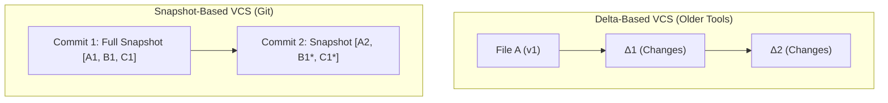
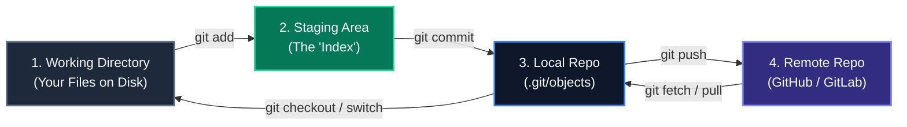
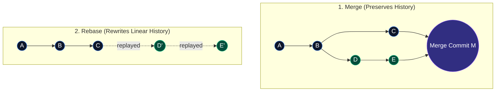

Almost every developer learns Git the exact same way: you memorize five incantations—`git status`, `git add .`, `git commit -m "fix"`, `git push`, and when things break, `git stash` and pray. 

Then one day, you find yourself trapped in a "Detached HEAD" state, accidentally overwrite your teammate’s branch, or hit a merge conflict spanning twenty files. In sheer panic, you copy your modified files into a folder named `backup-final-v2`, delete the repository, and clone it fresh from GitHub. 

We have all been there.

The reason Git feels terrifying is that it is usually taught as a collection of magical terminal commands rather than an intuitive mental model. In 2005, when Linus Torvalds wrote Git in just two weeks to manage the Linux kernel, he didn't set out to build a confusing file tracker. He built something remarkably simple: **a distributed, content-addressable key-value store overlaid with a Directed Acyclic Graph (DAG).**

Once you visualize what Git is doing beneath your working directory, the fear vanishes forever. Let's peel back the curtain.

---

## The Core Philosophy: Snapshots, Not Deltas

Older version control systems (like CVS and Subversion) modeled projects as **deltas** (lists of file-based diffs). If you changed one line in `Main.java`, SVN saved a note saying: *"In commit 42, line 15 changed from X to Y."* To view the project at version 50, SVN had to start at version 1 and sequentially compute every single diff over again.

Git threw that entire paradigm into the trash. **Git stores snapshots.**



Every time you make a commit, Git takes a complete picture of your entire project at that exact second. 

You might wonder: *Doesn't storing full snapshots make Git bloated and slow?* 

No, because Git is clever: **if a file hasn't changed between commits, Git does not duplicate it.** It simply creates a lightweight pointer back to the exact same file snapshot it already stored. This makes checking out old branches, computing diffs, and rolling back instantaneous.

---

## The Four Environments of Git

To understand any Git command, you have to ask yourself: *Which of the four environments am I moving data between?*



1. **The Working Directory**: The physical sandbox on your hard drive. This is where you write code, edit `.java` files, compile, and test. Git watches this folder, but until you tell it to track a change, your edits are completely unstaged.
2. **The Staging Area (The "Index")**: This is Git’s preparation table. It sits quietly as a binary file inside `.git/index`. It lets you carefully assemble your next commit. You can edit five files, but stage only one of them so your commit history stays clean and focused.
3. **The Local Repository (`.git`)**: The permanent local vault on your laptop. When you commit, Git writes the snapshot into `.git/objects`. This is 100% offline—you can commit on a plane with no Wi-Fi.
4. **The Remote Repository**: The hosted cloud mirror (GitHub, GitLab, Bitbucket). It exists so your team can share snapshots and synchronize work.

> [!TIP]
> **Why does the Staging Area exist?**
> Beginners often ask: *"Why can't I just commit directly from my working files?"*
> Imagine you are fixing a payment bug, and while testing, you also fixed an unrelated spelling mistake in a UI header. With the staging area, you can stage only the payment fix (`git add PaymentService.java`), commit it as `fix: resolve currency rounding bug`, and then stage the UI fix separately. Your git history reads like a clean, logical narrative rather than an incoherent dump.

---

## Peeking Inside `.git`: The Object Database

When you type `git init` in an empty folder, Git creates a hidden directory named `.git`. Inside `.git/objects`, Git maintains its entire universe using just **three primary building blocks**:

```mermaid
classDiagram
    class Blob {
        +Raw File Bytes
        +SHA-1 Hash
        (No filename, no permissions)
    }
    class Tree {
        +List of Blobs (files)
        +List of Subtrees (folders)
        +Filenames and permissions
    }
    class Commit {
        +Pointer to Root Tree
        +Pointer to Parent Commit(s)
        +Author & Timestamp
        +Commit Message
    }
    
    Commit --> Tree : "points to snapshot"
    Tree --> Blob : "contains file"
    Tree --> Tree : "contains folder"
    Commit --> Commit : "parent commit link"
```

Let's dissect what these objects actually are:

### Blobs (Binary Large Objects)
When you stage a file, Git compresses its content (using zlib) and calculates its cryptographic SHA-1 hash (a 40-character hexadecimal string). That content is stored as a **blob**. 
- A blob holds *only* the file data. 
- It does **not** store the file name, the folder path, or creation dates. If two files in different folders have the exact same contents, Git only stores a single blob!

### Trees (Directories)
A **tree** represents a folder. It is a simple list that maps human-readable filenames and file permissions to their corresponding blob hashes or child tree hashes.

### Commits (The Snapshot Metadata)
A **commit** is surprisingly small. If you inspect a commit object using Git’s low-level plumbing command (`git cat-file -p <commit-hash>`), you will see plain text:

```text
tree 92b8b694fc1102c64b22cbb24250325492d24263
parent 12a14e9f3ebc7512d506d8705a2e6f49e4198124
author Ada Lovelace <ada@example.com> 1718884800 +0000
committer Ada Lovelace <ada@example.com> 1718884800 +0000

feat: add customer balance calculation service
```

Look closely at that structure:
- It points to a **root tree** (the complete snapshot of your project).
- It points to a **parent commit** (the snapshot that came before it).
- It records **who** did it, **when**, and **why**.

Because every commit points back to its parent, your entire history forms a chain: a **Directed Acyclic Graph (DAG)**.

---

## Cryptographic Integrity: Why History Can't Be Faked

Everything in Git is addressed by its hash. A commit hash is not a random number; it is mathematically computed from:
1. The hash of the root tree (the exact contents of every file in the project).
2. The hash of the parent commit.
3. The author, committer, timestamp, and message.

Because the parent’s hash is baked into the child’s hash, **history in Git is mathematically immutable.**

```mermaid
flowchart LR
    C1["Commit A<br/>Hash: 3f9a..."] <-- "parent" -- C2["Commit B<br/>Hash: 8b1c..."] <-- "parent" -- C3["Commit C<br/>Hash: e4d2..."]
```

If someone attempts to stealthily alter a single character in a file from three years ago, that file's blob hash changes. That changes the tree hash, which changes Commit A's hash, which breaks Commit B's parent pointer, cascading all the way to today. Git will immediately detect the corruption.

> [!WARNING]
> This is why commands that "rewrite history" (like `git commit --amend` or `git rebase`) don't actually modify existing commits. They create **brand-new commit objects** with brand-new hashes and move your branch pointer to them. The old commits still float around orphaned in `.git/objects` until garbage-collected!

---

## Branching: Demystifying the Lightweight Pointer

In older systems like SVN, creating a branch meant literally copying your entire project folder into a new directory on the server. If your codebase was 500 MB, branching took minutes and wasted disk space.

In Git, **a branch is literally just a 41-byte text file containing a 40-character commit hash.**

If you look inside `.git/refs/heads/main`, you will see:
```text
8b1c2874f6372d82937402947192837492817263
```

When you type `git branch feature-checkout`, Git doesn't duplicate a single line of your code. It simply creates a new text file named `.git/refs/heads/feature-checkout` and writes that exact same 40-character hash into it!

```mermaid
flowchart TD
    subgraph Commits ["Commit History (DAG)"]
        C1["Commit 1 (a1b2)"] <-- C2["Commit 2 (c3d4)"] <-- C3["Commit 3 (e5f6)"]
    end

    Main["main pointer"] --> C3
    Feature["feature pointer"] --> C3
    HEAD["HEAD"] --> Feature
```

### What is `HEAD`?
`HEAD` is nothing more than Git’s internal bookmark. It is a file (`.git/HEAD`) that tells Git: *"Which branch or commit are you currently looking at?"*
Usually, `HEAD` points to a branch:
```text
ref: refs/heads/main
```
When you make a new commit, Git creates the commit object, points it back to `C3`, and automatically advances `main` (and `HEAD`) forward to the new commit.

### What is a "Detached HEAD"?
If you checkout a specific commit hash directly (`git checkout e5f6`), `HEAD` points directly to the commit instead of a branch. If you make commits in this state, they won't belong to any branch. The moment you switch away, those new commits become orphaned. 

If this happens, don't panic! Simply create a branch right where you are:
```bash
git switch -c my-saved-work
```

---

## Merge vs. Rebase: How Senior Teams Collaborate

When your feature branch diverges from `main`, you have two ways to bring changes back together:



### The Merge Strategy
- **How it works**: Git finds the common ancestor of both branches, compares the tips, and generates a brand-new **Merge Commit** with two parents that ties the branches together.
- **The Trade-Off**: It is safe and completely non-destructive, but over time it can produce a chaotic, tangled "subway map" history of merge bubbles.

### The Rebase Strategy
- **How it works**: Git lifts your feature commits off the branch, fast-forwards your branch to the latest commit on `main`, and then replays your commits one by one on top.
- **The Trade-Off**: It creates a clean, perfectly linear story where your feature looks like it was written this morning on top of the newest code. However, it changes commit hashes.

> [!CAUTION]
> **The Golden Rule of Rebasing:**
> **Never rebase commits that have already been pushed to a shared remote repository.** If your teammates have based their work on your old commits, rewriting those hashes will force them into merge hell. Rebase locally to clean up your own work; merge when integrating shared team branches.

---

## Anatomy of a Merge Conflict (And How to Stay Calm)

A merge conflict is not an error; it is Git politely refusing to guess your intent. 

When you and a teammate edit the exact same lines of the exact same file in different commits, Git cannot know which version is correct. It pauses and writes conflict markers directly into the file:

```java
public class PaymentGateway {
    public void processPayment(double amount) {
<<<<<<< HEAD
        // Added audit logging for compliance
        auditLogger.log("Processing payment: " + amount);
        stripeClient.charge(amount);
=======
        // Upgraded to PayPal API v2 with retry policy
        payPalClient.executeWithRetry(amount, 3);
>>>>>>> feature-paypal-v2
    }
}
```

### How to Resolve It in 3 Steps:
1. **Decode the Markers**:
   - `<<<<<<< HEAD`: The code that existed on the branch you are merging *into* (your current branch).
   - `=======`: The dividing line between the two competing changes.
   - `>>>>>>> feature-paypal-v2`: The code from the branch you are attempting to merge *in*.
2. **Make the Human Decision**:
   Talk to your teammate or review the requirements. Do you want Stripe? PayPal? Or both? Edit the file to what it *should* look like, and delete all the marker lines (`<<<<<<<`, `=======`, `>>>>>>>`).
3. **Finish the Merge**:
   ```bash
   git add PaymentGateway.java
   git commit -m "merge: integrate PayPal v2 alongside audit logging"
   ```

---

## The Ultimate Safety Net: `git reflog`

Every developer has experienced the ice-cold sweat of running `git reset --hard` and realizing they just wiped out three days of uncommitted ideas.

Here is the secret senior engineers know: **Git almost never deletes anything immediately.**

Whenever `HEAD` moves—whether you commit, rebase, checkout, or reset—Git records that movement in a ledger called the **Reflog** (`.git/logs/HEAD`). Even if you "destroy" a branch, its commits still exist in the object database for at least 30 days before garbage collection runs.

```bash
git reflog
```

You will see output like this:
```text
3a1b2c4 HEAD@{0}: reset: moving to HEAD~2
8f9e0d1 HEAD@{1}: commit: finish critical authentication logic
5c6d7e8 HEAD@{2}: checkout: moving from main to auth-feature
```

Look at `HEAD@{1}`: there is your lost commit hash (`8f9e0d1`)! To bring your lost work back from the dead, simply point a branch at it:

```bash
git switch -c recovered-work 8f9e0d1
```

Just like that, your entire branch is resurrected. You are virtually indestructible.

---

## Essential Clean Repository Habits

To work like a professional software engineer on a Java team:

### Always Use a Robust `.gitignore`
Never commit compiled `.class` files, IDE settings (`.idea`, `.vscode`), or build directories (`target/`, `build/`) to Git. Storing compiled binaries bloats the repository and causes endless merge conflicts.

A minimal Java `.gitignore`:
```text
# Compiled Bytecode
*.class
*.jar
*.war

# Build Directories
target/
build/
out/

# IDE Configuration
.idea/
*.iml
.vscode/
.settings/
.project/

# Operating System Junk
.DS_Store
Thumbs.db
```

### Write Commits That Tell a Story
Avoid committing messages like `fix`, `wip`, or `asdf`. Use the **Conventional Commits** standard:
- `feat: add Google OAuth2 login flow`
- `fix: prevent NullPointerException in OrderService when address is empty`
- `refactor: extract tax calculation into separate strategy interface`

---

## Summary & Mental Model Checkpoint

1. **Snapshots, Not Deltas**: Git captures full project pictures, reusing links to unchanged files.
2. **Three Internal Objects**:
   - **Blob**: Raw compressed file content.
   - **Tree**: Directory listing mapping names to blobs and subtrees.
   - **Commit**: Metadata pointing to a root tree and parent commit(s).
3. **Branches Are Just Pointers**: A branch is a 41-byte text file storing a 40-character commit hash.
4. **`HEAD`**: The bookmark indicating what branch or commit you currently have checked out.
5. **Rebase vs. Merge**: Rebase for clean local linear history; merge for preserving shared team branch history.
6. **`git reflog`**: Your time machine to recover "lost" commits.
