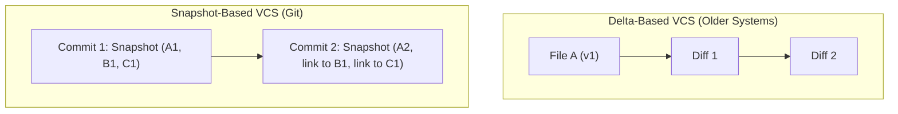
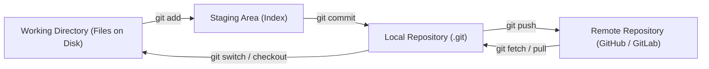
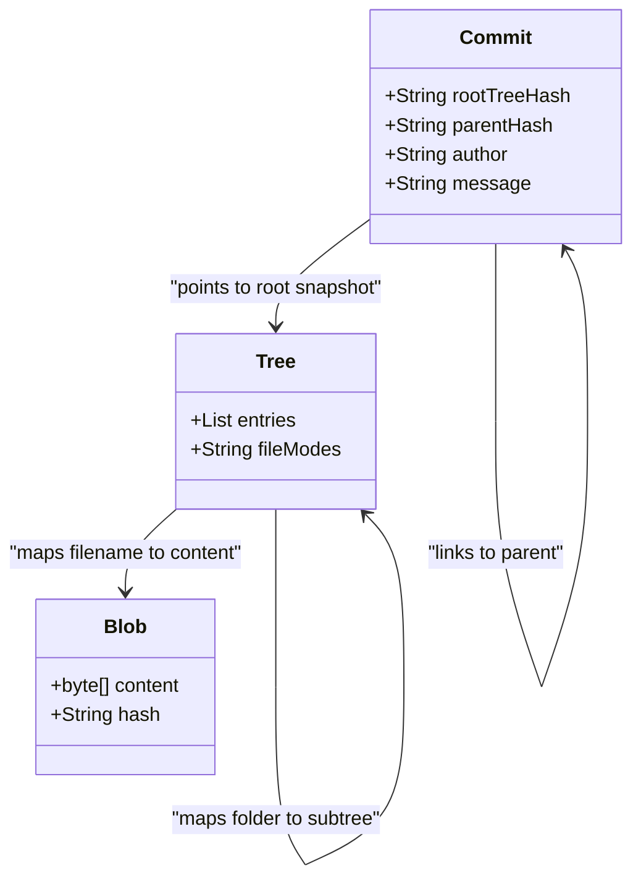
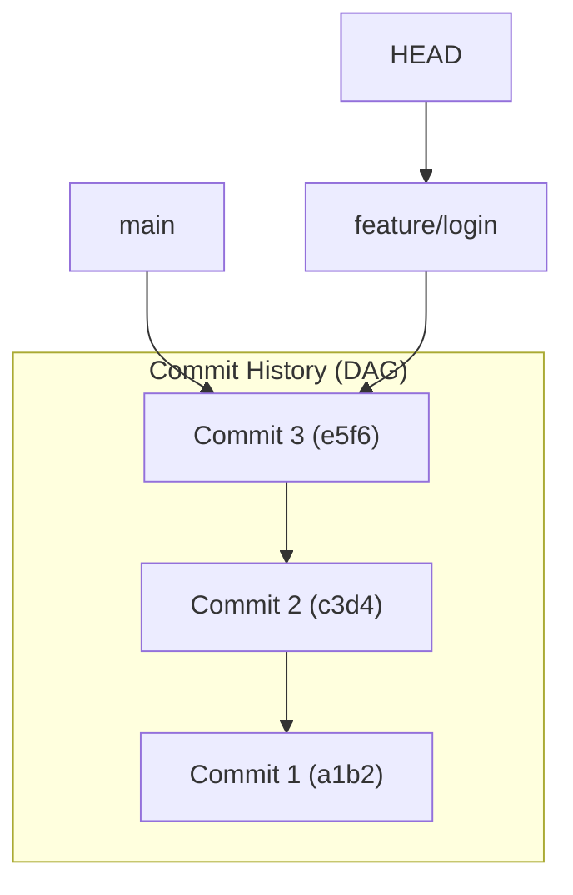
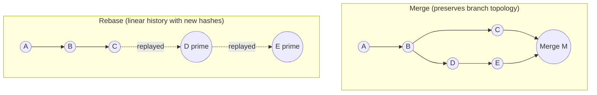

Many beginners start out managing code with folders named `project-v1`, `project-v2`, and `project-final-actually-final`. That breaks down the moment you fix a bug on Tuesday, accidentally break another feature on Wednesday, and need to figure out what changed in between. Add a second developer working on the same codebase, and emailing zip files back and forth turns into overwritten work within hours.

**Version control** solves this by recording every meaningful change to your project over time, along with who made it, when it happened, and why. **Git** is the distributed version control system used across almost the entire software industry, from solo side projects to large Java microservices teams.

Git can feel cryptic when you only memorize commands by rote. Once you see the simple model underneath it, every command makes sense.

---

## Why Use Version Control?

Even if you are coding alone on a small Java assignment, putting your code in Git pays off immediately:

- **Safe undo at any point:** If a refactor goes sideways, you can inspect the exact lines you changed or roll back to a working state in seconds.
- **Readable history:** Six months later, `git log` and `git blame` tell you *why* a weird edge-case check exists instead of forcing you to guess.
- **Isolated experiments:** Branches let you try a new library or rewrite a class without disturbing the working version of your application.
- **Team collaboration:** Multiple developers can edit the same repository concurrently and merge their changes in a controlled, reviewable way (typically through Pull Requests on GitHub, GitLab, or Bitbucket).
- **Backup and portability:** Pushing to a remote repository means a dead laptop does not cost you weeks of work.

---

## Snapshots, Not File Deltas

Older centralized systems like Subversion (SVN) stored history as a list of file-by-file diffs (deltas). To reconstruct version 50 of a file, the tool applied 50 incremental patches starting from version 1.

Git takes a different approach: **every commit is a snapshot of your entire project at that moment.**



Storing full snapshots does not waste disk space because Git deduplicates unchanged files. If `Order.java` did not change between Commit 1 and Commit 2, Git does not copy it again; Commit 2 simply points to the existing stored version of `Order.java`. This design makes switching branches, viewing history, and reverting changes fast even on large repositories.

---

## The Four Areas of Git

Almost every Git command moves changes between four areas. Knowing which area you are touching removes most of the confusion around Git.



1. **Working Directory:** The regular files and folders you edit in your IDE. Changes here are not saved in Git history yet.
2. **Staging Area (Index):** A preparation list stored in `.git/index` that holds the exact changes you want to include in your next commit.
3. **Local Repository (`.git`):** Your full local history of commits, branches, and tags. Because Git is distributed, committing, branching, and viewing logs work completely offline.
4. **Remote Repository:** A copy hosted on a server (such as GitHub, GitLab, or Bitbucket) that you synchronize with your teammates.

> [!TIP]
> **Why have a Staging Area at all?**
> Suppose you fix a bug in `PaymentService.java` and also notice a typo in `README.md`. Instead of lumping both edits into one messy commit, you can stage and commit `PaymentService.java` first, then stage and commit `README.md` separately. Each commit stays focused on a single purpose.

---

## Basic Git Commands

Before making your first commit on a new machine, tell Git your name and email so it can attach them to your commits:

```bash
git config --global user.name "Your Name"
git config --global user.email "you@example.com"
git config --global init.defaultBranch main
```

### Starting or Cloning a Repository

Create a new repository in an existing project folder, or download an existing one from a remote host:

```bash
# Initialize a brand-new local repository
git init

# Or clone an existing remote repository
git clone https://github.com/example/order-service.git
```

### Checking Status and Inspecting Changes

`git status` is the command you will run most often. It tells you which branch you are on, which files are modified, which are staged, and which are untracked.

```bash
git status

# See line-by-line unstaged changes in your working directory
git diff

# See changes that are already staged for the next commit
git diff --staged
```

### Staging and Committing (`add` and `commit`)

Move files from your working directory into the staging area with `git add`, then record a permanent snapshot with `git commit`:

```bash
# Stage a specific file (preferred when editing multiple unrelated things)
git add src/Main.java

# Stage all modified and new files in the repository
git add .

# Record the staged snapshot with a descriptive message
git commit -m "feat: add greeting message on startup"
```

To inspect your commit history:

```bash
git log --oneline --graph --decorate
```

### Synchronizing with a Remote (`push`, `fetch`, and `pull`)

If you initialized a local repository yourself, connect it to a remote URL (conventionally named `origin`):

```bash
git remote add origin https://github.com/example/order-service.git
```

Then share your commits or retrieve teammates' commits:

```bash
# Push your local main branch to origin (use -u the first time to set upstream tracking)
git push -u origin main

# On subsequent pushes from the same branch
git push

# Download remote changes without modifying your working directory
git fetch origin

# Download remote changes and immediately merge them into your current branch
git pull
```

> [!NOTE]
> **`git fetch` vs. `git pull`**
> `git fetch` is completely safe: it updates your local copy of remote branch pointers (like `origin/main`) without touching your working files. `git pull` is essentially `git fetch` followed by `git merge` (or `git rebase` if configured). When you want to inspect incoming changes before integrating them, run `git fetch` first.

---

## What Lives Inside `.git`

When you run `git init`, Git creates a hidden `.git` folder. Inside `.git/objects`, Git stores three core object types:



- **Blob:** Compressed file contents identified by a 40-character SHA-1 hash. A blob stores only content, not the filename. If two files have identical text, Git stores one blob.
- **Tree:** A directory listing that maps filenames and permissions to blob hashes and child tree hashes.
- **Commit:** A small metadata record pointing to a root tree, one or more parent commits, the author, timestamp, and commit message.

You can inspect any commit object directly with `git cat-file -p <hash>`:

```text
tree 92b8b694fc1102c64b22cbb24250325492d24263
parent 12a14e9f3ebc7512d506d8705a2e6f49e4198124
author Ada Lovelace <ada@example.com> 1718884800 +0000
committer Ada Lovelace <ada@example.com> 1718884800 +0000

feat: add customer balance calculation service
```

Because every commit hash is calculated from its tree, metadata, and **parent commit hash**, changing anything in an older commit changes its hash and the hash of every commit after it. That is why commands that "edit" history (like `git commit --amend` or `git rebase`) actually create brand-new commit objects rather than mutating old ones in place.

---

## Branching and Merging

In Git, **a branch is simply a movable 41-byte file containing a commit hash.** Creating a branch does not copy your files; it creates a new pointer to your current commit.



**`HEAD`** is Git's pointer to whatever you currently have checked out. Normally `HEAD` points to a branch (for example, `ref: refs/heads/feature/login`). When you make a new commit, Git advances that branch pointer forward automatically.

If you check out a raw commit hash directly (`git checkout e5f6`), `HEAD` points directly to the commit instead of a branch. Git calls this a **Detached HEAD**. If you make commits in that state and want to keep them, attach a new branch right where you are:

```bash
git switch -c saved-work
```

### Creating, Switching, and Deleting Branches

Modern Git provides `git switch` for branch navigation (clearer than the older overloaded `git checkout`):

```bash
# Create a new branch and switch to it immediately
git switch -c feature/discount-rules

# List all local branches (* marks the active one)
git branch

# Switch back to main
git switch main

# Delete a branch after its changes have been merged
git branch -d feature/discount-rules
```

### Merging Branches

When your feature branch is tested and ready, switch to the target branch (`main`) and merge the feature branch into it:

```bash
git switch main
git merge feature/discount-rules
```

Git handles merges in one of two ways:

1. **Fast-Forward Merge:** If nobody committed to `main` while you were working on `feature/discount-rules`, Git simply moves the `main` pointer forward to match your latest feature commit. No extra commit is needed.
2. **Three-Way Merge:** If `main` received other commits while you were working, the histories have diverged. Git finds their common ancestor, combines both sets of changes, and creates a new **merge commit** with two parents.

### Merge vs. Rebase

Another way to incorporate changes from `main` into a feature branch is **`git rebase`**. Instead of creating a merge commit, rebase replays your feature commits one by one on top of the latest commit on `main`.



- **Merge** preserves the exact branching history and never changes existing commit hashes, though busy repositories can accumulate many merge commits.
- **Rebase** keeps history clean and linear, but it rewrites commit hashes for every replayed commit.

> [!CAUTION]
> **Never rebase commits that have already been pushed to a shared branch.** Rewriting commit hashes forces teammates who based work on those commits to untangle divergent histories. Use rebase to tidy up your own local or private feature branch; use merge (or a pull request merge) for shared branches.

---

## Resolving Merge Conflicts

A merge conflict happens when two branches modify the same lines of the same file (or one branch deletes a file that the other edited). Git refuses to guess which edit should win. It pauses the merge, marks the conflicting files, and inserts conflict markers directly into the code:

```java
public class PaymentGateway {
    public void processPayment(double amount) {
<<<<<<< HEAD
        // Added audit logging for compliance
        auditLogger.log("Processing payment: " + amount);
        stripeClient.charge(amount);
=======
        // Switched to PayPal API v2 with retry policy
        payPalClient.executeWithRetry(amount, 3);
>>>>>>> feature-paypal-v2
    }
}
```

Here is how to resolve it cleanly:

1. **See which files are conflicted:** Run `git status` and look under `Unmerged paths`.
2. **Read the markers:**
   - Everything between `<<<<<<< HEAD` and `=======` is from your current branch.
   - Everything between `=======` and `>>>>>>> feature-paypal-v2` is from the incoming branch.
3. **Edit the file to the intended final code:** Decide whether to keep one version or combine both (for example, keeping the audit log and calling the new PayPal client). Remove all three marker lines (`<<<<<<<`, `=======`, `>>>>>>>`).
4. **Compile and run tests:** Never assume a resolved conflict compiles just because the markers are gone.
5. **Mark the file resolved and complete the merge:**

```bash
git add PaymentGateway.java
git commit -m "merge: combine audit logging with PayPal v2 client"
```

If you start a merge and realize you are not ready to resolve it yet, back out cleanly to the state before the merge with:

```bash
git merge --abort
```

IntelliJ IDEA and Eclipse also include a three-way visual merge tool that shows "Yours", "Result", and "Theirs" side by side, which makes large conflicts much easier to inspect than raw markers.

---

## Recovering Mistakes with `git reflog`

Every developer eventually runs a command like `git reset --hard HEAD~2` or deletes a branch too early and thinks their commits are gone.

In practice, Git rarely deletes committed objects right away. Every time `HEAD` moves (commits, switches, resets, rebases), Git records the previous location in a local log called the **reflog**. Unreferenced commits typically remain in `.git/objects` for at least 30 days before garbage collection removes them.

```bash
git reflog
```

Example output:

```text
3a1b2c4 HEAD@{0}: reset: moving to HEAD~2
8f9e0d1 HEAD@{1}: commit: finish order validation logic
5c6d7e8 HEAD@{2}: checkout: moving from main to order-validation
```

To restore the commit at `8f9e0d1`, create a new branch pointing directly at it:

```bash
git switch -c recovered-work 8f9e0d1
```

Note that `reflog` only protects **committed** snapshots. Uncommitted edits wiped out by `git reset --hard` were never stored in Git's object database, which is a good reason to commit small checkpoints often.

---

## Good Repository Habits for Java Projects

### Use a Java `.gitignore`

Do not commit compiled bytecode, build output folders, or personal IDE files. They bloat the repository and trigger constant merge conflicts across operating systems. Create a `.gitignore` file in your project root:

```text
# Compiled bytecode and archives
*.class
*.jar
*.war

# Build directories
target/
build/
out/
bin/

# IDE files
.idea/
*.iml
.vscode/
.settings/
.project
.classpath

# OS metadata
.DS_Store
Thumbs.db
```

### Write Clear Commit Messages

Vague messages like `fix`, `update`, or `changes` are useless when you are hunting for the commit that introduced a regression. Describe the *what* and, when helpful, the *why*. Many teams follow Conventional Commits:

- `feat: add CSV export for monthly invoices`
- `fix: guard against null address in OrderService`
- `refactor: extract tax calculation into TaxCalculator`

---

## Practical Questions

### What is the difference between `git fetch` and `git pull`?

`git fetch` downloads new commits and branch pointers from the remote repository into your local `.git` database without altering your working directory or current branch. `git pull` runs `git fetch` and then immediately integrates the downloaded commits into your current branch (via merge by default, or rebase if configured).

### Why does Git have a staging area instead of committing modified files directly?

The staging area lets you choose exactly which files (or even individual hunks with `git add -p`) belong in the next commit. If you touched three files while debugging but only two belong to the actual fix, you can stage and commit just those two so your history stays clean and easy to review.

### When should you choose `git merge` over `git rebase`?

Use `git merge` when integrating branches that others have already pulled or when you want an exact historical record of when a branch was joined. Use `git rebase` on your own local, unshared branches to replay your work cleanly on top of the latest `main` before opening a pull request. Never rebase commits that teammates already depend on.

### You ran `git reset --hard HEAD~1` by mistake right after committing. Can you get that commit back?

Yes. Run `git reflog` to find the hash of the commit `HEAD` pointed to before the reset, then run `git switch -c recovered-branch <hash>` (or `git reset --hard <hash>` if you want to move the current branch back to it). Because the snapshot was committed, it still exists in `.git/objects` until Git garbage-collects unreachable objects.
