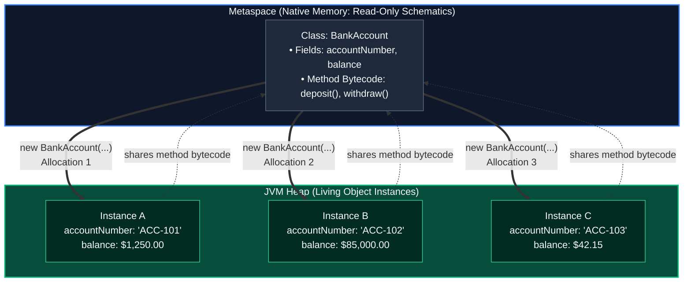
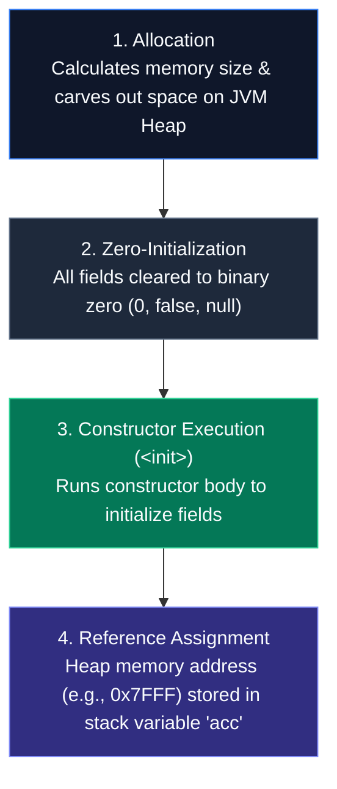
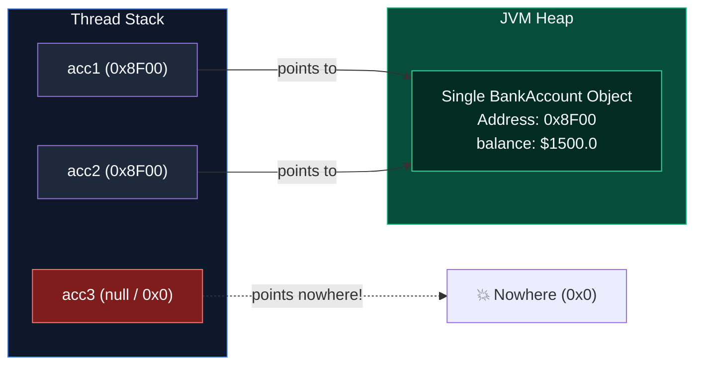

If you have ever worked on a large procedural codebase, you already know the nightmare: twenty different functions across five files all mutating the same global variables. A developer changes a status flag in one corner of the application, and a completely unrelated report crashes on the other side of the system.

In 1995, James Gosling and the designers of Java set out to eliminate that chaos. They chose a foundational philosophy: **Object-Oriented Programming (OOP)**.

In Java, code cannot float in the void. You cannot declare a "naked" global function or an isolated global variable. **Everything lives inside a Class.**

Why this dogmatic rule? Because real-world systems are not loose piles of arithmetic; they are ecosystems of distinct entities—customers, bank accounts, shopping carts, network sockets—each possessing their own private **data (state)** and the specific rules for how that data can be modified **(behavior)**.

Let's break down the mechanics of Java's object model: how blueprints become live memory, why `this` is not magic, and what actually happens when you create an object with `new`.

---

## The Blueprint vs. The Instance

The heart of OOP revolves around two intertwined concepts: **Classes** and **Objects**.

- **The Class (The Blueprint):** A class is a specification. It defines what fields an entity will have and what operations it can perform. It is not an actual thing—it is the engineering schematic. The class definition lives quietly in **Metaspace** (JVM native memory).
- **The Object (The Instance):** An object is the living, breathing entity carved out of RAM on the **JVM Heap**. From a single class blueprint, you can spawn ten, a thousand, or a million unique objects.



Notice a crucial architectural detail: **methods are not duplicated in memory for every object!** 
If you create 100,000 `BankAccount` objects, each object has its own private copies of `accountNumber` and `balance` on the Heap. But the bytecode for `deposit()` and `withdraw()` exists **exactly once** in Metaspace, shared across all 100,000 instances.

---

## Anatomy of a Class: State, Constructors, and Behavior

Let's look at how a class is structured in real-world Java code:

```java
package com.javahub.banking;

public class BankAccount {
    
    // 1. Fields (State / Properties)
    private final String accountNumber;
    private double balance;
    private boolean isFrozen;

    // 2. Constructor (Initialization Contract)
    public BankAccount(String accountNumber, double initialDeposit) {
        if (initialDeposit < 0) {
            throw new IllegalArgumentException("Initial deposit cannot be negative.");
        }
        this.accountNumber = accountNumber;
        this.balance = initialDeposit;
        this.isFrozen = false;
    }

    // 3. Methods (Behaviors / Operations)
    public void deposit(double amount) {
        if (isFrozen) {
            throw new IllegalStateException("Account is frozen.");
        }
        if (amount <= 0) {
            throw new IllegalArgumentException("Deposit amount must be positive.");
        }
        this.balance += amount;
        System.out.println("Deposited USD " + amount + ". New balance: USD " + this.balance);
    }

    public double getBalance() {
        return this.balance;
    }
}
```

Let's dissect each of these three building blocks:

### Fields (State)
Fields store the data associated with an object. In senior design, fields should almost always be marked `private` (Encapsulation). This ensures that outside code cannot bypass your business rules—for example, nobody can set `balance = -999999` without going through the `withdraw()` or `deposit()` methods!

### Constructors (Object Initialization)
A constructor is a special sub-routine executed at the exact millisecond an object is born.
- It shares the **exact name of the class**.
- It has **no return type** (not even `void`).
- Its job is to guarantee that an object enters the world in a **valid state**. If someone tries to create an account with a negative deposit, the constructor aborts before the object is ever created.

> [!NOTE]
> **The Automatic Default Constructor:**
> If you write a class and do *not* declare any constructor at all, the Java compiler (`javac`) automatically injects an empty, no-argument constructor:
> ```java
> public BankAccount() {
>     super(); // Calls Object's constructor
> }
> ```
> However, the instant you write **even one** custom constructor (like our `BankAccount(String, double)` above), Java permanently revokes the automatic default constructor. Calling `new BankAccount()` without arguments will now fail to compile!

### Methods (Behavior)
Methods define what an object can do. Notice how our `deposit()` method checks `isFrozen` and validates `amount` before changing `balance`. This is the fundamental promise of OOP: **state and logic are bundled together**.

---

## The `this` Keyword: Peeking at the Bytecode

Inside an instance method or constructor, what does `this` actually mean?

`this` is a reference to the **current object** executing the code. 

When you write:
```java
public void setBalance(double balance) {
    this.balance = balance;
}
```
The parameter is named `balance`, which shadows the instance field `balance`. Writing `this.balance` explicitly instructs Java: *"Assign the parameter `balance` to the `balance` field of THIS specific instance."*

### What Happens at the Bytecode Level?
Here is the secret the JVM doesn't tell you: **`this` is actually an invisible first parameter passed to every instance method!**

When you write:
```java
account.deposit(50.0);
```
Under the hood, the JVM translates that call into something conceptually like this:
```java
BankAccount.deposit(account, 50.0); // 'account' is passed as argument 0!
```

If you disassemble any instance method with `javap -c`, you will see instruction `aload_0`. Local Variable Slot 0 always holds the reference to `this`!

### Constructor Chaining with `this(...)`
You can also use `this(...)` as a method call inside a constructor to delegate to another constructor in the same class:

```java
public class BankAccount {
    private String accountNumber;
    private double balance;

    // Overloaded constructor: Defaults initial deposit to $0.00
    public BankAccount(String accountNumber) {
        this(accountNumber, 0.0); // Calls the main 2-argument constructor below!
    }

    public BankAccount(String accountNumber, double initialDeposit) {
        this.accountNumber = accountNumber;
        this.balance = initialDeposit;
    }
}
```
> [!CAUTION]
> If you chain constructors using `this(...)`, it **must be the very first statement** in the constructor body.

---

## The 4 Steps of Instantiation: What `new` Really Does

When you write:
```java
BankAccount acc = new BankAccount("ACC-101", 500.0);
```
What is the JVM doing behind the curtain?



1. **Memory Allocation:** The JVM calculates how many bytes the object requires (Object Header: 12-16 bytes + sum of field sizes + 8-byte padding). It allocates this chunk on the Heap.
2. **Zero-Initialization:** Before your code runs, the JVM wipes that memory to zero: numbers become `0`, booleans become `false`, and references become `null`.
3. **Constructor Execution (`<init>`):** The JVM executes the constructor bytecode, running your custom business logic.
4. **Reference Return:** The 64-bit memory address of the new Heap object is returned and stored in your Stack reference variable `acc`.

---

## Object References & The "Billion-Dollar Mistake": `null`

A variable in Java **never contains an object**. A variable contains a **pointer** (reference) to an object.

Think of an object as a house, and a reference variable as a piece of paper with the house's street address written on it:

```java
BankAccount acc1 = new BankAccount("ACC-101", 1000.0);
BankAccount acc2 = acc1; // Copies the ADDRESS, NOT the house!

acc2.deposit(500.0);
System.out.println(acc1.getBalance()); // Prints $1,500.0!
```
Because both `acc1` and `acc2` hold the exact same memory address, changing the object through `acc2` affects what `acc1` sees. There is only one house on the Heap!



### What is `null`?
If a reference variable points to no address at all, its value is `null` (address `0x0`).

In 1965, computer scientist Sir Tony Hoare invented the `null` reference for the language ALGOL W. Decades later, he famously apologized at a conference:
> *"I call it my billion-dollar mistake. It has led to innumerable errors, vulnerabilities, and system crashes, which have probably caused a billion dollars of pain and damage in the last forty years."*

If you attempt to call a method on a reference that points to `null`:
```java
BankAccount acc3 = null;
acc3.deposit(100.0); // 💥 CRASH! java.lang.NullPointerException
```
The CPU attempts to dereference address `0x0`, the operating system refuses memory access, and the JVM throws a **`NullPointerException` (NPE)**.

---

## Functions vs. Methods: Why Terminology Matters

In languages like Python, C, or JavaScript, you can write standalone functions:
```javascript
// Standalone JavaScript function (no class needed)
function calculateTax(amount) {
    return amount * 0.08;
}
```

In Java, this is impossible. Every unit of logic must be housed within a Class. 

Because of this, in Java we use the term **Method**. A method is not an isolated function; it is a **procedure bound to an object or type**. When you call `account.deposit(50)`, in classical object-oriented theory you are sending a *message* to the `account` object, asking it to invoke its internal method of responding.

---

## Summary & Mental Model Checkpoint

1. **Classes vs. Objects**: A Class is a blueprint in Metaspace; an Object is an instantiated entity in Heap memory.
2. **Shared Bytecode**: Methods exist once in Metaspace; only instance variables are duplicated per object on the Heap.
3. **Constructors**: Guarantee valid state upon instantiation. Java injects a default no-arg constructor *only* if you define no other constructors.
4. **`this` Keyword**: An implicit reference to the active object instance (stored at slot 0 in bytecode). Also used for constructor chaining (`this(...)`).
5. **The `new` Keyword**: Allocates heap space, zeroes fields, runs `<init>`, and returns the memory address.
6. **References & `null`**: Variables hold memory pointers, not objects. Dereferencing `null` results in `NullPointerException`.

---

## 🎯 Senior Engineer Interview Questions

### What happens in memory when an object is instantiated with `new`?
> **Answer:** 
> 1. The JVM checks if the class is loaded in Metaspace; if not, the ClassLoader loads and initializes it.
> 2. The JVM calculates instance size (header + fields + padding) and allocates memory on the Heap (often using Thread-Local Allocation Buffers / TLABs for lock-free speed).
> 3. Heap fields are initialized to their default binary values (`0`, `false`, `null`).
> 4. The `<init>` method is executed, which invokes the superclass constructor, initializes instance variable initializers, and executes the constructor body.
> 5. A reference (pointer) to the allocated heap space is returned and pushed to the caller's stack frame.

### What is the purpose of constructor chaining using `this()` and `super()`? What rules apply?
> **Answer:** Constructor chaining allows constructors within the same class (`this()`) or across inheritance hierarchies (`super()`) to reuse initialization logic without duplicating code. In Java, if `this()` or `super()` is used, it **must be the first statement** in the constructor body. A constructor cannot contain both `this()` and `super()`. If neither is written, the compiler implicitly inserts `super()` to call the parent class's no-argument constructor.

### If a class defines `public BankAccount(String id)`, can you call `new BankAccount()`?
> **Answer:** No. The Java compiler automatically generates a default no-argument constructor **only** if the class defines zero explicit constructors. Once any constructor is explicitly declared, the compiler withdraws the automatic default constructor. Calling `new BankAccount()` will result in a compile-time error unless a no-argument constructor is explicitly added to the code.

### What is the bytecode significance of the `this` reference inside instance methods?
> **Answer:** At the JVM bytecode level, instance methods are compiled to receive the reference to the current object as their first parameter at local variable table index `0`. When an instance method accesses an instance field or invokes another instance method, it uses the opcode `aload_0` to load `this` onto the operand stack. In contrast, `static` methods do not receive `this`, meaning index `0` is assigned to their first actual parameter.
