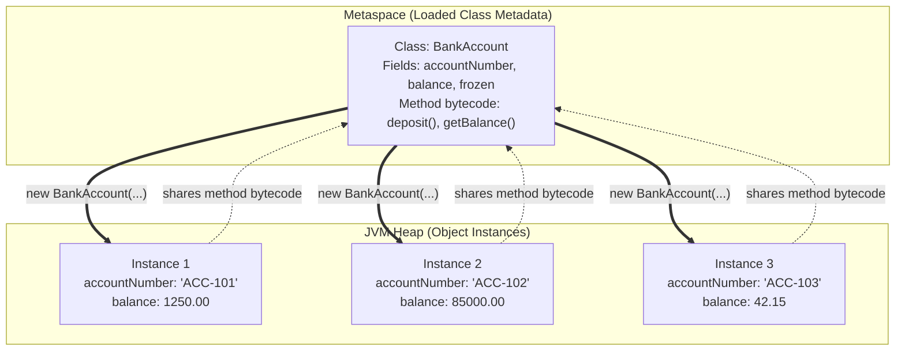
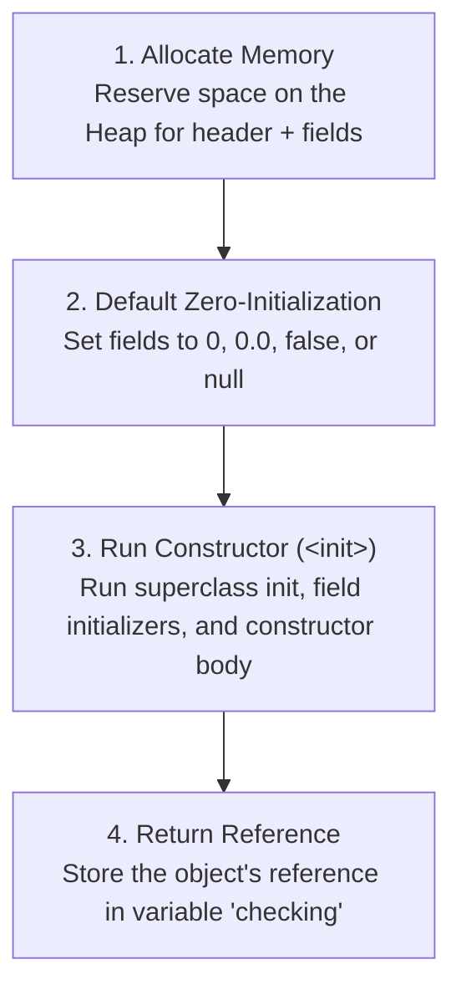
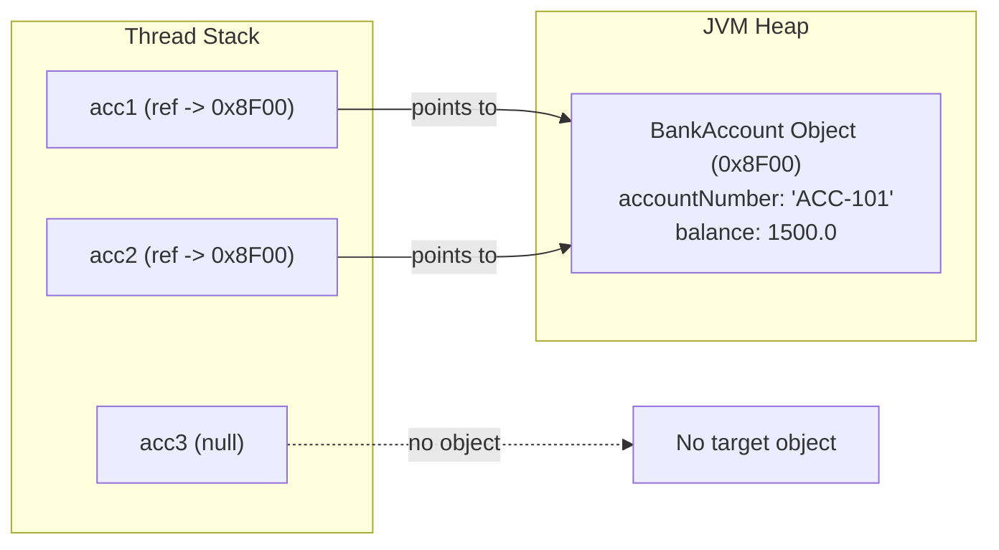

When a program is tiny, keeping a few variables and helper functions together in one file works fine. As soon as you start tracking dozens of bank accounts, shopping carts, or user sessions at the same time, loose arrays and unrelated variables quickly become hard to keep in sync. Changing a balance in one place while forgetting to update a transaction flag somewhere else leads to subtle bugs.

Object-Oriented Programming (OOP) organizes a program around self-contained concepts from your problem domain. Instead of separating data from the code that updates it, you bundle an entity's **state** (its fields) and its **behavior** (the methods that read or change those fields) into a single unit called a **class**.

In Java, OOP is built into the structure of the language itself: every piece of executable code belongs to a type such as a class, interface, enum, or record. Understanding how classes, objects, constructors, `this`, methods, and `null` references fit together gives you the foundation for everything else in Java.

---

## The Blueprint vs. the Instance

Two terms sit at the center of Java's object model: **Class** and **Object** (also called an **instance**).

- **A Class is the blueprint.** It describes what fields each entity will hold and what methods it supports. A class definition does not represent a specific bank account; it defines what *any* bank account looks like. On HotSpot, loaded class metadata and method bytecode live in **Metaspace**.
- **An Object is a concrete instance.** When you run `new BankAccount(...)`, the JVM allocates memory on the **Heap** for one individual account with its own field values. You can create one instance, ten instances, or a million instances from the same class blueprint.



One helpful detail to notice in the diagram: method bytecode is **not** copied into every object. If your application creates 100,000 `BankAccount` objects, each object has its own `accountNumber` and `balance` fields on the Heap, while the compiled code for `deposit()` and `getBalance()` exists once in Metaspace and is shared by all 100,000 instances.

Here is what that blueprint looks like in Java:

```java
package com.javahub.banking;

public class BankAccount {

    // Fields (state belonging to each instance)
    private final String accountNumber;
    private double balance;
    private boolean frozen;

    // Constructor (runs when a new instance is created)
    public BankAccount(String accountNumber, double initialDeposit) {
        if (accountNumber == null || accountNumber.isBlank()) {
            throw new IllegalArgumentException("Account number is required.");
        }
        if (initialDeposit < 0) {
            throw new IllegalArgumentException("Initial deposit cannot be negative.");
        }
        this.accountNumber = accountNumber;
        this.balance = initialDeposit;
        this.frozen = false;
    }

    // Methods (behavior that operates on this instance's fields)
    public void deposit(double amount) {
        if (frozen) {
            throw new IllegalStateException("Account is frozen.");
        }
        if (amount <= 0) {
            throw new IllegalArgumentException("Deposit amount must be positive.");
        }
        this.balance += amount;
    }

    public double getBalance() {
        return this.balance;
    }

    public String getAccountNumber() {
        return this.accountNumber;
    }
}
```

Marking the fields `private` means outside code cannot reach in and write `account.balance = -500.0`. Every change goes through methods like `deposit(...)` that enforce the rules of a valid account.

---

## Constructors and Object Initialization

A **constructor** is a special block of code that runs when an object is created with `new`. Its job is to put the new object into a valid starting state before any caller can use it.

Constructors follow two simple syntax rules:
- The constructor's name must match the class name exactly (`BankAccount`).
- A constructor has **no return type**, not even `void`.

> [!WARNING]
> If you accidentally write `public void BankAccount(...)`, Java does not treat it as a constructor. It compiles as a normal method that happens to share the class name, and it will not run when you call `new BankAccount(...)`.

### The Compiler-Generated Default Constructor

If you write a class without declaring *any* constructor at all, `javac` automatically generates a public (or package-private, matching the class) no-argument constructor:

```java
public class Counter {
    private int value;
    // javac inserts: public Counter() { super(); }
}
```

However, the moment you write **even one** custom constructor (like `BankAccount(String accountNumber, double initialDeposit)`), the compiler stops generating that default no-argument constructor. Calling `new BankAccount()` will no longer compile unless you explicitly define a no-argument constructor yourself.

### What `new` Actually Does Step by Step

When you execute:

```java
BankAccount checking = new BankAccount("ACC-101", 500.0);
```

the JVM performs four steps in order:



1. **Allocate memory on the Heap.** If the class has not been loaded yet, the JVM loads it first. Then it reserves enough space on the Heap for the object's header and all of its instance fields.
2. **Zero-initialize all fields.** Before a single line of your constructor runs, the JVM fills every instance field with its default value (`0` for integer types, `0.0` for floating-point types, `false` for `boolean`, `null` for object references). This is why instance fields always have a predictable default, whereas local variables declared inside a method do *not* get defaults and must be assigned before you read them.
3. **Execute the constructor (`<init>`).** The JVM runs superclass initialization, any inline field initializers (like `private boolean frozen = false;`), and finally your constructor body.
4. **Return the reference.** The reference pointing to the newly initialized object is stored in the local variable `checking`.

---

## The `this` Keyword Mechanics

Inside any instance method or constructor, `this` is a reference to the **current object** on which that method or constructor is running.

You will use `this` in three everyday situations:

### Resolving Shadowed Field Names

Constructor parameters and setter parameters often share the same names as the class's fields (`accountNumber`, `balance`). Inside the constructor, the parameter name *shadows* (hides) the field name. Writing `this.balance` explicitly refers to the instance field, while `balance` refers to the parameter:

```java
public BankAccount(String accountNumber, double balance) {
    this.accountNumber = accountNumber; // field = parameter
    this.balance = balance;             // field = parameter
}
```

If you accidentally wrote `balance = balance;`, you would just assign the parameter back to itself, leaving the instance field at `0.0`.

### Constructor Chaining with `this(...)`

A class can declare multiple constructors with different parameter lists (**constructor overloading**). Rather than duplicating validation and setup logic across them, one constructor can call another constructor in the same class using `this(...)`:

```java
public class BankAccount {
    private final String accountNumber;
    private double balance;

    // Convenience constructor: opens an account with a 0.0 balance
    public BankAccount(String accountNumber) {
        this(accountNumber, 0.0); // Delegates to the 2-argument constructor
    }

    public BankAccount(String accountNumber, double initialDeposit) {
        if (initialDeposit < 0) {
            throw new IllegalArgumentException("Initial deposit cannot be negative.");
        }
        this.accountNumber = accountNumber;
        this.balance = initialDeposit;
    }
}
```

In Java 21 LTS (and earlier versions), a `this(...)` call must be the **very first statement** in the constructor body, and a single constructor cannot contain both `this(...)` and `super(...)`.

### Passing or Returning the Current Object

Because `this` is a regular reference to the current instance, you can pass it to another method (for example, registering the object with a listener) or return `this` to support chained calls:

```java
public class QueryBuilder {
    private String table;
    private int limit;

    public QueryBuilder from(String table) {
        this.table = table;
        return this;
    }

    public QueryBuilder limit(int limit) {
        this.limit = limit;
        return this;
    }
}

// Chained usage:
QueryBuilder query = new QueryBuilder().from("orders").limit(25);
```

### How `this` Works Under the Hood

There is nothing mysterious about how an instance method knows which object's fields to read. At the JVM bytecode level, every instance method receives `this` as a hidden first parameter stored in local variable slot `0`.

When you write:

```java
checking.deposit(50.0);
```

the JVM passes `checking` as argument `0` and `50.0` as argument `1`. If you inspect the compiled bytecode with `javap -c BankAccount`, you will see instructions like `aload_0` whenever the method accesses `this` or reads one of its fields. By contrast, a `static` method belongs to the class itself rather than any instance, so it receives no hidden `this` reference, which is why referencing `this` inside a `static` method is a compile-time error.

---

## Functions vs. Methods

Developers coming from Python, JavaScript, or C are used to writing standalone functions that live outside of any class:

```javascript
// Standalone JavaScript function
function calculateTax(amount, rate) {
    return amount * rate;
}
```

In Java, you cannot declare a standalone function floating at the top level of a file. Every reusable block of behavior is declared inside a type and is called a **method**.

Java has two kinds of methods, and distinguishing them clears up most early confusion:

- **Instance methods** belong to an object. They can read and modify that object's fields via `this`, and you call them through an object reference (`checking.deposit(50.0)`).
- **`static` methods** belong to the class itself. They do not operate on any particular instance, have no `this` reference, and behave much like standalone utility functions grouped under a class name (`Math.max(10, 20)` or `Integer.parseInt("42")`).

```java
public class TaxCalculator {
    // Static method: no instance state needed
    public static double calculateTax(double amount, double rate) {
        return amount * rate;
    }
}

// Called on the class name, no 'new TaxCalculator()' required:
double tax = TaxCalculator.calculateTax(100.0, 0.08);
```

A good rule of thumb: if an operation reads or updates an object's fields, make it an instance method; if it only depends on its input parameters and does not need object state, a `static` method is usually cleaner.

---

## Object References and the `null` Value

One of the most important mental shifts for beginners in Java is understanding what a variable of a class type actually holds.

A primitive variable (`int count = 42;`) stores the value `42` directly. An object variable (`BankAccount acc1 = new BankAccount(...);`) does **not** hold the object itself. It holds a **reference** (an address pointing to the object on the Heap).

Think of the object on the Heap as a house, and the reference variable on the Stack as a sticky note with the house's address written on it:

```java
BankAccount acc1 = new BankAccount("ACC-101", 1000.0);
BankAccount acc2 = acc1; // Copies the reference, NOT the BankAccount object

acc2.deposit(500.0);
System.out.println(acc1.getBalance()); // Prints 1500.0
```

Copying `acc1` into `acc2` creates a second sticky note with the same address. Both variables point to the exact same `BankAccount` instance on the Heap, so depositing through `acc2` updates the balance that `acc1` sees.



Reassigning `acc2 = new BankAccount("ACC-202", 50.0);` only changes the address written on `acc2`'s sticky note. It leaves `acc1` pointing to the original `"ACC-101"` object untouched.

Notice also how `==` behaves with references: `acc1 == acc2` asks *"Do these two variables point to the exact same object in memory?"* It does **not** check whether two separate objects happen to have the same field values. To compare logical contents (such as two `String` objects with the same text), use `.equals(...)`.

### What `null` Means and How to Handle `NullPointerException`

When a reference variable does not point to any object, its value is `null`. Reference fields start out as `null` automatically if you do not assign them, and methods sometimes return `null` to signal "not found."

If you try to call a method or read a field through a `null` reference, Java throws a **`NullPointerException` (NPE)**:

```java
BankAccount acc3 = null;
acc3.deposit(100.0); // Throws NullPointerException at runtime
```

Since Java 14 (JEP 358), the JVM prints detailed diagnostic messages telling you exactly which variable was `null`:

```text
Exception in thread "main" java.lang.NullPointerException:
    Cannot invoke "BankAccount.deposit(double)" because "acc3" is null
```

You cannot eliminate `null` from Java, but a few simple habits prevent most NPEs before they happen:

1. **Validate constructor arguments early.** Use `Objects.requireNonNull(accountNumber, "accountNumber must not be null")` so bad inputs fail right at construction instead of crashing twenty methods later.
2. **Guard optional references before calling methods:**
   ```java
   if (account != null) {
       account.deposit(100.0);
   }
   ```
3. **Prefer empty values over `null` when returning results.** Returning an empty `String` (`""`) or an empty `List` (`List.of()`) lets callers iterate or inspect the result safely without null checks everywhere.

---

## Summary

- A **class** is the blueprint (fields + methods) loaded once by the JVM; an **object** is an instance allocated on the Heap with its own field values.
- **Constructors** initialize new objects into a valid state. The compiler generates a default no-argument constructor only when you declare no constructors of your own.
- **`this`** refers to the current instance (passed implicitly at slot `0` in instance methods), resolves shadowed field names, and chains overloaded constructors with `this(...)`.
- Java has no top-level standalone functions; behavior lives in **instance methods** (tied to an object) or **`static` methods** (tied to a class).
- Object variables hold **references**, not objects. Copying a reference creates an alias to the same object, and dereferencing a `null` reference throws `NullPointerException`.

---

## Interview Questions

### What happens step by step when Java executes `new BankAccount("ACC-101", 500.0)`?
First, the JVM ensures the `BankAccount` class is loaded and initialized in Metaspace. Next, it allocates memory on the Heap for the object header and fields, then zero-initializes all fields (`0`, `0.0`, `false`, `null`). After that, it runs the constructor (`<init>`), which runs superclass initialization, field initializers, and the constructor body. Finally, it returns the reference to the new object so it can be stored in a variable.

### If a class defines `public BankAccount(String id)`, why does `new BankAccount()` fail to compile?
The Java compiler generates a default no-argument constructor only when a class declares zero constructors. As soon as you define any constructor explicitly, the compiler assumes you want full control over how instances are constructed and does not generate the no-argument version. If you still want `new BankAccount()` to work, you must write that constructor yourself.

### What are the rules for constructor chaining with `this(...)`?
`this(...)` invokes another overloaded constructor in the same class to reuse initialization logic. In Java 21 and earlier, it must be the first statement in the constructor body, and a constructor cannot call both `this(...)` and `super(...)` because the chained constructor will eventually handle calling `super(...)`.

### Why can't you use `this` inside a `static` method?
At the bytecode level, instance methods receive a hidden reference to the current object in local variable slot `0`, which is what `this` refers to. A `static` method belongs to the class itself rather than any instance and can be called even when zero objects of that class exist, so no `this` reference is passed to it.
