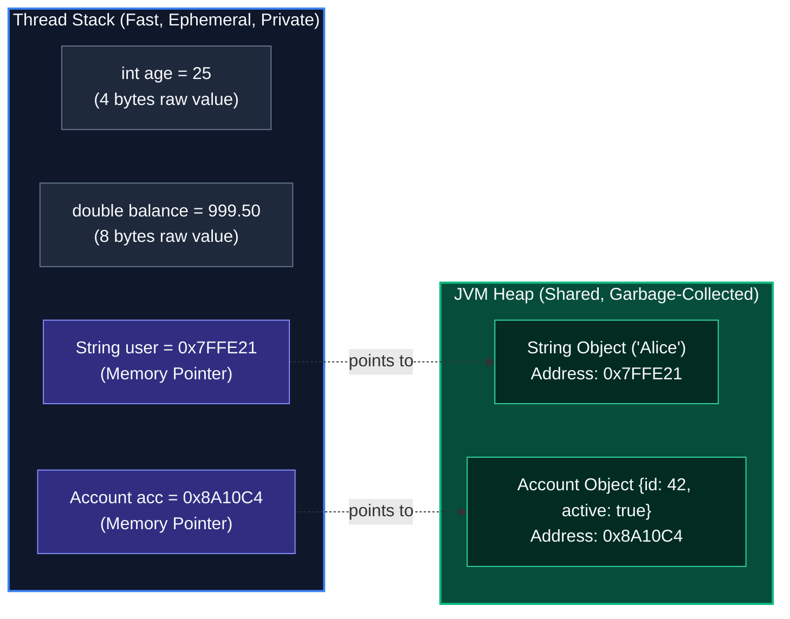
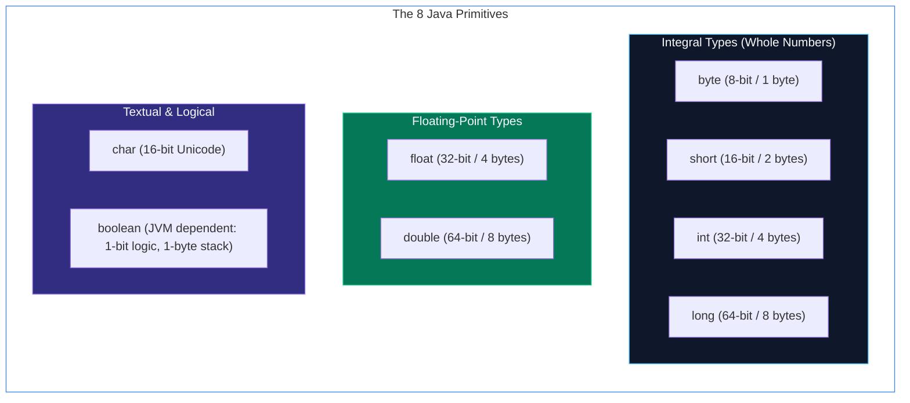
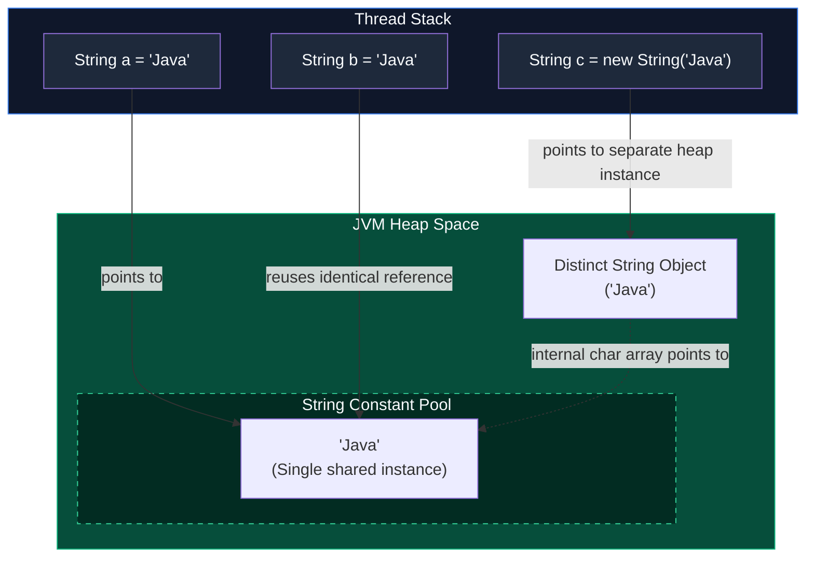

Have you ever wondered what actually happens inside your computer when you write `int score = 100;`?

To a compiler, code isn't just instructions; it is an architectural contract for **how memory is carved up in physical silicon**. In dynamically-typed languages like Python or JavaScript, you can throw whatever you want into a variable and change your mind five lines later:

```javascript
let balance = 100;     // It's a number
balance = "One Hundred"; // Now it's a string!
```

While that feels freeing when writing a 20-line script, it is the root cause of production nightmares in enterprise systems: a function expects an integer to calculate payroll, receives a string, and crashes at 2:00 AM.

Java chose a radically different path: **strict, static typing coupled with a dual-memory model**. 

In Java, every variable is a sealed storage container of an immutable shape. The compiler guarantees that if you promise a variable holds a 32-bit integer, it will hold a 32-bit integer until the universe cools down.

Let's look under the hood to see how Java stores data, why memory is split between the Stack and the Heap, and how to avoid the subtle performance traps that snare even experienced developers.

---

## The Dual-Memory Universe: Stack vs. Heap

To master Java types, you must first understand the two distinct neighborhoods where the JVM keeps your data: the **Stack** and the **Heap**.



### The Thread Stack
- **What lives here:** Method execution frames, local primitive variables, and references (pointers) to objects.
- **How it behaves:** Blazingly fast, Last-In-First-Out (LIFO). When a method is called, a new stack frame is pushed. When the method exits, the frame is popped and its memory vanishes instantly with zero cleanup overhead.
- **Memory footprint:** Each thread gets its own private stack (typically 1 MB by default).

### The JVM Heap
- **What lives here:** All objects, arrays, and string instances.
- **How it behaves:** A shared memory playground across the entire JVM. Objects created here live as long as someone holds a reference to them. When no active variable points to them, the Garbage Collector (GC) eventually sweeps them away.

Every variable in Java falls into one of two camps based on how it interacts with this memory model: **Primitive Types** or **Reference Types**.

---

## The 8 Primitive Types: Hardware in its Raw Form

Primitives are not objects. They have no methods, no inheritance, and zero object header overhead. They represent raw binary values stored directly on the Stack. 

Java provides exactly eight primitives, each tailored to specific bit-widths:



| Type | Size | Range | Default | Common Use Case |
| :--- | :--- | :--- | :--- | :--- |
| `byte` | 8 bits (1B) | -128 to 127 | `0` | Streaming binary files, network protocols |
| `short` | 16 bits (2B) | -32,768 to 32,767 | `0` | Legacy memory-constrained systems |
| `int` | 32 bits (4B) | -2,147,483,648 to 2,147,483,647 | `0` | **Default choice for whole numbers** |
| `long` | 64 bits (8B) | -9.22 × 10¹⁸ to 9.22 × 10¹⁸ | `0L` | Database IDs, timestamps, large counters |
| `float` | 32 bits (4B) | ~1.4 × 10⁻⁴⁵ to 3.4 × 10³⁸ (6-7 decimal digits) | `0.0f` | Graphics shaders, machine learning weights |
| `double` | 64 bits (8B) | ~4.9 × 10⁻³²⁴ to 1.7 × 10³⁰⁸ (15-17 digits) | `0.0d` | **Default choice for scientific/math decimals** |
| `char` | 16 bits (2B) | `\u0000` (0) to `\uffff` (65,535) | `\u0000` | Single UTF-16 Unicode character |
| `boolean`| ~1 byte | `true` or `false` | `false` | Conditional flags, logic gates |

### Readable Numeric Literals
Reading large numbers like `1000000000` causes human eye strain. In Java 7+, you can place underscores (`_`) anywhere inside numeric literals to make them legible:
```java
int oneBillion = 1_000_000_000;
long creditCard = 4532_8910_2234_5678L;
double hexValue = 0x7F_FF_FF;
```
The compiler strips all underscores during compilation—they exist purely for human sanity.

---

## Senior Traps with Primitives

### The Integer Overflow Silent Disaster
What happens when you increment an integer beyond its maximum capacity? In Java, it does **not** throw an exception. It silently overflows and wraps around to the minimum negative value:

```java
int max = Integer.MAX_VALUE; // 2,147,483,647
int broken = max + 1;
System.out.println(broken);  // Prints: -2147483648!
```

Imagine calculating a banking balance or e-commerce cart total: a customer adds an item, the counter overflows, and their account balance becomes negative!

> [!TIP]
> **Defensive Coding:**
> If you are writing mission-critical code, use Java 8's exact math methods:
> ```java
> int safe = Math.addExact(max, 1); // Instantly throws ArithmeticException instead of silently corrupting data!
> ```

### The Floating-Point Financial Catastrophe
Run this line in your terminal or IDE:
```java
System.out.println(0.1 + 0.2);
```
Does it print `0.3`? **No. It prints `0.30000000000000004`!**

Why? Because computers do not store base-10 decimals natively; they use base-2 binary floating point (IEEE 754). In binary, just like `1/3` is an endless repeating decimal in base-10 (`0.33333...`), numbers like `0.1` and `0.2` are infinite repeating fractions in binary.

> [!CAUTION]
> **Never use `float` or `double` for currency or account balances!**
> Over thousands of transactions, floating-point rounding errors will cause missing pennies and audit failures. 
> For money, always use **`java.math.BigDecimal`** or store the amount in minor units (e.g., store `$19.99` as an integer `1999` cents).

---

## The String Constant Pool & String Immutability

The `String` class is the undisputed king of reference types. Because almost every program handles strings constantly, storing duplicates would consume vast amounts of memory.

Java solves this with the **String Constant Pool**, an internal hashtable stored inside the JVM Heap.



### The Literal vs. `new` Constructor Difference

```java
String a = "Java";
String b = "Java";
System.out.println(a == b); // TRUE! Both point to the exact same memory address in the pool.

String c = new String("Java");
System.out.println(a == c); // FALSE! 'new' forces a fresh object on the general heap.
System.out.println(a.equals(c)); // TRUE! Their textual contents are identical.
```

> [!IMPORTANT]
> **`==` vs. `.equals()`**
> In Java, the `==` operator on reference types compares **memory addresses**, not contents. 
> To compare the actual text of two strings, **always use `.equals()`**.

### Why Are Strings Immutable?
Once a `String` object is created in Java, its character content can never be modified. If you call `name.toUpperCase()`, Java does not alter `name`; it creates a brand new String object with the uppercase characters.

Immutability gives Java three superpower guarantees:
1. **Thread Safety**: Multiple concurrent threads can read the same string without synchronization bugs.
2. **Security**: Sensitive parameters like database connection URLs, file paths, or network ports cannot be maliciously altered mid-flight after validation.
3. **Caching**: Hash codes can be computed once and cached, making Strings ultra-fast keys in `HashMap`s.

---

## Wrapper Classes & Autoboxing Traps

Because Java primitives are not objects, they cannot be passed into standard Java Collections. You cannot write:
```java
// COMPILE ERROR! Generics require Objects, not primitives:
List<int> numbers = new ArrayList<>(); 
```

To bridge this divide, Java provides an object wrapper for every primitive:

| Primitive | Wrapper Class (Heap Object) |
| :--- | :--- |
| `byte` | `Byte` |
| `short` | `Short` |
| `int` | `Integer` |
| `long` | `Long` |
| `float` | `Float` |
| `double` | `Double` |
| `char` | `Character` |
| `boolean` | `Boolean` |

### Autoboxing and Unboxing
Since Java 5, the compiler automatically converts between primitives and their wrapper counterparts:

```java
// Autoboxing: Compiler turns this into Integer.valueOf(42)
Integer boxed = 42; 

// Unboxing: Compiler turns this into boxed.intValue()
int primitive = boxed; 
```

While convenient, autoboxing hides two massive traps that every engineer must know:

### Trap 1: The Infamous Integer Cache (`-128` to `127`)
Look at this code snippet. What will it print?

```java
Integer x = 100;
Integer y = 100;
System.out.println(x == y); // Prints: true

Integer a = 200;
Integer b = 200;
System.out.println(a == b); // Prints: FALSE!
```

*Wait... why does 100 equal 100, but 200 does not equal 200?!*

Because Java maintains an **Integer Cache** for boxed values between `-128` and `127` (the range of a single byte). For numbers within this window, `Integer.valueOf()` returns a pre-allocated cached object from memory. Beyond 127, it instantiates brand new objects on the Heap. Because `==` checks reference equality, `a == b` fails!

**Rule:** Never compare wrapper objects using `==`. Always use `a.equals(b)`.

### Trap 2: Silent Performance Degradation
Notice what happens when you use a wrapper class in a loop:

```java
// ❌ HORRIBLE PERFORMANCE: Creates 10 million discarded objects on the Heap!
Long total = 0L;
for (long i = 0; i < 10_000_000L; i++) {
    total += i; // Unboxes 'total', adds 'i', then autoboxes back into a brand new Long object!
}

// ✅ BLAZING FAST: Operates strictly in CPU registers and stack memory
long fastTotal = 0L;
for (long i = 0; i < 10_000_000L; i++) {
    fastTotal += i;
}
```
The first loop is **10 to 15 times slower** and hammers the Garbage Collector with gigabytes of temporary garbage objects. Always prefer primitives for local computation loops.

---

## Type Casting: Widening vs. Narrowing

Converting data from one type to another falls into two directions:


### Widening (Implicit Casting)
Moving from a smaller memory footprint to a larger one. Because there is zero chance of data truncation, the compiler performs this automatically without asking:
```java
int small = 42;
double wide = small; // Automatically becomes 42.0
```

### Narrowing (Explicit Casting)
Moving from a larger type to a smaller type. Because higher-order bits or decimal precision will be permanently destroyed, the compiler refuses to do this unless you explicitly sign off using parentheses `(targetType)`:

```java
double pi = 3.999;
int truncated = (int) pi; // Explicit cast: truncated is 3 (NOT 4! Decimal is completely chopped off)

int bigNumber = 130;
byte squeezed = (byte) bigNumber; 
System.out.println(squeezed); // Prints: -126! (Bit truncation overflow)
```

---

## Variable Scope & The Lifetime of Data

A variable’s **scope** determines where it is visible and how long its memory exists:

```java
public class ScopeDemo {
    // 1. Instance Field: Lives on the Heap as long as this object exists
    private int instanceCount = 0;

    public void process(int parameter) { // 2. Parameter: Lives on Stack for duration of process()
        int localVariable = 10;          // 3. Local Variable: Lives on Stack until method exits

        if (localVariable > 5) {
            int blockScoped = 42;        // 4. Block Scope: Born at '{', destroyed at '}'
            System.out.println(blockScoped);
        }

        // System.out.println(blockScoped); // COMPILE ERROR: Variable no longer exists!
    }
}
```

### Variable Shadowing
If a local variable inside a method shares the exact same name as an instance variable of the class, the local variable "shadows" (hides) the instance variable:

```java
public class User {
    private String name;

    public void setName(String name) {
        // 'name' refers to the parameter passed in.
        // 'this.name' refers to the instance field on the Heap!
        this.name = name; 
    }
}
```

---

## Modern Java: Local Variable Type Inference (`var`)

Starting in **Java 10**, Java introduced the `var` keyword to cut down on redundant boilerplate. 

In older Java, declaring complex types felt absurdly repetitive:
```java
Map<String, List<CustomerOrder>> customerRegistry = new HashMap<String, List<CustomerOrder>>();
```

With `var`, you let the compiler infer the type from the right-hand assignment:
```java
var customerRegistry = new HashMap<String, List<CustomerOrder>>();
var message = "Hello, Java!"; // Inferred as String
var count = 42;               // Inferred as int
```

### Critical Rules for `var`
1. **`var` is NOT dynamic typing!** Unlike JavaScript, Java remains 100% statically typed. Once `var x = 10;` compiles, `x` is permanently an `int`. Writing `x = "text";` will cause a compile error.
2. **Local Variables Only:** You can only use `var` for local variables inside method bodies. You **cannot** use `var` for class fields, method return types, or method parameters.
3. **Must Have an Initializer:** You cannot write `var x;` because the compiler cannot read your mind to determine what type to assign.

---

## Summary & Mental Model Checkpoint

1. **Stack vs. Heap**: Primitives live directly on the Stack (fast, zero GC). Objects live on the Heap (shared, GC managed), referenced by 64-bit pointers on the Stack.
2. **The 8 Primitives**: `byte`, `short`, `int`, `long`, `float`, `double`, `char`, `boolean`.
3. **Money Rule**: Never use `float` or `double` for currency. Use `BigDecimal` or minor integer units.
4. **String Pool**: String literals are deduplicated in the Heap pool. Always use `.equals()` to compare textual content.
5. **Autoboxing Traps**: Beware the `-128` to `127` Integer cache with `==`, and avoid wrapper objects in high-throughput math loops.
6. **`var`**: A compile-time readability shortcut for local variables, preserving 100% static type safety.

---

## 🎯 Senior Engineer Interview Questions

### What is the difference between a primitive type and a reference type in memory?
> **Answer:** A primitive variable stores the actual binary value directly in the memory slot of the current thread's stack frame (e.g. 4 bytes for an `int`). A reference variable stores a memory pointer (usually a 32-bit or 64-bit compressed OOP address) on the stack, which points to the location of the object instance allocated on the JVM Heap.

### Why does `Integer a = 127; Integer b = 127; a == b;` return `true`, but `Integer a = 128; Integer b = 128; a == b;` return `false`?
> **Answer:** Java implements an internal `IntegerCache` for boxed integer values ranging from `-128` to `127` (configurable via `-XX:AutoBoxCacheMax`). Within this range, autoboxing via `Integer.valueOf()` returns the exact same pre-instantiated object reference from memory, causing `==` (reference identity) to evaluate to `true`. For numbers outside this range, a new `Integer` object is instantiated on the Heap, meaning both pointers point to distinct memory addresses.

### Why are Strings immutable, and how does Java 9's "Compact Strings" optimize memory?
> **Answer:** Strings are immutable to ensure security (network and file descriptors cannot be modified after validation), thread safety without locks, and caching consistency (the hash code can be computed once and reused). In Java 8 and earlier, strings stored characters in a UTF-16 `char[]` array (2 bytes per character). Java 9 introduced Compact Strings: if the string contains only Latin-1 characters (ASCII), it stores them in a `byte[]` array with a 1-byte coder flag, cutting heap memory consumption for strings by roughly 50% across most enterprise applications.

### Can `var` be used as a return type or method parameter? Why or why not?
> **Answer:** No. `var` is strictly limited to local variable declarations with initializers. It cannot be used for method return types or parameters because method signatures form public API contracts. Allowing `var` in signatures would break compiler type checking, prevent clean documentation generation, and make library backward-compatibility tracking impossible across compiled `.class` files.
