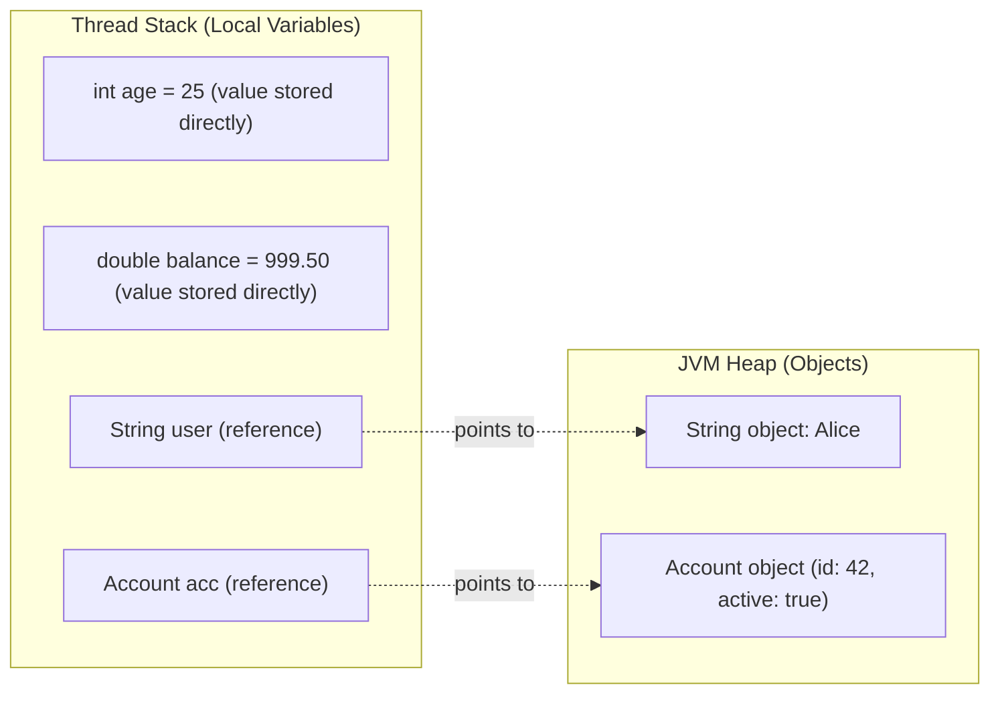
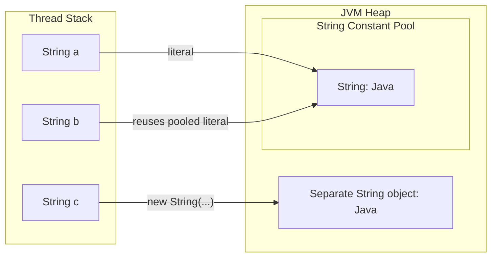
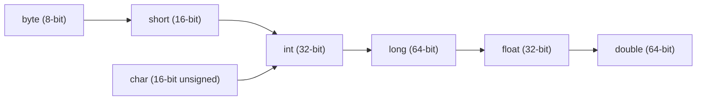

When you write `int score = 100;` in Java, you are telling the compiler two things: reserve storage for a 32-bit signed integer, and reject any code that tries to put a different kind of value (like `"one hundred"`) into `score`.

In dynamically typed languages like Python or JavaScript, a variable can hold a number on one line and a string on the next. That is quick for small scripts, but in larger codebases it lets type mismatches slip through until a specific code path runs in production. Java is **statically typed**: every variable has a fixed type checked at compile time.

To use Java's type system well, it helps to understand both the two categories of types (primitives and references) and where the JVM stores them while your program runs.

---

## Primitive vs. Reference Types (Stack and Heap)

Every Java type falls into one of two groups:

- **Primitive types** hold raw values directly (numbers, characters, booleans). They are not objects, have no methods, and cannot be `null`.
- **Reference types** (classes like `String`, interfaces, arrays, records, enums) hold a **reference** that points to an object allocated on the JVM Heap. A reference variable can also hold `null`, meaning it currently points to nothing.

While a method runs, the JVM divides memory primarily between each thread's **Stack** and the shared **Heap**:



- **Thread Stack:** Each thread gets its own call stack. Calling a method pushes a stack frame holding that method's parameters and local variables (both local primitives and references to objects). When the method returns, the frame is popped immediately.
- **JVM Heap:** Shared across all threads. Every object created with `new` (and every array) lives here until no reachable references remain and the Garbage Collector reclaims it.

One subtle detail that trips many people up: **local** primitive variables live in a stack frame, while primitive **fields** declared inside a class live on the heap as part of their enclosing object (for example, `id` and `active` inside `Account` above).

### Default Values vs. Local Variables

Instance and static fields automatically receive default values if you do not initialize them (`0`, `0.0`, `false`, `\u0000`, or `null` for references). **Local variables inside a method do not receive default values.** Reading an uninitialized local variable is a compile-time error:

```java
public class DefaultsDemo {
    int fieldCount; // Defaults to 0

    public void run() {
        int localCount;
        // System.out.println(localCount); // Compile error: variable localCount might not have been initialized
        localCount = 5;
        System.out.println(fieldCount + localCount); // Prints 5
    }
}
```

---

## The 8 Primitive Types

Java defines exactly eight primitive types with fixed, platform-independent value ranges (an `int` is always 32 bits regardless of whether you run on Windows, macOS, or Linux).

| Type | Width | Range | Default (Fields) | Typical Use |
| :--- | :--- | :--- | :--- | :--- |
| `byte` | 8 bits | -128 to 127 | `0` | Raw binary data, file/network buffers |
| `short` | 16 bits | -32,768 to 32,767 | `0` | Compact numeric arrays where memory matters |
| `int` | 32 bits | -2,147,483,648 to 2,147,483,647 | `0` | Default choice for whole numbers |
| `long` | 64 bits | -9,223,372,036,854,775,808 to 9,223,372,036,854,775,807 | `0L` | Database IDs, timestamps, large counters |
| `float` | 32 bits | IEEE 754 single-precision (~6-7 decimal digits) | `0.0f` | Graphics coordinates, ML weights |
| `double` | 64 bits | IEEE 754 double-precision (~15-17 decimal digits) | `0.0d` | Default choice for decimal math |
| `char` | 16 bits | `\u0000` (0) to `\uffff` (65,535) | `\u0000` | Single UTF-16 code unit |
| `boolean` | JVM-dependent | `true` or `false` | `false` | Conditions and flags |

Note that the JVM specification does not mandate a single storage width for `boolean`. In HotSpot, a local `boolean` occupies an `int` slot on the stack, while elements of a `boolean[]` array take 1 byte each.

### Numeric Literals, Suffixes, and Underscores

Whole-number literals default to `int`, and decimal literals default to `double`. Append `L` for `long` literals (prefer uppercase `L` over lowercase `l`, which looks like `1`) and `f` for `float` literals. You can also place underscores inside digits to keep large numbers readable:

```java
// int population = 8_100_000_000; // Compile error: integer number too large for int
long worldPopulation = 8_100_000_000L;
float interestRate = 4.25f;
int bitMask = 0b1111_0000;
```

The compiler ignores the underscores completely.

### Integer Overflow

Java does **not** throw an exception when integer arithmetic exceeds the type's maximum or minimum value. Instead, it wraps around using two's complement arithmetic:

```java
int max = Integer.MAX_VALUE; // 2_147_483_647
int wrapped = max + 1;
System.out.println(wrapped); // -2147483648
```

When silent wrap-around would corrupt business logic (such as inventory counts or financial totals in cents), use the exact arithmetic helpers in `java.lang.Math`:

```java
int safe = Math.addExact(max, 1); // Throws ArithmeticException: integer overflow
```

### Floating-Point Precision and Money

Try running this expression:

```java
System.out.println(0.1 + 0.2); // Prints: 0.30000000000000004
```

Both `float` and `double` store values in base-2 IEEE 754 binary floating point. Just as `1/3` cannot be written cleanly in base 10 (`0.3333...`), `0.1` and `0.2` are repeating fractions in binary.

> [!CAUTION]
> **Do not use `float` or `double` for money.** Small binary rounding errors accumulate across invoices and totals. Use `java.math.BigDecimal` (constructed from a `String`, such as `new BigDecimal("19.99")`) or store amounts as integer minor units (`long priceCents = 1999L;` for 19.99 USD).

---

## Wrapper Classes and Autoboxing

Java generics and collections only work with reference types, not primitives:

```java
// Compile error: unexpected type (required: reference, found: int)
// List<int> scores = new ArrayList<>();

List<Integer> scores = new ArrayList<>();
```

To bridge primitives and objects, `java.lang` provides an immutable **wrapper class** for each primitive:

| Primitive | Wrapper Class |
| :--- | :--- |
| `byte` | `Byte` |
| `short` | `Short` |
| `int` | `Integer` |
| `long` | `Long` |
| `float` | `Float` |
| `double` | `Double` |
| `char` | `Character` |
| `boolean` | `Boolean` |

Wrappers also carry useful static helper methods such as `Integer.parseInt("42")` and `Double.isNaN(value)`.

### Autoboxing and Unboxing

Java automatically converts between a primitive and its wrapper when needed:

```java
Integer boxed = 42;       // Autoboxing: compiled to Integer.valueOf(42)
int unboxed = boxed;      // Unboxing:   compiled to boxed.intValue()
```

Autoboxing is convenient, but it hides three real bugs and performance traps.

#### Pitfall: Unboxing `null` Throws `NullPointerException`

Because a wrapper is a reference type, it can be `null`. Assigning or using it where a primitive is expected triggers unboxing (`null.intValue()`) and crashes at runtime:

```java
Integer retryCount = null;
int next = retryCount + 1; // Throws NullPointerException at runtime
```

Always check for `null` (or provide a default) before unboxing values that came from a `Map`, database query, or optional field.

#### Pitfall: Comparing Wrappers with `==` and the `Integer` Cache

Look at the output of these two comparisons:

```java
Integer a = 100;
Integer b = 100;
System.out.println(a == b); // true

Integer x = 200;
Integer y = 200;
System.out.println(x == y); // false
```

The Java specification requires `Integer.valueOf(int)` to cache instances for values from `-128` through `127` (HotSpot lets you raise the upper bound with `-XX:AutoBoxCacheMax`, though the minimum guaranteed range is `-128` to `127`). For `100`, both `a` and `b` receive the same cached `Integer` object, so `==` compares identical references and returns `true`. For `200`, each call allocates a new `Integer` on the heap, so `==` returns `false`.

Always compare wrapper objects with `.equals()` (or `Objects.equals(x, y)` if either side might be `null`).

#### Pitfall: Accidental Boxing Inside Loops

```java
// Bad: unboxes and allocates a new Long object on every iteration
Long sum = 0L;
for (long i = 0; i < 10_000_000L; i++) {
    sum += i;
}

// Good: stays purely in primitive long arithmetic
long fastSum = 0L;
for (long i = 0; i < 10_000_000L; i++) {
    fastSum += i;
}
```

In the first loop, `sum += i` compiles to `sum = Long.valueOf(sum.longValue() + i)`, allocating millions of temporary `Long` objects on the heap and giving the Garbage Collector unnecessary work. Use primitives for local calculations and counters, and wrappers only where an object type is required (like collections or nullable fields).

---

## The `String` Constant Pool

`String` is a reference type, not a primitive, yet Java gives it special syntax (`"Java"`) and memory optimization because programs create huge numbers of strings.

String literals are stored in a shared area of the Heap called the **String Constant Pool** (also known as the String Intern Pool). When two variables use the same string literal, they point to the exact same `String` object in the pool:



```java
String a = "Java";
String b = "Java";
String c = new String("Java");

System.out.println(a == b);      // true  (same pooled reference)
System.out.println(a == c);      // false (c forced a separate heap object)
System.out.println(a.equals(c)); // true  (same sequence of characters)
```

> [!IMPORTANT]
> **`==` checks reference identity; `.equals()` checks content.**
> Never compare strings with `==`. Even two strings with identical text will fail `==` if one came from user input, a file, JSON deserialization, or `new String(...)`. Always write `a.equals(c)` or `"Java".equals(input)` (putting the literal first avoids a `NullPointerException` if `input` is `null`).

You almost never need `new String("...")`. If you do have a dynamically constructed string and specifically want the pooled copy, `str.intern()` returns the canonical reference from the pool (though manual interning is rarely needed outside specialized memory tuning).

### Why Strings Are Immutable

Once created, a `String` object's characters cannot change. Calling `a.toUpperCase()` returns a brand-new `String` (`"JAVA"`) and leaves `a` untouched.

Immutability makes string pooling safe in the first place: if modifying `a` mutated the shared `"Java"` object in the pool, `b` would silently change underneath you. It also makes strings inherently thread-safe, lets `String` cache its `hashCode()` for fast `HashMap` lookups, and ensures values like file paths or URLs cannot be altered after validation checks.

*(Implementation note: Since Java 9, HotSpot's Compact Strings optimization stores Latin-1 strings in a `byte[]` with 1 byte per character instead of UTF-16 `char[]` with 2 bytes per character, substantially reducing heap usage for typical ASCII/Latin-1 text.)*

---

## Type Casting

Converting a primitive value from one numeric type to another happens in two ways: **widening** (implicit) and **narrowing** (explicit).



### Widening (Implicit Conversion)

Moving from a smaller range to a larger range happens automatically without a cast:

```java
int count = 42;
long wideCount = count;     // 42L (exact)
double exactDouble = count; // 42.0 (exact)
```

One nuance worth knowing: although `int -> float`, `long -> float`, and `long -> double` are widening conversions allowed implicitly by the compiler, floating-point types have fewer precision bits than `int` or `long` can hold at extreme values. Converting a very large `long` to a `float` or `double` preserves magnitude but can round off the lowest digits:

```java
long big = 9_007_199_254_740_993L;
double approx = big; // Allowed implicitly, but loses the last digit of precision
System.out.println((long) approx); // Prints 9007199254740992
```

### Narrowing (Explicit Cast)

Going from a larger type to a smaller type can drop fractional digits or overflow bits, so the compiler requires you to write an explicit cast `(targetType)`:

```java
double price = 9.99;
int wholeDollars = (int) price; // 9 (truncates toward zero; does NOT round)

int value = 130;
byte narrowed = (byte) value;   // -126 (high bits are discarded)
```

Notice `char` as well: because `char` is unsigned (`0` to `65,535`) while `byte` and `short` are signed, converting between `short` and `char` (or `byte` to `char`) always requires an explicit cast.

---

## Block Scope and Variable Lifetime

A variable's **scope** is the region of code where its name is visible. In Java, scope is determined by the enclosing pair of curly braces `{ }`.

```java
public class ScopeExample {
    // 1. Instance field: belongs to each ScopeExample object on the Heap
    private int total = 0;

    public void calculate(int multiplier) { // 2. Method parameter: visible throughout calculate()
        int base = 10;                      // 3. Method-local variable: visible until method ends

        if (multiplier > 0) {
            int bonus = base * multiplier;  // 4. Block-scoped variable: born at '{', ends at '}'
            total += bonus;
        }

        // System.out.println(bonus); // Compile error: cannot find symbol 'bonus'
    }
}
```

Loop counters declared in a `for` header follow the same block-scope rule:

```java
for (int i = 0; i < 5; i++) {
    System.out.println(i);
}
// 'i' is out of scope here, so you can safely reuse 'i' in a later loop.
```

### Variable Shadowing

Java does not let you declare two local variables with the same name in nested blocks of the same method. However, a parameter or local variable *can* share the name of a class field. When that happens, the local variable **shadows** the field, and you use `this.` to refer to the field explicitly:

```java
public class Customer {
    private String name;

    public void setName(String name) {
        this.name = name; // 'this.name' is the field; 'name' is the parameter
    }
}
```

---

## Local Variable Type Inference (`var`)

Introduced in **Java 10**, `var` lets the compiler infer the type of a local variable from its initializer so you do not have to repeat verbose generic types on both sides of `=`:

```java
// Without var
Map<String, List<String>> ordersByCustomer = new HashMap<String, List<String>>();

// With var (identical compiled bytecode)
var ordersByCustomer = new HashMap<String, List<String>>();
var message = "Order confirmed"; // Inferred as String
var itemCount = 3;               // Inferred as int
```

### Rules and Limits of `var`

1. **Still 100% statically typed:** `var` is resolved completely at compile time. Once `var count = 10;` is inferred as `int`, writing `count = "ten";` fails to compile.
2. **Local variables only:** You can use `var` for local variables, enhanced `for` loop variables, traditional `for` loop indices, and `try`-with-resources variables. You **cannot** use `var` for class fields, method parameters, or method return types.
3. **Initializer required (and not plain `null`):** `var x;` and `var y = null;` do not compile because the compiler has no type to infer from.
4. **Watch out for the diamond operator `<>`:** Writing `var items = new ArrayList<>();` compiles, but infers `ArrayList<Object>` instead of a specific element type. Provide the type argument on the right-hand side: `var items = new ArrayList<String>();`.

Use `var` when the right-hand side already makes the type obvious (like `new BufferedReader(...)` or `List.of("a", "b")`). When calling a method whose return type is not clear from its name (`var data = service.fetch();`), writing the explicit type makes the code much easier for the next reader to follow.

---

## Practical Questions

### What is the difference between a primitive variable and a reference variable in memory?

A primitive variable stores the actual binary value directly in its memory slot (on the thread's stack if it is a local variable, or inside the enclosing object on the heap if it is a field). A reference variable stores a reference (typically a 4-byte Compressed OOP or 8-byte address on 64-bit HotSpot) that points to an object allocated on the JVM Heap, or `null` if it points to nothing.

### Why does `Integer a = 127; Integer b = 127; a == b` evaluate to `true`, while the same code with `128` evaluates to `false`?

Autoboxing compiles to `Integer.valueOf(...)`, which caches `Integer` instances for values between `-128` and `127`. For `127`, both `a` and `b` point to the same cached object, so reference comparison (`==`) returns `true`. For `128`, two separate `Integer` instances are created on the heap, so `==` returns `false`. Always compare wrapper values with `.equals()`.

### Why should you compare `String` values with `.equals()` instead of `==`?

`==` checks whether two variables point to the exact same object in memory, not whether their characters match. Two identical string literals happen to share a reference because of the String Constant Pool, which can trick `==` into appearing to work in small tests, while strings constructed at runtime (from I/O, concatenation, or `new String(...)`) reside at different heap addresses and return `false` under `==`.

### Why can't `var` be used on method parameters or return types?

Method signatures form the public contract of a class and are compiled into `.class` metadata for callers and libraries. Requiring explicit parameter and return types keeps APIs readable without reading the method body, preserves binary compatibility across separate compilations, and keeps compiler error messages localized when types change.
