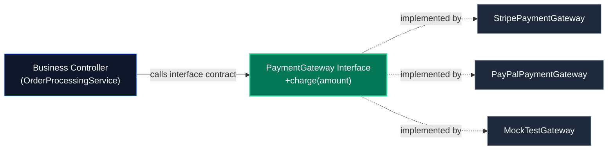
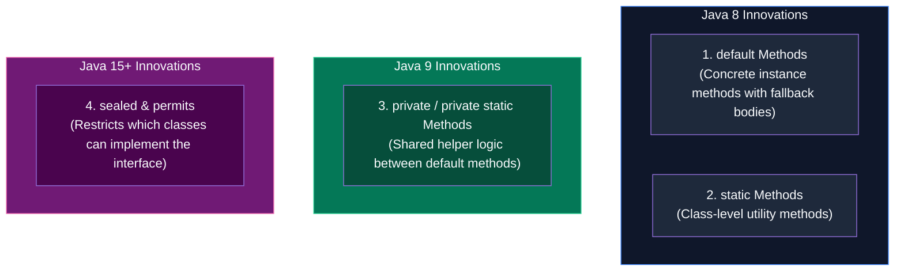

When you plug a lamp into a wall socket, you do not think about the coal plant forty miles away, the high-voltage step-down transformers in your neighborhood, or the alternating current oscillating at 60 Hz through copper wires.

You see two prongs and a standardized outlet. You plug it in, and light turns on.

The electrical grid has established an **Abstraction**: a strict, standardized contract that completely separates **what** you receive (120 volts of electricity) from **how** that electricity was generated.

In software engineering, **Abstraction is how we keep multi-million-line codebases from collapsing under their own complexity.**

Without abstraction, your business logic would be tangled with low-level HTTP socket sockets, raw SQL database connections, and specific payment vendor SDKs. If Stripe changes their API tomorrow, your entire company would have to rewrite hundreds of business files.

In Java, abstraction is realized through two distinct mechanisms: **Abstract Classes** and **Interfaces**. 

Let's explore how these tools work, the hidden memory traps of abstract constructors, how modern Java solved multiple inheritance collisions, and how to design clean, evolvable software contracts.

---

## The Core Concept: Contracts vs. Implementations

Abstraction is the deliberate act of hiding volatile implementation mechanics behind a stable, immutable interface.



Notice what this architectural seam accomplishes:
- `OrderProcessingService` has zero knowledge of Stripe or PayPal. It only knows `PaymentGateway`.
- When unit testing, you can swap Stripe with `MockTestGateway` in one line without changing a single character of production business logic.
- If your company migrates to Adyen next quarter, you write one new adapter class and delete the old one.

---

## Abstract Classes: The Incomplete Blueprint

An **Abstract Class** is a class marked with the `abstract` keyword. It represents a conceptual foundation that is incomplete on its own. 

Because it is incomplete, **the JVM strictly forbids instantiating an abstract class directly**:

```java
// ❌ COMPILE ERROR! Cannot instantiate abstract class
PaymentProcessor processor = new PaymentProcessor(); 
```

An abstract class can contain:
1. **Concrete Methods:** Fully implemented methods shared across all child classes.
2. **Abstract Methods:** Method signatures without a body (`abstract void process();`), forcing every concrete subclass to provide its own implementation.
3. **Instance State:** Instance fields, protected members, and full constructors.

```java
public abstract class ReportGenerator {
    // Shared state
    protected final String reportTitle;
    protected final Instant generatedAt;

    // Constructor to initialize shared state
    public ReportGenerator(String reportTitle) {
        this.reportTitle = reportTitle;
        this.generatedAt = Instant.now();
    }

    // Concrete method: Common across all reports
    public void printHeader() {
        System.out.println("=== " + reportTitle + " (Generated: " + generatedAt + ") ===");
    }

    // Abstract method: Every format must implement its own export logic!
    public abstract void export(List<String> data);
}
```

---

## Architectural Masterclass: The Template Method Pattern

The greatest architectural superpower of an abstract class is the **Template Method Pattern**. 

Imagine you are processing banking transactions. Every transaction must follow four strict steps:
1. Authenticate the user.
2. Validate account balance.
3. Execute the ledger update.
4. Send an audit log.

If you let every developer write this from scratch, someone will inevitably forget to validate the balance or omit the audit log. 

With an abstract class, you can lock the overarching algorithm into a `final` method, delegating only the custom steps to subclasses:

```java
public abstract class TransactionWorkflow {

    // The Template Method: Final to prevent subclasses from altering the security sequence!
    public final void executeTransaction(String accountId, double amount) {
        authenticateUser(accountId);
        validateLimits(accountId, amount);
        executeLedgerEntry(accountId, amount); // Subclass step
        recordAuditLog(accountId, amount);
    }

    private void authenticateUser(String accountId) {
        System.out.println("1. Security: Authenticating token for " + accountId);
    }

    private void validateLimits(String accountId, double amount) {
        System.out.println("2. Compliance: Validating velocity limits for $" + amount);
    }

    // The polymorphic hook: Subclasses specialize this specific behavior!
    protected abstract void executeLedgerEntry(String accountId, double amount);

    private void recordAuditLog(String accountId, double amount) {
        System.out.println("4. Audit: Ledger updated successfully for " + accountId);
    }
}
```

Now, whether a developer implements `WireTransferWorkflow` or `CryptoWithdrawalWorkflow`, the security checks and audit logging are guaranteed to run in the exact required order!

---

## The Dangerous Trap: Calling Overridable Methods in Constructors

Here is a legendary bug that catches even experienced Java engineers off guard. 

Look at this code:

```java
public abstract class Parent {
    public Parent() {
        // ❌ DEADLY HAZARD: Calling an overridable method inside a constructor!
        init(); 
    }

    public abstract void init();
}

public class Child extends Parent {
    // Child field initialized to "CUSTOM_VALUE"
    private String config = "CUSTOM_VALUE";

    @Override
    public void init() {
        System.out.println("Config value length: " + config.length());
    }

    public static void main(String[] args) {
        new Child(); // What happens?!
    }
}
```

When you run this code, it does **not** print `12`. 

**It crashes with a `NullPointerException`!**

Why?
Remember the constructor chaining sequence:
1. `new Child()` begins execution.
2. The `Parent()` constructor executes **first**, before `Child`'s fields are initialized.
3. `Parent()` calls `init()`.
4. Because the runtime object is `Child`, dynamic polymorphism dispatches to `Child.init()`.
5. But `Child` has not finished initializing its fields yet! `config` is still `null`! `config.length()` explodes with an NPE.

> [!CAUTION]
> **The Constructor Invariant:**
> Never call overridable (`non-final`, `non-private`) methods from inside a constructor. Only invoke private or final methods during object construction.

---

## Interfaces: The Universal Contract

If an abstract class is an incomplete entity, an **Interface** is a pure capability contract.

Historically (prior to Java 8), an interface was a 100% abstract specification:
- No instance fields allowed (any fields declared are implicitly `public static final` constants).
- No constructors allowed.
- All methods were implicitly `public abstract`.

```java
public interface AutoCloseable {
    void close() throws Exception;
}
```

Any class that declares `implements AutoCloseable` makes a binding public promise to supply a `close()` method.

---

## Modern Interface Evolution: Java 8 to Java 21

As Java matured, maintaining large libraries with pure interfaces became problematic. If Oracle wanted to add a `.stream()` method to `java.util.Collection`, adding an abstract method would instantly break every custom collection ever written since 1996.

To allow interfaces to evolve without breaking backward compatibility, Java modernized interfaces across three major releases:



### 1. `default` Methods
You can now provide a default method body directly inside an interface:

```java
public interface NotificationChannel {
    void send(String message);

    // Default method: Implementing classes can use this as-is or override it!
    default void sendWithRetry(String message, int retries) {
        for (int i = 0; i < retries; i++) {
            try {
                send(message);
                return;
            } catch (Exception e) {
                System.err.println("Retry " + (i + 1) + " failed...");
            }
        }
    }
}
```

### 2. Resolving Default Method Collisions
What happens if a class implements two interfaces that both declare the exact same `default` method?

```java
interface Left {
    default void ping() { System.out.println("Left"); }
}

interface Right {
    default void ping() { System.out.println("Right"); }
}

// ❌ COMPILE ERROR: Class inherits unrelated defaults for ping() from types Left and Right
public class DisambiguationDemo implements Left, Right {
    // You MUST override the method and explicitly choose or resolve!
    @Override
    public void ping() {
        Left.super.ping(); // Explicitly delegates to Left's default implementation
    }
}
```

### The Three Rules of Default Method Resolution:
1. **Classes Beat Interfaces:** If a superclass defines a concrete method, it always overrides any interface `default` method with the same signature.
2. **Sub-Interfaces Beat Super-Interfaces:** If `B extends A`, `B`'s default method wins.
3. **Explicit Disambiguation:** If neither rule applies, the compiler halts and forces you to override the method manually using `InterfaceName.super.methodName()`.

---

## Sealed Interfaces: Algebraic Type Hierarchies (Java 15+)

Historically, anyone could implement any public interface. But what if your domain model represents a closed set of states—like an HTTP response or an OAuth2 token grant?

In **Java 15/17 LTS**, Java introduced **Sealed Interfaces**:

```java
public sealed interface PaymentStatus 
    permits PaymentStatus.Success, PaymentStatus.Failed, PaymentStatus.Pending {

    record Success(String transactionId, long timestamp) implements PaymentStatus {}
    record Failed(String errorCode, String reason) implements PaymentStatus {}
    record Pending(int queuePosition) implements PaymentStatus {}
}
```

By sealing the interface, the compiler knows every possible implementation that can ever exist. In **Java 21 LTS**, this enables **exhaustive switch pattern matching** with zero boilerplate:

```java
public String handleStatus(PaymentStatus status) {
    // No 'default' branch needed! The compiler proves all cases are covered:
    return switch (status) {
        case PaymentStatus.Success s -> "Payment succeeded: " + s.transactionId();
        case PaymentStatus.Failed f -> "Declined: " + f.reason();
        case PaymentStatus.Pending p -> "Queued at position: " + p.queuePosition();
    };
}
```

---

## Abstract Class vs. Interface: The Decision Matrix

| Dimension | Abstract Class | Interface |
| :--- | :--- | :--- |
| **Relationship** | Strict "Is-A" (specialization) | "Can-Do" (capability contract) |
| **State** | Can hold mutable/immutable instance fields | No instance state (only static constants) |
| **Constructors** | Yes (invoked via `super()`) | No constructors allowed |
| **Inheritance** | Single inheritance only (`extends`) | Multiple inheritance of types (`implements`) |
| **Evolution** | Adding concrete methods doesn't break children | Adding default methods doesn't break implementors |
| **Primary Use Case** | Code sharing + Template Method pattern | Decoupled contracts, APIs, and plugins |

---

## Summary & Mental Model Checkpoint

1. **Abstraction**: Separates *what* a component does from *how* it does it, decoupling systems from concrete dependencies.
2. **Abstract Classes**: Incomplete entities that share state and logic; instantiated only as part of concrete child instances.
3. **Template Method Pattern**: Locks overall algorithmic workflow into final methods while delegating custom steps to abstract hooks.
4. **Constructor Trap**: Never call overridable methods inside a constructor, as child fields are not yet initialized.
5. **Modern Interfaces**: Java 8 added `default`/`static` methods; Java 9 added `private` helpers; Java 15/17 added `sealed` hierarchies.
6. **Default Conflict Rule**: Classes beat interfaces; sub-interfaces beat super-interfaces; identical peers require explicit `Interface.super.method()` overrides.

---

## 🎯 Senior Engineer Interview Questions

### Why can't an abstract class be instantiated directly, yet it is allowed to define constructors?
> **Answer:** An abstract class is conceptually incomplete and may contain abstract methods lacking bytecode implementations; allowing direct instantiation via `new` would risk invoking unimplemented operations at runtime. However, abstract classes frequently define instance state (fields) and initialization invariants. When a concrete subclass is instantiated, constructor chaining mandates that the subclass constructor invokes `super()` to execute the abstract class's constructor, ensuring the foundational state is properly initialized.

### How does Java resolve conflicts when a class inherits multiple `default` methods with identical signatures?
> **Answer:** Java follows a strict three-tier resolution hierarchy:
> 1. **Class wins:** A concrete implementation in a superclass always takes precedence over any interface default method.
> 2. **Sub-interface wins:** If an interface extends another interface and overrides its default method, the most specific sub-interface implementation wins.
> 3. **Manual disambiguation:** If two unrelated interfaces provide conflicting defaults, the compiler rejects the class with an error, requiring the developer to explicitly override the method and resolve the ambiguity (often delegating via `InterfaceName.super.methodName()`).

### What is the subtle danger of invoking an overridable method from inside an abstract class constructor?
> **Answer:** In Java, superclass constructors execute before subclass instance fields are initialized. If an abstract class constructor calls an overridable method, dynamic method dispatch routes the call to the subclass's overridden implementation. Because the subclass constructor has not yet run, any subclass instance fields accessed within that method will hold default zero/null values rather than their intended initial values, leading to `NullPointerException`s or severe data corruption.

### How do Java 17 Sealed Interfaces enhance the compiler's ability to perform exhaustive pattern matching in Java 21?
> **Answer:** A sealed interface uses the `permits` clause to declare a closed, finite set of permitted implementations at compile time. In Java 21 switch expressions, the compiler can mathematically verify that all permitted subclasses or records are handled. Because the hierarchy is closed, the compiler does not require a fallback `default` branch and can issue a compile-time error if a new permitted subtype is added later without updating the switch statement.
