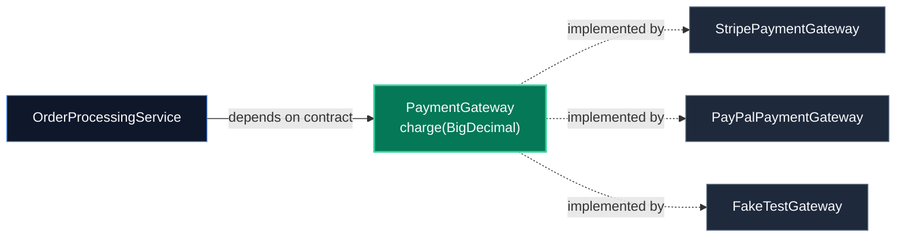
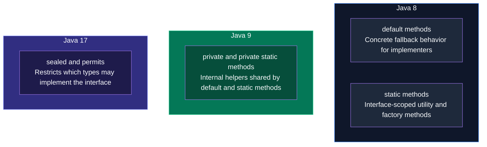

When a service charges a customer's credit card, the order-processing logic should not care whether the underlying network call talks to Stripe's REST API, PayPal's SDK, or an in-memory stub during a unit test. If the vendor changes its SDK or your team switches payment providers, only the adapter talking to that vendor should need to change.

That separation between **what** an operation promises to do and **how** it is carried out is **abstraction**. In Java, you build abstractions using two language constructs: **abstract classes** and **interfaces**. Both let you hide implementation details behind a stable type, but they serve different design needs and follow different rules in the type system.

---

## Separating Contracts from Implementations

Before comparing syntax, look at the dependency boundary an abstraction creates in a typical backend application:



Because `OrderProcessingService` only references `PaymentGateway`, three practical things become straightforward:

- Production code stays decoupled from third-party libraries and transport details.
- Unit tests can pass a `FakeTestGateway` without spinning up HTTP servers or hitting external sandboxes.
- Adding a new provider means writing a new implementing class rather than editing existing checkout flows.

---

## Abstract Classes and Abstract Methods

An **abstract class** is a class declared with the `abstract` modifier. It models a shared base concept that is intentionally incomplete on its own.

Because part of its behavior may be left unimplemented, Java does not allow you to instantiate an abstract class directly with `new`:

```java
public abstract class ReportGenerator {
    protected final String reportTitle;
    protected final Instant generatedAt;

    public ReportGenerator(String reportTitle) {
        this.reportTitle = reportTitle;
        this.generatedAt = Instant.now();
    }

    // Concrete method shared by every subclass
    public String formatHeader() {
        return "=== " + reportTitle + " (Generated: " + generatedAt + ") ===";
    }

    // Abstract method: subclasses must supply the body
    public abstract byte[] export(List<String> rows);
}

// Compile error: ReportGenerator is abstract; cannot be instantiated
// ReportGenerator generator = new ReportGenerator("Q4 Sales");
```

An abstract class can declare everything a normal class can:

- **Instance fields** (mutable or `final`) with any access modifier (`private`, package-private, `protected`, `public`).
- **Constructors**, which cannot be called directly via `new` on the abstract type, but are invoked via `super(...)` when a concrete subclass is instantiated.
- **Concrete methods** that implement shared logic once.
- **Abstract methods** declared without a body, forcing any concrete subclass to implement them (otherwise the subclass must also be declared `abstract`).

A concrete subclass supplies the missing pieces and inherits the shared state and methods:

```java
import java.nio.charset.StandardCharsets;
import java.util.List;

public class CsvReportGenerator extends ReportGenerator {

    public CsvReportGenerator(String reportTitle) {
        super(reportTitle);
    }

    @Override
    public byte[] export(List<String> rows) {
        String body = formatHeader() + "\n" + String.join("\n", rows);
        return body.getBytes(StandardCharsets.UTF_8);
    }
}
```

### Enforcing a Fixed Workflow with the Template Method Pattern

One of the clearest uses for an abstract class is the **Template Method** pattern. Suppose every financial transfer must run the same sequence of steps: authenticate the caller, check velocity limits, write the ledger entry, and record an audit event. Only the ledger step differs between a wire transfer and an internal account transfer.

You can mark the workflow method `final` so subclasses cannot skip or reorder the mandatory checks, while exposing a `protected abstract` hook for the step that varies:

```java
import java.math.BigDecimal;

public abstract class TransferWorkflow {

    public final void execute(String accountId, BigDecimal amount) {
        authenticate(accountId);
        validateLimits(accountId, amount);
        postLedgerEntry(accountId, amount);
        writeAuditLog(accountId, amount);
    }

    private void authenticate(String accountId) {
        System.out.println("Authenticating request for account " + accountId);
    }

    private void validateLimits(String accountId, BigDecimal amount) {
        if (amount.signum() <= 0) {
            throw new IllegalArgumentException("Amount must be positive");
        }
    }

    // Subclasses customize only this step
    protected abstract void postLedgerEntry(String accountId, BigDecimal amount);

    private void writeAuditLog(String accountId, BigDecimal amount) {
        System.out.println("Audit recorded for account " + accountId + ": " + amount);
    }
}
```

Every subclass inherits the fixed guardrails automatically, and its code stays focused strictly on its own ledger mechanics.

### Constructor Pitfall: Calling Overridable Methods

A subtle bug shows up when an abstract class constructor calls an abstract or non-final method:

```java
public abstract class BaseService {
    protected BaseService() {
        // Risky: calls an overridden method before the subclass is initialized
        initialize();
    }

    protected abstract void initialize();
}

public class AuditService extends BaseService {
    private final String destination = "audit-log";

    @Override
    protected void initialize() {
        // Throws NullPointerException!
        System.out.println("Destination length: " + destination.length());
    }

    public static void main(String[] args) {
        new AuditService();
    }
}
```

Running `new AuditService()` throws a `NullPointerException`. Here is why:

1. `new AuditService()` allocates the object with all fields set to their default values (`destination` is `null`).
2. `AuditService`'s constructor invokes `super()` (`BaseService()`) before running `AuditService`'s field initializers or constructor body.
3. `BaseService()` calls `initialize()`, which dispatches dynamically to `AuditService.initialize()`.
4. Inside `AuditService.initialize()`, `destination` is still `null`, so `destination.length()` fails.

> [!CAUTION]
> Never call overridable (non-`private`, non-`final`) methods from a constructor. Limit constructor calls to `private` or `final` helpers so subclasses cannot observe a half-initialized object.

---

## Interfaces and Multiple Inheritance of Types

An **interface** defines a capability contract without tying implementing classes to a specific parent class or shared instance state.

```java
public interface PaymentGateway {
    // Implicitly public abstract
    Receipt charge(String customerId, BigDecimal amount);
}
```

Any field declared in an interface is implicitly `public static final` (a compile-time or class-level constant). Interfaces cannot have constructors and cannot hold per-instance fields.

### Multiple Inheritance of Types

Java intentionally restricts classes to **single inheritance** (`class A extends B`). If a class could extend two classes that each had their own instance fields and state invariants, managing shared superclass state and constructor ordering would become complex and error-prone (the classic diamond inheritance problem of state).

Interfaces avoid that problem because they carry no instance state. As a result, a Java class can implement any number of interfaces, and an interface can extend multiple parent interfaces:

```java
public interface Auditable {
    String auditId();
}

public interface Retryable {
    int maxAttempts();
}

public interface Exportable extends Auditable, Retryable {
    byte[] toCsv();
}

public class InvoiceJob implements Auditable, Retryable {
    private final String invoiceId;

    public InvoiceJob(String invoiceId) {
        this.invoiceId = invoiceId;
    }

    @Override
    public String auditId() {
        return "INV-" + invoiceId;
    }

    @Override
    public int maxAttempts() {
        return 3;
    }
}
```

This is **multiple inheritance of types**: a single `InvoiceJob` instance can be passed to any method expecting an `Auditable`, a `Retryable`, or an `Object`, without forcing `InvoiceJob` into a rigid class tree.

---

## Default, Static, and Private Methods in Interfaces

Before Java 8, interfaces could only contain abstract methods and constants. That created a real library evolution problem: adding a new method like `stream()` to `java.util.Collection` would have broken every custom `Collection` implementation written over the previous two decades.

Java extended interfaces in stages to solve library evolution and reduce helper boilerplate:



### Default Methods (Java 8+)

A `default` method includes a concrete body inside the interface. Implementing classes inherit it automatically and can override it if they need custom behavior:

```java
public interface NotificationChannel {
    void send(String message);

    default void sendWithRetry(String message, int maxAttempts) {
        int attempt = 0;
        while (true) {
            try {
                attempt++;
                send(message);
                return;
            } catch (RuntimeException ex) {
                if (attempt >= maxAttempts) {
                    throw ex;
                }
            }
        }
    }
}
```

### Static Methods (Java 8+)

Interface `static` methods let you keep factory and utility methods next to the interface they serve, instead of maintaining a separate companion class (the older `Collection` / `Collections` split):

```java
import java.util.Objects;

public interface DiscountPolicy {
    double apply(double price);

    static DiscountPolicy none() {
        return price -> price;
    }

    static DiscountPolicy percentageOff(double percent) {
        if (percent < 0 || percent > 100) {
            throw new IllegalArgumentException("Percent must be between 0 and 100");
        }
        return price -> price * (1.0 - percent / 100.0);
    }

    static DiscountPolicy combine(DiscountPolicy first, DiscountPolicy second) {
        Objects.requireNonNull(first);
        Objects.requireNonNull(second);
        return price -> second.apply(first.apply(price));
    }
}
```

Note one important rule: **static interface methods are not inherited** by implementing classes or sub-interfaces. Callers always invoke them through the declaring interface name (`DiscountPolicy.percentageOff(10)`).

### Private Interface Methods (Java 9+)

Once interfaces could hold multiple `default` and `static` methods, duplicated helper logic quickly became an issue. Making a helper `default` would expose it as part of the public API and allow subclasses to override it.

Java 9 added `private` and `private static` methods inside interfaces so you can factor out internal helpers without leaking them to callers:

```java
import java.time.Instant;

public interface AuditLogger {
    void write(String formattedLine);

    default void logInfo(String message) {
        write(formatEntry("INFO", message));
    }

    default void logError(String message) {
        write(formatEntry("ERROR", message));
    }

    // Internal helper: hidden from implementing classes and callers
    private String formatEntry(String level, String message) {
        return "[" + Instant.now() + "] [" + level + "] " + sanitize(message);
    }

    private static String sanitize(String message) {
        return message == null ? "" : message.replace("\n", " ");
    }
}
```

A `private` instance method can call other `private`, `default`, or abstract methods on the interface; a `private static` method can be called from both `static` and `default` methods.

### Resolving Default Method Diamond Conflicts

Because a class can implement multiple interfaces, two interfaces can declare `default` methods with the exact same signature. Java resolves these collisions using three deterministic rules:

1. **A class always wins over an interface.** If a superclass (or the class itself) provides a concrete method, it overrides any matching `default` method from implemented interfaces.
2. **A more specific sub-interface wins over a super-interface.** If `SubInterface extends BaseInterface` and both define `default void log()`, `SubInterface`'s implementation wins.
3. **Unrelated conflicting defaults cause a compile-time error.** The implementing class must override the method and resolve the ambiguity explicitly, using `InterfaceName.super.methodName(...)` if it wants to delegate to one or both defaults.

```java
interface ConsoleOutput {
    default void emit(String text) {
        System.out.println("Console: " + text);
    }
}

interface FileOutput {
    default void emit(String text) {
        System.out.println("File: " + text);
    }
}

public class DualOutput implements ConsoleOutput, FileOutput {
    // Required: without this override, javac rejects the class
    @Override
    public void emit(String text) {
        ConsoleOutput.super.emit(text);
        FileOutput.super.emit(text);
    }
}
```

The syntax `ConsoleOutput.super.emit(text)` targets the specific super-interface's default method directly. Note that you can only use `InterfaceName.super` for a direct super-interface, not to reach past a closer sub-interface that already overrode the method.

---

## Sealed Interfaces at a Glance (Java 17+)

Normally, any `public` interface can be implemented by any class anywhere in the classpath. Starting with Java 17 (finalized in JEP 409 after previews in Java 15 and 16), you can mark an interface or abstract class `sealed` and list its exact permitted subtypes with `permits`:

```java
public sealed interface PaymentStatus
        permits PaymentStatus.Success, PaymentStatus.Failed, PaymentStatus.Pending {

    record Success(String transactionId) implements PaymentStatus {}
    record Failed(String errorCode, String reason) implements PaymentStatus {}
    record Pending(int queuePosition) implements PaymentStatus {}
}
```

Because the set of implementations is closed, Java 21 `switch` expressions can check exhaustiveness without requiring a catch-all `default` branch. We cover sealed hierarchies, `non-sealed`, and pattern matching in full in the *Sealed Classes and Pattern Matching* lesson.

---

## When to Choose an Abstract Class vs. an Interface

In day-to-day Java code, **start with an interface** when defining a public contract or capability. Reach for an abstract class only when you specifically need shared instance state, controlled construction, or a skeletal base implementation for closely related classes.

| Dimension | Abstract Class | Interface |
| :--- | :--- | :--- |
| **Design intent** | Shared identity and partial implementation ("is-a") | Shared capability or contract ("can-do") |
| **Instance state** | Allowed (instance fields with any visibility) | Not allowed (only `public static final` constants) |
| **Constructors** | Allowed (run via `super(...)` from subclasses) | Not allowed |
| **Inheritance** | Single (`extends` one class) | Multiple (`implements` many interfaces) |
| **Method visibility** | `public`, `protected`, package-private, `private` | `public` (default/abstract/static) or `private` helpers (Java 9+) |
| **Typical use** | Template Method workflows, skeletal implementations (`AbstractList`) | Service APIs, strategies, callbacks, mixins (`Comparable`, `AutoCloseable`) |

Notice how the JDK itself combines both tools: `java.util.List` is an **interface** defining the public contract, while `java.util.AbstractList` is an **abstract skeletal implementation** that custom list authors can optionally extend to save effort without forcing every `List` implementation to inherit from it.

---

## Recap

- Abstraction hides volatile implementation details behind a stable type boundary.
- Abstract classes hold shared instance state, constructors, concrete methods, and abstract hooks (making them a natural fit for the Template Method pattern), but support only single inheritance.
- Never call overridable methods from a constructor; subclass fields are not initialized yet when the superclass constructor runs.
- Interfaces enable multiple inheritance of types and support `default` and `static` methods (Java 8+), `private` helper methods (Java 9+), and `sealed` restrictions (Java 17+).
- When two interfaces define conflicting `default` methods, Java resolves them by class-over-interface, sub-interface-over-super-interface, or explicit override using `InterfaceName.super.method()`.

---

## Interview Questions

### Why can an abstract class declare constructors if it cannot be instantiated directly?
An abstract class can define instance fields and invariants that every concrete subclass depends on. When you create an instance of a concrete subclass, Java's constructor chaining runs the abstract superclass constructor via `super(...)` first, ensuring the inherited fields are properly initialized before subclass code runs.

### How does Java resolve conflicts when a class inherits two `default` methods with the same signature?
Java applies three rules in order. First, a concrete method in the class or any superclass beats any interface `default` method. Second, if one interface extends the other, the more specific sub-interface's `default` method wins. Third, if the two interfaces are unrelated, compilation fails until the implementing class overrides the method and resolves the conflict explicitly, optionally delegating with `InterfaceName.super.method()`.

### Why did Java 9 add `private` methods to interfaces?
Java 8 allowed `default` and `static` methods in interfaces, which meant interfaces could contain real implementation code. Without `private` methods, any shared helper extracted from two `default` methods had to be `public` (either another `default` method or a `static` method), polluting the interface's public API. Private and private static methods let interface authors share helper logic internally without exposing it to callers or implementers.

### When would you still choose an abstract class over an interface with `default` methods?
Choose an abstract class when subclasses need shared mutable or immutable instance state, non-public helper methods (`protected` or package-private), constructors that enforce initialization invariants, or `final` template methods that subclasses must not override. Default methods in interfaces cannot declare instance fields, cannot be `final`, and cannot be `protected`.
