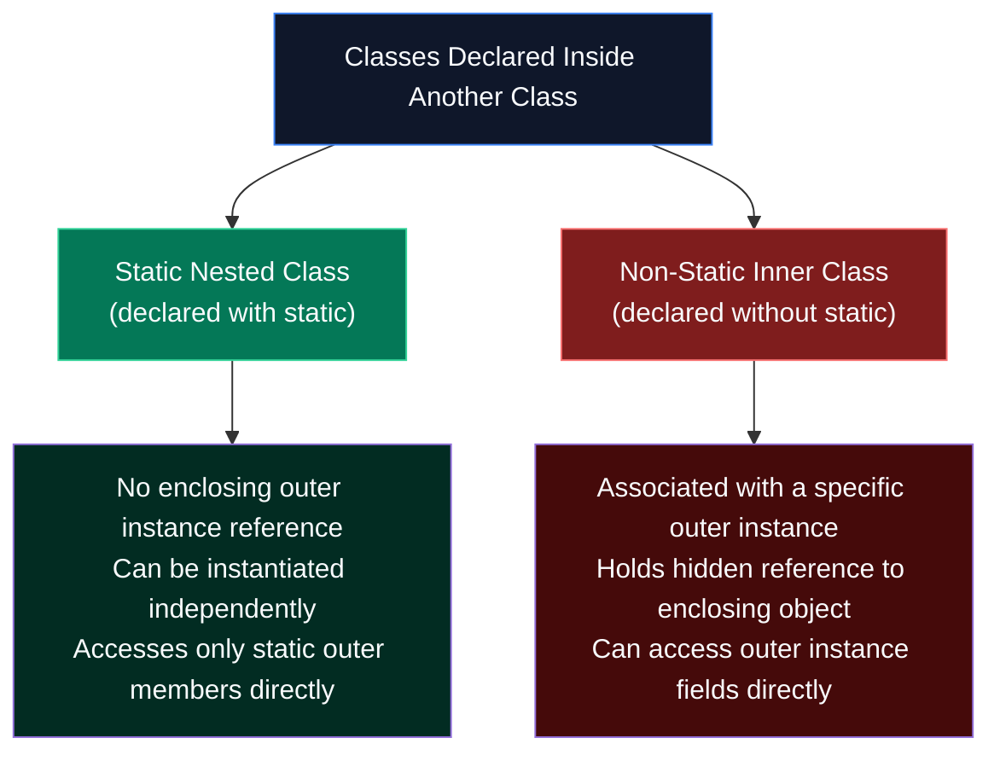
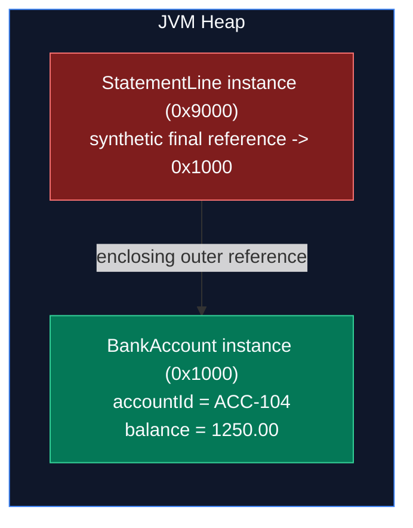

Most classes in a Java project live as top-level types in their own `.java` files. Sometimes, though, a helper type only exists to support one enclosing class, such as the internal `Node` inside a `LinkedList`, an `Entry` inside a `Map`, or a `Builder` paired with an immutable configuration object. Turning every helper into a public top-level class clutters the package namespace and weakens encapsulation.

Java gives you **nested classes** for grouping tightly related types, **anonymous inner classes** for one-off inline implementations, and **records** (previewed in Java 14 and finalized in Java 16) for concise, immutable data carriers. Each has specific memory and lifecycle rules that matter in production code.

---

## Nested Classes: Static vs. Non-Static Inner Classes

A class declared inside another class falls into one of two broad categories: **static nested classes** and **non-static inner classes** (which include member inner classes, local classes, and anonymous classes).

The presence or absence of `static` changes how the object behaves on the heap:



### Static Nested Classes

A **static nested class** behaves like a regular top-level class that happens to be scoped inside an enclosing class's namespace. It has no implicit reference to an instance of the outer class, and it can access `private static` members of the outer class directly (and private instance members if given an explicit outer object reference).

The Builder pattern is one of the most common uses:

```java
public class DatabaseClient {
    private final String url;
    private final int maxPoolSize;

    private DatabaseClient(Builder builder) {
        this.url = builder.url;
        this.maxPoolSize = builder.maxPoolSize;
    }

    public static class Builder {
        private String url;
        private int maxPoolSize = 10;

        public Builder url(String url) {
            this.url = url;
            return this;
        }

        public Builder maxPoolSize(int maxPoolSize) {
            this.maxPoolSize = maxPoolSize;
            return this;
        }

        public DatabaseClient build() {
            if (url == null || url.isBlank()) {
                throw new IllegalStateException("Database URL is required");
            }
            return new DatabaseClient(this);
        }
    }
}
```

Callers can create the builder without first creating a `DatabaseClient`:

```java
DatabaseClient client = new DatabaseClient.Builder()
        .url("jdbc:postgresql://localhost:5432/orders")
        .maxPoolSize(20)
        .build();
```

### Non-Static Member Inner Classes and the `this$0` Reference

When you omit `static`, the nested class becomes a **member inner class**. Every instance of a member inner class belongs to a specific instance of the enclosing class:

```java
public class BankAccount {
    private final String accountId;
    private double balance;

    public BankAccount(String accountId, double initialBalance) {
        this.accountId = accountId;
        this.balance = initialBalance;
    }

    // Non-static inner class: bound to a specific BankAccount instance
    public class StatementLine {
        public String summary() {
            // Reads private instance fields of the enclosing BankAccount directly
            return accountId + " current balance: " + balance;
        }
    }
}
```

Outside `BankAccount`, instantiating `StatementLine` requires an existing outer object:

```java
BankAccount account = new BankAccount("ACC-104", 1250.00);
BankAccount.StatementLine line = account.new StatementLine();
```

How does `StatementLine` read `accountId` and `balance` when it compiles to its own separate class file (`BankAccount$StatementLine.class`)?

Under the hood, the `javac` compiler generates a hidden synthetic `final` field in the inner class (conventionally named `this$0`) and passes the enclosing `BankAccount` reference into the inner class's constructor. Inside `StatementLine`, references to `balance` read through that hidden outer reference (which you can also reference explicitly in source code as `BankAccount.this`).



### How a Non-Static Inner Class Causes a Memory Leak

That hidden outer reference is the source of a classic Java memory leak. Because the inner object keeps a strong reference to its enclosing outer object, **the garbage collector cannot reclaim the outer object as long as the inner object stays reachable**.

Consider an order processor that holds a large buffer in memory and submits a background task to a shared queue:

```java
public class OrderBatchProcessor {
    // 50 MB working buffer used during batch processing
    private final byte[] workingBuffer = new byte[50 * 1024 * 1024];
    private final String batchId;

    public OrderBatchProcessor(String batchId) {
        this.batchId = batchId;
    }

    public Runnable createCompletionTask() {
        return new CompletionNotifier();
    }

    // Problem: non-static inner class retains a strong reference to OrderBatchProcessor
    private class CompletionNotifier implements Runnable {
        @Override
        public void run() {
            System.out.println("Finished batch " + batchId);
        }
    }
}
```

Once batch processing finishes, your application drops its reference to `OrderBatchProcessor`, expecting the 50 MB `workingBuffer` to be garbage collected. However, `CompletionNotifier` is still sitting in a delayed executor queue waiting to run. Because `CompletionNotifier` holds a synthetic `this$0` pointer back to `OrderBatchProcessor`, the entire 50 MB buffer stays pinned in heap memory until that task finishes and is discarded. If hundreds of batches are queued, the heap fills up and throws `OutOfMemoryError`.

The fix is straightforward: declare `CompletionNotifier` as a `static` nested class and pass only the small `String batchId` it actually needs into its constructor.

> [!TIP]
> Follow *Effective Java* Item 24: **always declare a nested class `static` unless it genuinely needs access to an enclosing instance.** Even when a newer compiler (JDK 18+) can omit an unused outer reference in certain cases, declaring the class `static` makes the independence explicit and prevents a future edit from silently reintroducing the retention bug.

---

## Local Classes and Anonymous Inner Classes

Java also lets you declare classes inside a method or block.

### Local Classes

A **local class** is a named class declared inside a method body. You occasionally see them when a method needs a short helper type with multiple methods or custom state that is useless anywhere else:

```java
public void processNames(List<String> names) {
    class NormalizedName {
        final String original;
        final String key;

        NormalizedName(String original) {
            this.original = original;
            this.key = original.trim().toLowerCase();
        }
    }

    List<NormalizedName> items = names.stream()
            .map(NormalizedName::new)
            .toList();
    // use items locally
}
```

### Anonymous Inner Classes

An **anonymous inner class** declares and instantiates a one-off subclass or interface implementation in a single expression without giving it a class name:

```java
import java.util.Comparator;
import java.util.List;

public class AnonymousExample {
    public void sortByLength(List<String> words) {
        words.sort(new Comparator<String>() {
            @Override
            public int compare(String a, String b) {
                return Integer.compare(a.length(), b.length());
            }
        });
    }
}
```

Since Java 8, lambda expressions (`(a, b) -> Integer.compare(a.length(), b.length())`) have replaced most anonymous classes that implement a single-method functional interface. However, anonymous inner classes are still required when you need to:

- Extend an abstract or concrete class on the fly.
- Implement an interface with **two or more** abstract methods.
- Hold mutable instance fields inside the inline implementation.

Also watch out for two subtle differences between anonymous classes and lambdas: inside an anonymous class, `this` refers to the anonymous class instance itself (whereas in a lambda, `this` refers to the enclosing class); and an anonymous class created inside an instance method can also capture the enclosing instance, carrying the same memory-retention risk as a non-static inner class.

### Why Captured Local Variables Must Be Effectively Final

Both local classes and anonymous inner classes (as well as lambdas) can read local variables and parameters from their enclosing method, provided those variables are `final` or **effectively final** (assigned once and never reassigned):

```java
public Runnable createAuditTask(String transactionId, double amount) {
    // Reassigning amount here would cause a compile error because the anonymous class captures it:
    // amount = amount * 1.05;

    return new Runnable() {
        @Override
        public void run() {
            System.out.println("Audited " + transactionId + " for amount " + amount);
        }
    };
}
```

If you uncomment `amount = amount * 1.05;`, `javac` fails with:

```text
local variables referenced from an inner class must be final or effectively final
```

The reason comes down to stack vs. heap lifetimes. `transactionId` and `amount` live in the current method's **stack frame**, which disappears as soon as `createAuditTask()` returns. The `Runnable` object lives on the **heap** and may run minutes later on a different thread.

To make that work, the compiler copies the values of `transactionId` and `amount` into hidden fields inside the heap-allocated `Runnable`. Because there are now two separate copies (one on the stack and one inside the object on the heap), Java forbids mutating the local variable so the two copies can never silently drift out of sync.

---

## Records: Immutable Data Carriers (Java 16+)

Historically, modeling a simple immutable data holder in Java took dozens of lines of repetitive code: `private final` fields, a constructor, getters, `equals`, `hashCode`, and `toString`. Every time you added a field, you had to remember to update all of them.

**Records** were introduced as a preview feature in **Java 14** (JEP 359) and **Java 15** (JEP 384), and finalized as a standard language feature in **Java 16** (JEP 395). A record declares a transparent, shallowly immutable carrier of a fixed set of values in one line:

```java
public record CustomerProfile(String id, String email) {}
```

From that declaration, `javac` automatically generates:

- A `final` class that implicitly extends `java.lang.Record`.
- A `private final` field for each component (`id` and `email`).
- A **canonical constructor** `CustomerProfile(String id, String email)` that assigns every component.
- Public accessor methods matching the component names (`id()` and `email()`, without a `get` prefix).
- Component-wise implementations of `equals()`, `hashCode()`, and `toString()` (implemented via `invokedynamic` and `java.lang.runtime.ObjectMethods` in modern JDKs).

### Compact Constructors, Validation, and Defensive Copying

Records are not restricted to unvalidated bags of fields. You can validate or normalize inputs using a **compact constructor**, which omits the parameter list and automatically assigns the fields at the end of its body:

```java
import java.math.BigDecimal;
import java.util.List;
import java.util.Objects;

public record OrderSummary(String orderId, BigDecimal total, List<String> itemSkus) {

    // Compact constructor: runs before fields are assigned
    public OrderSummary {
        Objects.requireNonNull(orderId, "orderId is required");
        if (total == null || total.signum() < 0) {
            throw new IllegalArgumentException("Total cannot be negative");
        }
        // Defensive copy: records are only shallowly immutable by default
        itemSkus = List.copyOf(itemSkus);
    }

    // You can still add custom instance or static methods
    public int itemCount() {
        return itemSkus.size();
    }
}
```

Pay close attention to `itemSkus = List.copyOf(itemSkus)`. A record makes its component *references* `final`, which means **records are shallowly immutable**. If a component holds a mutable `ArrayList`, `Date`, or `byte[]`, callers can still mutate the contents of that list or array unless you copy it defensively in the compact constructor.

### What Records Can and Cannot Do

Because a record's header is the complete specification of its state, Java enforces a few clear boundaries:

- **Allowed:** implementing interfaces, adding instance methods, adding `static` fields and `static` methods, defining compact or custom constructors, and nesting records inside other classes.
- **Not allowed:** extending another class (every record already extends `java.lang.Record`), being subclassed (records are implicitly `final`), or declaring extra non-static instance fields inside the body.

### Records vs. Hand-Written Classes and Lombok

Teams previously used libraries like Project Lombok (`@Value`) to cut down on POJO boilerplate. Records differ in two structural ways:

1. **Standard language and reflection support:** Records are part of the Java language and JVM (`Class.isRecord()`, `Class.getRecordComponents()`), requiring no annotation processors or compiler internals.
2. **Safer Java serialization:** Traditional Java Object Serialization bypasses constructors and populates fields directly from the byte stream, which can leave deserialized objects in invalid states that violate constructor invariants. For records, the serialization specification requires deserialization to read component values from the stream and pass them through the **canonical constructor**, so validation in your compact constructor always runs.

Records are ideal for DTOs, API payloads, value objects (`Money`, `Coordinate`), configuration snapshots, and composite map keys. They are **not** a good fit for mutable domain entities or JPA `@Entity` classes, which require mutable fields, proxies, and no-argument constructors.

### Preview of Record Patterns (Java 21+)

Because the compiler knows the exact structure of every record, **Java 21** (JEP 440) lets you deconstruct records directly in `instanceof` and `switch`:

```java
public record Money(BigDecimal amount, String currency) {}
public record Account(String owner, Money balance) {}

public void inspect(Object obj) {
    if (obj instanceof Account(String owner, Money(BigDecimal amount, String currency))) {
        System.out.println(owner + " holds " + amount + " " + currency);
    }
}
```

We explore nested record patterns and exhaustive `switch` expressions in full in the *Sealed Classes and Pattern Matching* lesson.

---

## Recap

- **Static nested classes** have no reference to an enclosing outer instance and should be your default choice for nested helpers and builders.
- **Non-static inner classes** hold a hidden synthetic reference (typically `this$0`) to their enclosing instance; handing them to long-lived executors or caches can keep the outer object pinned in memory.
- **Local and anonymous inner classes** capture enclosing local variables by copying them into heap fields, which is why captured variables must be `final` or effectively final.
- **Records** (previewed in Java 14–15, finalized in Java 16) provide concise, shallowly immutable data carriers with compiler-generated accessors, `equals`/`hashCode`/`toString`, compact constructors for validation and defensive copying, and constructor-enforced serialization.

---

## Interview Questions

### Why can a non-static inner class cause a memory leak when submitted to a thread pool or cache?
A non-static inner class holds a hidden synthetic reference to the enclosing outer class instance (commonly compiled as `this$0`). As long as the inner object remains queued in an executor, stored in a static collection, or registered as a listener, that reference keeps the outer object strongly reachable so the garbage collector cannot reclaim it, even if the rest of the application no longer holds any reference to the outer object. Making the nested class `static` breaks that implicit link.

### Why must local variables referenced by an anonymous inner class or lambda be effectively final?
Local variables live on the thread's stack frame and disappear when the method returns, whereas the anonymous class or lambda object lives on the heap and can outlive the method. The compiler copies the values of captured local variables into synthetic fields on the heap object. Requiring those variables to be `final` or effectively final guarantees that the stack variable and the captured copy can never diverge.

### Are Java records deeply immutable? How do you protect a record that contains a `List` or array?
No. Records are only **shallowly immutable**: their generated component fields are `private final`, so the references cannot be reassigned, but mutable objects referenced by those fields (such as an `ArrayList` or `byte[]`) can still be modified. To achieve deep immutability, perform defensive copying in a compact constructor (for example, `items = List.copyOf(items)` or `bytes = bytes.clone()`) and return defensive copies from custom accessors if needed for mutable arrays.

### How does Java serialization treat records differently from ordinary classes?
Ordinary Java serialization instantiates objects without invoking their constructors and injects deserialized field values directly, which can bypass validation checks and create invalid objects. For records, Java serialization reads component values from the stream and invokes the record's canonical constructor, guaranteeing that any validation or normalization logic in the constructor is enforced.
