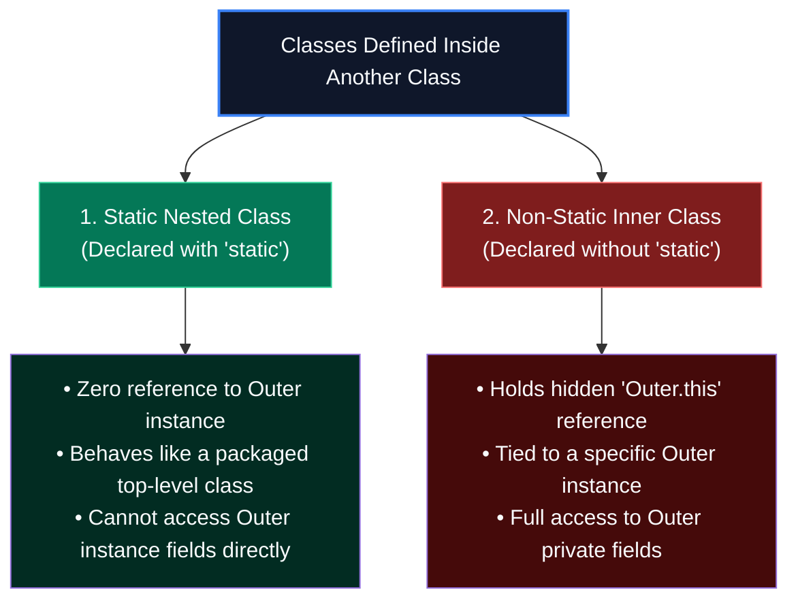
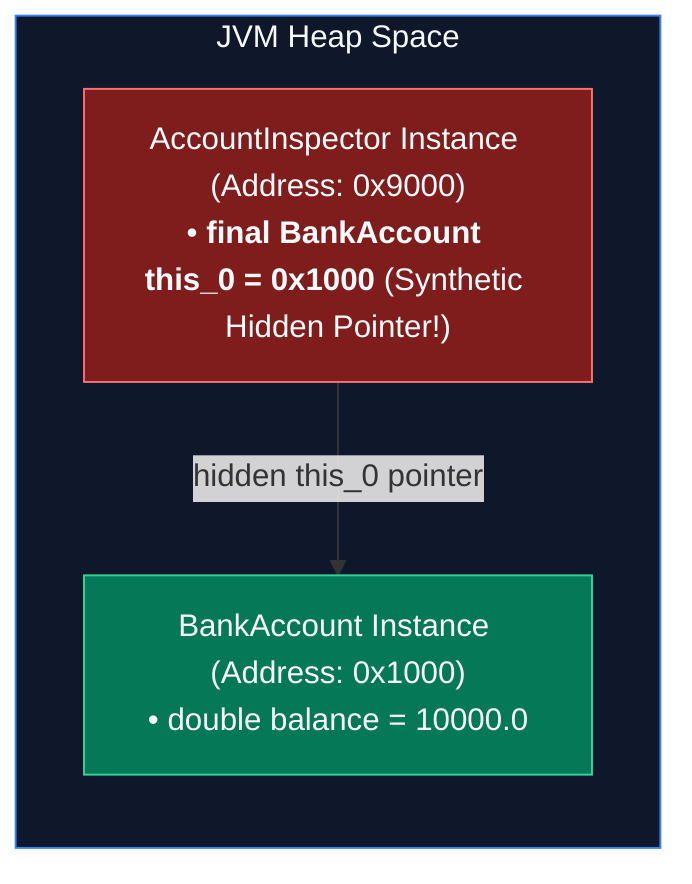
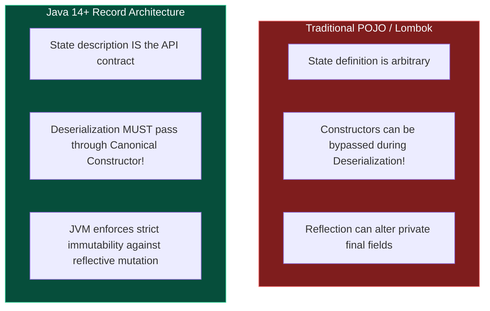

Up to this point, you have defined classes as independent citizens living in their own files: one class, one file, matching names.

However, real-world software often requires components that exist solely to support an enclosing entity. A `LinkedList` has internal `Node`s. A `DatabaseConnection` has a `TransactionHolder`. A GUI button has a click listener. 

If you make these helper classes public top-level files, you pollute your library's public namespace. 

Java's solution is **Nested Classes**: classes defined directly within the curly braces of another class. 

When used properly, nested structures create elegant encapsulation, enable the famous Builder pattern, and group cohesive logic. When misunderstood, they introduce **insidious memory leaks** that keep gigabytes of abandoned heap memory alive.

Furthermore, we will explore **Records**—one of the most impactful language features added in modern Java—and uncover why they are fundamentally safer for serialization and domain modeling than traditional JavaBean POJOs.

---

## Nested Classes: Static vs. Non-Static Inner Classes

In Java terminology, the distinction between "Static Nested" and "Inner" is not semantic pedantry—it represents a profound difference in **Heap memory layout**:



---

## Static Nested Classes: The Clean Collaborator

A **Static Nested Class** is simply a top-level class that has been tucked inside another class's namespace for logical grouping.

```java
public class DatabaseClient {
    private final String url;

    public DatabaseClient(Builder builder) {
        this.url = builder.url;
    }

    // STATIC NESTED CLASS: Does NOT hold an instance of DatabaseClient!
    public static class Builder {
        private String url;

        public Builder setUrl(String url) {
            this.url = url;
            return this;
        }

        public DatabaseClient build() {
            return new DatabaseClient(this);
        }
    }
}
```

### Key Properties:
1. **No Implicit Pointer:** It has no implicit pointer to an instance of `DatabaseClient`. It can be instantiated anywhere without creating the outer class first:
   ```java
   DatabaseClient.Builder builder = new DatabaseClient.Builder();
   ```
2. **Access Rules:** It can access `private static` members of the outer class, but **cannot** access non-static instance fields of the outer class without an explicit reference.
3. **Primary Use Case:** The **Builder Design Pattern**, cache entry holders, and private helper calculators.

---

## Non-Static Inner Classes: The Hidden Pointer & Memory Leak Hazard

When you omit the `static` keyword from a nested class, you create a **Non-Static Inner Class**.

An inner class cannot exist in a vacuum—it is fundamentally tethered to a specific parent instance on the Heap:

```java
public class BankAccount {
    private double balance = 10_000.0;

    // NON-STATIC INNER CLASS
    public class AccountInspector {
        public void printAudit() {
            // Direct access to outer private field!
            System.out.println("Auditing account balance: $" + balance);
        }
    }
}
```

To instantiate `AccountInspector`, you must have an active `BankAccount` instance:
```java
BankAccount account = new BankAccount();
BankAccount.AccountInspector inspector = account.new AccountInspector();
```

### The JVM Metal: How `Outer.this` Works in Memory
How can `AccountInspector` read `balance` if it's in a separate class? 

Under the hood, the Java compiler silently injects a **synthetic final field** into the inner class:



The compiler adds a hidden parameter to `AccountInspector`'s constructor and assigns `this.this_0 = account`. When you write `balance`, the compiler secretly translates it to `this_0.balance`.

### The Lethal Senior Memory Leak Trap
Because `AccountInspector` carries this hidden `this_0` pointer, **the Garbage Collector can never reclaim `BankAccount` as long as `AccountInspector` is alive!**

Imagine this common bug in an enterprise web service:

```java
public class LargeOrderProcessingService {
    // 50 Megabytes of cached transaction data in memory
    private byte[] cachedLedgerData = new byte[50 * 1024 * 1024];

    public void scheduleNotification() {
        // Creates an inner class and registers it with a global long-running thread pool
        GlobalAsyncJobQueue.submit(new OrderNotificationTask());
    }

    // ❌ NON-STATIC INNER CLASS!
    public class OrderNotificationTask implements Runnable {
        @Override
        public void run() {
            System.out.println("Order delivered!");
        }
    }
}
```

What happens here?
The `OrderNotificationTask` sits in the background thread queue waiting for hours. Because it holds a hidden `this_0` pointer to `LargeOrderProcessingService`, **all 50 Megabytes of cached ledger data cannot be garbage collected**! 

If 1,000 orders are scheduled, your server will exhaust its heap and crash with `java.lang.OutOfMemoryError: Java heap space`.

> [!TIP]
> **Joshua Bloch's Rule (*Effective Java* Item 24):**
> **Always declare a nested class as `static` unless it explicitly requires access to an enclosing instance.**

---

## Local and Anonymous Classes: The "Effectively Final" Secret

Java allows you to define classes inside method bodies (Local Classes) or on the fly without a name (Anonymous Classes):

```java
public class PaymentService {
    public void executePayment(double amount, String transactionId) {
        // Anonymous Inner Class implementing Runnable on the fly
        Runnable auditTask = new Runnable() {
            @Override
            public void run() {
                // Captures method parameters!
                System.out.println("Audited " + transactionId + " for $" + amount);
            }
        };

        new Thread(auditTask).start();
    }
}
```

### The Variable Capture Invariant: Why Variables Must Be Effectively Final
Notice that `auditTask` accesses `transactionId` and `amount`. 

If you try to modify `amount` inside the method after declaring the task (`amount = 0.0;`), the Java compiler flatly rejects your code:

```text
Local variable amount defined in an enclosing scope must be final or effectively final
```

Why does this restriction exist?

Think about where variables live:
1. `amount` is a local variable living on the thread's **Stack Frame**. When `executePayment()` finishes, that stack frame is popped and destroyed.
2. The `auditTask` object lives on the **JVM Heap** and will continue executing in a background thread minutes after `executePayment()` has vanished from memory!

How can an object on the Heap reference a variable on a stack frame that no longer exists?

**The compiler cheats:** It secretly copies the values of `amount` and `transactionId` into synthetic private fields inside the anonymous class object on the Heap.

Because there are now **two distinct copies** of the value (one on the Stack, one on the Heap), Java mandates that the variable must be `final` or **effectively final** (never modified). This prevents race conditions where the stack and heap values drift out of sync!

---

## Modern Java: Records (Java 14/16+)

For twenty-five years, Java was criticized for boilerplate. If you wanted a simple immutable data-holder (a Data Transfer Object / POJO), you had to write fifty lines of ceremonial code:

```java
// ❌ THE OLD 50-LINE JAVABEAN POJO:
public final class CustomerProfile {
    private final String id;
    private final String email;

    public CustomerProfile(String id, String email) { ... }
    public String getId() { ... }
    public String getEmail() { ... }
    @Override public boolean equals(Object o) { ... }
    @Override public int hashCode() { ... }
    @Override public String toString() { ... }
}
```

In **Java 14 (finalized in Java 16)**, Java introduced **Records** (JEP 395):

```java
// ✅ THE MODERN JAVA RECORD (One single line!)
public record CustomerProfile(String id, String email) {}
```

That single line instructs `javac` to generate:
- A `final` class extending `java.lang.Record`.
- `private final` fields for every component.
- A canonical constructor initializing all components.
- Modern accessor methods (`id()` and `email()`, without the legacy `get` prefix).
- Component-wise, high-performance implementations of `equals()`, `hashCode()`, and `toString()`.

---

## Compact Constructors & Validation

Records are designed for **data modeling with integrity**. If you need to validate inputs or normalize data, you do not write a standard constructor; you write a **Compact Constructor**:

```java
public record Money(double amount, String currency) {

    // Compact Constructor: Notice there are NO parameter parentheses!
    public Money {
        if (amount < 0) {
            throw new IllegalArgumentException("Monetary amount cannot be negative.");
        }
        if (currency == null || currency.isBlank()) {
            throw new IllegalArgumentException("Currency code is required.");
        }
        // Normalize currency to uppercase:
        currency = currency.trim().toUpperCase();

        // The compiler automatically assigns this.amount = amount 
        // and this.currency = currency at the end of this block!
    }
}
```

---

## Why Records Are Architecturally Superior to Lombok `@Data`

Many teams used Project Lombok's `@Data` or `@Value` annotations to auto-generate boilerplate. While convenient, Lombok relies on non-standard internal `javac` AST hacking. 

Records provide core JVM architectural advantages that Lombok can never match:



### The Serialization Security Shield:
In traditional Java serialization, an incoming byte stream bypasses class constructors completely, allocating raw bytes straight onto the Heap. This is the root cause of dozens of catastrophic remote-code-execution (RCE) vulnerabilities.

**The JVM treats Records differently:** The Java serialization protocol guarantees that deserializing a Record **MUST invoke its canonical constructor**. It is impossible to sneak an invalid or malicious state past a Record's validation checks!

---

## Java 21 LTS: Record Patterns and Deconstruction

Because the JVM understands the exact shape of a Record's components, modern Java lets you **deconstruct records directly inside conditionals**:

```java
public void handleTransaction(Object event) {
    // Record pattern match: checks type AND extracts inner components in one shot!
    if (event instanceof Money(double amount, String currency)) {
        System.out.println("Processing " + currency + " " + amount);
    }
}
```

You can even nest record patterns:
```java
public record User(String name, Money balance) {}

if (obj instanceof User(String name, Money(double amount, String currency))) {
    System.out.println(name + " holds " + amount + " " + currency);
}
```

---

## Summary & Mental Model Checkpoint

1. **Static Nested Class**: A packaged top-level class with no outer instance pointer. Use by default for builders and helpers.
2. **Inner Class**: Tethered to an outer instance via a hidden synthetic pointer (`Outer.this`). Beware memory leaks in asynchronous tasks!
3. **Variable Capture**: Local/anonymous classes capture local variables by copying them to the Heap; variables must be effectively final to guarantee consistency.
4. **Records (Java 14+)**: Transparent, shallowly immutable data carriers with compiler-generated accessors, equality, and hash contracts.
5. **Serialization Safety**: Records enforce deserialization through their canonical constructor, preventing corrupted state injection.
6. **Record Deconstruction**: Java 21 pattern matching unpacks records directly in `if` and `switch` expressions.

---

## 🎯 Senior Engineer Interview Questions

### Why can a non-static inner class cause a memory leak when passed to an asynchronous executor?
> **Answer:** A non-static inner class retains a hidden synthetic reference (`this_0`) pointing directly to the enclosing outer class instance on the Heap. If the inner class is submitted to a long-running thread pool, event bus, or static collection, that hidden reference prevents the Garbage Collector from collecting the outer instance—even if the application has discarded all direct references to the outer object. If the outer instance holds large data structures, this results in severe heap exhaustion (`OutOfMemoryError`).

### Why must local variables captured by anonymous inner classes or lambda expressions be "effectively final"?
> **Answer:** Local variables reside in the thread's Stack frame and are reclaimed when the method returns, whereas anonymous classes and lambdas are Heap-allocated objects that may outlive the method. To enable execution after method completion, the compiler makes a private copy of the local variable inside the heap object. Requiring the variable to be effectively final guarantees that the Stack copy and the Heap copy never diverge in value, preventing subtle concurrency and data synchronization bugs.

### How does Java Record deserialization fundamentally differ from standard JavaBean serialization?
> **Answer:** Standard Java serialization instantiates objects using native JVM reflection without invoking any constructor, allowing corrupted or malicious payloads to bypass validation logic. In contrast, the Java Object Serialization Specification explicitly mandates that Records must be deserialized by extracting the component values from the stream and passing them directly into the Record's canonical constructor. This guarantees that all validation, normalization, and security invariants in the constructor are unconditionally enforced during deserialization.

### Can you declare additional instance fields inside the body of a Java Record? Why or why not?
> **Answer:** No. You cannot declare additional non-static instance fields in a Record body. The foundational design principle of a Record is that **its header declaration is the sole and complete specification of its state**. Allowing arbitrary instance fields would break the 1-to-1 isomorphism between the Record's state description, its canonical constructor, its accessor methods, its `equals`/`hashCode` contracts, and its deconstruction patterns. Only static fields are permitted.
