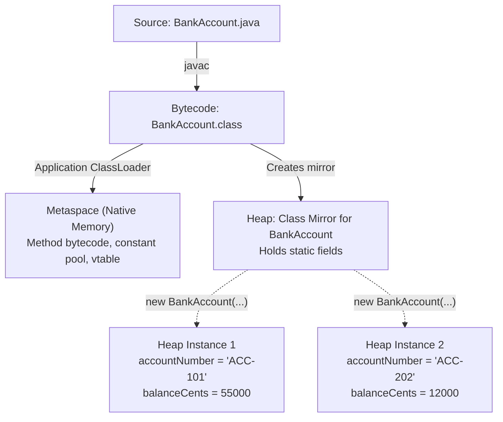
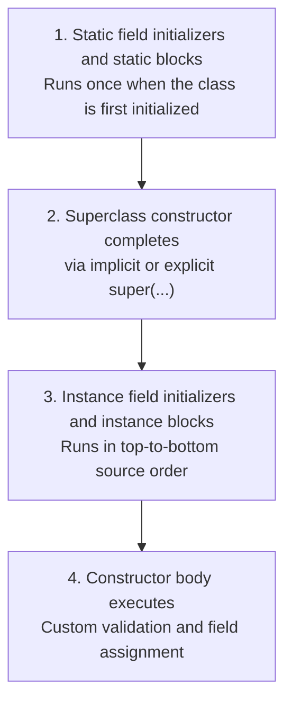
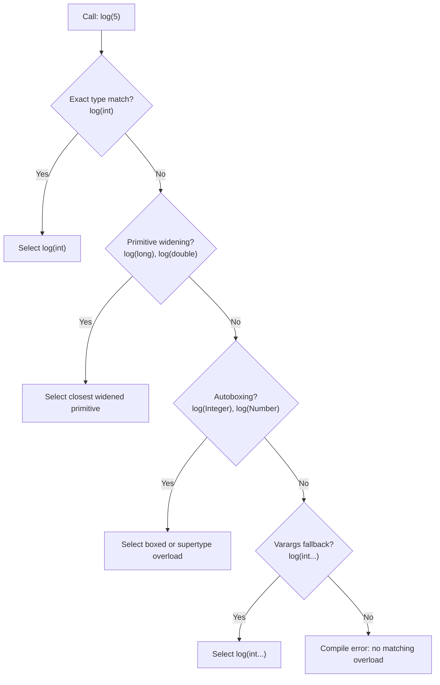

When a program is only a hundred lines long, a few top-level variables and static helper functions can get the job done. Once a codebase grows to track thousands of active users, orders, or network connections at the same time, keeping all that data in loose variables quickly falls apart. You need a way to group related data with the operations that are allowed to read and modify it.

In Java, that unit of organization is a **class**, and each live copy created from it is an **object** (also called an **instance**). Understanding how classes and objects behave in code and in JVM memory is the foundation for everything else in object-oriented Java.

## The Blueprint vs. the Instance

A common way to picture the difference between a class and an object is an architectural blueprint versus the houses built from it.

- A **class** is the definition you write in a `.java` file. It describes what data each object will hold (its **fields**) and what actions it can perform (its **methods**). On its own, a class does not represent a specific user or bank account.
- An **object** (instance) is a concrete allocation created at runtime using the `new` keyword. You can create ten, a thousand, or a million instances from the same class, and each one keeps its own independent field values.

Consider a `BankAccount` class:

```java
public class BankAccount {
    // Instance variables (state owned by each object)
    private final String accountNumber;
    private long balanceCents;

    // Constructor
    public BankAccount(String accountNumber, long initialBalanceCents) {
        this.accountNumber = accountNumber;
        this.balanceCents = initialBalanceCents;
    }

    // Instance methods (behavior operating on this object's state)
    public void deposit(long amountCents) {
        if (amountCents <= 0) {
            throw new IllegalArgumentException("Deposit must be positive.");
        }
        this.balanceCents += amountCents;
    }

    public long getBalanceCents() {
        return this.balanceCents;
    }

    public String getAccountNumber() {
        return this.accountNumber;
    }
}
```

When you run the code below, one class definition produces two separate objects on the Heap:

```java
BankAccount aliceAccount = new BankAccount("ACC-101", 50_000);
BankAccount bobAccount = new BankAccount("ACC-202", 12_000);

aliceAccount.deposit(5_000);

System.out.println(aliceAccount.getBalanceCents()); // 55000
System.out.println(bobAccount.getBalanceCents());   // 12000
```

Depositing into `aliceAccount` never touches `bobAccount`. Both objects share the same method bytecode defined in `BankAccount`, but each object has its own memory block holding its own `accountNumber` and `balanceCents`.

### How the JVM Loads a Class and Creates Instances

Before `new BankAccount(...)` can run for the first time, the JVM has to load the compiled `BankAccount.class` file through its **ClassLoader subsystem** (typically the Application ClassLoader for your project code, delegating upward to the Platform and Bootstrap ClassLoaders for JDK classes).

In modern **HotSpot JVM (Java 8 and later)**, memory is split cleanly between class structure and live instances:



Notice how HotSpot separates these pieces:

- **Metaspace (native host memory):** Stores class metadata such as method bytecode, symbol tables, and virtual method tables. Java 8 replaced the older fixed-size PermGen region with Metaspace so class metadata could grow in native memory instead of hitting fixed heap limits (unless explicitly capped with `-XX:MaxMetaspaceSize`).
- **Heap (garbage-collected memory):** Holds every object instance you allocate with `new`, as well as the `java.lang.Class` mirror object that holds the class's static fields.

This layout is specific to HotSpot rather than mandated down to the byte by the Java Language Specification, which only defines observable semantics. Still, knowing that class definitions live once while object state is allocated per `new` makes object memory costs much easier to reason about.

## Instance Variables and Methods

Inside a class, non-static fields are **instance variables** and non-static methods are **instance methods**.

### Default Values vs. Local Variables

Java treats instance variables differently from local variables declared inside a method:

- **Instance variables** are automatically zero-initialized when the JVM allocates the object: `0` for numeric primitives (`byte`, `short`, `int`, `long`), `0.0` for `float` and `double`, `false` for `boolean`, `'\u0000'` for `char`, and `null` for any reference type.
- **Local variables** inside methods receive **no** default value. Reading an uninitialized local variable is a compile-time error.

```java
public class ConnectionConfig {
    private String host;     // Defaults to null
    private int port;        // Defaults to 0
    private boolean useTls;  // Defaults to false

    public void printSummary() {
        int retries;
        // System.out.println(retries); // Compile error: variable retries might not have been initialized
        retries = 3;
        System.out.println(host + ":" + port + " tls=" + useTls + " retries=" + retries);
    }
}
```

Even though instance variables get default values automatically, relying on `null` or `0` often leaves objects in a half-valid state. Constructors exist to make sure an object starts life with meaningful values.

### Instance Methods vs. Shared Class State

Every instance method is called on a specific object reference (`aliceAccount.deposit(5_000)`). Behind the scenes, the JVM passes that object reference as a hidden first argument to the method, which is what `this` refers to.

By contrast, a `static` field belongs to the class itself rather than any individual instance. A static counter shared across all instances works for tracking totals, though mutable static fields create concurrency hazards if multiple threads update them without synchronization. We will examine `static` in detail in the next lesson.

## Constructors: Default, No-Args, and Parameterized

A **constructor** is a special block of code that initializes a newly allocated object. It has the exact same name as the class and **no return type** (not even `void`). If you accidentally write `public void BankAccount(...)`, Java treats it as an ordinary method, not a constructor.

Java developers generally distinguish three kinds of constructors.

### Default Constructor

If you write a class and declare **no constructors at all**, the Java compiler automatically generates a public (matching the class's visibility) parameterless constructor with an empty body:

```java
public class Task {
    private String title;
    private boolean completed;
    // Compiler generates: public Task() { super(); }
}
```

You can then call `new Task()`, and every field keeps its default value (`null`, `false`).

> [!IMPORTANT]
> The compiler **only** generates a default constructor when your class defines zero constructors. The moment you write any constructor of your own, the automatic default constructor disappears.

### No-Args Constructor

A **no-args constructor** is a parameterless constructor that *you* write explicitly. Unlike the compiler-generated default constructor, an explicit no-args constructor lets you assign sensible defaults, initialize collections, or log creation:

```java
import java.time.Instant;
import java.util.ArrayList;
import java.util.List;

public class ShoppingCart {
    private final Instant createdAt;
    private final List<String> itemIds;

    // Explicit no-args constructor
    public ShoppingCart() {
        this.createdAt = Instant.now();
        this.itemIds = new ArrayList<>();
    }
}
```

You will also see explicit no-args constructors required by certain frameworks (such as JPA/Hibernate or Jackson when not configured for creator constructors) that instantiate objects via reflection.

### Parameterized Constructors

A **parameterized constructor** accepts arguments so callers must supply required data up front. This is the primary way to enforce class invariants from the moment an object is created:

```java
public class Product {
    private final String sku;
    private final String name;
    private final long priceCents;

    public Product(String sku, String name, long priceCents) {
        if (sku == null || sku.isBlank()) {
            throw new IllegalArgumentException("SKU is required.");
        }
        if (priceCents < 0) {
            throw new IllegalArgumentException("Price cannot be negative.");
        }
        this.sku = sku;
        this.name = name;
        this.priceCents = priceCents;
    }
}
```

Because `Product` defines a parameterized constructor, calling `new Product()` will no longer compile unless you also write a no-args constructor explicitly. For domain objects like `Product`, that is usually a good thing: an empty product with a `null` SKU makes no sense in the domain.

### Constructor Overloading and the Telescoping Problem

A class can define multiple constructors as long as their parameter lists differ in number, type, or order. This is **constructor overloading**.

When a class has many optional settings, chaining overloaded constructors together often turns into the **telescoping constructor** pattern:

```java
public class HttpClientConfig {
    private final String baseUrl;
    private final int connectTimeoutMs;
    private final int readTimeoutMs;
    private final int maxRetries;

    public HttpClientConfig(String baseUrl) {
        this(baseUrl, 3_000);
    }

    public HttpClientConfig(String baseUrl, int connectTimeoutMs) {
        this(baseUrl, connectTimeoutMs, 10_000);
    }

    public HttpClientConfig(String baseUrl, int connectTimeoutMs, int readTimeoutMs) {
        this(baseUrl, connectTimeoutMs, readTimeoutMs, 2);
    }

    public HttpClientConfig(String baseUrl, int connectTimeoutMs, int readTimeoutMs, int maxRetries) {
        this.baseUrl = baseUrl;
        this.connectTimeoutMs = connectTimeoutMs;
        this.readTimeoutMs = readTimeoutMs;
        this.maxRetries = maxRetries;
    }
}
```

For two or three parameters, overloaded constructors are fine. Once you have three consecutive `int` arguments, it becomes very easy to swap `connectTimeoutMs` and `readTimeoutMs` at the call site without any compiler warning, and callers have to look up the signature to read what `new HttpClientConfig("https://api.example.com", 3000, 10000, 2)` means.

For objects with many optional configuration parameters, a **Builder** keeps call sites readable and preserves immutability:

```java
public class HttpClientConfig {
    private final String baseUrl;
    private final int connectTimeoutMs;
    private final int readTimeoutMs;
    private final int maxRetries;

    private HttpClientConfig(Builder builder) {
        this.baseUrl = builder.baseUrl;
        this.connectTimeoutMs = builder.connectTimeoutMs;
        this.readTimeoutMs = builder.readTimeoutMs;
        this.maxRetries = builder.maxRetries;
    }

    public static class Builder {
        private final String baseUrl;
        private int connectTimeoutMs = 3_000;
        private int readTimeoutMs = 10_000;
        private int maxRetries = 2;

        public Builder(String baseUrl) {
            this.baseUrl = baseUrl;
        }

        public Builder connectTimeoutMs(int connectTimeoutMs) {
            this.connectTimeoutMs = connectTimeoutMs;
            return this;
        }

        public Builder readTimeoutMs(int readTimeoutMs) {
            this.readTimeoutMs = readTimeoutMs;
            return this;
        }

        public Builder maxRetries(int maxRetries) {
            this.maxRetries = maxRetries;
            return this;
        }

        public HttpClientConfig build() {
            return new HttpClientConfig(this);
        }
    }
}
```

At the call site, every parameter is self-documenting:

```java
HttpClientConfig config = new HttpClientConfig.Builder("https://api.example.com")
        .connectTimeoutMs(2_000)
        .readTimeoutMs(8_000)
        .maxRetries(3)
        .build();
```

## The `this` Keyword

Inside any instance method or constructor, `this` is a reference to the current object whose method or constructor is running. It has four practical uses in Java.

### Disambiguating Shadowed Fields

When a constructor or method parameter has the same name as an instance field, the parameter **shadows** the field inside that block. Writing `balance = balance;` assigns the parameter to itself and leaves the field untouched, which is a classic bug. Prefixing the field with `this.` makes the target unambiguous:

```java
public class ServerEndpoint {
    private final String host;
    private final int port;

    public ServerEndpoint(String host, int port) {
        this.host = host; // Assigns parameter 'host' to instance field 'this.host'
        this.port = port;
    }
}
```

### Constructor Chaining with `this(...)`

One constructor can delegate to another constructor in the same class using `this(...)`, as shown in the `HttpClientConfig` overloading example above. Centralizing validation and field assignment in a single "canonical" constructor avoids duplicating logic across overloads.

Two compiler rules apply to `this(...)`:
1. In standard Java (prior to JEP 447 / JEP 482 flexible constructor bodies in Java 22-24 preview and JEP 513 in Java 25), `this(...)` must be the **very first statement** in the constructor.
2. A constructor cannot call both `this(...)` and `super(...)`, because the chained constructor will eventually call `super(...)`.

### Returning `this` for Fluent APIs

Methods like `Builder.connectTimeoutMs(...)` return `this` so callers can chain calls one after another on the same object without repeating the variable name.

### Passing the Current Object to Another Method

An object can hand a reference to itself to a collaborator: `auditLog.record(this)`. That is safe once the object is fully constructed, which brings up an important constructor hazard.

### The `this` Escape Pitfall

Never let `this` escape from a constructor before the constructor finishes executing. Common ways `this` escapes include registering the object with an event listener, storing it in a static collection, or starting a thread that accesses the object from inside the constructor.

```java
public class OrderEventHandler {
    private final String handlerName;

    public OrderEventHandler(EventBus bus) {
        // Dangerous: another thread on the EventBus can invoke onOrder()
        // before handlerName has been assigned.
        bus.register(this);

        this.handlerName = "order-processor";
    }

    public void onOrder(String orderId) {
        // Can throw NullPointerException if called during construction
        System.out.println(handlerName.toUpperCase() + " handled " + orderId);
    }
}
```

Because `bus.register(this)` runs before `this.handlerName` is assigned, another thread listening on `EventBus` can observe a **partially constructed object** where even a `final` field still appears `null`. Java's memory model only guarantees safe publication of `final` fields *after* the constructor returns without `this` escaping.

> [!CAUTION]
> Keep constructors focused on validating inputs and initializing fields. If an object needs to register listeners, open background threads, or subscribe to queues, do that in a separate `start()` method or a static factory method after `new` completes.

```java
public static OrderEventHandler createAndRegister(EventBus bus) {
    OrderEventHandler handler = new OrderEventHandler();
    bus.register(handler);
    return handler;
}
```

## Object Initialization Order

When you create an object, Java executes initialization steps in a deterministic order defined by the Java Language Specification:



You can observe this directly with a small program:

```java
public class InitOrderExample {

    static {
        System.out.println("1. Static initializer block");
    }

    private String label = initLabel();

    {
        System.out.println("3. Instance initializer block");
    }

    private String initLabel() {
        System.out.println("2. Instance field initializer");
        return "ready";
    }

    public InitOrderExample() {
        System.out.println("4. Constructor body (label=" + label + ")");
    }

    public static void main(String[] args) {
        System.out.println("--- First instance ---");
        new InitOrderExample();

        System.out.println("--- Second instance ---");
        new InitOrderExample();
    }
}
```

Output:

```text
1. Static initializer block
--- First instance ---
2. Instance field initializer
3. Instance initializer block
4. Constructor body (label=ready)
--- Second instance ---
2. Instance field initializer
3. Instance initializer block
4. Constructor body (label=ready)
```

Notice two practical details here. First, the `static` block runs once when the class is initialized, not per instance. Second, instance field initializers and anonymous `{ ... }` instance blocks run in the exact textual order they appear in the file, *before* the constructor body runs. Because anonymous instance initializer blocks can easily surprise readers, most teams prefer putting initialization logic directly inside a constructor (and chaining via `this(...)`) instead of using `{ ... }` blocks.

## Method Overloading Resolution

Just like constructors, regular methods can be overloaded within a class as long as their parameter lists differ. The return type is **not** part of a method's overload signature: you cannot have both `int parse(String s)` and `double parse(String s)` in the same class, because a caller writing `parse("42");` would be ambiguous.

When multiple overloaded methods could accept a call like `log(5)`, the Java compiler resolves the match at compile time in strict order:



```java
public class OverloadDemo {
    static void log(long value)    { System.out.println("long: " + value); }
    static void log(Integer value) { System.out.println("Integer: " + value); }
    static void log(int... values) { System.out.println("varargs count: " + values.length); }

    public static void main(String[] args) {
        log(5); // Prints: long: 5
    }
}
```

Primitive widening beats autoboxing because Java 5 introduced autoboxing without wanting to change the meaning of existing code written for Java 1.0-1.4. Note also that Java will not combine widening and boxing in a single step: passing an `int` to a method expecting `Long` fails to compile.

## Practical Questions

### Why does adding a parameterized constructor sometimes break existing code that calls `new MyClass()`?
Java only synthesizes a default parameterless constructor when a class declares no constructors at all. Adding even a single parameterized constructor tells the compiler you are taking control of how the class is instantiated, so it stops generating the default constructor. If callers or frameworks still need a zero-argument constructor, you have to declare an explicit no-args constructor yourself.

### What happens if you accidentally put a return type like `void` on a constructor?
The code still compiles, because Java allows a method to have the same name as its class (though IDEs and linters warn loudly against it). However, Java treats it as a normal instance method rather than a constructor, which means it never runs during `new` and the compiler may still generate a default constructor behind your back.

### Why is escaping `this` from a constructor dangerous even when all fields are `final`?
Java's memory model guarantees that once a constructor completes normally, any thread that obtains a reference to the object will see the initialized values of its `final` fields without extra synchronization. If `this` escapes *during* construction (for example, by registering with another thread's event bus or starting a background thread), that guarantee is void: another thread can observe default zero or `null` values before the constructor finishes assigning them.

### What is the difference between where a class definition lives and where its objects live in HotSpot Java 8+?
HotSpot stores class metadata (method bytecode, constant pool, method dispatch tables) in native memory called Metaspace. Individual object instances created with `new`, along with the `java.lang.Class` mirror object that holds static fields, live on the garbage-collected Java Heap.
