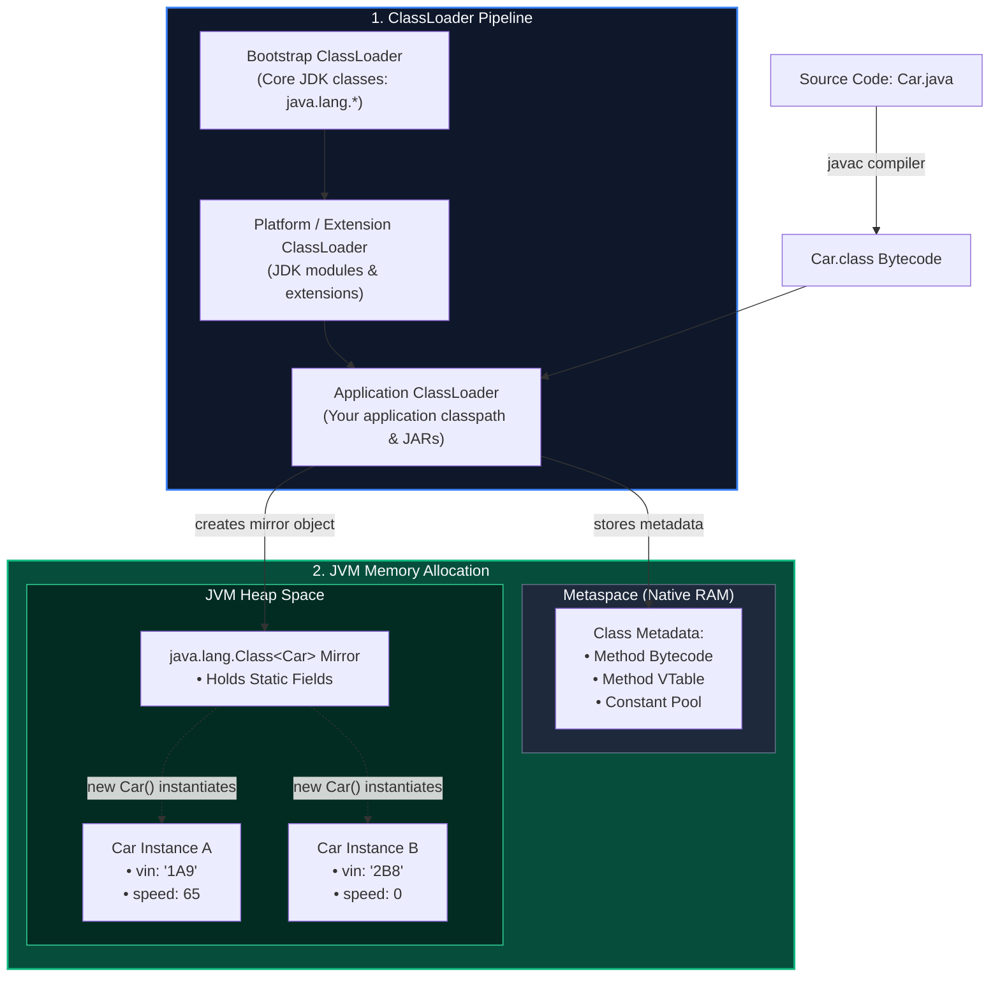
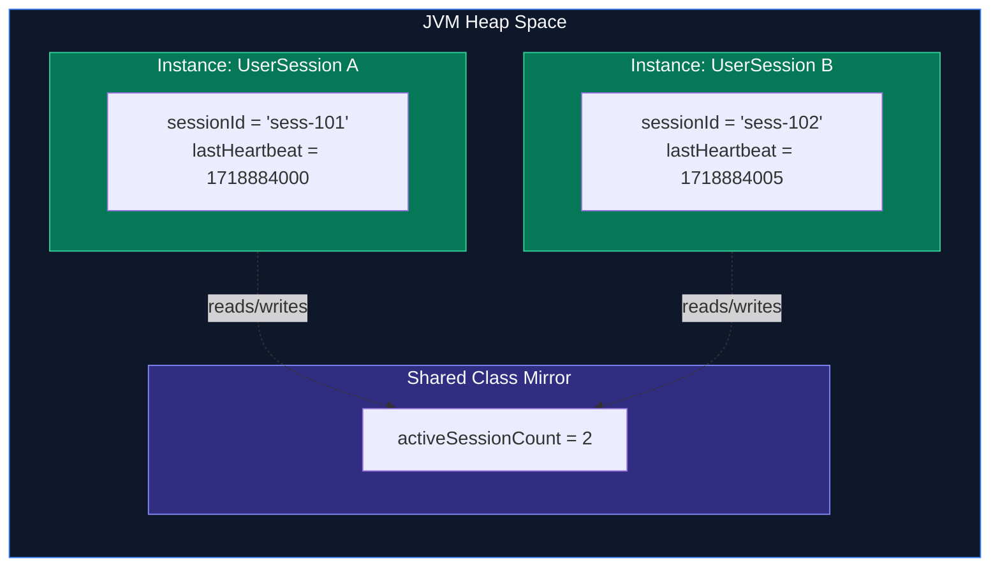
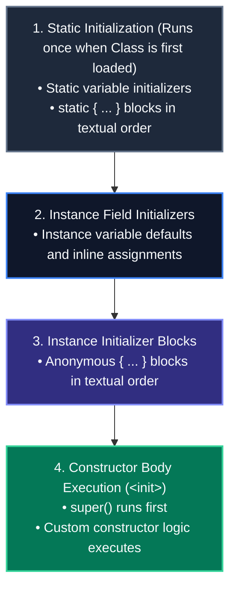
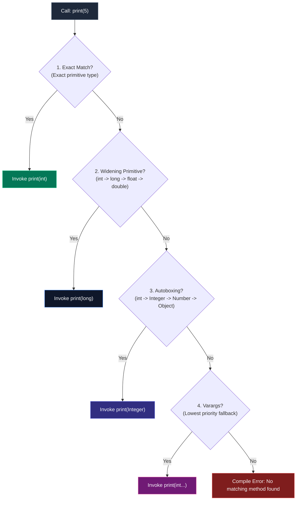

When you write small programs or university assignments, procedural code feels natural: you declare a handful of global variables, write five functions, and pass data back and forth. 

Then you land in an enterprise codebase with four hundred engineers, five million lines of code, and thousands of concurrent database requests per second. Suddenly, procedural thinking collapses. If anyone can mutate data from anywhere, bugs become ghosts—impossible to reproduce and lethal to debug.

**Classes and Objects are Java's answer to chaos.** 

They are not just syntax for grouping data; they are self-governing capsules designed to protect state, enforce business invariants, and construct scalable software architectures.

In this deep dive, we will step beyond beginner definitions and unpack how the JVM actually brings classes and objects to life: from the native memory of Metaspace to the Heap, through the precise millisecond sequence of constructor execution, and into the subtle traps that trip up mid-level engineers.

---

## The Machine Behind the Curtain: ClassLoader & Metaspace

Before you can create even a single object using `new Car()`, the JVM must understand what a `Car` actually is. 

How does the JVM acquire this knowledge? Through the **ClassLoader Subsystem**.



### Metaspace vs. Java 7's PermGen
Historically, class metadata was stored in the JVM's "PermGen" (Permanent Generation) space on the Heap. Because PermGen had a fixed maximum size, deploying large enterprise apps frequently crashed servers with `java.lang.OutOfMemoryError: PermGen space`.

In **Java 8**, Oracle eliminated PermGen entirely and replaced it with **Metaspace**.
- Metaspace lives in **native host memory** outside the JVM Garbage-Collected Heap.
- It grows dynamically based on available system RAM.
- **Where do static fields live?** In modern Java, class metadata (bytecodes, method tables) lives in native Metaspace, while static variables and the class mirror (`Car.class`) live directly in the standard Heap!

---

## State Architecture: Instance vs. Class (Static) Fields

When you define fields in a class, you make a profound architectural choice between **individual object state** and **shared global state**:

```java
public class UserSession {
    // 1. Instance Field: Unique to EVERY user (lives on Heap inside each instance)
    private final String sessionId;
    private long lastHeartbeatTimestamp;

    // 2. Static Field: ONE single copy shared across the entire JVM
    private static int activeSessionCount = 0;

    public UserSession(String sessionId) {
        this.sessionId = sessionId;
        this.lastHeartbeatTimestamp = System.currentTimeMillis();
        activeSessionCount++; // Increments the shared JVM counter
    }
}
```



### The Senior Warning: Shared Mutable State
Static variables are accessible by any thread running anywhere in your application. If two threads create or invalidate sessions simultaneously, `activeSessionCount++` will suffer from **race conditions** and produce corrupt totals unless synchronized. 

**Rule of Thumb:** Use `static` for immutable constants (`public static final double TAX_RATE = 0.08;`) or stateless utility functions (`Math.max()`). Avoid shared mutable static variables.

---

## The Exact Sequence of Object Initialization

When an object is created, in what exact order does Java initialize fields, run blocks, and invoke constructors? 

Understanding this sequence prevents elusive bugs where fields appear `null` or uninitialized:



### Let's Prove the Lifecycle in Code:

```java
public class InitializationOrderDemo {

    // 1. Static Initializer Block (Runs once when class is loaded)
    static {
        System.out.println("1. Static initializer block executed.");
    }

    // 2. Instance Field Initializer
    private String name = initName();

    // 3. Instance Initializer Block
    {
        System.out.println("3. Instance initializer block executed.");
    }

    // Helper method to demonstrate field assignment timing
    private String initName() {
        System.out.println("2. Instance field initialized.");
        return "JavaMaster";
    }

    // 4. Constructor
    public InitializationOrderDemo() {
        System.out.println("4. Constructor body executed.");
    }

    public static void main(String[] args) {
        System.out.println("--- Creating Instance 1 ---");
        new InitializationOrderDemo();

        System.out.println("--- Creating Instance 2 ---");
        new InitializationOrderDemo();
    }
}
```

**Console Output:**
```text
1. Static initializer block executed.
--- Creating Instance 1 ---
2. Instance field initialized.
3. Instance initializer block executed.
4. Constructor body executed.
--- Creating Instance 2 ---
2. Instance field initialized.
3. Instance initializer block executed.
4. Constructor body executed.
```

Notice: The `static` block executed only **once** upon class loading. Each subsequent `new` instantiation ran the instance field, instance block, and constructor in strict sequence.

---

## The Subtle Senior Trap: The "this" Escape Hazard

One of the most dangerous concurrency bugs in Java is allowing the `this` reference to escape from a constructor before the object is fully formed.

Look at this innocent-looking code:

```java
public class EventListenerRegistration {
    private final String listenerId;

    public EventListenerRegistration(EventBus bus) {
        // ❌ DANGEROUS: Registering 'this' before initialization finishes!
        bus.register(this); 
        
        // Simulating heavy setup work
        this.listenerId = "LISTENER-42";
    }

    public void onEvent() {
        // If an event fires while the constructor is still running,
        // this will print 'null' or throw a NullPointerException!
        System.out.println("Handled by: " + listenerId.toLowerCase());
    }
}
```

What went wrong?
`bus.register(this)` handed a reference to `this` to another thread before the constructor finished assigning `listenerId`! If the event bus receives an incoming message immediately, it calls `onEvent()` on a **partially initialized object**, crashing with a `NullPointerException`.

> [!CAUTION]
> **The Constructor Safety Invariant:**
> Never pass `this` to another thread, register `this` with a listener, or start a new thread inside a constructor. Complete all field initialization first, and register listeners in a separate `start()` or `init()` lifecycle method.

---

## Overloading Constructors & The Telescoping Anti-Pattern

In real applications, objects have many optional configuration parameters (timeout, retries, host, SSL enabled). 

Beginners often write a chain of overloaded constructors, known as the **Telescoping Constructor Anti-Pattern**:

```java
public class DatabaseClient {
    private final String host;
    private final int port;
    private final int timeoutMs;
    private final boolean ssl;

    public DatabaseClient(String host) {
        this(host, 5432);
    }

    public DatabaseClient(String host, int port) {
        this(host, port, 5000);
    }

    public DatabaseClient(String host, int port, int timeoutMs) {
        this(host, port, timeoutMs, true);
    }

    public DatabaseClient(String host, int port, int timeoutMs, boolean ssl) {
        this.host = host;
        this.port = port;
        this.timeoutMs = timeoutMs;
        this.ssl = ssl;
    }
}
```

### Why Telescoping Sucks:
1. **Parameter Confusion:** If two consecutive parameters are `int`, swapping them accidentally compiles with zero warnings: `new DatabaseClient("localhost", 5000, 5432)`.
2. **Readability:** Calling `new DatabaseClient("db.prod", 5432, 10000, false)` forces readers to check the source code to figure out what `10000` and `false` represent.

### The Professional Solution: The Builder Pattern
By returning `this` from setter-like methods, we create a fluent, type-safe API:

```java
public class DatabaseClient {
    private final String host;
    private final int port;
    private final int timeoutMs;
    private final boolean ssl;

    private DatabaseClient(Builder builder) {
        this.host = builder.host;
        this.port = builder.port;
        this.timeoutMs = builder.timeoutMs;
        this.ssl = builder.ssl;
    }

    public static class Builder {
        private final String host; // Mandatory
        private int port = 5432;   // Optional default
        private int timeoutMs = 5000;
        private boolean ssl = true;

        public Builder(String host) {
            this.host = host;
        }

        public Builder port(int port) {
            this.port = port;
            return this; // Method chaining!
        }

        public Builder timeoutMs(int timeoutMs) {
            this.timeoutMs = timeoutMs;
            return this;
        }

        public Builder ssl(boolean ssl) {
            this.ssl = ssl;
            return this;
        }

        public DatabaseClient build() {
            return new DatabaseClient(this);
        }
    }
}
```

Now, calling code reads like clean English:
```java
DatabaseClient client = new DatabaseClient.Builder("db.internal.net")
        .port(5433)
        .timeoutMs(2500)
        .ssl(true)
        .build();
```

---

## Method Overloading Rules & Resolution Priority

Method overloading allows multiple methods to share the same name within a class. 

However, Java follows strict compile-time rules to determine which method to invoke:

```java
public class OverloadResolver {
    public void print(int x)         { System.out.println("Primitive int: " + x); }
    public void print(long x)        { System.out.println("Widened long: " + x); }
    public void print(Integer x)     { System.out.println("Boxed Integer: " + x); }
    public void print(Number x)      { System.out.println("Polymorphic Number: " + x); }
    public void print(int... x)      { System.out.println("Varargs int...: " + x.length); }
}
```

If you call `print(5)`, which method wins?

Java resolves overloaded method calls in **four distinct phases**:



> [!IMPORTANT]
> **Widening Beats Autoboxing!**
> If you comment out `print(int x)`, calling `print(5)` will invoke `print(long x)`, **NOT** `print(Integer x)`. Java prioritized legacy C-style primitive widening before Java 5's autoboxing was introduced.

---

## Summary & Mental Model Checkpoint

1. **ClassLoader & Metaspace**: Class metadata and method bytecode live in native Metaspace. Static fields and class mirror objects live in the Heap.
2. **Instance vs. Static**: Instance variables duplicate on the Heap per object; static variables exist once per class loader.
3. **Initialization Order**: 
   - Static initializers (once on load).
   - Instance field initializers & anonymous instance blocks (textual order).
   - Constructor body (`<init>`).
4. **Never Escape `this`**: Do not pass `this` to outside listeners or start threads inside constructors.
5. **Builder over Telescoping**: Replace multi-argument constructor confusion with fluent Builders.
6. **Overload Priority**: Exact match $\rightarrow$ Primitive widening $\rightarrow$ Autoboxing $\rightarrow$ Varargs.

---

## 🎯 Senior Engineer Interview Questions

### What was the architectural motivation for replacing PermGen with Metaspace in Java 8?
> **Answer:** PermGen was an area of fixed contiguous memory allocated inside the JVM heap. Tuning its size (`-XX:MaxPermSize`) was notoriously difficult: if an application dynamically generated classes (e.g. via Spring CGLIB, Hibernate proxies, or OSGi bundle redeployment), PermGen would inevitably exhaust its capacity and throw `java.lang.OutOfMemoryError: PermGen space`, taking down the entire JVM. Metaspace solves this by allocating class metadata in native host memory, bounded only by the physical RAM and swap space of the machine (unless capped via `-XX:MaxMetaspaceSize`).

### What is the "this escape" problem in Java constructors, and how can it cause multithreading defects?
> **Answer:** "This escape" occurs when the `this` reference to an object becomes visible outside the constructor before constructor execution finishes. Examples include passing `this` to an event listener, storing `this` in a public static variable, or launching a thread inside the constructor. In concurrent environments, another thread can observe the object in a partially initialized state where non-final fields hold default zeros or nulls, violating invariants and causing unpredictable `NullPointerException`s or data corruption.

### Does the return type participate in a method's signature for overloading resolution? Why or why not?
> **Answer:** No. In Java, a method signature consists strictly of the **method name** and the **number, types, and order of its parameters**. The return type is not part of the signature. Allowing overloading by return type would introduce fatal syntactic ambiguity: for a method call `calculate()`, the compiler could not determine whether to invoke a version returning `void`, `int`, or `double` if the caller ignores the return value.

### Can an anonymous instance initializer block `{ ... }` throw a checked exception?
> **Answer:** An instance initializer block can only throw a checked exception if **every single constructor** in the class explicitly declares that checked exception in its `throws` clause. Because instance blocks are copied into the beginning of every constructor by the compiler, an unhandled checked exception in an instance block would otherwise violate Java's compile-time exception checking.
