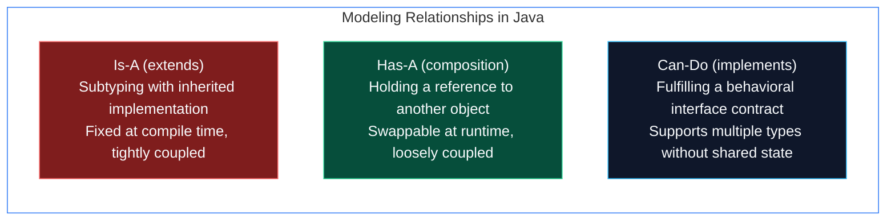
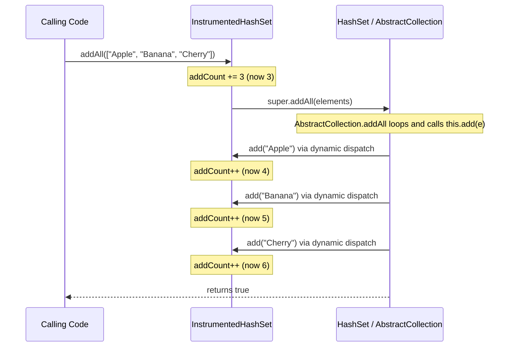
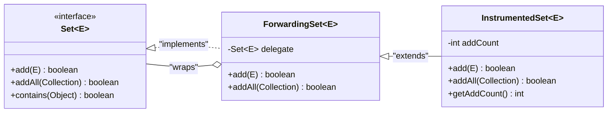
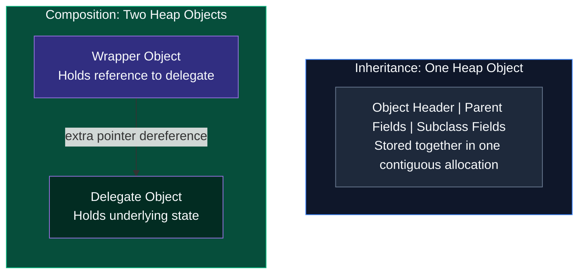

Early object-oriented textbooks treated class inheritance as the default way to reuse code. If class `B` needed a few methods from class `A`, you wrote `class B extends A` and moved on. You can still see that style in older Java standard library classes: `java.util.Properties` extends `Hashtable`, `java.util.Stack` extends `Vector`, and Swing components sit six or seven levels deep (`Object` -> `Component` -> `Container` -> `JComponent` -> `AbstractButton` -> `JButton`).

Experience in real codebases taught a different lesson: implementation inheritance (`extends`) is the tightest form of coupling in Java. A subclass is bound not just to its parent's public API, but often to how the parent implements that API internally. That is why both the Gang of Four (*Design Patterns*) and Joshua Bloch (*Effective Java*, Item 18) give the same practical advice: **favor composition over inheritance**.

---

## "Is-A", "Has-A", and "Can-Do" Relationships

Most design mistakes start by reaching for `extends` when one of the other two relationships fits better:



Suppose you are modeling a `Car` that needs propulsion. Extending an engine class mixes two unrelated concepts just to reuse a method:

```java
// Poor design: a Car is not a CombustionEngine
public class SportsCar extends CombustionEngine {
    // Exposes engine-specific methods on SportsCar and locks it to combustion forever
}
```

With composition, `SportsCar` holds an `Engine` interface as a field and delegates propulsion to it:

```java
import java.util.Objects;

public interface Engine {
    void deliverTorque();
}

public class SportsCar {
    private Engine engine;

    public SportsCar(Engine engine) {
        this.engine = Objects.requireNonNull(engine);
    }

    public void setEngine(Engine newEngine) {
        this.engine = Objects.requireNonNull(newEngine);
    }

    public void drive() {
        engine.deliverTorque();
    }
}
```

This separation pays off immediately:

- **Runtime flexibility:** You can inject a `V8Engine`, an `ElectricMotor`, or a test stub without touching `SportsCar`.
- **Clean public API:** Callers of `SportsCar` see driving operations, not low-level engine maintenance methods.
- **Better encapsulation:** `SportsCar` interacts with `Engine` only through its contract, never depending on private or protected internals.

---

## Deep Inheritance Pitfalls

Inheritance feels convenient at level one or two, but deep hierarchies accumulate problems that slow down every change:

1. **API leakage and broken invariants.** Because `java.util.Properties` extends `Hashtable<Object, Object>`, callers can invoke `properties.put("timeout", 30)` with an `Integer` value, even though `Properties` is documented to store string keys and string values. Calling `getProperty("timeout")` later silently returns `null`. Extending `Hashtable` exposed methods that violate `Properties`' own contract.
2. **Inherited baggage.** Every subclass carries all fields, constructors, and dependencies of every ancestor above it. You cannot opt out of inherited public methods without throwing `UnsupportedOperationException`, which violates the Liskov Substitution Principle.
3. **Rigid compile-time combinations.** If you model features as subclasses (for example `BufferedFileReader`, `EncryptedFileReader`, `CompressedFileReader`), combining two or three features causes a combinatorial explosion of classes (`BufferedEncryptedCompressedFileReader`). Composition lets you stack small wrappers dynamically at runtime, just as `java.io` stacks `BufferedInputStream` around `GZIPInputStream` around `FileInputStream`.
4. **Hard-to-trace behavior.** Understanding what a single method call does in a five-level hierarchy often requires jumping across five files to see which level overrode what and where `super` was called.

---

## The Fragile Base Class Problem

The sharpest risk of extending a concrete class is the **Fragile Base Class problem**: a subclass can break when the superclass changes its internal implementation, even if every public method signature stays identical.

The classic example from *Effective Java* is `InstrumentedHashSet`, a `Set` that counts how many elements have been added over its lifetime (not its current `size()`, which drops when elements are removed or duplicates are ignored).

```java
import java.util.Collection;
import java.util.HashSet;
import java.util.List;

public class InstrumentedHashSet<E> extends HashSet<E> {
    private int addCount = 0;

    @Override
    public boolean add(E element) {
        addCount++;
        return super.add(element);
    }

    @Override
    public boolean addAll(Collection<? extends E> elements) {
        addCount += elements.size();
        return super.addAll(elements);
    }

    public int getAddCount() {
        return addCount;
    }

    public static void main(String[] args) {
        InstrumentedHashSet<String> set = new InstrumentedHashSet<>();
        set.addAll(List.of("Apple", "Banana", "Cherry"));
        System.out.println("Total items added: " + set.getAddCount());
    }
}
```

At first glance, `getAddCount()` should print `3`. Instead, it prints `6`.

### Tracing the Double-Counting Bug

The surprise comes from **self-use** inside the superclass. `HashSet` inherits `addAll()` from `java.util.AbstractCollection`, which implements `addAll()` by looping over the input collection and calling `this.add(e)` for each item:



Because `InstrumentedHashSet` overrode `add()`, dynamic method dispatch routes `AbstractCollection`'s internal `add()` calls back into the subclass. Each element is counted once in `addAll()` and a second time in `add()`.

You might think, "Fine, I will just stop overriding `addAll()` and let `add()` do all the counting." That fixes today's bug, but it leaves your subclass tightly coupled to an undocumented implementation detail. If a future JDK release optimizes `HashSet.addAll()` to insert entries directly into its internal map without calling `add()`, your counter quietly stops counting bulk additions.

The reverse problem also happens: if a superclass adds a brand-new method in a future release that happens to share a name with a method in your subclass (with a different return type or narrower visibility), your subclass will fail to compile or silently start overriding a method it never meant to override.

---

## Using Interfaces and Composition: The Forwarding Class Pattern

Instead of extending `HashSet`, implement the `Set<E>` interface, hold a private `Set<E>` instance inside your class, and forward all standard operations to it. This is the **Decorator** (or **Wrapper**) pattern.

To avoid repeating boilerplate forwarding methods every time you need a new `Set` wrapper, split the work into two classes: a reusable `ForwardingSet<E>` and a focused `InstrumentedSet<E>` that extends it.



First, write the reusable forwarding class once:

```java
import java.util.Collection;
import java.util.Iterator;
import java.util.Objects;
import java.util.Set;

public class ForwardingSet<E> implements Set<E> {
    private final Set<E> delegate;

    public ForwardingSet(Set<E> delegate) {
        this.delegate = Objects.requireNonNull(delegate);
    }

    @Override public boolean add(E e) { return delegate.add(e); }
    @Override public boolean addAll(Collection<? extends E> c) { return delegate.addAll(c); }
    @Override public boolean contains(Object o) { return delegate.contains(o); }
    @Override public boolean containsAll(Collection<?> c) { return delegate.containsAll(c); }
    @Override public int size() { return delegate.size(); }
    @Override public boolean isEmpty() { return delegate.isEmpty(); }
    @Override public boolean remove(Object o) { return delegate.remove(o); }
    @Override public boolean removeAll(Collection<?> c) { return delegate.removeAll(c); }
    @Override public boolean retainAll(Collection<?> c) { return delegate.retainAll(c); }
    @Override public void clear() { delegate.clear(); }
    @Override public Iterator<E> iterator() { return delegate.iterator(); }
    @Override public Object[] toArray() { return delegate.toArray(); }
    @Override public <T> T[] toArray(T[] a) { return delegate.toArray(a); }
    @Override public boolean equals(Object o) { return delegate.equals(o); }
    @Override public int hashCode() { return delegate.hashCode(); }
    @Override public String toString() { return delegate.toString(); }
}
```

Now the decorator only overrides the methods it cares about:

```java
import java.util.Collection;
import java.util.Set;

public class InstrumentedSet<E> extends ForwardingSet<E> {
    private int addCount = 0;

    public InstrumentedSet(Set<E> delegate) {
        super(delegate);
    }

    @Override
    public boolean add(E e) {
        addCount++;
        return super.add(e);
    }

    @Override
    public boolean addAll(Collection<? extends E> c) {
        addCount += c.size();
        return super.addAll(c);
    }

    public int getAddCount() {
        return addCount;
    }
}
```

Look at what changed:

1. **No fragile self-use coupling.** When `InstrumentedSet.addAll()` calls `super.addAll()`, `ForwardingSet` invokes `delegate.addAll()`. Inside `delegate`, `this` refers to the wrapped `HashSet`, not to `InstrumentedSet`. Internal `this.add()` calls stay inside `HashSet`, so `addCount` is `3` regardless of how `HashSet` is implemented.
2. **Works with any `Set` implementation.** You are no longer restricted to `HashSet`:

```java
Set<String> hashCounter = new InstrumentedSet<>(new HashSet<>());
Set<String> sortedCounter = new InstrumentedSet<>(new TreeSet<>());
Set<String> orderedCounter = new InstrumentedSet<>(new LinkedHashSet<>());
```

3. **Modular composition.** You can build small, single-purpose decorators (logging, metrics, read-only guards, validation) and combine them in any order at runtime.

### The One Caveat of Wrapper Classes: The SELF Problem

Wrapper classes have one well-known limitation: they do not work well with callback frameworks where the wrapped object passes a reference to `this` to another object for later callbacks. Because the wrapped object does not know it is inside a wrapper, it registers itself (`this`), and future callbacks bypass the wrapper completely. Keep this in mind if you wrap objects that register themselves with listeners or event loops.

---

## Memory Layout and Indirection Trade-Offs

Composition is usually the right architectural choice, though it is worth knowing its low-level runtime cost on JVMs like HotSpot:



With inheritance, superclass and subclass fields live in a single heap object, which tends to keep related fields close together in CPU cache lines. With composition, the outer object stores a reference to a separate heap object, adding a small object header overhead and an extra pointer dereference (which can occasionally cause a cache miss in tight, memory-bound loops).

In most business services, web APIs, and data pipelines, that difference is negligible compared to network I/O, database queries, and garbage collection, and HotSpot's JIT compiler frequently inlines simple forwarding calls. Only in specialized low-latency or memory-constrained hot loops (such as high-frequency trading engines or primitive collections) should you flatten objects after profiling proves the indirection actually matters.

---

## When Inheritance Is the Right Tool

"Favor composition" does not mean "never use `extends`." Inheritance is appropriate when all of the following hold:

- There is a genuine **is-a** relationship that satisfies the Liskov Substitution Principle (every subclass instance can be used anywhere the superclass is expected without surprising callers).
- The superclass was **designed and documented for inheritance** (for example, `AbstractList` or a Template Method base class where overridable hooks and self-use behavior are explicitly specified), or both classes live in the same package under the same team's control.
- Otherwise, mark classes `final` or make constructors package-private so nobody accidentally subclasses a class that was never designed to be extended safely.

---

## Recap

- Reach for composition ("has-a") and interfaces ("can-do") by default; reserve class inheritance ("is-a") for true subtypes of classes designed for extension.
- Deep inheritance hierarchies leak unwanted methods, tangle dependencies, and make combining behaviors rigid.
- The Fragile Base Class problem happens when a subclass depends on internal self-use in its superclass, as shown by `InstrumentedHashSet` double-counting elements in `addAll()`.
- Combining an interface with a reusable forwarding class (`ForwardingSet` + `InstrumentedSet`) decouples your code from concrete implementations and lets you wrap any implementation of that interface.

---

## Interview Questions

### Explain the Fragile Base Class problem with a concrete Java example.
The Fragile Base Class problem occurs when a subclass relies on internal implementation details of its superclass rather than only its public contract. In `InstrumentedHashSet extends HashSet`, overriding both `add()` and `addAll()` to increment a counter causes `addAll()` to double-count elements because `AbstractCollection.addAll()` internally loops and calls `this.add()`, which dynamically dispatches back into the subclass. Even if you work around that by not overriding `addAll()`, your code breaks again if a future JDK release changes `HashSet.addAll()` to stop calling `add()`.

### How does the Forwarding Class pattern solve the `InstrumentedHashSet` bug?
A `ForwardingSet<E>` implements `Set<E>`, holds a `private final Set<E>` delegate, and forwards every interface method to that delegate. `InstrumentedSet<E>` extends `ForwardingSet<E>` and increments its counter in `add()` and `addAll()` before delegating to `super`. When `delegate.addAll()` runs internally on the wrapped `HashSet`, any self-calls to `add()` stay inside `HashSet` rather than dispatching back to `InstrumentedSet`. As a bonus, `InstrumentedSet` can wrap any `Set` (`HashSet`, `TreeSet`, `LinkedHashSet`), not just `HashSet`.

### What is the "SELF problem" in wrapper/decorator classes?
If a wrapped object passes a reference to `this` to another object (for example, registering itself with a callback or event listener), the external system holds a reference to the inner object directly, not the wrapper. When callbacks later fire, they invoke methods directly on the inner object and bypass any instrumentation, locking, or logging added by the wrapper.

### When is class inheritance still preferable to composition?
Inheritance makes sense when there is a true substitutable "is-a" relationship and either both classes are maintained together within the same package or the superclass is explicitly designed and documented for extension (such as a Template Method base class or a skeletal implementation like `AbstractMap`). It can also be chosen deliberately in measured, performance-critical data structures where avoiding an extra heap object and pointer indirection matters.
