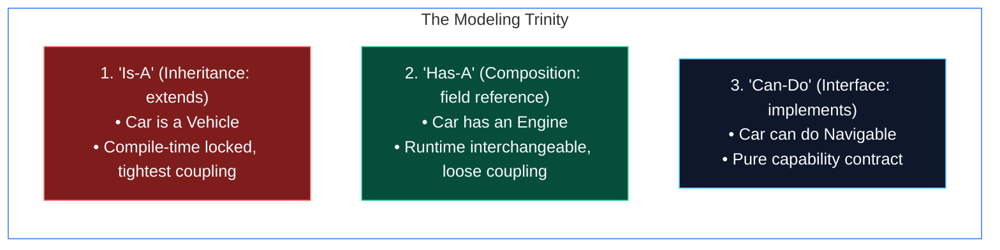
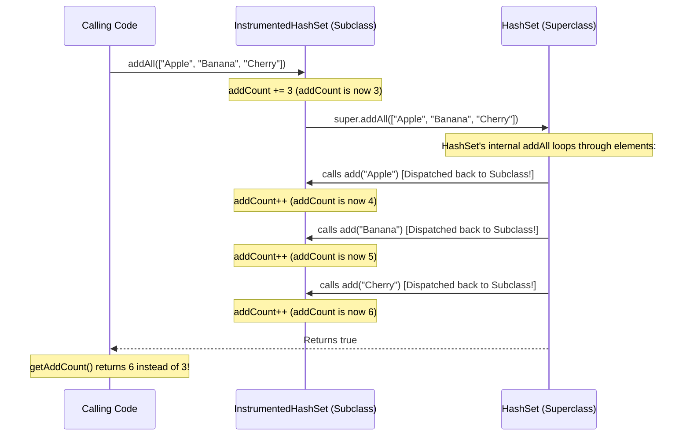
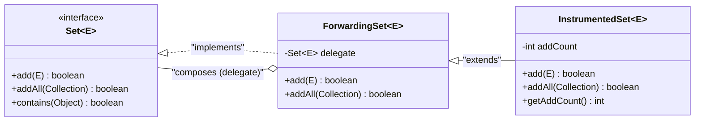
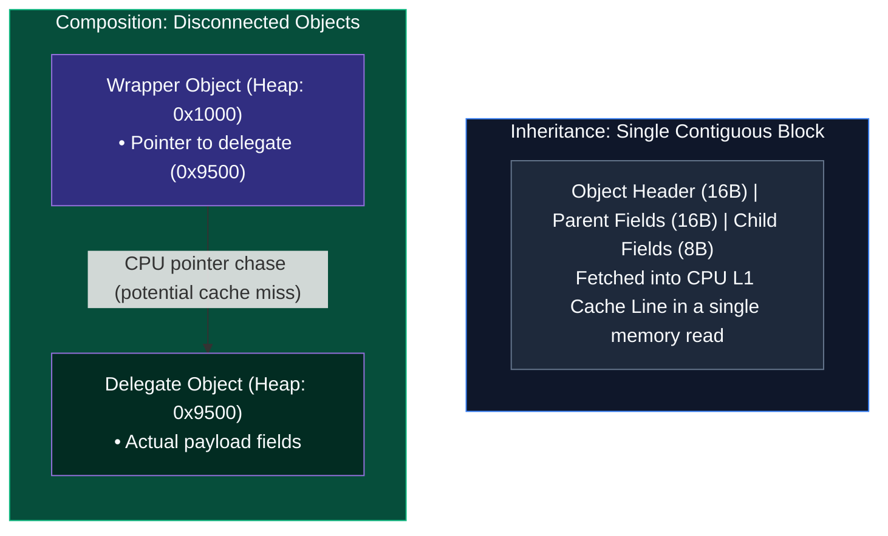

In the 1990s, when Object-Oriented Programming took over the technology landscape, inheritance was hailed as the silver bullet for software reuse. 

Textbooks taught developers to model the world with towering inheritance hierarchies: `LivingThing` -> `Animal` -> `Mammal` -> `Canine` -> `DomesticDog` -> `GoldenRetriever`. Early Java GUI toolkits like AWT and Swing featured classes with ancestry trees eight levels deep (`Object` -> `Component` -> `Container` -> `JComponent` -> `AbstractButton` -> `JButton`).

Thirty years later, the global software engineering industry arrived at an overwhelming consensus: **Inheritance is the tightest, most dangerous form of coupling available in Object-Oriented design.**

Today, the golden rule of enterprise design—immortalized in the Gang of Four's *Design Patterns* and Joshua Bloch's *Effective Java*—is unambiguous:

> **"Favor Composition over Inheritance."**

Let's dissect why inheritance frequently creates catastrophic maintenance nightmares, step through the famous Fragile Base Class problem, and master the Forwarding Class pattern that senior architects use to construct resilient, decoupled systems.

---

## The Modeling Trinity: "Is-A" vs. "Has-A" vs. "Can-Do"

When modeling domain entities, every relationship falls into one of three architectural patterns:



### The Pitfall of Mistaking "Has-A" for "Is-A"
Consider modeling a high-performance sports car:

```java
// ❌ HORRIBLE DESIGN: A Car is NOT an Engine!
public class SportsCar extends CombustionEngine {
    // What happens if we build an electric car tomorrow?
    // SportsCar cannot change its parent! It is permanently married to pistons and spark plugs!
}
```

By forcing an inheritance relationship, `SportsCar` inherits all the internal methods and fields of `CombustionEngine`. It pollutes the public API of `SportsCar` with methods like `igniteFuel()` or `replaceSparkPlug()`.

### The Composed Alternative:
```java
// ✅ SUPERIOR DESIGN: A Car HAS an Engine
public class SportsCar {
    private Engine engine; // Polymorphic interface reference!

    public SportsCar(Engine engine) {
        this.engine = engine;
    }

    public void setEngine(Engine newEngine) {
        this.newEngine = newEngine; // Interchangeable at runtime!
    }

    public void drive() {
        engine.deliverTorque();
    }
}
```

Notice the immediate architectural benefits:
1. **Runtime Flexibility:** We can pass a `V8CombustionEngine` today, an `ElectricMotor` tomorrow, or a `MockEngine` during unit testing without touching a single line of `SportsCar`.
2. **Encapsulation:** The internal mechanics of how the engine works remain completely hidden from `SportsCar`.
3. **No API Leakage:** Callers interacting with `SportsCar` only see steering, driving, and braking methods.

---

## The "Banana, Gorilla, Jungle" Problem

Why does deep inheritance turn codebases into maintenance liabilities? 

Erlang creator Joe Armstrong famously articulated the core flaw of deep class hierarchies:

> *"The problem with object-oriented languages is they've got all this implicit environment that they carry around with them. You wanted a banana, but what you got was a gorilla holding the banana and the entire jungle."*

When you inherit from a class to reuse one small helper method, you inherit the entire baggage of its superclasses:
- All their private and protected fields (occupying memory on the Heap).
- All their constructors (which must be executed in sequence).
- All their dependencies, database connections, and configuration assumptions.
- All their public methods, exposing dangerous operations you never intended your class to support.

---

## Deep Dive: The Fragile Base Class Catastrophe

The most devastating consequence of inheritance is the **Fragile Base Class Problem**.

Because a subclass relies on the internal implementation mechanics of its parent, **a completely benign change to the parent class can silently break subclasses across the enterprise—even when all method signatures remain unchanged**.

Let's recreate the legendary `InstrumentedHashSet` bug documented in *Effective Java*:

### The Scenario:
You want to create a `Set` that keeps an accurate count of how many total elements have been added to it over its entire lifetime.

You decide to subclass Java's standard `java.util.HashSet`:

```java
import java.util.Collection;
import java.util.HashSet;
import java.util.List;

public class InstrumentedHashSet<E> extends HashSet<E> {
    private int addCount = 0;

    @Override
    public boolean add(E element) {
        addCount++; // Increment counter
        return super.add(element); // Delegate to parent
    }

    @Override
    public boolean addAll(Collection<? extends E> elements) {
        addCount += elements.size(); // Increment by collection size
        return super.addAll(elements); // Delegate to parent
    }

    public int getAddCount() {
        return addCount;
    }
}
```

This code looks clean, professional, and intuitive. Now let's test it:

```java
InstrumentedHashSet<String> set = new InstrumentedHashSet<>();
set.addAll(List.of("Apple", "Banana", "Cherry"));

System.out.println("Total items added: " + set.getAddCount());
```

What does this print?
Does it print `3`?

**No. It prints `6`!**

### Why Did the Counter Double?
Let's trace the execution through the JVM's dynamic method dispatch table:



Look at the trap:
1. `addAll()` in `InstrumentedHashSet` incremented `addCount` by `3`.
2. It called `super.addAll()`.
3. Inside JDK's `HashSet`, the developers chose to implement `addAll()` by internally looping over the collection and calling `this.add()`.
4. Because `add()` was overridden in our subclass, the JVM's virtual method dispatch routed those internal calls **back down into our child class**, incrementing `addCount` three more times!

### The Nightmare of Inheritance:
Your subclass broke because it relied on an undocumented internal implementation detail of `HashSet`. 

If Oracle updates the JDK tomorrow to optimize `HashSet.addAll()` to insert elements directly into hash buckets without calling `add()`, your subclass count would change from `6` to `3` without you touching a single line of your own code!

---

## The Solution: Composition + The Forwarding Class Pattern

How do senior software architects solve this cleanly?

By replacing inheritance with **Composition and Interfaces** (the Decorator Pattern):
1. Implement the `Set<E>` interface.
2. Hold a `private final Set<E>` field representing the underlying collection.
3. Delegate all standard operations to the enclosed set.



### 1. The Reusable Forwarding Wrapper
To avoid writing dozens of boilerplate delegation methods in every customized set, we write a single, reusable `ForwardingSet`:

```java
import java.util.*;

public class ForwardingSet<E> implements Set<E> {
    private final Set<E> delegate;

    public ForwardingSet(Set<E> delegate) {
        this.delegate = delegate;
    }

    @Override public boolean add(E e) { return delegate.add(e); }
    @Override public boolean addAll(Collection<? extends E> c) { return delegate.addAll(c); }
    @Override public boolean contains(Object o) { return delegate.contains(o); }
    @Override public int size() { return delegate.size(); }
    @Override public boolean isEmpty() { return delegate.isEmpty(); }
    @Override public void clear() { delegate.clear(); }
    @Override public Iterator<E> iterator() { return delegate.iterator(); }
    // ... delegate all remaining Set interface methods
}
```

### 2. The Resilient Instrumented Decorator
Now, writing our counter set is trivial and bulletproof:

```java
public class InstrumentedSet<E> extends ForwardingSet<E> {
    private int addCount = 0;

    public InstrumentedSet(Set<E> delegate) {
        super(delegate);
    }

    @Override
    public boolean add(E e) {
        addCount++;
        return super.add(e);
    }

    @Override
    public boolean addAll(Collection<? extends E> c) {
        addCount += c.size();
        return super.addAll(c);
    }

    public int getAddCount() {
        return addCount;
    }
}
```

### The Huge Architectural Victory:
1. **100% Robust:** `InstrumentedSet` has zero dependency on how the underlying set implements its methods. Even if `HashSet.addAll()` calls `add()` internally, those calls happen inside `HashSet`'s private instance and never route back into our wrapper. `addCount` is guaranteed to be `3`.
2. **Universal Compatibility:** Our `InstrumentedSet` isn't restricted to `HashSet`! It can wrap a `TreeSet`, a `LinkedHashSet`, or an unmodifiable set created via `Set.of()`:
```java
Set<String> treeCounter = new InstrumentedSet<>(new TreeSet<>());
Set<String> hashCounter = new InstrumentedSet<>(new HashSet<>());
```

---

## The Hardware Reality: The Pointer Chasing Trade-Off

Is Composition strictly superior in every single dimension?

Architecturally, yes. But a true "Java God" knows the underlying hardware cost: **Pointer Chasing and CPU Cache Locality**.



- **Inheritance:** Superclass fields and subclass fields are packed side-by-side in a **single contiguous block** on the Heap. The CPU prefetcher loads them together into a 64-byte L1 cache line in a single RAM access.
- **Composition:** The outer wrapper object holds a 64-bit reference to the inner object. Calling a method on the inner object requires the CPU to dereference that pointer and jump to a different memory address, potentially triggering an **L1/L2/L3 cache miss**.

In ultra-low-latency high-frequency trading (HFT) engines processing millions of orders per second, cache misses matter. 

However, in 99.99% of enterprise backend systems, the maintainability, decoupling, testability, and safety of Composition vastly outweigh the sub-nanosecond cost of pointer dereferencing.

---

## Summary & Mental Model Checkpoint

1. **Favor Composition**: Code reuse is best achieved by assembling objects containing other objects ("Has-A") rather than subclassing ("Is-A").
2. **Fragile Base Class Trap**: Changes or self-invocations in a superclass can silently corrupt subclass state via dynamic method dispatch.
3. **Decorator Pattern**: Combine interfaces and composition with the Forwarding Class pattern to safely wrap and extend existing classes.
4. **Runtime Flexibility**: Composition enables hot-swapping algorithms and strategies at runtime; inheritance freezes behavior at compile time.
5. **When to Use `extends`**: Only when an unmistakable "Is-A" relationship exists, the superclass was explicitly designed and documented for extension, and both classes reside within the same package.

---

## 🎯 Senior Engineer Interview Questions

### Explain the Fragile Base Class problem and describe how self-use of methods in a superclass causes it.
> **Answer:** The Fragile Base Class problem occurs when a superclass's internal implementation details leak into its subclasses. When a superclass method invokes another of its own methods (self-use, e.g. `addAll()` internally invoking `add()`), a subclass that overrides both methods will intercept those internal calls via dynamic dispatch. If the subclass modifies state in both methods, operations like bulk additions execute child logic twice, corrupting invariants. Because this depends on undocumented internal execution paths of the superclass, updates to the superclass can silently break subclasses without changing public method signatures.

### What is the Forwarding Class (or Wrapper) pattern, and why is it superior to subclassing concrete collections?
> **Answer:** The Forwarding Class pattern implements the target interface and delegates all method invocations directly to an enclosed private instance of the interface. Subclasses extend the forwarding class to override only the specific methods they wish to instrument or decorate. This approach decouples the decorator from the concrete implementation of the underlying object, completely neutralizes the Fragile Base Class problem, and allows the decorator to wrap any arbitrary implementation of the interface (e.g. `TreeSet`, `HashSet`, or `ConcurrentSkipListSet`).

### How does Composition enable the Strategy Design Pattern in enterprise Java?
> **Answer:** Inheritance locks an object's behavior into a rigid class hierarchy determined at compile time. By composing an object with a polymorphic interface reference (the Strategy), the host object can dynamically alter its behavior at runtime simply by reassigning the reference or injecting an alternate implementation (e.g., swapping a `CreditCardPaymentStrategy` for a `PayPalPaymentStrategy` or injecting a `MockStrategy` during automated tests).

### What is the hardware-level performance difference between an inherited class and a composed wrapper object?
> **Answer:** An inherited subclass instance is allocated as a single, contiguous block of memory on the JVM Heap containing both superclass and subclass fields, which optimizes CPU spatial cache locality (loading fields together into an L1 cache line). In contrast, a composed wrapper holds an object reference (compressed OOP) to a separate heap allocation, requiring the CPU to perform an additional pointer dereference (pointer chasing) that can trigger a cache miss if the two objects reside on disparate memory pages.
