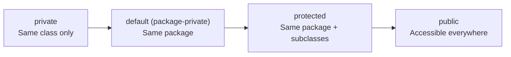

Suppose you write an `Order` class with a `public double total` field, and six other packages in your application read and modify `order.total` directly. Three months later, you realize `double` causes floating-point rounding errors on currency and you need to switch to `BigDecimal` or `long totalCents`. Or you need to enforce a rule that an order total can never drop below zero.

Because external code depends directly on the raw field, you can no longer change the internal representation or enforce new business rules in one place. Every caller breaks.

**Encapsulation** solves this by bundling data with the methods that operate on it and restricting direct access to internal state. In Java, you enforce those boundaries using **access modifiers**, intentional method design, and, wherever practical, **immutability**.

## Java's Four Access Modifiers

Java provides four visibility levels for class members (fields, methods, constructors, and nested types). Narrower visibility means fewer callers can depend on an implementation detail, which gives you more freedom to refactor later.

| Modifier | Same Class | Same Package | Subclass (Different Package) | Everywhere Else |
| :--- | :---: | :---: | :---: | :---: |
| `private` | Yes | No | No | No |
| `default` (no keyword) | Yes | Yes | No | No |
| `protected` | Yes | Yes | Yes* | No |
| `public` | Yes | Yes | Yes | Yes |

\*There is a subtle rule for `protected` across packages, covered below.



Note that **top-level classes** can only be `public` or package-private (no modifier). You cannot declare a top-level class `private` or `protected`, because top-level classes have no enclosing class to own them.

### `private`

A `private` member is visible only inside the enclosing class. Neither subclasses nor other classes in the same package can access it directly.

`private` should be your default choice for fields and internal helper methods. If a helper method is `private`, you can rename, inline, or delete it with full confidence that no other file in the repository calls it.

> [!NOTE]
> Inside the same top-level file, an outer class and its nested/inner classes can access each other's `private` members. Prior to Java 11, `javac` generated hidden synthetic bridge methods (`access$000`) to make this work in bytecode. Java 11 introduced **Nest-Based Access Control (JEP 181)** so the JVM supports private access among nestmates directly.

### `default` (Package-Private)

When you omit an access modifier altogether, Java assigns **package-private** visibility: any class in the exact same package can see the member or class, and no class outside the package can.

Package-private is easy to overlook, yet it is one of the cleanest ways to structure a Java package:

```text
com.acme.billing/
  InvoiceService.java      // public: entry point for other packages
  TaxCalculator.java       // package-private: internal collaborator
  DiscountPolicy.java      // package-private: internal collaborator
  InvoiceRepository.java   // package-private: internal persistence helper
```

Other packages (such as `com.acme.api` or `com.acme.shipping`) can only see `InvoiceService`. The internal classes collaborate freely inside `com.acme.billing`, and you can reorganize or rewrite `TaxCalculator` without affecting any external caller.

### `protected`

A `protected` member is accessible to every class in the same package **and** to subclasses located in other packages.

Two nuances trip developers up with `protected`:

1. **Cross-package access requires a subclass reference:** If `Parent` is in package `a` with `protected int count`, and `Child extends Parent` is in package `b`, code inside `Child` can access `this.count` or `otherChild.count`, but it **cannot** access `parentInstance.count` through a plain `Parent` variable.
2. **Design commitment:** Making a method `protected` in a `public` class makes it part of your supported inheritance API. External subclasses can override or call it, which makes changing it later almost as hard as changing a `public` method. Use `protected` deliberately, only when a class is genuinely designed to be subclassed.

### `public`

A `public` member is visible to every class in the application (or to any module that exports its package when using the Java Platform Module System). Treat `public` methods as a long-term contract: once other teams or modules call them, changing parameter lists or behavior becomes expensive.

A practical rule of thumb: start with the narrowest visibility that compiles (`private`), widen to package-private when collaborating classes in the same package need it, and mark only the deliberate external API as `public`.

## Information Hiding Principles

Access modifiers are the syntax; **information hiding** is the design principle behind them.

Information hiding means concealing internal representation choices so callers only interact with a stable set of operations. Look at how that pays off in a simple `Temperature` class:

```java
public final class Temperature {
    // Internal storage could be Celsius, Kelvin, or Fahrenheit.
    // Callers do not know and do not care.
    private final double kelvin;

    private Temperature(double kelvin) {
        if (kelvin < 0.0) {
            throw new IllegalArgumentException("Temperature cannot be below absolute zero.");
        }
        this.kelvin = kelvin;
    }

    public static Temperature ofCelsius(double celsius) {
        return new Temperature(celsius + 273.15);
    }

    public static Temperature ofFahrenheit(double fahrenheit) {
        return new Temperature((fahrenheit - 32.0) * 5.0 / 9.0 + 273.15);
    }

    public double toCelsius() {
        return kelvin - 273.15;
    }

    public double toFahrenheit() {
        return (kelvin - 273.15) * 9.0 / 5.0 + 32.0;
    }
}
```

If you later switch the private field from `kelvin` to `celsius` or a scaled integer, zero calling code changes. Information hiding also ensures the invariant (`kelvin >= 0.0`) holds across every instance ever created.

People sometimes mix up **encapsulation** and **abstraction**. They work together, but they answer different questions:

- **Encapsulation** hides internal state and protects invariants inside a class boundary.
- **Abstraction** simplifies complexity by exposing *what* an operation does (for example, through an interface like `PaymentProcessor`) while hiding *how* a specific implementation carries it out.

## Getters, Setters, and Why Blind Accessors Break Encapsulation

A common beginner habit is marking every field `private` and immediately letting the IDE generate a `getX()` and `setX()` method for every single field:

```java
public class BankAccount {
    private long balanceCents;
    private boolean frozen;

    public long getBalanceCents() { return balanceCents; }
    public void setBalanceCents(long balanceCents) { this.balanceCents = balanceCents; }

    public boolean isFrozen() { return frozen; }
    public void setFrozen(boolean frozen) { this.frozen = frozen; }
}
```

Marking `balanceCents` as `private` and immediately exposing an unrestricted `setBalanceCents(long)` offers almost no protection over a `public` field. Any caller can write `account.setBalanceCents(-99_000)` or change the balance of a frozen account without triggering a single check.

When classes are reduced to bags of getters and setters while all validation lives in external service classes, the design turns into an **anemic domain model**: the same validation rules get duplicated across multiple callers, and it is easy for one caller to forget a check.

### Prefer Behavior-Focused Methods ("Tell, Don't Ask")

Instead of pulling state out of an object, checking rules outside, and pushing a new value back in with a setter, put the domain operation on the class itself:

```java
public class BankAccount {
    private long balanceCents;
    private boolean frozen;

    public BankAccount(long openingBalanceCents) {
        if (openingBalanceCents < 0) {
            throw new IllegalArgumentException("Opening balance cannot be negative.");
        }
        this.balanceCents = openingBalanceCents;
    }

    public void deposit(long amountCents) {
        ensureActive();
        if (amountCents <= 0) {
            throw new IllegalArgumentException("Deposit amount must be positive.");
        }
        this.balanceCents = Math.addExact(this.balanceCents, amountCents);
    }

    public void withdraw(long amountCents) {
        ensureActive();
        if (amountCents <= 0) {
            throw new IllegalArgumentException("Withdrawal amount must be positive.");
        }
        if (amountCents > this.balanceCents) {
            throw new IllegalStateException("Insufficient funds.");
        }
        this.balanceCents -= amountCents;
    }

    public void freeze() {
        this.frozen = true;
    }

    // Read-only getters are fine when callers legitimately need to inspect state
    public long getBalanceCents() {
        return balanceCents;
    }

    public boolean isFrozen() {
        return frozen;
    }

    private void ensureActive() {
        if (frozen) {
            throw new IllegalStateException("Account is frozen.");
        }
    }
}
```

Notice also why this example uses `long` minor units (cents) instead of `double`: binary floating-point types cannot represent decimal fractions like `0.10` accurately, so production financial code uses `BigDecimal` or integer minor units.

### When Getters and Setters Make Sense

Getters and setters are not inherently bad; *unthinking* setters are.

- **Read-only getters** are normal and useful whenever callers need to display, log, or serialize state (as long as getters return defensive copies or unmodifiable views for mutable fields).
- **Validated setters** make sense when a property can legitimately change independently and the setter enforces valid bounds (for example, `setTimeout(Duration timeout)` rejecting zero or negative durations).
- **Data Transfer Objects (DTOs)** at API boundaries exist purely to carry JSON or request payloads; even there, immutable Java `record` types are usually cleaner than mutable getter/setter classes.

## Immutability Concepts

One of the simplest ways to protect an object's invariants is to prevent its state from changing at all after construction. An **immutable object** is initialized once in its constructor and stays in that exact state for its entire lifetime.

Why immutable objects are heavily favored in Java:

- **Built-in thread safety:** Multiple threads can read an immutable object concurrently without locks or synchronization, because no thread can mutate it.
- **No accidental aliasing bugs:** You can pass references around freely or cache them without worrying that some downstream method will mutate them.
- **Reliable `Map` keys and `Set` elements:** If a mutable object's fields change after you insert it into a `HashMap` or `HashSet`, its `hashCode()` can change and the entry becomes unreachable. Immutable keys never suffer from this bug.
- **Failure atomicity:** Because operations return a *new* instance instead of mutating in place, an exception mid-operation never leaves an existing object half-updated.

### Practical Immutability Checklist

To make a standard Java class genuinely immutable, check all five boxes:

1. **Prevent subclassing:** Declare the class `final` (or keep constructors `private` and expose static factory methods) so a subclass cannot override methods to simulate mutable state.
2. **Make all fields `private` and `final`:** Ensures fields are assigned once during construction and are safely published across threads.
3. **Provide no mutator methods:** No setters and no methods that modify fields in place. If you need a "change" operation (like `LocalDate.plusDays(1)`), return a new instance.
4. **Defensively copy mutable inputs in the constructor:** If a caller passes a `List`, array, or `Date`, copy it before storing (and before validating).
5. **Never expose raw mutable fields from getters:** Return an unmodifiable copy/view (`List.copyOf(...)`, `Collections.unmodifiableList(...)`) or a defensive copy.

Here is a complete immutable class following every step:

```java
import java.util.List;
import java.util.Objects;

public final class AuditEvent {
    private final String eventId;
    private final List<String> affectedHosts;

    public AuditEvent(String eventId, List<String> affectedHosts) {
        this.eventId = Objects.requireNonNull(eventId, "eventId must not be null");
        Objects.requireNonNull(affectedHosts, "affectedHosts must not be null");

        // List.copyOf (Java 10+) both copies the input and makes it unmodifiable,
        // and also rejects null elements.
        this.affectedHosts = List.copyOf(affectedHosts);
    }

    public String getEventId() {
        return eventId;
    }

    public List<String> getAffectedHosts() {
        // Safe to return directly because List.copyOf already created an unmodifiable list
        return affectedHosts;
    }
}
```

If a caller modifies the original `ArrayList` they passed to `new AuditEvent(...)`, `AuditEvent` is unaffected. If a caller attempts `event.getAffectedHosts().add("db-9")`, Java throws `UnsupportedOperationException`.

### Records for Concise Immutable Data Carriers (Java 16+)

Writing immutable classes by hand involves repetitive boilerplate (`final` fields, constructor, getters, `equals`, `hashCode`, `toString`). Java previewed **Records** in Java 14 and 15 and finalized them in **Java 16 (JEP 395)**:

```java
import java.util.List;
import java.util.Objects;

public record AuditRecord(String eventId, List<String> affectedHosts) {
    // Compact constructor runs before fields are assigned
    public AuditRecord {
        Objects.requireNonNull(eventId, "eventId must not be null");
        Objects.requireNonNull(affectedHosts, "affectedHosts must not be null");
        // Reassign parameter to an unmodifiable defensive copy!
        affectedHosts = List.copyOf(affectedHosts);
    }
}
```

The compiler generates a `final` class, `private final` fields, accessor methods (`eventId()`, `affectedHosts()`), and value-based `equals`, `hashCode`, and `toString`.

> [!WARNING]
> By default, a `record` is only **shallowly immutable**. If you declare `record AuditRecord(String eventId, List<String> affectedHosts)` *without* calling `List.copyOf(affectedHosts)` in the compact constructor, the list reference cannot be reassigned, but external code can still call `.add()` or `.clear()` on the underlying `ArrayList`. Always defensively copy mutable components inside the compact constructor.

## Practical Questions

### Why isn't making every field `private` and generating public getters and setters true encapsulation?
Encapsulation is about hiding internal representation and enforcing invariants, not just adding getter/setter syntax. An unrestricted `setBalance(long)` lets callers put an object into invalid states and couples external code directly to the field's type. Real encapsulation exposes meaningful domain operations (`deposit`, `withdraw`) that validate state transitions internally.

### When should you choose package-private (`default`) over `public`?
Use package-private for helper classes, internal repositories, and package-scoped methods that exist to support a feature within one package but should not be called directly from the rest of the application. Keeping those types package-private shrinks your public API surface and lets you refactor internals safely.

### Why does a `final` reference field not guarantee immutability by itself?
`final` on a reference field only means the field cannot be reassigned to point to a different object after construction. If the field points to a mutable object like an `ArrayList`, `HashMap`, or `Date`, callers can still mutate the contents of that object unless you defensively copy it on entry and avoid exposing mutable references on exit.

### What is the subtle restriction on `protected` members accessed from a subclass in another package?
Inside a subclass in a different package, you can access a superclass's `protected` member on `this` or on another instance of your own subclass, but you cannot access that `protected` member through a reference typed as the superclass itself. This prevents a subclass in one package from reaching into the protected internals of an unrelated subclass instance of the same parent.
