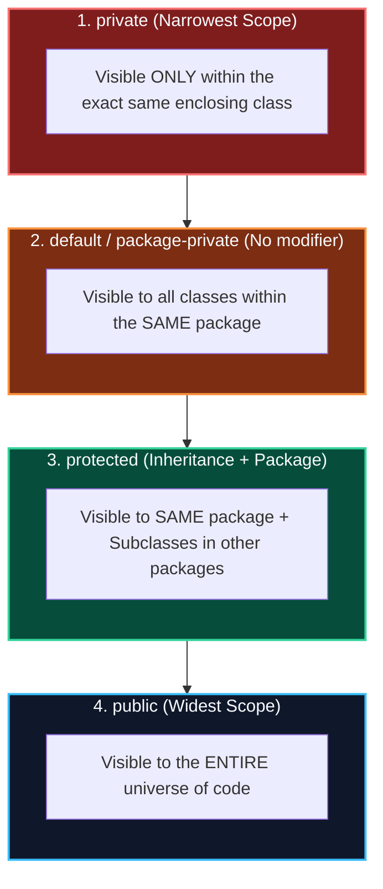
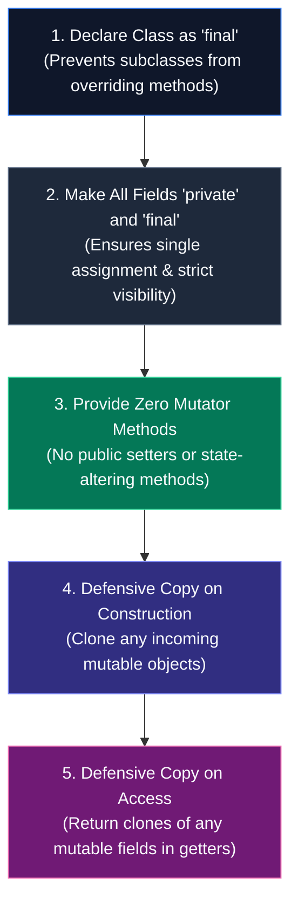

Imagine you are driving a modern car. 

On your dashboard, you have an intuitive interface: a steering wheel, a gas pedal, a brake, and a gear selector. When you press the gas pedal, you do not manually calculate fuel injection timing, trigger spark plug firing angles, or pump hydraulic fluids through steel lines. 

The engine block conceals those thousands of volatile moving parts behind a firewall. You are only given the safe, validated inputs needed to operate the vehicle.

If cars did not have engine hoods—if every passenger could reach into the transmission gears while cruising down the highway at 70 mph—a single errant touch would cause catastrophic mechanical failure.

**Encapsulation is the engine hood of software engineering.**

It is not merely a rule about writing `private` and generating getters and setters. Encapsulation is the deliberate discipline of **bundling state with behavior, hiding internal complexity, and establishing non-negotiable boundaries** so that outside code cannot corrupt your system's integrity.

Let's explore how Java's access modifiers work under the hood, why package-private is an underappreciated architectural tool, and how to avoid the "anemic domain model" trap.

---

## The Visibility Hierarchy: Java's Four Gatekeepers

Java provides four levels of visibility. Choosing the correct modifier defines the **blast radius** of your code: the smaller the visibility, the freer you are to refactor your code tomorrow without breaking other teams.



| Access Modifier | Enclosing Class | Same Package | Subclass (Other Package) | Global World |
| :--- | :---: | :---: | :---: | :---: |
| `private` | **YES** | NO | NO | NO |
| `default` *(no keyword)* | **YES** | **YES** | NO | NO |
| `protected` | **YES** | **YES** | **YES** | NO |
| `public` | **YES** | **YES** | **YES** | **YES** |

---

## Deep Dive into the Four Modifiers

### `private`: The Atomic Vault
Marking a member `private` means that only code between the `{` and `}` of that specific class can see it. 

Even if another class lives in the exact same package or extends your class as a child, it is completely blind to private members.

> [!NOTE]
> **Java 11 Nestmates Feature:**
> In older Java versions, an inner class accessing a private field of its outer class required the compiler to inject invisible synthetic bridge methods (`access_000`). Java 11 introduced **Nest-Based Access Control** (JEP 181), allowing nestmates to access each other's private fields natively in bytecode without performance or security overhead.

---

### `default` (Package-Private): The Architect's Secret Weapon
If you do not prefix a class, method, or field with any access modifier, Java assigns it **package-private** access.

Many junior developers assume that leaving off a modifier is an accident. In senior domain-driven architecture, **package-private is the most powerful tool for modular encapsulation**.

Imagine an order fulfillment package:
```text
com.mycompany.fulfillment/
├── OrderService.java        (public: The only class outside packages can talk to)
├── InventoryValidator.java  (package-private: internal helper)
├── TaxCalculator.java       (package-private: internal helper)
└── ShippingLabelGen.java    (package-private: internal helper)
```

By marking helper classes as package-private:
- `OrderService` can use `InventoryValidator` freely because they live in the same package.
- Other packages (like `com.mycompany.web.controllers`) **cannot even see `InventoryValidator`**. 
- You can completely rewrite, delete, or replace `TaxCalculator` next week, and you have 100% mathematical certainty that zero external classes will break!

---

### `protected`: The Fragile Inheritance Bridge
`protected` grants access to two distinct groups:
1. Any class in the **same package** (identical to package-private).
2. Any **subclass**, even if that subclass lives in a completely different package or third-party library.

> [!CAUTION]
> **The `protected` Trap:**
> In practice, `protected` is often an architectural smell. Once you publish a `protected` method in a public class, any developer anywhere can subclass your class and depend on that method. You have leaked internal mechanics into an inheritance hierarchy that is almost impossible to change without breaking downstream clients. Prefer composition and interfaces over `protected` hooks.

---

### `public`: The Irrevocable Public Contract
`public` means global exposure. Every class, in every package, in every module can call this member.

Whenever you mark a method `public`, you are making a binding architectural promise. Once other teams begin calling your public method, you can never change its parameters or delete it without causing compile failures across the organization.

**Golden Rule of API Design:** Start everything as `private`. Elevate to package-private only when internal package collaborators need access. Elevate to `public` only for the explicit external interface.

---

## The Getter/Setter Anti-Pattern & "Tell, Don't Ask"

One of the greatest misconceptions in Java education is that "Encapsulation means making fields private and generating getters and setters for all of them."

Look at this class:

```java
public class BankAccount {
    private double balance;

    public double getBalance() {
        return balance;
    }

    public void setBalance(double balance) {
        this.balance = balance;
    }
}
```

Is this class encapsulated? **Absolutely not!** 

Writing a blind public setter on a private field is functionally identical to making the field `public`. Any external caller can write:

```java
// Bypassing business rules entirely:
account.setBalance(-50000.0);
```

This anti-pattern is known as an **Anemic Domain Model**: an object that is just a dumb data bag with zero internal behavior, forcing the caller to perform all the logic.

### The Solution: The "Tell, Don't Ask" Principle
Instead of asking an object for its data, manipulating the data outside, and setting it back, **tell the object what business operation to perform**:

```java
public class BankAccount {
    private double balance;
    private boolean isFrozen;

    // Encapsulated Business Operation
    public void withdraw(double amount) {
        if (isFrozen) {
            throw new IllegalStateException("Account is currently frozen.");
        }
        if (amount <= 0) {
            throw new IllegalArgumentException("Withdrawal amount must be greater than zero.");
        }
        if (amount > this.balance) {
            throw new InsufficientFundsException("Insufficient balance for withdrawal.");
        }
        this.balance -= amount;
    }

    // Read-only getter is fine:
    public double getBalance() {
        return this.balance;
    }
}
```

Now, the `BankAccount` object fiercely guards its own state. It is physically impossible for the balance to become negative or for money to be withdrawn from a frozen account.

---

## Immutability: The Highest Form of Encapsulation

What is safer than a class that protects its state? **A class whose state can never change at all.**

An **Immutable Object** is created once and remains frozen in that exact state until it is garbage collected.

### Why Senior Architects Strive for Immutability:
1. **Zero Thread-Safety Hazards:** Because immutable objects cannot be modified, multiple concurrent threads can read them simultaneously without locks, mutexes, or synchronization overhead.
2. **Failure Atomicity:** An immutable object cannot be left in a half-corrupted intermediate state if an exception is thrown.
3. **Safe Hash Keys:** When used as keys in a `HashMap` or `HashSet`, their hash codes never change, preventing lost keys.

---

## The 5 Iron Rules for Crafting Immutable Classes

To build a strictly immutable class in Java, you must follow Joshua Bloch's five rules:



### The Defensive Copying Implementation:

```java
import java.util.ArrayList;
import java.util.Collections;
import java.util.List;

// Rule 1: final class
public final class SecurityAuditRecord {

    // Rule 2: private and final fields
    private final String incidentId;
    private final List<String> affectedServers;

    // Rule 3: Constructor only
    public SecurityAuditRecord(String incidentId, List<String> affectedServers) {
        this.incidentId = incidentId; // String is already immutable

        // Rule 4: Defensive copy of mutable collection on entry!
        this.affectedServers = new ArrayList<>(affectedServers);
    }

    public String getIncidentId() {
        return this.incidentId;
    }

    // Rule 5: Defensive protection on exit!
    public List<String> getAffectedServers() {
        // Return an unmodifiable wrapper so external callers cannot mutate our list!
        return Collections.unmodifiableList(this.affectedServers);
    }
}
```

---

## Modern Java: Records for Immutable Data Carriers

In **Java 14+**, Java introduced **Records** (JEP 395) to eliminate the verbose boilerplate of creating immutable data holders:

```java
public record UserProfile(String username, String email, int loyaltyPoints) {
    // Compact constructor for validation
    public UserProfile {
        if (loyaltyPoints < 0) {
            throw new IllegalArgumentException("Loyalty points cannot be negative.");
        }
    }
}
```

With just three lines of code, the Java compiler automatically generates:
- A `final` class with `private final` fields.
- Canonical constructor with validation.
- Accessor methods (`username()`, `email()`, `loyaltyPoints()`).
- High-performance, field-aware implementations of `equals()`, `hashCode()`, and `toString()`.

> [!WARNING]
> Records are **shallowly immutable**. If a Record holds a reference to a mutable object (like an `ArrayList`), the list reference cannot be reassigned, but the elements inside the list *can still be modified*. Always wrap mutable collections in unmodifiable views!

---

## Summary & Mental Model Checkpoint

1. **Information Hiding**: Keep fields private to protect class invariants and decouple internal mechanics from public API contracts.
2. **The 4 Modifiers**: `private` (class only), `default` (same package), `protected` (package + subclasses), and `public` (open to the universe).
3. **Package-Private for Modularity**: Use package-private classes to build cohesive internal package modules without polluting the public API.
4. **Tell, Don't Ask**: Eliminate dumb setters; write expressive business methods that enforce validation internally.
5. **Rules of Immutability**: `final` class, `private final` fields, no setters, and defensive copies on mutable entry and exit points.
6. **Records (Java 14+)**: Concise, compiler-guaranteed immutable data carriers.

---

## 🎯 Senior Engineer Interview Questions

### Why is returning an unmodifiable collection view (like `Collections.unmodifiableList()`) preferable to cloning a list in getters?
> **Answer:** Cloning an entire list on every getter call allocates a brand-new list object and array on the Heap, resulting in `O(n)` time complexity and intense memory pressure on the Garbage Collector. In contrast, `Collections.unmodifiableList()` is a lightweight `O(1)` wrapper around the existing list that simply intercepts mutation methods (like `.add()` or `.remove()`) and throws `UnsupportedOperationException`, preserving encapsulation with zero copying overhead.

### What is the architectural difference between Encapsulation and Abstraction?
> **Answer:** Encapsulation is about **Information Hiding and Protection**—bundling state and methods together while restricting direct access to internal fields to safeguard invariants. Abstraction is about **Complexity Reduction and Contract Definition**—hiding the implementation mechanics (how something works) while exposing only the essential interface (what it does), typically realized through abstract classes and interfaces.

### Can a top-level class in Java be declared as `private` or `protected`? Why?
> **Answer:** No. A top-level class can only be declared `public` or package-private (no modifier). Declaring a top-level class `private` would mean no other class could ever access it, rendering it completely useless to the compiler and runtime. Declaring it `protected` is nonsensical because `protected` includes subclass access outside the package, but without an enclosing class to define an inheritance root, top-level accessibility is strictly bounded by the package or the universe.

### How does Java 11's Nestmates feature (JEP 181) improve encapsulation between outer and inner classes at the bytecode level?
> **Answer:** Prior to Java 11, the JVM bytecode specification did not recognize nested classes; the compiler generated separate `.class` files (e.g. `Outer_Inner.class`). To allow the inner class to access private members of the outer class, `javac` had to generate synthetic package-private accessor methods (`access_000`). This slightly weakened encapsulation and bloated bytecode. Java 11 introduced native nestmate attributes in the class file (`NestMembers` and `NestHost`), allowing the JVM to directly verify and permit private member access between nested classes without synthetic bridges.
