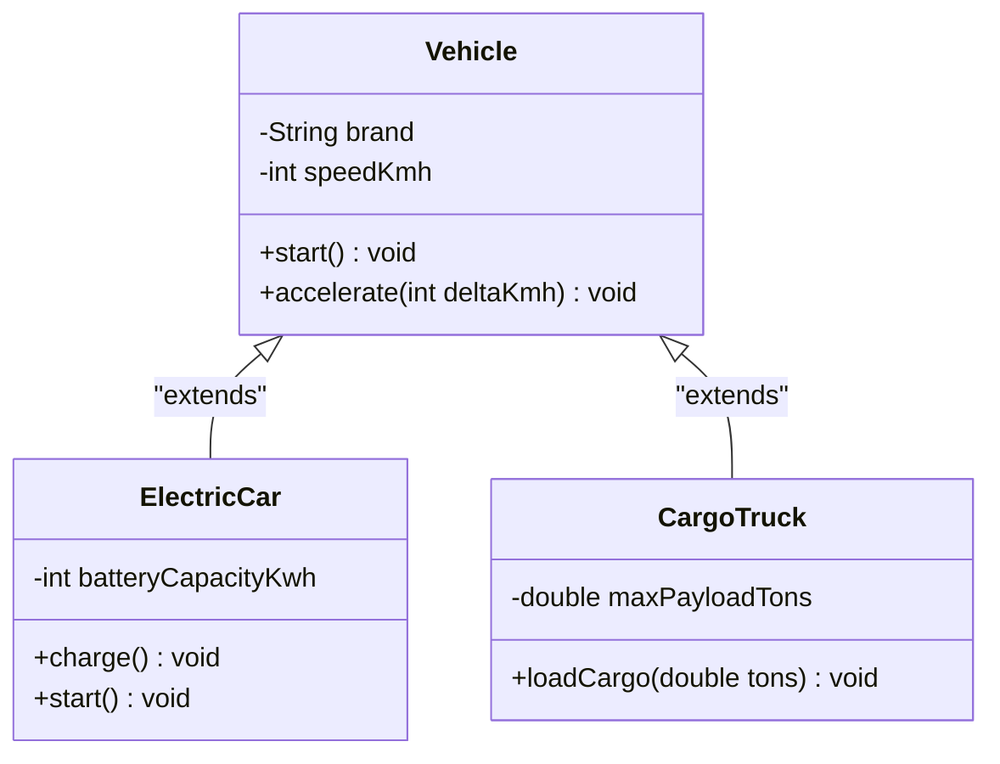
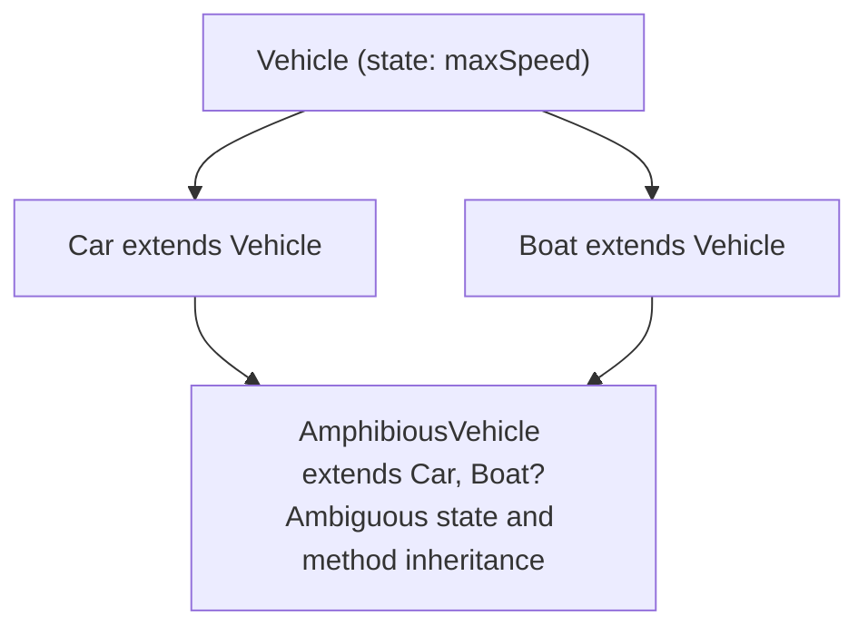

When two classes share common state and behavior, duplicating the same fields and methods across both files quickly creates maintenance drift. Java's **inheritance** mechanism lets one class (the **subclass** or child) extend another class (the **superclass** or parent), inheriting its accessible fields and methods while adding or specializing behavior of its own.

Inheritance is genuinely useful when one type is a true specialization of another, such as `CheckingAccount` extending `BankAccount` or `FileNotFoundException` extending `IOException`. At the same time, overusing inheritance purely to share helper code produces deep, tangled hierarchies where a small change in a base class breaks subclasses unexpectedly. Knowing both how inheritance works mechanically and where its boundaries lie will keep your designs clean.

## The `extends` Keyword and the "Is-A" Test

You declare an inheritance relationship in Java using `extends`:

```java
public class Vehicle {
    private final String brand;
    private int speedKmh;

    public Vehicle(String brand) {
        this.brand = brand;
        this.speedKmh = 0;
    }

    public String getBrand() {
        return brand;
    }

    public int getSpeedKmh() {
        return speedKmh;
    }

    public void accelerate(int deltaKmh) {
        if (deltaKmh <= 0) {
            throw new IllegalArgumentException("Acceleration must be positive.");
        }
        this.speedKmh += deltaKmh;
    }

    public void start() {
        System.out.println(brand + " is starting.");
    }
}

public class ElectricCar extends Vehicle {
    private final int batteryCapacityKwh;

    public ElectricCar(String brand, int batteryCapacityKwh) {
        super(brand);
        this.batteryCapacityKwh = batteryCapacityKwh;
    }

    public int getBatteryCapacityKwh() {
        return batteryCapacityKwh;
    }

    public void charge() {
        System.out.println("Charging " + getBrand() + " (" + batteryCapacityKwh + " kWh).");
    }
}
```

Before reaching for `extends`, apply the **"is-a"** test (more formally, the Liskov Substitution Principle): can an instance of the subclass safely stand in anywhere the superclass is expected?

- An `ElectricCar` **is a** `Vehicle`. Anywhere code expects a `Vehicle`, an `ElectricCar` makes sense.
- A `Car` **is not an** `Engine`. A car *has an* engine, which calls for **composition** (holding an `Engine` field inside `Car`), not inheritance.



### Single Inheritance and Avoiding the Diamond Problem

In Java, a class can extend **at most one** superclass:

```java
// Compile error: Java does not allow multiple class inheritance
public class AmphibiousVehicle extends Car, Boat { }
```

Java restricts classes to single inheritance to avoid the **diamond problem** of inherited state: if both `Car` and `Boat` extended `Vehicle` and each maintained or modified inherited fields differently, an `AmphibiousVehicle` extending both would face ambiguous field layout and conflicting implementations.



Instead, Java supports **single inheritance of implementation (classes)** and **multiple inheritance of type (interfaces)**, which you will explore in the Abstraction lesson.

### What Happens in Memory for a Subclass Instance

When you run `new ElectricCar("Rivian", 135)`, the JVM does **not** allocate two separate objects (a `Vehicle` object and an `ElectricCar` object). It allocates **one single object** on the Heap that contains all fields from `Object`, `Vehicle`, and `ElectricCar` together.

Notice an important detail about `private` fields: `brand` and `speedKmh` are `private` in `Vehicle`, yet they **still occupy memory inside every `ElectricCar` instance**. The `private` modifier is an access restriction enforced by the compiler and JVM access checks, not a memory-exclusion rule. `ElectricCar` interacts with those fields indirectly through `Vehicle`'s constructors and methods (`getBrand()`, `accelerate(...)`).

*(Implementation note: In HotSpot JVM on 64-bit platforms, a single object consists of an object header—typically 12 bytes with compressed class pointers or 16 bytes without—followed by superclass fields, subclass fields, and alignment padding to an 8-byte boundary. Exact field ordering and padding are JVM implementation details, not Java language guarantees.)*

## The `super` Keyword and Constructor Chaining

The `super` keyword lets a subclass interact directly with its immediate parent class in two ways: invoking a superclass constructor (`super(...)`) and calling an overridden method or accessing a hidden member (`super.method()`).

### Constructor Chaining with `super(...)`

A subclass object cannot be initialized until its superclass portion is initialized first. For that reason, every constructor in Java begins by executing a superclass constructor (unless it chains to another constructor in the same class using `this(...)`, which will itself call `super(...)`).

```java
public class BaseEntity {
    private final String id;

    public BaseEntity(String id) {
        this.id = id;
        System.out.println("1. BaseEntity initialized: " + id);
    }

    public String getId() {
        return id;
    }
}

public class Account extends BaseEntity {
    private final String owner;

    public Account(String id, String owner) {
        super(id); // Must run before subclass fields are initialized
        this.owner = owner;
        System.out.println("2. Account initialized for: " + owner);
    }
}
```

Creating `new Account("acc-42", "Maya")` prints:

```text
1. BaseEntity initialized: acc-42
2. Account initialized for: Maya
```

### The Implicit `super()` Rule and a Common Compile Error

If you do not write an explicit `super(...)` or `this(...)` call in a subclass constructor, the compiler automatically inserts `super();` (calling the parent's no-args constructor).

That works fine as long as the parent has an accessible no-args constructor. If the parent defines **only parameterized constructors** (like `BaseEntity(String id)` above), there is no no-args `BaseEntity()` constructor, and omitting `super(id)` causes a compile error:

```text
constructor BaseEntity in class BaseEntity cannot be applied to given types;
  required: java.lang.String
  found:    no arguments
```

*(Version note: Prior to JEP 447/482 preview in Java 22-24 and JEP 513 finalized in Java 25, `super(...)` had to be the very first statement in a constructor. Modern Java 25 allows validating arguments or preparing local variables before `super(...)`, as long as the code does not read `this` before the superclass constructor finishes.)*

### Calling Parent Behavior with `super.method()`

When a subclass overrides a method, it often wants to *extend* the parent's behavior rather than replace it completely. Use `super.methodName(...)` to delegate to the parent's implementation:

```java
public class LoggingElectricCar extends ElectricCar {
    public LoggingElectricCar(String brand, int batteryCapacityKwh) {
        super(brand, batteryCapacityKwh);
    }

    @Override
    public void start() {
        super.start(); // Runs superclass behavior first
        System.out.println("Battery telemetry online.");
    }
}
```

Note that `super` only reaches one level up; Java does not allow `super.super.start()` because bypassing an immediate parent could violate invariants that the parent maintains.

## Method Overriding vs. Method Overloading

Method **overriding** and method **overloading** sound similar and are tested constantly in Java interviews, yet they are completely different mechanisms.

- **Overloading** defines multiple methods with the **same name** and **different parameter lists** (usually in the same class, though a subclass can also add a new overload alongside an inherited method). The compiler picks which overload to call at **compile time** using the declared argument types.
- **Overriding** redefines an inherited instance method in a **subclass** with the **exact same name and parameter list**. The JVM picks which implementation to run at **runtime** based on the actual object type on the Heap (**dynamic dispatch** via `invokevirtual`).

| Feature | Method Overloading | Method Overriding |
| :--- | :--- | :--- |
| Where it happens | Same class (or subclass adding a new parameter list) | Subclass redefining an inherited superclass method |
| Method name | Same | Same |
| Parameter list | **Must differ** (count, types, or order) | **Must match exactly** |
| Return type | Can be anything (not part of overload signature) | Same type, or a **covariant subtype** (Java 5+) |
| Access modifier | Any | Cannot be more restrictive (can widen, e.g. `protected` to `public`) |
| Checked exceptions | Independent per overload | Cannot declare new or broader checked exceptions |
| Binding time | **Compile time** (static binding) | **Runtime** (dynamic dispatch) |
| Applies to `static` / `private` / `final`? | Yes, you can overload them | No (`static` hides; `private` is invisible; `final` fails to compile) |

### Seeing Both Side by Side

```java
class NotificationService {
    // Method 1: Base version
    public void send(String message) {
        System.out.println("Generic notification: " + message);
    }

    // Overloaded method: same name, different parameter list (compile-time choice)
    public void send(String message, int priority) {
        System.out.println("Generic notification [priority=" + priority + "]: " + message);
    }
}

class EmailNotificationService extends NotificationService {
    // Overridden method: same name and parameter list as superclass (runtime choice)
    @Override
    public void send(String message) {
        System.out.println("Email sent: " + message);
    }
}

public class DispatchDemo {
    public static void main(String[] args) {
        NotificationService service = new EmailNotificationService();

        // Runtime dispatch calls EmailNotificationService.send(String)
        service.send("Order shipped");

        // Compile-time overload resolution picks send(String, int), inherited from NotificationService
        service.send("Server down", 1);
    }
}
```

Output:

```text
Email sent: Order shipped
Generic notification [priority=1]: Server down
```

### Rules of Method Overriding

Java enforces four rules on overriding methods so that any subclass remains safely substitutable for its superclass:

1. **Exact signature match:** Method name and parameter types must match the superclass method.
2. **Access level cannot be narrowed:** You can widen visibility (`protected` to `public`), because callers who already had access still have access. Narrowing visibility (`public` to `protected` or `private`) is a compile error.
3. **Checked exceptions cannot be broadened:** An overriding method may throw the same checked exceptions, narrower subclasses of them, or none at all. It cannot add new checked exceptions that callers holding a superclass reference did not catch. (Unchecked `RuntimeException`s have no such compile-time restriction.)
4. **Covariant return types (Java 5+):** If the parent method returns a reference type (for example `Vehicle`), the overriding method may return a more specific subtype (for example `ElectricCar`):

```java
class VehicleFactory {
    public Vehicle create(String brand) {
        return new Vehicle(brand);
    }
}

class ElectricCarFactory extends VehicleFactory {
    @Override
    public ElectricCar create(String brand) { // Covariant return type
        return new ElectricCar(brand, 100);
    }
}
```

Callers working directly with `ElectricCarFactory` get an `ElectricCar` back without casting, while callers working with a `VehicleFactory` reference still receive a valid `Vehicle`. (Covariant returns do not apply to primitive return types: you cannot override a method returning `long` with one returning `int`.)

### Always Use `@Override` to Catch Accidental Overloading

One of the easiest bugs to introduce in Java is intending to override a method but accidentally overloading it instead. The classic example is writing `equals`:

```java
public class Book {
    private final String isbn;

    public Book(String isbn) {
        this.isbn = isbn;
    }

    // Bug: parameter is Book, NOT Object! This OVERLOADS Object.equals instead of overriding it.
    // Adding @Override here immediately catches the bug at compile time!
    public boolean equals(Book other) {
        return other != null && this.isbn.equals(other.isbn);
    }
}
```

If you put `Book` instances into a `HashSet<Book>` or `List<Book>`, collections call `Object.equals(Object)`, never `equals(Book)`. Your custom equality check silently does nothing. Putting `@Override` above every intended override turns silent runtime bugs like this into immediate compile errors.

### Why Constructors Should Never Call Overridable Methods

Be careful never to call a non-`final`, non-`private` method from a superclass constructor. Because the superclass constructor runs *before* the subclass constructor has initialized the subclass's fields, an overridden method invoked during superclass construction will run against uninitialized subclass state (seeing `0`, `false`, or `null` even for `final` fields).

## The Cosmic `Object` Class

Every class in Java implicitly extends `java.lang.Object` if it does not declare another superclass with `extends`. That means every object in a Java program inherits a core set of methods from `Object`.

| Method | What It Does | Override Guidance |
| :--- | :--- | :--- |
| `toString()` | Returns a string summary of the object (default: `ClassName@hexHashCode`). | Override for readable logs and debugging. |
| `equals(Object obj)` | Compares logical equality (default: reference identity `this == obj`). | Override for value-based classes. |
| `hashCode()` | Returns an `int` hash used by `HashMap`, `HashSet`, and `Hashtable`. | **Must** override whenever you override `equals`. |
| `getClass()` | Returns the runtime `java.lang.Class<?>` mirror object (stored on the Heap in HotSpot). | Cannot override (`final`). |
| `clone()` | Performs a `protected` shallow copy if `Cloneable` is implemented. | Avoid; prefer copy constructors or factories. |
| `wait()`, `notify()`, `notifyAll()` | Low-level monitor coordination primitives for threads. | Cannot override (`final`). |
| `finalize()` | Legacy GC hook; deprecated in Java 9 and deprecated for removal in Java 18 (JEP 421). | Never override; use `AutoCloseable` / `try-with-resources`. |

### Implementing `equals`, `hashCode`, and `toString` Properly

By default, `Object.equals` only returns `true` if two references point to the exact same object in memory (`a == b`), and `Object.toString()` prints unhelpful strings like `Order@5f184fc6`. For value objects and domain identifiers, override all three consistently:

```java
import java.util.Objects;

public final class ProductCode {
    private final String region;
    private final String sku;

    public ProductCode(String region, String sku) {
        this.region = Objects.requireNonNull(region);
        this.sku = Objects.requireNonNull(sku);
    }

    @Override
    public boolean equals(Object obj) {
        if (this == obj) {
            return true;
        }
        if (!(obj instanceof ProductCode other)) {
            return false;
        }
        return region.equals(other.region) && sku.equals(other.sku);
    }

    @Override
    public int hashCode() {
        return Objects.hash(region, sku);
    }

    @Override
    public String toString() {
        return "ProductCode[region=" + region + ", sku=" + sku + "]";
    }
}
```

*(If a class is simply a transparent data carrier like `ProductCode`, a Java 16+ `record ProductCode(String region, String sku)` generates `equals`, `hashCode`, and `toString` automatically.)*

### The `equals` and `hashCode` Contract

Whenever you override `equals`, you must honor two contracts defined by `java.lang.Object`:

1. **`equals` must be an equivalence relation:** reflexive (`x.equals(x)` is `true`), symmetric (`x.equals(y)` matches `y.equals(x)`), transitive, consistent while unmodified, and `x.equals(null)` must return `false`.
2. **Equal objects must have equal hash codes:** If `a.equals(b)` is `true`, then `a.hashCode() == b.hashCode()` **must** be `true`. (The reverse is not required: two unequal objects may share a hash code, known as a hash collision.)

Watch what breaks if you override `equals` without overriding `hashCode`:

```java
Set<ProductCode> catalog = new HashSet<>();
catalog.add(new ProductCode("US", "KB-900"));

// With matching hashCode(): returns true
// Without overriding hashCode(): HashSet checks a different bucket and returns false!
boolean found = catalog.contains(new ProductCode("US", "KB-900"));
```

`HashMap` and `HashSet` first compute `hashCode()` to choose a bucket, and only call `equals()` against entries inside that bucket. If two equal objects return different hash codes, hash-based collections fail to find existing keys and allow duplicate entries in sets.

## Practical Questions

### What is the key runtime difference between method overloading and method overriding?
Method overloading is resolved at **compile time** based on the declared reference type and the compile-time types of the arguments. Method overriding is resolved at **runtime** via dynamic dispatch (`invokevirtual`) based on the actual class of the object on the Heap.

### Why can't an overriding method reduce visibility or throw broader checked exceptions?
Because a subclass must remain usable anywhere code expects the superclass (the Liskov Substitution Principle). If a caller holds a `Vehicle` reference and invokes a `public` method that declares no checked exceptions, substituting a subclass whose overridden method is `private` or throws `IOException` would break the caller's compile-time guarantees.

### When a subclass extends a superclass with `private` fields, are those fields still allocated inside the subclass instance?
Yes. The JVM allocates a single object on the Heap containing both the superclass's fields (including `private` ones) and the subclass's fields. The `private` modifier restricts direct access by name in the subclass's source code and bytecode, so the subclass works with those fields through inherited constructors and accessible methods.

### Why does overriding `equals(Object)` require overriding `hashCode()`?
Hash-based collections like `HashMap` and `HashSet` use `hashCode()` to locate the bucket where an element belongs before comparing elements with `equals()`. If two objects are equal according to `equals()` but inherit `Object.hashCode()` (which is derived from object identity), they will usually hash to different buckets, causing lookups to return `null`/`false` and sets to store duplicates.
