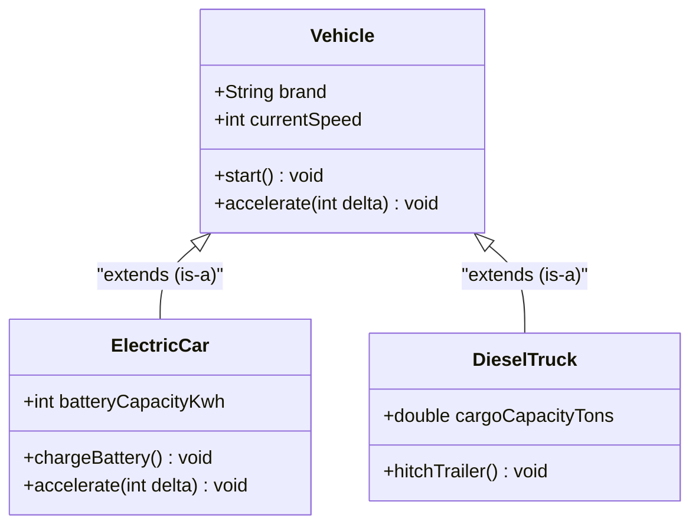
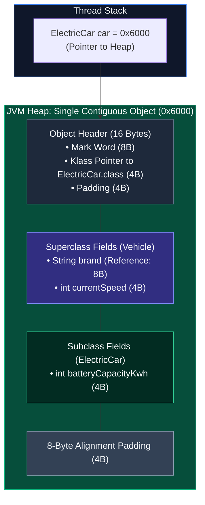
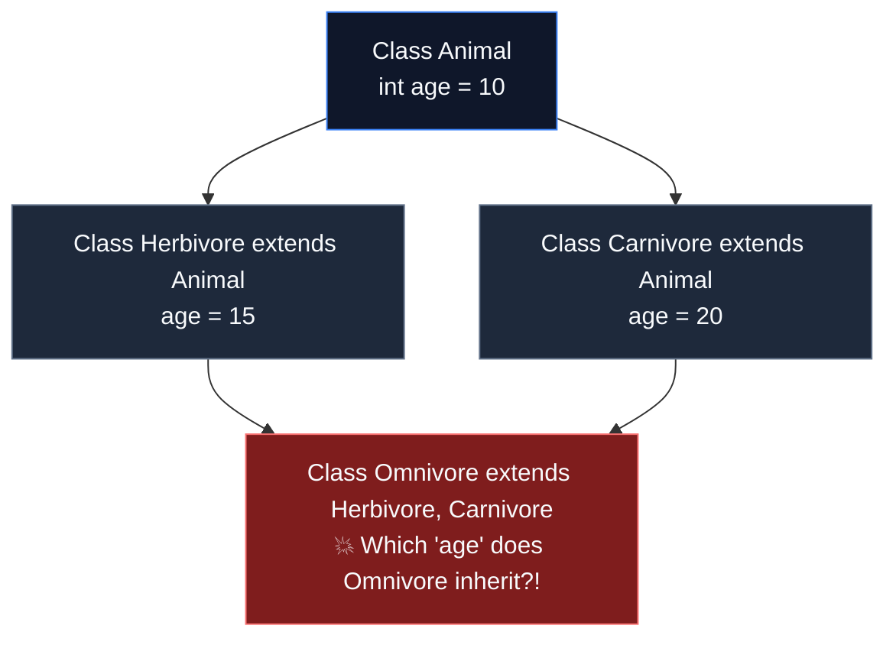

Every developer remembers their first encounter with Object-Oriented Inheritance. It feels like magic. 

You write a base class with fifty lines of logic, write a child class with `extends`, and suddenly your child class inherits everything for free. You feel like you've discovered the ultimate secret of code reuse.

Then, two years later, you inherit a production codebase with an inheritance tree six layers deep: `BaseEntity` extends `AuditableEntity` extends `TenantScopedEntity` extends `VersionedDomainModel` extends `AbstractOrder` extends `PurchaseOrder`. 

A developer changes one line in `BaseEntity` to fix a logging quirk, and three completely unrelated billing modules fail in production.

**Inheritance is the most powerful—and most dangerous—relationship in Object-Oriented design.**

When applied correctly, it establishes clean, polymorphic domain models. When abused, it creates brittle, tightly-coupled hierarchies that collapse under their own weight.

Let's examine how inheritance actually works inside the JVM: how memory is carved out on the Heap for child objects, why constructor chaining is strictly enforced, and how to master method overriding without falling into common architectural traps.

---

## The "Is-A" Test: When Inheritance Is Justified

Before typing the `extends` keyword, you must subject your domain model to the strict **"Is-A" Rule**.

- A `SavingsAccount` **is a** `BankAccount`. (Valid inheritance)
- A `SportsCar` **is a** `Vehicle`. (Valid inheritance)
- A `Car` **is an** `Engine`. (❌ Invalid! A car *has an* engine; this is **Composition**, not Inheritance)



In Java, this relationship is declared using the `extends` keyword:

```java
// The Superclass (Parent)
public class Vehicle {
    protected String brand;
    protected int currentSpeed;

    public Vehicle(String brand) {
        this.brand = brand;
        this.currentSpeed = 0;
    }

    public void start() {
        System.out.println(brand + " engine humming.");
    }
}

// The Subclass (Child)
public class ElectricCar extends Vehicle {
    private int batteryCapacityKwh;

    public ElectricCar(String brand, int batteryCapacityKwh) {
        super(brand); // Must initialize the superclass first!
        this.batteryCapacityKwh = batteryCapacityKwh;
    }

    public void chargeBattery() {
        System.out.println("Charging battery to " + batteryCapacityKwh + " kWh.");
    }
}
```

---

## Memory Internals: The Subclass Heap Layout

When you call `new ElectricCar("Tesla", 100)`, how many objects does the JVM allocate on the Heap? 

Beginners often imagine that the JVM creates two separate objects—one `Vehicle` object and one `ElectricCar` object—and links them together.

**That is completely false. The JVM allocates exactly ONE single object on the Heap.**



Notice what this layout reveals:
1. **Memory Allocation vs. Access Rights:** Even if a superclass field is marked `private`, it is **still physically allocated space inside the child object on the Heap**! The private modifier merely tells the compiler: *"Do not allow child class methods to directly reference this memory slot by name."*
2. **Atomic Allocation:** Because the parent and child fields sit contiguously in memory, garbage collection, pointer indexing, and cache line prefetching treat the entire inheritance chain as a single, cohesive memory block.

---

## Constructor Chaining: The Foundation Before the Roof

You cannot paint the walls or install windows on a house whose foundation has not yet been poured. 

Similarly, the JVM strictly mandates that **before a child class constructor executes, the parent class constructor MUST finish first.**

This rule is enforced by constructor chaining via the **`super()`** keyword:

```java
public class BaseEntity {
    private final String id;
    private final long createdAt;

    public BaseEntity(String id) {
        this.id = id;
        this.createdAt = System.currentTimeMillis();
        System.out.println("1. BaseEntity constructor executed for ID: " + id);
    }
}

public class User extends BaseEntity {
    private final String username;

    public User(String id, String username) {
        super(id); // MUST BE THE VERY FIRST STATEMENT!
        this.username = username;
        System.out.println("2. User constructor executed for username: " + username);
    }
}
```

```java
User u = new User("usr-101", "alice");
```

**Output:**
```text
1. BaseEntity constructor executed for ID: usr-101
2. User constructor executed for username: alice
```

### The Automatic Implicit `super()` Trap
If your superclass defines a parameterless constructor (or defines no constructors at all, allowing Java to inject the default one), you do not need to write `super()`. The compiler invisibly injects `super();` as the first line of every child constructor.

**However, here is the trap:**
If the parent class defines **only a parameterized constructor** (like `BaseEntity(String id)`), the parent no longer has a default constructor. If the child class omits `super(id)`, the compiler will fail with an error:

```text
Constructor BaseEntity in class BaseEntity cannot be applied to given types;
  required: java.lang.String
  found: no arguments
```

---

## Method Overriding & Covariant Return Types

Method overriding allows a subclass to provide a specialized implementation of a method defined in its superclass:

```java
public class PaymentGateway {
    public void process(double amount) {
        System.out.println("Processing standard credit card payment of $" + amount);
    }
}

public class CryptoPaymentGateway extends PaymentGateway {
    @Override
    public void process(double amount) {
        System.out.println("Executing blockchain transaction for $" + amount);
    }
}
```

### The 4 Invariants of Method Overriding:
1. **Identical Name and Arguments:** The method signature must match exactly.
2. **Access Level Cannot Be Reduced:** You can expand visibility (`protected` -> `public`), but you **cannot narrow it** (`public` -> `protected` or `private`). Why? Doing so would break polymorphism (the Liskov Substitution Principle).
3. **Checked Exceptions Cannot Be Expanded:** An overriding method can throw the same checked exceptions, fewer exceptions, or subclasses of those exceptions. It **cannot throw new or broader checked exceptions** that the parent caller did not anticipate.
4. **Covariant Return Types (Java 5+):** The overriding method can return a **subclass** of the type returned by the parent method!

### Covariant Return Types in Action:
```java
public class AnimalShelter {
    public Animal adopt() {
        return new Animal();
    }
}

public class DogShelter extends AnimalShelter {
    @Override
    public Dog adopt() { // Covariant Return! Dog is a subclass of Animal
        return new Dog();
    }
}
```
Callers interacting with `DogShelter` receive a strongly-typed `Dog` directly, eliminating the need for awkward downcasting: `Dog d = (Dog) shelter.adopt()`.

> [!TIP]
> **Always Use `@Override`:**
> The `@Override` annotation is not just documentation. It instructs the compiler to verify that you are truly overriding a superclass method. If you make a typo (e.g., writing `pubic void proccess(double a)` with two 'c's), the compiler will immediately catch the mistake rather than treating it as an unintended new method!

---

## The Single Inheritance Limitation & The Diamond Problem

Unlike C++, which permits multiple inheritance of classes (`class C : public A, public B`), **Java strictly forbids a class from extending more than one parent.**

```java
// ❌ COMPILE ERROR! Java forbids multiple class inheritance
public class FlyingCar extends Car, Airplane { }
```

Why did James Gosling and the Java team make this restriction? To eliminate the dreaded **Diamond Problem of State**:



If both `Herbivore` and `Carnivore` modify or inherit fields from `Animal`, and `Omnivore` inherits from both, how much memory should the JVM allocate on the Heap? Which version of a method should execute? 

In C++, resolving this requires complex virtual base classes and pointer-offset gymnastics. 
Java solved this by establishing a clear rule: **Single inheritance of state (classes), but multiple inheritance of type (interfaces).**

---

## The Cosmic Root: `java.lang.Object`

In the Java type system, all roads lead to Rome. **Every single class you ever create implicitly extends `java.lang.Object`.**

If you write:
```java
public class Employee { }
```
The compiler silently translates it into:
```java
public class Employee extends java.lang.Object { }
```

Because of this universal ancestry, every object on the JVM Heap inherits eleven foundational methods:

| Method | Purpose | Should You Override It? |
| :--- | :--- | :--- |
| `equals(Object obj)` | Tests logical value equality rather than memory address identity. | **YES** (whenever comparing value objects) |
| `hashCode()` | Returns an integer hash representation for hash tables (`HashMap`, `HashSet`). | **YES** (mandatory if you override `equals`) |
| `toString()` | Human-readable string representation of the object. | **YES** (for logging and debugging) |
| `getClass()` | Returns the runtime `java.lang.Class<?>` mirror object in Metaspace. | **NO** (`final` method) |
| `clone()` | Creates a field-by-field shallow copy. | **NO** (avoid; use Copy Constructors) |
| `wait()`, `notify()`, `notifyAll()` | Low-level thread synchronization primitives based on intrinsic monitors. | **NO** (`final` methods) |
| `finalize()` | Legacy garbage collector callback. | **NEVER** (deprecated in Java 9, removed/disabled) |

---

## Summary & Mental Model Checkpoint

1. **The "Is-A" Contract**: Use inheritance only when the subclass represents a genuine, substitutable specialization of the superclass.
2. **Single Heap Allocation**: A subclass instance is a single, contiguous memory block on the Heap containing both parent and child fields.
3. **Constructor Chaining**: `super()` must execute before child constructor logic to guarantee parent invariants are established.
4. **Covariant Returns**: Overriding methods can narrow the return type to any subclass of the parent's return type.
5. **No Multiple Inheritance of State**: Java forbids extending multiple classes to avoid the Diamond Problem and memory alignment chaos.
6. **Cosmic Root**: Every object in Java inherits from `java.lang.Object`, receiving fundamental contracts for equality, hashing, and representation.

---

## 🎯 Senior Engineer Interview Questions

### What happens in Heap memory when a subclass inherits a `private` field from its superclass?
> **Answer:** The private field is physically allocated memory space directly inside the single contiguous object instance allocated on the Heap. The subclass object physically contains the field and its data. However, the Java compiler enforces access-control checks that prevent bytecode within the subclass from referencing the field name directly. The subclass can only manipulate this private memory slot indirectly through inherited `public` or `protected` methods of the superclass.

### Explain the rules of method overriding regarding checked exceptions and access visibility. Why do these rules exist?
> **Answer:** An overriding method cannot reduce access visibility (e.g. `public` cannot become `protected`), and it cannot declare new or broader checked exceptions than the superclass method. These rules preserve the **Liskov Substitution Principle (LSP)**: any caller holding a reference to the superclass must be able to invoke the method without facing unexpected access security exceptions or unhandled checked exceptions that were not declared in the superclass contract.

### What is the "Fragile Base Class" problem in Object-Oriented inheritance?
> **Answer:** The Fragile Base Class problem occurs when changes to a superclass inadvertently break the functionality or invariants of its subclasses. Because subclasses often depend on the internal execution order and self-use of methods within the parent, altering a parent method's implementation can trigger infinite recursion, unintended side-effects, or corrupted state in subclasses without producing compile-time warnings.

### Why does overriding `equals(Object)` strictly require overriding `hashCode()` in Java?
> **Answer:** The `Object` contract mandates that **if two objects are equal according to `equals()`, they MUST produce the exact same integer `hashCode()`**. Hash-based collections (`HashMap`, `HashSet`) use the hash code to determine which bucket stores an object. If two objects are logically equal but produce different hash codes, the collection will search the wrong bucket during `.get()`, resulting in lost data, duplicate set elements, and silent collection lookup failures.
