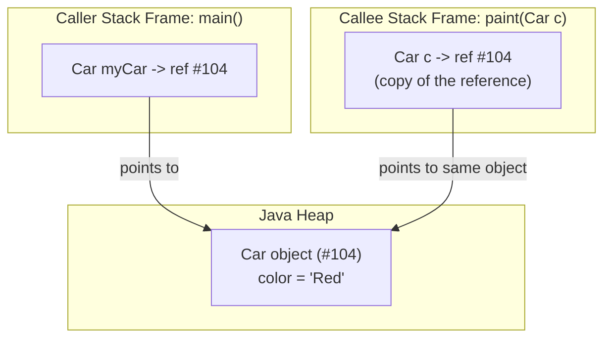
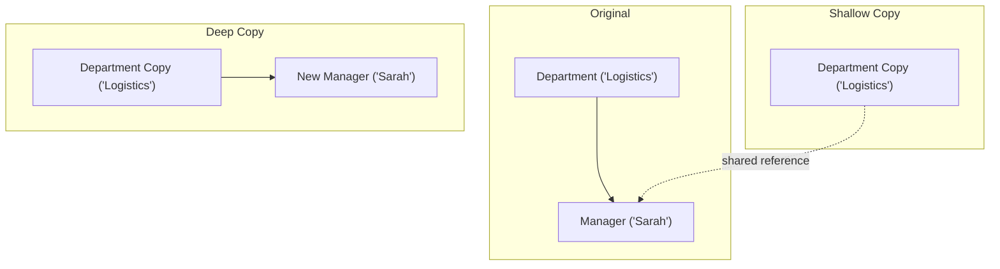

Few Java questions cause more confusion among new developers than this one: *"Is Java pass-by-value or pass-by-reference?"*

The confusion is understandable. If you pass an `int` to a method and reassign it inside the method, the caller's variable does not change. If you pass a `List` or custom object to a method and mutate a field on it, the caller *does* see the change. Yet if you reassign the object parameter to a `new` object inside the method, the caller does *not* see the new object.

Once you separate an **object** (which lives on the Heap) from the **reference variable** pointing to it (which lives on the Stack or inside another object), all of these behaviors follow one simple rule: **Java is strictly pass-by-value, for both primitives and objects.**

## Pass-by-Value vs. Pass-by-Reference

When Java calls a method, it copies the value stored in each argument into the method's parameter variable.

- For a **primitive** (`int`, `double`, `boolean`), the variable holds the raw value itself, so the method gets a copy of that number or boolean.
- For a **reference type** (`Car`, `List`, `String`, arrays), the variable does not hold the object itself. It holds a **reference** (an opaque handle to the object on the Heap; in HotSpot this is typically a 32-bit compressed OOP or 64-bit pointer depending on heap size and flags). Passing the argument copies **that reference**, not the object.



Think of the Heap object as a house and the reference variable as a piece of paper with its street address written on it. Passing the reference to a method photocopies the piece of paper.

- If the method drives to that address and paints the front door (`c.setColor("Blue")`), the caller sees the blue door because both papers point to the same house.
- If the method erases the address on its photocopy and writes down a brand-new address (`c = new Car("Green")`), the caller's original piece of paper still has the old address on it.

### Proof in Code: Mutation vs. Reassignment

Look at what happens in both cases:

```java
public class PassByValueDemo {

    static class Car {
        private String color;

        Car(String color) {
            this.color = color;
        }

        String getColor() { return color; }
        void setColor(String color) { this.color = color; }
    }

    static void repaint(Car c) {
        // Follows the copied reference and mutates the shared Heap object
        c.setColor("Blue");
    }

    static void replace(Car c) {
        // Reassigns only the local parameter 'c' in replace()'s stack frame
        c = new Car("Green");
        c.setColor("Yellow");
    }

    public static void main(String[] args) {
        Car myCar = new Car("Red");

        repaint(myCar);
        System.out.println("After repaint: " + myCar.getColor()); // Blue

        replace(myCar);
        System.out.println("After replace: " + myCar.getColor()); // Still Blue
    }
}
```

A classic demonstration of the same rule is trying to write a `swap` method in Java:

```java
static void swap(Car a, Car b) {
    Car temp = a;
    a = b;
    b = temp;
}
```

Calling `swap(car1, car2)` only swaps the local parameter copies `a` and `b` inside `swap`. When `swap` returns, `car1` and `car2` in the caller still point to their original objects. In a true pass-by-reference language (such as C++ with `Car& a, Car& b`), `swap` would rebind the caller's variables directly. Java never passes variables themselves by reference.

## The Assignment Trap

The exact same distinction applies to the `=` operator.

For primitives, assignment copies the value:

```java
int a = 10;
int b = a;
b = 99;
System.out.println(a); // 10
```

For objects, assignment **does not copy the object**. It copies the reference, leaving two variables pointing to the exact same object on the Heap. This is called **reference aliasing**.

```java
class Profile {
    String displayName;
    Profile(String displayName) { this.displayName = displayName; }
}

Profile original = new Profile("Alice");
Profile copy = original; // Alias, NOT a new Profile object

copy.displayName = "Bob";
System.out.println(original.displayName); // Bob
```

Aliasing is completely normal and useful when you *want* two parts of a program to share the same object (for example, passing a shared `ConnectionPool` to two services). It becomes a bug when you thought you made an independent snapshot, modify the "copy," and silently corrupt the original data elsewhere in the application.

## Shallow Copy and `Object.clone()`

When you genuinely need a separate object on the Heap, you have to choose between a **shallow copy** and a **deep copy**. The difference shows up as soon as an object holds references to other mutable objects.



- A **shallow copy** allocates a new top-level object and copies every field directly. Primitives are duplicated, and object references are copied as-is, meaning the original and the copy still share the same nested child objects.
- A **deep copy** allocates a new top-level object *and* recursively creates independent copies of all mutable nested objects (and mutable elements inside collections).

### How `Object.clone()` Works

Java 1.0 shipped with `protected Object clone()` on `java.lang.Object` and a marker interface called `java.lang.Cloneable`. By default, `Object.clone()` performs a field-by-field **shallow copy** in native JVM code, but only if the class implements `Cloneable`; otherwise it throws `CloneNotSupportedException`.

Here is what implementing `Cloneable` looks like in practice:

```java
class Address {
    String city;

    Address(String city) {
        this.city = city;
    }
}

class Employee implements Cloneable {
    String name;
    Address address;

    Employee(String name, Address address) {
        this.name = name;
        this.address = address;
    }

    @Override
    public Employee clone() {
        try {
            // Shallow copy: copies 'name' and the REFERENCE to 'address'
            return (Employee) super.clone();
        } catch (CloneNotSupportedException e) {
            throw new AssertionError("Should not happen since Employee implements Cloneable", e);
        }
    }
}
```

Watch what happens when you mutate the cloned employee's address:

```java
Employee e1 = new Employee("Priya", new Address("Austin"));
Employee e2 = e1.clone();

e2.address.city = "Seattle";
System.out.println(e1.address.city); // Prints: Seattle!
```

Because `super.clone()` copied the reference to `Address` rather than creating a new `Address`, changing `e2.address.city` silently mutated `e1` as well.

### Why Modern Java Avoids `Cloneable`

You should know how `Object.clone()` works because you will encounter it in legacy codebases and the JDK itself, but most experienced Java developers (following Joshua Bloch's *Effective Java*) avoid implementing `Cloneable` in new classes:

1. **Inverted interface design:** `Cloneable` does not declare a `clone()` method. It only changes the behavior of `protected Object.clone()` on `Object`, so having a `Cloneable` reference does not even guarantee you can call `.clone()` on it without reflection or a known concrete type.
2. **Bypasses constructors:** `super.clone()` allocates the new object without running any constructor, skipping constructor validation and invariant checks.
3. **Clashes with `final` fields:** If you want to replace a shallow-copied mutable field with a deep copy inside `clone()`, that field cannot be `final` because you have to reassign it after `super.clone()` returns.
4. **Checked exception and inheritance fragility:** You have to deal with `CloneNotSupportedException`, casts, and fragile subclass chains where every parent must carefully call `super.clone()`.

> [!NOTE]
> The one place `clone()` works cleanly in Java is **arrays**: `int[] copy = original.clone();` returns a properly typed array without casting or checked exceptions (though for arrays of mutable objects, it is still a shallow copy of the elements).

## Deep Copy with Copy Constructors and Static Factories

Instead of fighting `Cloneable`, write a **copy constructor** or a **static copy factory method**. Both use normal Java object construction, work cleanly with `final` fields, need no casts or checked exceptions, and make shallow vs. deep copying explicit right in the code.

```java
import java.util.ArrayList;
import java.util.List;

public class Address {
    private String street;
    private String city;

    public Address(String street, String city) {
        this.street = street;
        this.city = city;
    }

    // Copy constructor
    public Address(Address other) {
        // String is immutable, so copying the reference is completely safe
        this.street = other.street;
        this.city = other.city;
    }

    public String getCity() { return city; }
    public void setCity(String city) { this.city = city; }
}

public class Customer {
    private final String name;
    private final Address address;
    private final List<String> tags;

    public Customer(String name, Address address, List<String> tags) {
        this.name = name;
        this.address = new Address(address);
        this.tags = new ArrayList<>(tags);
    }

    // Deep copy constructor
    public Customer(Customer other) {
        this.name = other.name;                 // Immutable String: safe to share
        this.address = new Address(other.address); // Mutable Address: create a new copy
        this.tags = new ArrayList<>(other.tags);   // Mutable List: copy list structure
    }

    // Static copy factory alternative
    public static Customer copyOf(Customer other) {
        return new Customer(other);
    }

    public Address getAddress() {
        return new Address(address);
    }
}
```

Notice a subtle detail about copying collections: `new ArrayList<>(other.tags)` creates a new list, which is a deep enough copy *only because `String` is immutable*. If you had a `List<Address>`, you would need to copy each mutable element as well:

```java
List<Address> copiedAddresses = other.addresses.stream()
        .map(Address::new)
        .toList();
```

Copy constructors and static factories also give you flexibility that `clone()` cannot offer: a copy constructor can accept an interface type and convert between implementations, just like `new ArrayList<>(someSet)` or `new HashSet<>(someList)` in the Java Collections Framework.

### What About Serialization for Deep Copying?

You may occasionally see advice to deep-copy complex object graphs by serializing to bytes (Java Serialization or JSON via Jackson) and deserializing back. That works for quick prototypes or test fixtures, but it carries real trade-offs: it is significantly slower than direct copy constructors, requires every nested class to be serializable or JSON-mapped, and can silently drop transient fields or break constructors and invariants. For domain objects in production code, explicit copy constructors or immutable value types are cleaner and faster.

## Defensive Copying

Understanding reference aliasing is also essential when writing classes that must protect their internal state from outside callers.

Look at this classic bug using the legacy mutable `java.util.Date` class:

```java
import java.util.Date;

public final class BrokenPeriod {
    private final Date start;
    private final Date end;

    public BrokenPeriod(Date start, Date end) {
        if (start.after(end)) {
            throw new IllegalArgumentException("start must not be after end");
        }
        this.start = start; // Stores caller's mutable reference directly
        this.end = end;
    }

    public Date getStart() {
        return start; // Exposes internal mutable reference directly
    }
}
```

Even though the fields are `private final`, a caller can break the `start <= end` invariant in two ways:

```java
Date start = new Date();
Date end = new Date(start.getTime() + 60_000);
BrokenPeriod period = new BrokenPeriod(start, end);

// Mutation 1: caller keeps modifying the Date it passed in
start.setTime(end.getTime() + 120_000);

// Mutation 2: caller mutates the Date returned by the getter
period.getStart().setTime(0);
```

To close both holes, make **defensive copies** of mutable arguments on the way in, and defensive copies of mutable fields on the way out:

```java
import java.util.Date;

public final class SafePeriod {
    private final Date start;
    private final Date end;

    public SafePeriod(Date start, Date end) {
        // Copy FIRST, before validation
        this.start = new Date(start.getTime());
        this.end = new Date(end.getTime());

        // Validate the private copies, not the caller's objects
        if (this.start.after(this.end)) {
            throw new IllegalArgumentException("start must not be after end");
        }
    }

    public Date getStart() {
        return new Date(start.getTime());
    }

    public Date getEnd() {
        return new Date(end.getTime());
    }
}
```

Copying *before* checking `this.start.after(this.end)` prevents a subtle concurrency bug called a **Time-of-Check to Time-of-Use (TOCTOU)** race: if you validated `start` first and copied it second, another thread could mutate `start` in the gap between the `if` check and the copy.

> [!TIP]
> The easiest way to eliminate defensive copying altogether is to use **immutable types**. Replacing `java.util.Date` with `java.time.Instant` or `java.time.LocalDate`, and storing `List.copyOf(items)` (Java 10+) instead of exposing raw mutable lists, lets you share references safely with zero aliasing risk.

## Practical Questions

### If Java is strictly pass-by-value, why can a method add elements to a `List` passed into it?
Because the value copied into the method parameter is the **reference** pointing to the `List` on the Heap. Both the caller's variable and the method's parameter hold copies of that same reference, so calling `list.add("x")` mutates the single `List` object they both point to. Reassigning `list = new ArrayList<>()` inside the method, however, only changes the method's local parameter and has no effect on the caller's variable.

### What is the difference between a shallow copy and a deep copy?
A shallow copy creates a new top-level object and copies its field values directly, which means any mutable nested objects are still shared by reference between the original and the copy. A deep copy recursively creates fresh copies of all mutable nested objects as well, so mutating any part of the copy cannot affect the original.

### Why do experienced Java developers prefer copy constructors over `Object.clone()`?
`Object.clone()` relies on the empty `Cloneable` marker interface, bypasses constructors (skipping invariant checks), forces handling `CloneNotSupportedException` and casting, performs only a shallow copy by default, and cannot easily deep-copy `final` fields. Copy constructors and static copy factories use regular Java construction, work naturally with `final` fields, and make shallow vs. deep copying explicit.

### Why don't you need to deep-copy `String`, `Integer`, or `LocalDate` fields inside a copy constructor?
Because those types are **immutable**: once created, their internal state can never change. Sharing a reference to an immutable object between two parent objects carries zero risk of unexpected mutation, so copying the reference is both safe and efficient.
