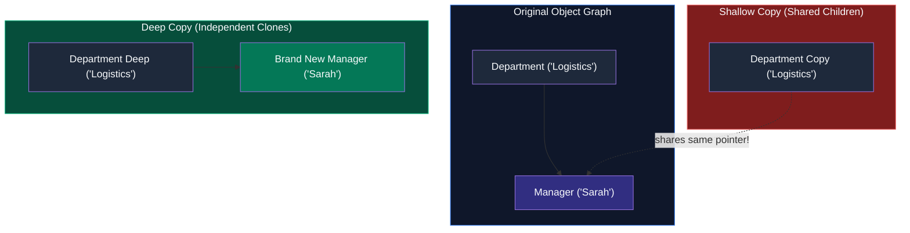

Ask a group of developers: *"Is Java pass-by-value or pass-by-reference?"* and you will trigger a heated, confusing debate. 

Someone will point to code where passing an object into a method allowed that method to change the object's properties: *"Look! It changed the original! It must be pass-by-reference!"*

Someone else will show a snippet where reassigning the parameter inside the method had zero effect on the caller: *"Look! Nothing changed! It must be pass-by-value!"*

Both observed behaviors are real, yet the confusion stems from mixing up **an object** with **the reference pointing to that object**.

Here is the definitive truth that clears the fog forever: **Java is strictly 100% Pass-by-Value. Always. Without exception.**

Once you understand what "value" means in the context of reference variables and stack frames, you will never get tricked by parameter aliasing, broken clones, or leaky getters again.

---

## The Definitive Proof: Java is Strictly Pass-by-Value

To understand how Java passes arguments to methods, picture two physical items:
1. **The Object on the Heap:** A physical television mounted on the wall.
2. **The Reference Variable on the Stack:** A handheld infrared remote control programmed to that television's frequency.

When you pass an object into a method, **Java never passes the television**. 
Instead, Java makes an identical **duplicate of the remote control** and hands that duplicate to the method's parameter.

```mermaid
flowchart TD
    subgraph CallerStack ["Caller Stack Frame: main()"]
        Original["Car myCar = 0x9000<br/>(Original Remote)"]
    end

    subgraph CalleeStack ["Callee Stack Frame: paintCar(Car c)"]
        ParamCopy["Car c = 0x9000<br/>(Duplicated Remote Passed by Value)"]
    end

    subgraph HeapMemory ["JVM Heap Space"]
        TV["Car Object (Address: 0x9000)<br/>• color = 'Red'"]
    end

    Original -->|"points to"| TV
    ParamCopy -->|"points to"| TV

    style CallerStack fill:#0f172a,stroke:#3b82f6,stroke-width:2px,color:#f8fafc
    CalleeStack fill:#1e293b,stroke:#64748b,stroke-width:2px,color:#f8fafc
    style HeapMemory fill:#064e3b,stroke:#10b981,stroke-width:2px,color:#f8fafc
    style Original fill:#312e81,color:#f8fafc
    style ParamCopy fill:#312e81,color:#f8fafc
    style TV fill:#022c22,stroke:#34d399,color:#f8fafc
```

Because both remote controls broadcast to the exact same TV at memory address `0x9000`, pressing a button on the copied remote (`c.setColor("Blue")`) changes the channel on the TV.

### Now, Here is the Proof of Pass-by-Value:
What happens if the method points its remote control at a brand-new TV?

```java
public class ReferenceDemo {

    public static void testSwap(Car c) {
        // We reassign the local parameter 'c' to a brand-new object
        c = new Car("Green");
        c.setColor("Yellow");
    }

    public static void main(String[] args) {
        Car myCar = new Car("Red");
        testSwap(myCar);
        System.out.println("Color after method: " + myCar.getColor());
    }
}
```

What does `main` print?
```text
Color after method: Red
```

If Java were truly pass-by-reference (like C++ reference parameters `void test(Car& c)`), reassigning `c` inside `testSwap` would have repointed `myCar` in `main()` to the new green/yellow car! 

Because Java passed the **value of the pointer**, reassigning `c` merely altered the local stack variable inside `testSwap()`. The caller's `myCar` reference remained completely untouched.

---

## The Assignment Operator Trap (`=`)

In procedural programming with numbers, assigning one variable to another duplicates the data:
```java
int a = 10;
int b = a; // 'b' receives a brand-new copy of the bits (10)
b = 99;    // 'a' remains 10
```

With reference types, **the `=` operator does NOT clone or copy objects.** It merely duplicates the memory pointer:

```java
User user1 = new User("Alice", 28);
User user2 = user1; // Aliasing! Both variables point to the exact same Heap object

user2.setName("Bob");
System.out.println(user1.getName()); // Prints: Bob!
```

This is called **Pointer Aliasing**. When multiple references alias the same object, mutations performed through one variable cause "spooky action at a distance" for all other variables. 

To create an independent clone, you must perform explicit object copying.

---

## Shallow Copy vs. Deep Copy: The Object Graph

When an object contains references to other nested objects (an object graph), copying becomes non-trivial:



### Shallow Copy
- Creates a new instance of the parent object on the Heap.
- Copies all primitive fields directly.
- **Copies the references of nested objects** rather than cloning the nested objects themselves.
- *The Danger:* Modifying the child object (`Dept2.getManager().setBonus(...)`) silently alters the child of `Dept1`!

### Deep Copy
- Creates a new instance of the parent object.
- Recursively creates brand-new instances of **all nested child objects**.
- *The Result:* Two completely autonomous, decoupled object hierarchies in memory. Altering any field anywhere in the copy has zero side effects on the original.

---

## Why `Cloneable` and `Object.clone()` Are Broken

In the early days of Java 1.0, designers provided the `Cloneable` interface and `protected Object clone()` in `java.lang.Object`.

Almost every senior Java architect—including Joshua Bloch, author of *Effective Java*—strongly advises: **Never use `Cloneable` in modern software.**

Why is `clone()` considered an architectural failure?
1. **Marker Interface Flaw:** `Cloneable` does not actually contain a `clone()` method! It is a marker interface that simply signals to `Object.clone()` that native field copying is permitted.
2. **Bypasses Constructors:** `Object.clone()` allocates the object via a low-level JVM memory dump without invoking any constructor! This violates class invariants and makes initializing `final` fields impossible.
3. **Forces Type-Casting and Checked Exceptions:** Calling `clone()` forces you to catch `CloneNotSupportedException` and cast the result from `Object`.
4. **Shallow by Default:** It only copies references for nested objects.

---

## Modern Idiom 1: The Copy Constructor & Static Factory

The cleanest, most idiomatic way to copy objects in Java is using a **Copy Constructor** or a **Copy Factory Method**:

```java
public class Address {
    private String street;
    private String city;

    public Address(String street, String city) {
        this.street = street;
        this.city = city;
    }

    // 1. Copy Constructor
    public Address(Address other) {
        this.street = other.street; // Strings are immutable, safe to share!
        this.city = other.city;
    }

    // Getters and Setters...
}

public class Customer {
    private String name;
    private Address address;

    public Customer(String name, Address address) {
        this.name = name;
        this.address = address;
    }

    // 2. Deep Copy Constructor
    public Customer(Customer other) {
        this.name = other.name;
        // DEEP COPY: Instantiate a new Address rather than aliasing!
        this.address = new Address(other.address);
    }

    // 3. Alternative: Static Factory Copy Method
    public static Customer newInstance(Customer other) {
        return new Customer(other);
    }
}
```

### Why Copy Constructors Win:
- They don't fight with `final` fields.
- They invoke proper Java constructors, guaranteeing business invariant checks run.
- They do not force checked exceptions or ugly casts.
- You can accept interface types (e.g. `public HashSet(Collection<? extends E> c)`).

---

## Defensive Copying: Protecting Encapsulation

Understanding memory references isn't just about copying; it is the cornerstone of **Defensive Programming**.

Look at this seemingly secure class:

```java
public final class ImmutablePeriod {
    private final Date start;
    private final Date end;

    // Vulnerable Constructor!
    public ImmutablePeriod(Date start, Date end) {
        if (start.after(end)) {
            throw new IllegalArgumentException("Start after end!");
        }
        this.start = start; // ❌ Leaking reference from outside!
        this.end = end;
    }

    public Date getStart() {
        return this.start; // ❌ Leaking internal reference to outside!
    }
}
```

Even though fields are `private` and `final`, an attacker or careless caller can completely corrupt this object:

```java
Date start = new Date();
Date end = new Date();
ImmutablePeriod period = new ImmutablePeriod(start, end);

// Attacker mutates the external reference:
start.setYear(70); // Corrupts internal 'start' field inside the period!

// Attacker mutates via getter:
period.getStart().setYear(2050); // Corrupted again!
```

### The Fix: Defensive Copying
Make copies of mutable parameters **on the way in**, and copies of mutable fields **on the way out**:

```java
public final class SecurePeriod {
    private final Date start;
    private final Date end;

    public SecurePeriod(Date start, Date end) {
        // Defensive copy on entry:
        this.start = new Date(start.getTime());
        this.end = new Date(end.getTime());

        // Validate the COPIES, not the arguments!
        if (this.start.after(this.end)) {
            throw new IllegalArgumentException("Start after end!");
        }
    }

    public Date getStart() {
        // Defensive copy on exit:
        return new Date(this.start.getTime());
    }
}
```

> [!TIP]
> Modern Java solved this specific problem by replacing `java.util.Date` with the **`java.time` API** (`Instant`, `LocalDate`, `ZonedDateTime`), which are completely **immutable**. With immutable types, defensive copying is never needed!

---

## Summary & Mental Model Checkpoint

1. **Strictly Pass-by-Value**: Java copies the primitive value or the object's memory address pointer into the method parameter stack frame.
2. **Reassignment vs. Mutation**: Mutating an object through a copied reference alters the shared heap instance; reassigning the parameter variable only alters the local stack frame.
3. **Aliasing Trap**: The assignment operator (`a = b`) only copies the 64-bit reference address, creating two pointers to one single object.
4. **Shallow vs. Deep**: Shallow copies duplicate the top object but share child pointers; deep copies recursively clone the entire object tree.
5. **Ditch `Cloneable`**: Prefer Copy Constructors or static copy factories over `Object.clone()`.
6. **Defensive Copying**: Always copy incoming and outgoing mutable references to prevent external corruption of private state.

---

## 🎯 Senior Engineer Interview Questions

### If Java is strictly pass-by-value, why does modifying a list inside a method change the list for the caller?
> **Answer:** Because the "value" being passed into the method is the 64-bit memory address (reference) pointing to the `ArrayList` object on the Heap. Java duplicates this address onto the method's local stack frame. When the method invokes `list.add("item")`, it uses this address to locate and mutate the physical object in Heap memory. Both caller and callee hold copies of the same address, observing the mutation.

### Why should defensive copies in a constructor be created before validating constructor parameters?
> **Answer:** To protect against **Time-of-Check to Time-of-Use (TOCTOU) race attacks**. If you validate the parameter object first and then copy it, another concurrent thread could alter the mutable object during the window of time between validation and copying. By copying the object first and then validating the newly created private copy, you guarantee that no external thread can tamper with the validated state.

### How does Java's `Cloneable` mechanism violate the standard contract of class instantiation?
> **Answer:** `Object.clone()` creates an object without invoking any constructor. It bypasses class initialization rules, making it impossible to initialize `final` fields inside the clone method. Furthermore, if a class uses `super.clone()` and has child classes, subtle inheritance coupling occurs if the parent returns a type not castable to the child, leading to fragile designs.

### In Java, why is it safe to share references to `String`, `Integer`, or `LocalDate` objects without defensive copying?
> **Answer:** Because these classes are **strictly immutable**. Their internal state cannot be modified after construction. Since no caller or thread can alter their data, sharing their reference addresses across threads or method boundaries is completely thread-safe and free from side effects, eliminating the need and performance cost of defensive copying.
