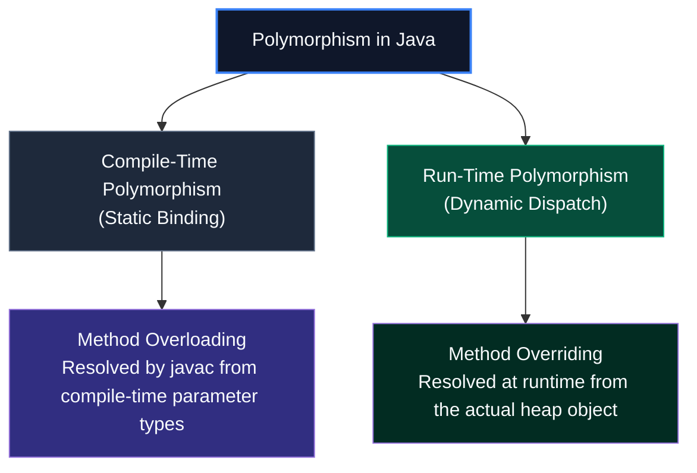
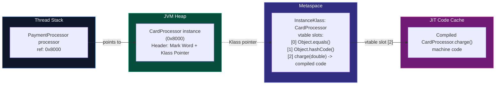
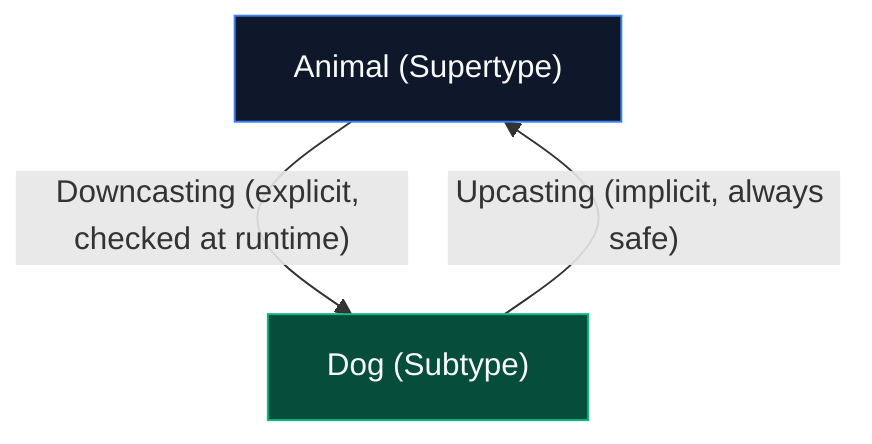

Suppose you are writing a shipping calculator that handles standard parcels, refrigerated crates, and oversized freight. Without polymorphism, every place in your codebase that calculates shipping cost ends up repeating a long chain of type checks:

```java
if (item instanceof StandardParcel) {
    cost = calculateParcelCost((StandardParcel) item);
} else if (item instanceof RefrigeratedCrate) {
    cost = calculateColdChainCost((RefrigeratedCrate) item);
}
// Every new shipment type forces edits across every caller
```

With **polymorphism** (from Greek *poly* "many" and *morph* "form"), the caller works with a single supertype—such as a `Shipment` interface or base class—and calls `item.shippingCost()`. Each concrete type supplies its own implementation, and the caller does not need to change when new shipment types are added later.

Java supports polymorphism in two distinct ways: **compile-time (static)** and **run-time (dynamic)**.

---

## Compile-Time vs. Run-Time Polymorphism



### Compile-Time Polymorphism (Method Overloading)

**Method overloading** defines multiple methods in the same class with the same name but different parameter lists (different number of parameters, different parameter types, or different parameter order). Return type alone does not distinguish overloads.

```java
public class ReceiptPrinter {

    public String format(double amount) {
        return String.format("USD %.2f", amount);
    }

    public String format(double amount, String currency) {
        return String.format("%s %.2f", currency, amount);
    }

    public String format(int cents, String currency) {
        return String.format("%s %.2f", currency, cents / 100.0);
    }
}
```

The Java compiler (`javac`) chooses which overload to call **at compile time**, using the declared (static) types of the arguments. That leads to a classic surprise when overloading is mixed with inheritance:

```java
public class Classifier {
    static String label(Object o) { return "Object"; }
    static String label(String s) { return "String"; }

    public static void main(String[] args) {
        Object value = "hello";
        System.out.println(label(value)); // Prints "Object", not "String"!
    }
}
```

Even though `value` points to a `String` at runtime, its compile-time type is `Object`, so `javac` binds the call to `label(Object)`. Overloading is always static; only overriding is dynamic.

### Run-Time Polymorphism (Method Overriding)

**Method overriding** lets a subclass (or implementing class) provide its own version of an instance method declared in a superclass or interface. When you invoke that method through a supertype reference, the JVM executes the version belonging to the **actual runtime object on the heap**:

```java
public abstract class PaymentProcessor {
    public abstract void charge(double amount);
}

public class CardProcessor extends PaymentProcessor {
    @Override
    public void charge(double amount) {
        System.out.println("Charging card: " + amount);
    }
}

public class BankTransferProcessor extends PaymentProcessor {
    @Override
    public void charge(double amount) {
        System.out.println("Initiating bank transfer: " + amount);
    }
}

// Compile-time type is PaymentProcessor; runtime object decides which charge() runs
PaymentProcessor processor = selectProcessor(order);
processor.charge(49.99);
```

Two details are easy to miss when overriding:

- **Covariant return types:** An overriding method may narrow the return type to a subtype of the superclass method's return type (for example, overriding `Animal copy()` with `Dog copy()`).
- **Non-overridable members:** `static` methods, `private` methods, `final` methods, constructors, and fields do **not** participate in dynamic dispatch. Calling a `static` method or reading a field always resolves against the reference's compile-time type.

---

## How the JVM Dispatches Overridden Methods

The Java Language Specification defines *what* dynamic dispatch must do: call the most specific override for the runtime class of the receiver object. *How* that lookup happens is an implementation detail of each JVM.

In Oracle/OpenJDK's **HotSpot JVM**, instance method calls compile to either `invokevirtual` (when the reference type is a class) or `invokeinterface` (when the reference type is an interface). Here is how a HotSpot `invokevirtual` lookup works conceptually:



1. Follow the reference from the stack frame to the object on the heap.
2. Read the object header's class metadata pointer (HotSpot's Klass pointer) to locate the runtime type's metadata in Metaspace.
3. Look up the method entry in the class's **vtable** (virtual method table) at a fixed slot index.
4. Jump to the target method's bytecode interpreter entry or JIT-compiled native code.

### Why HotSpot Uses Both `vtable` and `itable`

- **Class methods (`invokevirtual` / `vtable`):** Because a Java class can only extend one superclass, every subclass can place overridden methods at the exact same slot indices as its parent. Lookup is a direct indexed read (`O(1)`).
- **Interface methods (`invokeinterface` / `itable`):** Because a class can implement multiple interfaces in any combination, an interface method cannot occupy a single fixed slot across unrelated classes. HotSpot maintains an **itable** (interface method table) per class to locate the implementing method for a given interface.

> [!TIP]
> **HotSpot JIT Inline Caching:**
> Virtual dispatch does not usually pay the full table-lookup cost in warm code. HotSpot's JIT compiler profiles each call site at runtime. If only one concrete class ever arrives at a call site (**monomorphic**), the JIT guards on the class pointer and inlines the target method directly. With two concrete classes (**bimorphic**), it emits a fast two-way check. Only when three or more classes hit the same call site (**megamorphic**) does HotSpot typically fall back to full `vtable`/`itable` dispatch.

---

## Upcasting and Downcasting

Working with inheritance hierarchies means converting references up toward more general types or down toward more specific types:



### Upcasting

**Upcasting** assigns a subtype reference to a supertype variable. It happens automatically without cast syntax because every `Dog` is guaranteed to satisfy `Animal`'s contract:

```java
Dog rex = new Dog("Rex");
Animal pet = rex; // Implicit upcast
pet.speak();      // Calls Dog.speak() via dynamic dispatch
```

Through `pet`, you can only call methods declared on `Animal` (and `Object`), even though the underlying object on the heap is still a `Dog`.

### Downcasting

**Downcasting** converts a supertype reference back to a subtype reference. Because the compiler cannot be certain what concrete object `pet` holds at runtime, you must write an explicit cast:

```java
Animal pet = loadPetById(42);
Dog dog = (Dog) pet; // Explicit downcast
dog.fetchBall();
```

If `loadPetById(42)` actually returned a `Cat`, the JVM catches the mismatch at runtime and throws `ClassCastException`:

```java
Animal pet = new Cat("Milo");
Dog dog = (Dog) pet; // Throws java.lang.ClassCastException at runtime
```

The compiler also rejects impossible casts up front: trying to cast a `String` directly to an `Integer` is a compile-time error because neither class can ever be a subtype of the other.

---

## The `instanceof` Operator

Before downcasting an unknown reference, you check its actual runtime type with the `instanceof` operator. The expression `ref instanceof TargetType` returns `true` if `ref` is non-null and can be cast to `TargetType` (either because it is an instance of `TargetType`, a subclass of `TargetType`, or a class implementing the `TargetType` interface).

```java
public void interact(Animal animal) {
    if (animal instanceof Dog) {
        Dog dog = (Dog) animal;
        dog.fetchBall();
    } else if (animal instanceof Cat) {
        Cat cat = (Cat) animal;
        cat.purr();
    }
}
```

Three rules of `instanceof` are worth memorizing:

1. **`null instanceof Anything` is always `false`.** It never throws a `NullPointerException`, which means you do not need a separate `animal != null &&` check before `instanceof`.
2. **It works with interfaces as well as classes.** `list instanceof RandomAccess` checks whether the runtime class implements the `RandomAccess` marker interface.
3. **Unrelated classes fail to compile.** If the reference's compile-time type is `String`, writing `str instanceof Integer` is a compile-time error because a `String` can never be an `Integer`. (If the target is a non-sealed interface, the compiler allows the check unless the reference's class is `final` and does not implement that interface.)

---

## Pattern Matching for `instanceof` (Java 16+)

Look again at the pre-Java 16 `instanceof` check above. It repeats the type name three times in two lines: check `animal instanceof Dog`, declare `Dog dog`, and cast `(Dog) animal`. It is easy to copy-paste a block and accidentally cast to the wrong type.

**Pattern Matching for `instanceof`** (previewed in Java 14 and 15, finalized in **Java 16** via JEP 394) combines the type test, variable declaration, and cast into one step:

```java
public void interact(Animal animal) {
    if (animal instanceof Dog dog) {
        dog.fetchBall();
    } else if (animal instanceof Cat cat) {
        cat.purr();
    }
}
```

If `animal` is a `Dog` (and not `null`), the compiler binds the pattern variable `dog` with static type `Dog`. No manual cast is needed.

### Flow Scoping

Pattern variables follow **flow scoping** rather than simple block scoping: the variable is in scope wherever the compiler can prove the pattern definitely matched.

That allows clean guard conditions with `&&`:

```java
if (animal instanceof Dog dog && dog.weightKg() > 25) {
    System.out.println("Large dog: " + dog.name());
}
```

Notice why `||` does not work the same way: in `if (animal instanceof Dog dog || dog.weightKg() > 25)`, the right-hand side only runs when `animal` is **not** a `Dog`, so `dog` is not in scope there and the compiler rejects it.

Flow scoping also makes negated early returns concise:

```java
public void registerWorkingDog(Animal animal) {
    if (!(animal instanceof Dog dog)) {
        return;
    }

    // Execution can only reach this line when animal matched Dog
    System.out.println("Registered working dog: " + dog.name());
}
```

Here `dog` stays in scope for the rest of the method because the `if` branch always exits early (via `return` or `throw`).

---

## Looking Ahead: Pattern Matching in `switch` (Java 21+)

When you have several subtypes to handle, long `if / else if` chains of `instanceof` still get noisy. **Java 21** finalized Pattern Matching for `switch` (JEP 441), allowing type patterns, `when` guards, and explicit `case null` branches inside a single `switch` expression:

```java
public String describeEvent(PaymentEvent event) {
    return switch (event) {
        case PaymentSuccess s when s.amount() > 10_000 ->
            "High-value payment flagged for review: " + s.transactionId();
        case PaymentSuccess s ->
            "Payment settled: " + s.transactionId();
        case PaymentFailed f ->
            "Payment failed with code: " + f.errorCode();
        case PaymentCancelled c ->
            "Payment cancelled by customer";
        case null ->
            "No payment event provided";
    };
}
```

If `PaymentEvent` is a `sealed` interface whose permitted subtypes are `PaymentSuccess`, `PaymentFailed`, and `PaymentCancelled`, the compiler verifies that every subtype is covered without needing a `default` branch. We cover sealed hierarchies and record deconstruction in detail in the *Sealed Classes and Pattern Matching* lesson.

Note that polymorphism via overridden methods is still usually preferred over `instanceof` or `switch` when behavior naturally belongs to each subtype and new subtypes will be added frequently. Reach for `instanceof` or pattern-matching `switch` when you are writing external operations over a closed set of data types (like AST nodes, protocol messages, or event payloads).

---

## Recap

- **Compile-time polymorphism (overloading)** picks a method based on compile-time argument types during compilation.
- **Run-time polymorphism (overriding)** dispatches to the implementation defined by the actual heap object's runtime class.
- In HotSpot, dynamic dispatch uses `vtable` entries for `invokevirtual` and `itable` lookups for `invokeinterface`, with JIT inline caching eliminating table lookups at hot monomorphic and bimorphic call sites.
- **Upcasting** is implicit and safe; **downcasting** is explicit and throws `ClassCastException` if the runtime type does not match.
- **`instanceof`** safely tests runtime type compatibility and always evaluates to `false` for `null`.
- **Pattern matching for `instanceof` (Java 16+)** eliminates redundant casts and uses flow scoping to keep pattern variables available only where the match is guaranteed.

---

## Interview Questions

### Why does overloaded method selection not depend on the runtime type of an argument?
Method overloading is resolved by `javac` at compile time using the static (declared) types of the arguments, and the chosen method signature is encoded directly into the bytecode. Only the receiver object of an overridden instance method is dispatched dynamically at runtime. If you pass an `Object` variable holding a `String` into overloaded methods `print(Object)` and `print(String)`, `print(Object)` is always invoked.

### What happens if you evaluate `null instanceof String`, and why is that useful?
`null instanceof String` evaluates to `false` and never throws a `NullPointerException`. Because `null` is not an instance of any reference type, `instanceof` doubles as a null check, which simplifies both classic guards (`if (obj instanceof String)`) and Java 16 pattern matches (`if (obj instanceof String s)`).

### How does HotSpot's JIT compiler keep polymorphic method calls fast?
Although dynamic dispatch conceptually consults a `vtable` or `itable` via the object's class metadata pointer, HotSpot's JIT compiler profiles call sites during execution and applies inline caching. If a call site consistently sees only one concrete class (monomorphic), the JIT emits a quick type check and inlines the target method body directly. For two types (bimorphic), it emits a fast conditional check. Only when three or more classes appear (megamorphic) does it typically fall back to indirect table dispatch.

### Can `private` methods, `static` methods, or constructors be overridden polymorphically?
No. Constructors, `private` methods, and `static` methods are resolved statically at compile time (`invokespecial` for constructors and `private` methods, `invokestatic` for `static` methods). Declaring a `static` method with the same signature in a subclass hides the superclass method rather than overriding it, so which one executes depends strictly on the compile-time type used to call it.
