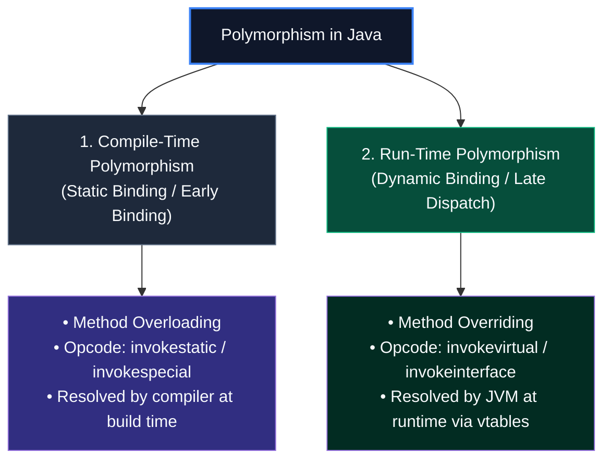
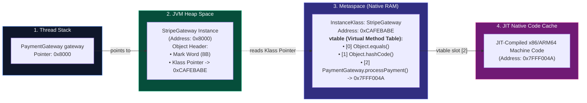
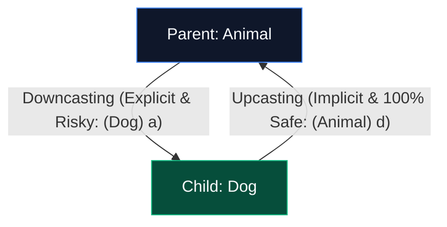

Imagine you are designing the operating system for a high-speed airport baggage conveyor belt. 

Luggage of all shapes, weights, and sizes arrives continuously: soft duffel bags, hard polycarbonate suitcases, cardboard boxes, and golf club carriers. 

If the conveyor software had to inspect every single type with an exhaustive list of if-else checks:
```java
if (bag instanceof DuffelBag) { routeDuffel((DuffelBag) bag); }
else if (bag instanceof HardSuitcase) { routeSuitcase((HardSuitcase) bag); }
// What happens when a passenger checks a musical cello tomorrow?!
```
The entire airport would grind to a halt every time a passenger introduced a new luggage style.

Instead, the baggage handler asks only one question: *"Do you implement `ScannableLuggage`?"* 
If yes, the system sends a uniform command: `luggage.dispatch()`. Each luggage item handles its own balance, routing, and orientation.

**This is Polymorphism.** 

Derived from the Greek words *poly* (many) and *morph* (form), polymorphism is the crowning capability of Object-Oriented design. It allows you to write software that operates effortlessly on classes that **have not even been written yet**.

Let's look under the hood to see how the JVM dispatches polymorphic calls at runtime, explore the HotSpot `vtable` mechanics, and master modern Java pattern matching.

---

## The Two Faces: Static vs. Dynamic Binding

Polymorphism in Java splits into two distinct mechanical universes:



### 1. Compile-Time Polymorphism (Static Binding)
When you overload methods within the same class, the compiler inspects the arguments provided and wires the bytecode directly to that specific method's address. There is zero runtime guesswork or indirection.

### 2. Run-Time Polymorphism (Dynamic Binding)
When a parent reference points to a child instance on the Heap, the compiler cannot know which implementation will execute:

```java
// Compile-time knows only: 'gateway' is a PaymentGateway
PaymentGateway gateway = resolveGatewayForTenant(tenantId);

// Runtime magic: Executes Stripe, PayPal, or WireTransfer based on the HEAP object!
gateway.processPayment(49.99); 
```

How does the JVM know which method to execute without slow conditional checks? Let's trace the hardware execution.

---

## The JVM Engine Room: Dynamic Method Dispatch & The `vtable`

When the JVM executes `gateway.processPayment(49.99)`, it uses the bytecode instruction **`invokevirtual`**. 

Here is the exact journey through physical memory:



### The 4-Step Resolution Cycle:
1. **The Object Dereference:** The CPU follows the stack pointer to byte address `0x8000` on the Heap.
2. **Reading the Header:** The CPU inspects the object's **Klass Pointer** stored inside the 16-byte object header.
3. **Indexing the `vtable`:** The Klass Pointer leads directly into the `StripeGateway` metadata in native Metaspace. The JVM looks at the **vtable** (Virtual Method Table)—an internal array of function pointers.
4. **Direct Execution:** The vtable returns the exact memory address in the JIT Code Cache where native CPU machine instructions live (`0x7FFF004A`).

### `vtable` vs. `itable`: Why Interfaces Differ
- **Class Inheritance (`vtable`):** Because Java enforces single inheritance of classes, method offsets in a vtable are **constant across the entire hierarchy**. Slot 2 in the parent is *guaranteed* to be slot 2 in every subclass, allowing direct indexed memory access ($O(1)$).
- **Interface Inheritance (`itable`):** Because a class can implement dozens of interfaces in any arbitrary order, the JVM cannot guarantee fixed offsets. It uses an **`itable` (Interface Method Table)**, which performs a rapid offset lookup.

> [!TIP]
> **JIT Inline Caching:**
> Is dynamic dispatch slow? In modern HotSpot JVMs, almost never! The HotSpot JIT compiler monitors call sites. If a method call is **Monomorphic** (99% of the time, the same concrete class arrives at that call site), the JIT completely bypasses the vtable and inlines the machine code directly!

---

## Upcasting vs. Downcasting: Navigating the Type Hierarchy

Polymorphism requires moving references up and down the class hierarchy:



### 1. Upcasting: Safe and Automatic
Casting from a specialized subtype up to a general supertype is always safe. A `Dog` is guaranteed to satisfy all contracts of `Animal`:
```java
Dog myDog = new Dog("Rex");
Animal myAnimal = myDog; // Implicit upcast. No casting syntax needed!
```

### 2. Downcasting: Explicit and Dangerous
Casting from a general supertype down to a specific subtype requires an explicit cast:
```java
Animal myAnimal = fetchFromDatabase();

// Explicit Downcast: You are promising the compiler that 'myAnimal' is a Dog!
Dog myDog = (Dog) myAnimal; 
myDog.fetchBall();
```

### The `ClassCastException` Production Crash
What happens if someone passes a `Cat` into that method?
```java
Animal myAnimal = new Cat();
Dog myDog = (Dog) myAnimal; // 💥 CRASH! java.lang.ClassCastException
```
At runtime, the JVM checks the object header, detects that `Cat` cannot be cast to `Dog`, and immediately halts execution with a fatal `ClassCastException`.

---

## Modern Pattern Matching for `instanceof` (Java 16+)

Historically, to safely downcast an object, Java developers were forced to write awkward, repetitive ceremony:

```java
// ❌ THE OLD, UGLY BOILERPLATE (Pre-Java 16):
public void handleAnimal(Animal a) {
    if (a instanceof Dog) {
        Dog d = (Dog) a; // Redundant! We JUST checked that it was a Dog!
        d.fetchBall();
    }
}
```

In **Java 16**, Java introduced **Pattern Matching for `instanceof`** (JEP 394):

```java
// ✅ MODERN, TYPE-SAFE JAVA:
public void handleAnimal(Animal a) {
    if (a instanceof Dog d) {
        // 'd' is automatically created, cast, and available in this scope!
        d.fetchBall();
    }
}
```

### Flow Scoping: Smart Compiler Reasoning
Pattern matching uses **Flow Scoping**—the pattern variable is in scope only where the compiler can mathematically prove the condition was true:

```java
// Negation pattern with early return:
public void processDog(Animal a) {
    if (!(a instanceof Dog d)) {
        return; // If it's not a Dog, exit immediately!
    }

    // 'd' is fully in scope here because execution could only reach this line if 'a' was a Dog!
    System.out.println("Processing dog: " + d.getBreed());
}
```

You can even combine pattern variables in the same logical condition:
```java
if (a instanceof Dog d && d.getWeightKg() > 25) {
    System.out.println("Large dog detected: " + d.getName());
}
```

---

## Java 21 LTS: Pattern Matching in Switch Expressions

Java 21 took polymorphism to its ultimate evolution by combining pattern matching with modern `switch` expressions:

```java
public String processPaymentNotification(PaymentEvent event) {
    return switch (event) {
        case PaymentSuccess s when s.amount() > 10_000 -> 
            "Large payment flagged for audit: $" + s.amount();
        case PaymentSuccess s -> 
            "Payment processed: " + s.transactionId();
        case PaymentFailed f -> 
            "Payment failed with code: " + f.errorCode();
        case PaymentCancelled c -> 
            "Order cancelled by customer.";
        case null -> 
            "Null notification received.";
    };
}
```

Notice the elegance:
1. **Zero Casting:** No manual downcasting or `instanceof` checks.
2. **Guards (`when`):** You can attach fine-grained boolean conditions to individual type branches.
3. **Exhaustive Verification:** If `PaymentEvent` is a sealed interface, the compiler guarantees you have handled every possible subclass.

---

## Summary & Mental Model Checkpoint

1. **Static vs. Dynamic**: Overloading is static binding at compile time; overriding is dynamic dispatch at runtime.
2. **The `vtable` Mechanics**: HotSpot looks up the object's Klass Pointer in Metaspace and executes the method function pointer from the vtable array.
3. **Safe Upcasting**: Subtypes can always be treated as supertypes implicitly.
4. **Dangerous Downcasting**: Explicit downcasting risks `ClassCastException` if the runtime heap instance does not match.
5. **Pattern Matching for `instanceof`**: Java 16 flow scoping eliminates manual casting boilerplate.
6. **Pattern Matching in Switch**: Java 21 LTS enables exhaustive, declarative type dispatch with `when` guard clauses.

---

## 🎯 Senior Engineer Interview Questions

### How does the HotSpot JVM optimize polymorphic method calls through "Inline Caching"?
> **Answer:** Dynamic method dispatch via a vtable lookup requires multiple pointer dereferences. The HotSpot JIT compiler optimizes this using **Inline Caching**. Call sites are tracked during execution:
> - **Monomorphic Call Site:** If only one concrete class is ever invoked at that site (common in practice), the JIT eliminates the vtable lookup entirely and inlines the target method directly.
> - **Bimorphic Call Site:** If exactly two types arrive, the JIT compiles a simple conditional jump (`if (klass == TypeA) ... else ...`).
> - **Megamorphic Call Site:** If three or more concrete types arrive, the JIT falls back to standard table-driven vtable dispatch.

### What is the difference between the `invokevirtual` and `invokeinterface` bytecodes?
> **Answer:** `invokevirtual` is used to invoke class-based methods. Because Java enforces single class inheritance, method offsets within a class's `vtable` are fixed and known across the entire inheritance chain, allowing fast indexed lookup. `invokeinterface` is used when the reference type is an interface. Because classes can implement multiple interfaces in arbitrary order, the method cannot have a fixed offset across all implementers. The JVM must inspect an `itable` (interface table) to map the interface method index to the concrete class's vtable slot, introducing a minor lookup indirection.

### What is "Flow Scoping" in Java's pattern matching for `instanceof`?
> **Answer:** Flow scoping is a compiler analysis mechanism where a pattern variable is introduced into scope only within the execution paths where the pattern is guaranteed to have matched. For instance, in `if (obj instanceof String s)`, `s` is scoped inside the `if` block. In `if (!(obj instanceof String s)) throw new IllegalArgumentException();`, `s` remains in scope for the remainder of the method body following the check because the method could only continue executing if the condition evaluated to true.

### Can constructors or `private` methods participate in dynamic method dispatch? Why or why not?
> **Answer:** No. Dynamic method dispatch is exclusively used for methods that can be overridden by subclasses. Constructors and `private` methods are implicitly `final` and cannot be overridden. The Java compiler invokes them using the **`invokespecial`** bytecode opcode, which permanently binds the method target at compile time using static binding rather than consulting a runtime `vtable`.
