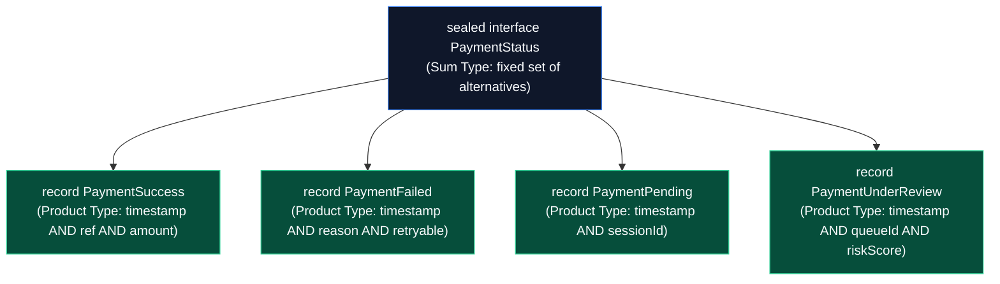

For most of Java's history, class inheritance gave you only two extremes: mark a class `final` so nobody can extend it, or leave it open so *any* class in *any* package can extend it.

That binary choice creates friction whenever you model a fixed set of domain states—such as payment statuses, protocol messages, query filters, or nodes in an expression tree. If the base type stays open, another developer can add a new subtype in a distant package without updating existing `if/else` chains or handlers, and the compiler will not warn you. Working around that required either package-private constructors (which break down across packages and still do not tell `switch` that the set of subtypes is closed) or the Gang-of-Four **Visitor pattern**, which adds substantial double-dispatch boilerplate.

**Sealed classes** (previewed in Java 15 and 16, finalized in **Java 17** via JEP 409) paired with **Pattern Matching for `switch`** (JEP 441) and **Record Patterns** (JEP 440) in **Java 21** let you declare closed hierarchies that the compiler and JVM both understand and verify.

---

## Why Open Inheritance Breaks Closed Domain Models

Consider a checkout service that models payment outcomes with a normal open abstract class:

```java
public abstract class PaymentStatus {
    private final Instant timestamp = Instant.now();
    public Instant getTimestamp() { return timestamp; }
}

public class PaymentSuccess extends PaymentStatus {
    private final String transactionRef;
    public PaymentSuccess(String ref) { this.transactionRef = ref; }
    public String getTransactionRef() { return transactionRef; }
}

public class PaymentFailed extends PaymentStatus {
    private final String reasonCode;
    public PaymentFailed(String reasonCode) { this.reasonCode = reasonCode; }
    public String getReasonCode() { return reasonCode; }
}
```

Later, a fraud team introduces a new state in another package:

```java
package com.payments.fraud;

public class PaymentUnderReview extends PaymentStatus {
    private final String queueId;
    public PaymentUnderReview(String queueId) { this.queueId = queueId; }
    public String getQueueId() { return queueId; }
}
```

Meanwhile, the settlement handler still handles only the original two subclasses:

```java
public void handleSettlement(PaymentStatus status) {
    if (status instanceof PaymentSuccess success) {
        orderService.ship(success.getTransactionRef());
    } else if (status instanceof PaymentFailed failed) {
        orderService.cancel(failed.getReasonCode());
    } else {
        log.warn("Unhandled payment status: {}", status);
    }
}
```

Everything compiles cleanly. Yet at runtime, every `PaymentUnderReview` silently drops into the fallback `else` branch. Nothing forces the developer who added `PaymentUnderReview` to inspect every consumer of `PaymentStatus`.

---

## Algebraic Data Types: Sum Types and Product Types

Functional languages describe domain models with **Algebraic Data Types (ADTs)**, built from two simple building blocks:

- **Product types (AND):** A type that bundles multiple values together. A Java `record Money(BigDecimal amount, String currency)` holds an `amount` **and** a `currency`. Its total set of possible states is the Cartesian product of its component domains.
- **Sum types (OR):** A type whose value must be one of a fixed set of alternatives. A `PaymentStatus` is a `PaymentSuccess` **or** a `PaymentFailed` **or** a `PaymentPending` **or** a `PaymentUnderReview`. Its total set of possible states is the sum of its subtype domains.



Combining **sealed interfaces/classes** (sum types) with **records** (product types) brings full ADTs directly into standard Java.

---

## The `sealed`, `non-sealed`, and `permits` Modifiers

A sealed class or interface uses the `sealed` keyword and lists its direct permitted subtypes in a `permits` clause:

```java
import java.math.BigDecimal;
import java.time.Instant;

public sealed interface PaymentStatus
        permits PaymentSuccess, PaymentFailed, PaymentPending, PaymentUnderReview {

    Instant timestamp();
}

public record PaymentSuccess(
        Instant timestamp,
        String transactionRef,
        BigDecimal amount
) implements PaymentStatus {}

public record PaymentFailed(
        Instant timestamp,
        String reasonCode,
        boolean retryable
) implements PaymentStatus {}

public record PaymentPending(
        Instant timestamp,
        String gatewaySessionId
) implements PaymentStatus {}

public record PaymentUnderReview(
        Instant timestamp,
        String queueId,
        int riskScore
) implements PaymentStatus {}
```

Java enforces three rules on every permitted direct subtype:

1. **Same package or module:** All permitted subtypes must be in the same package (or in the same named module if you use the Java Platform Module System). If all permitted subtypes are declared in the **same `.java` source file** (for example as nested records inside the sealed interface), you can omit the `permits` clause and the compiler infers it automatically.
2. **Direct extension or implementation:** Every listed subtype must directly `extend` or `implement` the sealed type.
3. **Explicit inheritance modifier:** Every permitted subtype must declare exactly one of three modifiers:
   - **`final`**: Closes that branch completely; no further subclasses are allowed. (Java `record` and `enum` types are implicitly `final`, which is why records pair so cleanly with sealed interfaces.)
   - **`sealed`**: Keeps that branch restricted with its own `permits` clause.
   - **`non-sealed`**: Deliberately re-opens that specific branch so any class can extend it again.

### When `non-sealed` Is Useful

Suppose your payment system supports a fixed set of known statuses plus an extensible hook for custom partner plugins:

```java
public sealed interface Notification permits EmailNotification, SmsNotification, CustomNotification {}

public final class EmailNotification implements Notification {}
public final class SmsNotification implements Notification {}

// Re-opens just this branch for external extensions
public non-sealed class CustomNotification implements Notification {}
```

Even though `CustomNotification` is open to arbitrary subclasses, the top-level `Notification` hierarchy is still closed: any `switch` over `Notification` remains exhaustive as long as it handles `EmailNotification`, `SmsNotification`, and `CustomNotification` (which covers all subclasses of `CustomNotification`).

### How the JVM Enforces Sealing at Runtime

Sealing is not just a `javac` check. When compiling a sealed type, `javac` writes a `PermittedSubclasses` attribute (defined in JVMS 4.7.31) into the `.class` file. Inspecting it with `javap -v` shows the exact list of permitted binary class names:

```text
PermittedSubclasses:
  com/payments/PaymentSuccess
  com/payments/PaymentFailed
  com/payments/PaymentPending
  com/payments/PaymentUnderReview
```

At runtime, when the JVM loads any class whose superclass or superinterface is sealed, it checks that the loading class appears in the supertype's `PermittedSubclasses` table (and resides in the same runtime package or module). If someone tries to sneak in an unauthorized subclass via bytecode generation or a custom class loader, the JVM rejects it with `java.lang.IncompatibleClassChangeError`.

---

## Exhaustive Pattern Matching in `switch` (Java 21+)

Sealed types pay off most when combined with **Pattern Matching for `switch`** (finalized in Java 21, JEP 441). Because the compiler knows every permitted subtype of `PaymentStatus`, a `switch` expression over `PaymentStatus` is **exhaustive** without a `default` branch:

```java
public String formatCustomerMessage(PaymentStatus status) {
    return switch (status) {
        case PaymentSuccess s -> "Payment settled. Ref: " + s.transactionRef();
        case PaymentFailed f -> "Payment declined: " + f.reasonCode();
        case PaymentPending p -> "Awaiting gateway session: " + p.gatewaySessionId();
        case PaymentUnderReview r -> "Payment under security review (queue " + r.queueId() + ")";
    };
}
```

Now suppose someone adds `PaymentRefunded` to `PaymentStatus`'s `permits` list. Every exhaustive `switch` over `PaymentStatus` in the codebase immediately fails to compile:

```text
error: the switch expression does not cover all possible input values
```

Instead of discovering a missed branch in production logs, the compiler points you to every place that needs to decide how to handle `PaymentRefunded`.

> [!WARNING]
> Avoid adding a `default -> ...` branch to a `switch` over a sealed type unless you intentionally want future subtypes to fall into generic fallback logic. A `default` branch satisfies exhaustiveness automatically, which silences the compiler error when a new permitted subtype is added later.

Also note two other Java 21 `switch` behaviors:

- **Null handling:** A `switch` without `case null` still throws `NullPointerException` if the selector is `null`. You can handle `null` explicitly with `case null -> ...` or `case null, default -> ...`.
- **Pattern dominance:** More specific patterns (such as guarded cases with `when`) must appear before more general patterns for the same type; otherwise `javac` reports a dominance error.

---

## Record Patterns and Nested Deconstruction

**Record Patterns** (finalized in Java 21, JEP 440) let you unpack a record's components directly inside `case` labels or `instanceof` checks instead of calling accessor methods manually. You can also combine them with `when` guard clauses for value-based branching:

```java
public void processStatus(PaymentStatus status) {
    switch (status) {
        case PaymentSuccess(var ts, var ref, var amount) ->
            ledger.credit(ref, amount);

        case PaymentFailed(var ts, var reason, boolean retryable) when retryable ->
            scheduler.scheduleRetry(reason);

        case PaymentFailed(var ts, var reason, boolean retryable) ->
            notifications.alertCustomer(reason);

        case PaymentPending(var ts, var sessionId) ->
            watchdog.trackSession(sessionId);

        case PaymentUnderReview(var ts, var queueId, int riskScore) when riskScore > 80 ->
            securityOps.escalate(queueId, riskScore);

        case PaymentUnderReview(var ts, var queueId, var riskScore) ->
            securityOps.assignStandardQueue(queueId);
    }
}
```

Notice that Java 21 does not support literal constants inside record patterns (you cannot write `case PaymentFailed(var ts, var reason, true)` directly); instead, bind the component (`boolean retryable`) and test it in a `when` guard. (If you are on **Java 22+**, JEP 456 finalized unnamed pattern variables `_`, allowing you to write `case PaymentSuccess(_, var ref, var amount)` when you do not need `ts`.)

### Nested Deconstruction

Record patterns can be nested to match deep object graphs in one expression. Consider an order model built from nested records:

```java
public record Address(String city, String countryCode) {}
public record Customer(String name, Address shippingAddress) {}
public record Money(BigDecimal amount, String currency) {}
public record Order(String orderId, Customer customer, Money total) {}

public String routeOrder(Object payload) {
    return switch (payload) {
        case Order(
                var id,
                Customer(var name, Address(var city, var country)),
                Money(var amount, var currency)
        ) when "US".equals(country) && amount.compareTo(new BigDecimal("500")) > 0 ->
            "Expedited US fulfillment for " + name + " (" + city + "): " + id + " [" + currency + "]";

        case Order(var id, Customer(var name, Address(_, var country)), _) ->
            "Standard fulfillment to " + country + " for " + name + " (" + id + ")";

        default -> "Unsupported payload";
    };
}
```

*(Note: replace `_` with `var ignoredCity` and `var ignoredTotal` if compiling on Java 21 rather than Java 22+.)*

Nested deconstruction also shines in tree and AST transformations, where you can match a compound pattern like `case Add(Constant(int a), Constant(int b)) -> new Constant(a + b);` to fold constant subexpressions in a single line.

---

## Replacing the Gang-of-Four Visitor Pattern

Before sealed classes and pattern matching, writing multiple independent operations over a closed tree of types (such as an expression evaluator, pretty-printer, and optimizer over an AST) usually led to the **Visitor pattern**.

### Before: Classic Visitor Double Dispatch

With the Visitor pattern, every node class must accept a visitor and bounce the call back to a type-specific `visit` overload (double dispatch):

```java
public interface ExprVisitor<R> {
    R visitConstant(ConstantExpr expr);
    R visitAdd(AddExpr expr);
    R visitMultiply(MultiplyExpr expr);
}

public interface Expr {
    <R> R accept(ExprVisitor<R> visitor);
}

public final class ConstantExpr implements Expr {
    private final int value;
    public ConstantExpr(int value) { this.value = value; }
    public int value() { return value; }

    @Override
    public <R> R accept(ExprVisitor<R> visitor) {
        return visitor.visitConstant(this);
    }
}

public final class AddExpr implements Expr {
    private final Expr left, right;
    public AddExpr(Expr left, Expr right) { this.left = left; this.right = right; }
    public Expr left() { return left; }
    public Expr right() { return right; }

    @Override
    public <R> R accept(ExprVisitor<R> visitor) {
        return visitor.visitAdd(this);
    }
}

public final class MultiplyExpr implements Expr {
    private final Expr left, right;
    public MultiplyExpr(Expr left, Expr right) { this.left = left; this.right = right; }
    public Expr left() { return left; }
    public Expr right() { return right; }

    @Override
    public <R> R accept(ExprVisitor<R> visitor) {
        return visitor.visitMultiply(this);
    }
}

public class EvaluatorVisitor implements ExprVisitor<Integer> {
    @Override public Integer visitConstant(ConstantExpr e) { return e.value(); }
    @Override public Integer visitAdd(AddExpr e) { return e.left().accept(this) + e.right().accept(this); }
    @Override public Integer visitMultiply(MultiplyExpr e) { return e.left().accept(this) * e.right().accept(this); }
}
```

### After: Sealed Hierarchy + Records + Pattern Matching

With Java 21, the data model stays pure data, and each operation is a plain method using an exhaustive `switch`:

```java
public sealed interface Expr permits Constant, Add, Multiply {}

public record Constant(int value) implements Expr {}
public record Add(Expr left, Expr right) implements Expr {}
public record Multiply(Expr left, Expr right) implements Expr {}

public class Expressions {

    public static int evaluate(Expr expr) {
        return switch (expr) {
            case Constant(int value) -> value;
            case Add(Expr left, Expr right) -> evaluate(left) + evaluate(right);
            case Multiply(Expr left, Expr right) -> evaluate(left) * evaluate(right);
        };
    }

    public static String format(Expr expr) {
        return switch (expr) {
            case Constant(int value) -> Integer.toString(value);
            case Add(Expr left, Expr right) -> "(" + format(left) + " + " + format(right) + ")";
            case Multiply(Expr left, Expr right) -> "(" + format(left) + " * " + format(right) + ")";
        };
    }

    // Nested record pattern: folds constant additions directly
    public static Expr simplify(Expr expr) {
        return switch (expr) {
            case Add(Constant(int a), Constant(int b)) -> new Constant(a + b);
            case Multiply(Constant(int a), Constant(int b)) -> new Constant(a * b);
            case Expr other -> other;
        };
    }
}
```

You get the same compile-time exhaustiveness guarantee that `ExprVisitor` enforced, without `accept()` methods, visitor interfaces, extra visitor object allocations, or awkward workarounds for nested matching (which Visitor handles poorly).

### The Expression Problem Trade-Off

Sealed classes + pattern matching do not replace regular OOP polymorphism everywhere. They sit on opposite sides of a classic design trade-off known as the **Expression Problem**:

| Design Style | Adding a New Data Type | Adding a New Operation | Best Fit |
| :--- | :--- | :--- | :--- |
| **Open Interface + Virtual Methods** | Easy: add a new implementing class without editing existing code | Hard: add a method to the interface and update every class | Plugin architectures, extensible services (`PaymentGateway`, `Collection`) |
| **Sealed Hierarchy + Pattern Matching** | Requires updating `permits` and every exhaustive `switch` (compiler points out every site) | Easy: write a new method with a `switch` without touching the data types | Closed domain states, ASTs, protocol messages, event unions |

Choose an open interface when external teams need to plug in new implementations without modifying your code. Choose a sealed hierarchy when your set of domain variants is small and controlled, and you expect to write many operations over those variants. The Visitor pattern itself is still worth recognizing because you will encounter it in older Java codebases (pre-Java 21) and libraries like ASM or ANTLR that expose stateful traversal hooks.

---

## Recap

- **Algebraic Data Types** combine product types (Java `record`s: A and B) with sum types (`sealed` types: A or B).
- **`sealed`** and **`permits`** (Java 17+) restrict direct subtypes to a known set in the same package or module; every permitted subtype must be `final`, `sealed`, or `non-sealed`.
- The JVM enforces sealing at class-loading time via the `PermittedSubclasses` classfile attribute, throwing `IncompatibleClassChangeError` on unauthorized subclasses.
- **Exhaustive `switch` expressions** (Java 21+) verify at compile time that all permitted subtypes are handled, so omit `default` when you want the compiler to flag newly added subtypes.
- **Record patterns** (Java 21+) deconstruct flat and nested records inline and combine cleanly with `when` guards.
- Sealed hierarchies with pattern matching replace most uses of the Gang-of-Four **Visitor pattern** with less boilerplate and easier nested matching, trading ease of adding new types for ease of adding new operations.

---

## Interview Questions

### Why must permitted subclasses of a sealed type reside in the same package or module?
Both the compiler and the JVM need a closed, trustworthy list of permitted subtypes to verify exhaustiveness in `switch` expressions and enforce sealing at runtime. If arbitrary external JARs in unrelated packages could declare permitted subtypes independently, the sealed type's author would lose control over the closed set, and separate compilation could no longer guarantee that every subtype is known. Keeping permitted subtypes in the same package (or named module) ensures the sealed hierarchy evolves as one cohesive unit.

### Why is adding a `default` branch to a `switch` over a sealed hierarchy usually a mistake?
The main compile-time safeguard of switching over a sealed type is exhaustiveness checking: when you later add a new permitted subtype, the compiler reports an error at every `switch` that has not been updated. Adding a `default` branch makes the `switch` trivially exhaustive, so the compiler stays silent and newly added subtypes quietly fall into the fallback path at runtime.

### How does the JVM prevent someone from bypassing `sealed` restrictions using reflection or bytecode generation?
`javac` records the permitted subtypes in the classfile's `PermittedSubclasses` attribute (JVMS 4.7.31). When the JVM loads any class whose superclass or superinterface is sealed, the class loader checks that the new class is listed in that attribute and lives in the same runtime package or module. If not, class loading fails immediately with `IncompatibleClassChangeError`.

### When should you choose an open interface with overridden methods instead of a sealed hierarchy with pattern matching?
Use an open interface with virtual methods when you expect callers or external modules to add new implementations frequently while the set of operations stays stable (for example, `PaymentGateway` or `InputStream`). Use a sealed hierarchy with pattern matching when the set of data variants is closed and controlled by one module, and you want to add many independent operations (formatting, validation, serialization, evaluation) without bloating the data classes themselves.
