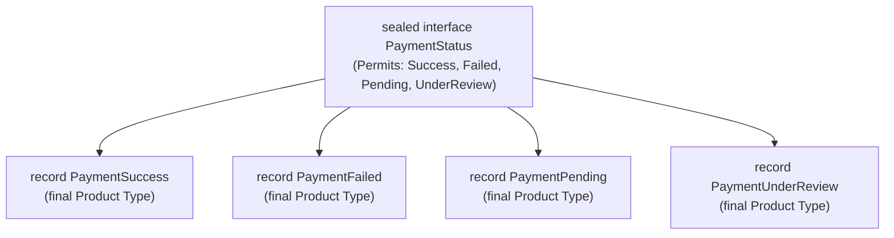

For nearly twenty-five years, Java developers faced a binary architectural dilemma when designing class hierarchies: you either made a class `final` (locking down inheritance entirely) or left it open to the entire world (`public class`), hoping that downstream engineers wouldn't subvert your domain invariants. 

If you were building a core domain engine—such as a financial state machine, a compiler AST, or an order fulfillment pipeline—leaving a class open was an invitation for chaos. Anyone in any package could extend your base class, bypass your business rules, and introduce unhandled states. To work around this, Java teams relied on the Gang of Four **Visitor Pattern**, introducing hundreds of lines of double-dispatch boilerplate (`accept(Visitor v)`, `visit(Node n)`) just to simulate closed type hierarchies.

Java 17 (stabilized with record patterns and switch pattern matching in Java 21) fundamentally solved this problem by introducing **Sealed Classes** and **Algebraic Data Types (ADTs)**. In this deep dive, we explore how sealed hierarchies work at the JVM bytecode level, how pattern matching transforms state machine design, and why modern Java renders the Visitor pattern obsolete.

---

### The Flaw of Open Inheritance: The Payment State Disaster

To understand why sealed classes exist, let's examine a real production incident at a high-volume payment processor. 

The checkout microservice modeled transaction statuses using classic class inheritance:

```java
// Legacy unsealed inheritance
public abstract class PaymentStatus {
    private final Instant timestamp = Instant.now();
    public Instant getTimestamp() { return timestamp; }
}

public class PaymentSuccess extends PaymentStatus {
    private final String transactionReference;
    public PaymentSuccess(String ref) { this.transactionReference = ref; }
    public String getTransactionReference() { return transactionReference; }
}

public class PaymentFailed extends PaymentStatus {
    private final String reasonCode;
    public PaymentFailed(String reason) { this.reasonCode = reason; }
    public String getReasonCode() { return reasonCode; }
}
```

Months later, a contractor on the fraud mitigation team needed to introduce a new operational state: manual review. Without realizing the downstream ramifications, they created a new subclass in their own package:

```java
package com.payment.fraud;

public class PaymentUnderReview extends PaymentStatus {
    private final String agentQueueId;
    public PaymentUnderReview(String queueId) { this.agentQueueId = queueId; }
    public String getAgentQueueId() { return agentQueueId; }
}
```

The fulfillment service processed payments using standard conditional logic:

```java
public void handleSettlement(PaymentStatus status) {
    if (status instanceof PaymentSuccess success) {
        orderService.shipGoods(success.getTransactionReference());
    } else if (status instanceof PaymentFailed failed) {
        orderService.cancelOrder(failed.getReasonCode());
    } else {
        // The "catch-all" fallback
        log.warn("Unknown status encountered, skipping settlement: {}", status);
    }
}
```

Because `PaymentUnderReview` was a valid `PaymentStatus`, the compiler emitted zero warnings. When high-value transactions triggered fraud review flags, they fell straight through to the `else` branch. The orders were neither shipped nor canceled; customer credit cards sat pre-authorized until the authorization holds expired after 7 days, costing the business millions in lost revenue.

Open inheritance allows infinite, unauthorized subclasses. Sealed classes eliminate this category of bugs by giving the author complete control over which classes may inherit from them.

---

### Algebraic Data Types: Sum Types vs Product Types

Modern functional programming categorizes data structures using **Algebraic Data Types (ADTs)**. An ADT is simply a composite type formed by combining other types:

```
Algebraic Data Types (ADTs)
  |-- Product Types: Records (A AND B)
  `-- Sum Types: Sealed Classes (A OR B)
```

1. **Product Types (Records)**: A product type represents a Cartesian product of its fields. A Java `record Coordinate(int x, int y)` has `Domain(x) * Domain(y)` possible states. If `x` can be 10 values and `y` can be 10 values, `Coordinate` has 100 possible permutations. It is an **AND** relationship (`x` AND `y`).
2. **Sum Types (Sealed Classes)**: A sum type represents a discriminated union. A `PaymentStatus` is either `PaymentSuccess` OR `PaymentFailed` OR `PaymentPending`. Its total domain of possible states is the sum of its subtypes (`Domain(Success) + Domain(Failed) + Domain(Pending)`). It is an **OR** relationship.

When you combine **Product Types (Java Records)** with **Sum Types (Java Sealed Classes)**, you get full Algebraic Data Types in Java.

---

### The Sealed Class Modifiers: sealed, permits, and non-sealed

A sealed class or interface declares the `sealed` keyword and enumerates its permitted direct subclasses via the `permits` clause:

```java
public sealed interface PaymentStatus 
    permits PaymentSuccess, PaymentFailed, PaymentPending, PaymentUnderReview {
    Instant timestamp();
}
```

Every permitted subclass **must** satisfy three strict compile-time constraints:

1. **Colocation**: The permitted subclasses must reside in the same package (or in the same named module if using the Java Platform Module System).
2. **Direct Inheritance**: Every permitted subclass must directly implement or extend the sealed supertype.
3. **Explicit Modifier**: Every permitted subclass must explicitly declare one of three modifiers:
   - `final`: No further subclasses are permitted. The inheritance branch terminates here.
   - `sealed`: The subclass continues to seal inheritance, declaring its own distinct `permits` list.
   - `non-sealed`: The subclass deliberately re-opens inheritance to arbitrary extension.

Here is the robust, domain-hardened payment model:

```java
public sealed interface PaymentStatus permits 
    PaymentSuccess, 
    PaymentFailed, 
    PaymentPending, 
    PaymentUnderReview {

    Instant timestamp();
}

public record PaymentSuccess(
    Instant timestamp, 
    String transactionReference, 
    BigDecimal amount
) implements PaymentStatus {}

public record PaymentFailed(
    Instant timestamp, 
    String reasonCode, 
    boolean retryable
) implements PaymentStatus {}

public record PaymentPending(
    Instant timestamp, 
    String gatewaySessionId
) implements PaymentStatus {}

public record PaymentUnderReview(
    Instant timestamp, 
    String agentQueueId, 
    int riskScore
) implements PaymentStatus {}
```



Because `record` classes are implicitly `final`, they make ideal leaf nodes for sealed sum types.

---

### Bytecode Internals: The PermittedSubclasses Attribute

How does the JVM enforce sealing? Is this merely a javac compiler trick?

No. Sealing is enforced directly by the JVM ClassLoader at runtime. When javac compiles a sealed class, it injects a dedicated classfile attribute defined in the JVM specification: `PermittedSubclasses`.

If we inspect the compiled bytecode of `PaymentStatus.class` using `javap`:

```bash
javap -v -p com/domain/PaymentStatus.class
```

You will see the metadata attribute:

```
Classfile /.../PaymentStatus.class
  public abstract interface com.domain.PaymentStatus
  minor version: 0
  major version: 65
  flags: (0x0601) ACC_PUBLIC, ACC_INTERFACE, ACC_ABSTRACT
...
PermittedSubclasses:
  com/domain/PaymentSuccess
  com/domain/PaymentFailed
  com/domain/PaymentPending
  com/domain/PaymentUnderReview
```

When the JVM loads any class claiming to implement `PaymentStatus` (e.g., via bytecode injection, dynamic proxies, or custom ClassLoaders), the JVM verifier inspects `PaymentStatus.class`'s `PermittedSubclasses` table. If the candidate class is not explicitly present in that array, the JVM immediately throws a `java.lang.IncompatibleClassChangeError`. Sealing cannot be bypassed via runtime reflection or rogue classloading.

---

### Exhaustive Pattern Matching in Switch (Java 21+)

The true superpower of sealed classes surfaces when paired with modern `switch` expressions. 

Because the Java compiler knows the complete, closed set of all permitted subclasses at compile time, it can guarantee **exhaustiveness**. You no longer need an artificial `default` branch:

```java
public String renderCustomerNotice(PaymentStatus status) {
    return switch (status) {
        case PaymentSuccess s -> "Payment settled. Ref: " + s.transactionReference();
        case PaymentFailed f -> "Payment failed: " + f.reasonCode();
        case PaymentPending p -> "Payment pending gateway session: " + p.gatewaySessionId();
        case PaymentUnderReview r -> "Payment held for security review in queue: " + r.agentQueueId();
    };
}
```

Notice what happens if another engineer adds a new state—say, `PaymentRefunded`—to `PaymentStatus`:

```java
public sealed interface PaymentStatus permits 
    PaymentSuccess, PaymentFailed, PaymentPending, PaymentUnderReview, PaymentRefunded { ... }
```

Instantly, every single `switch` statement across your entire codebase that inspects `PaymentStatus` **fails to compile**:

```
[ERROR] the switch expression does not cover all possible input values: 
        com.domain.PaymentRefunded
```

The compiler transforms from a silent spectator into an automated correctness assistant. Every business flow that must account for a new state is highlighted before code ever reaches a pull request.

> [!WARNING]
> Never add a `default` case to a sealed switch expression unless you truly desire a catch-all behavior for future extensions. Adding `default -> ...` defeats compile-time exhaustiveness checks, causing new subclasses to silently route through the default branch without compiler errors.

---

### Record Patterns and Nested Deconstruction

Java 21 introduced **Record Patterns** (JEP 440), enabling direct deconstruction of record components within pattern matching conditions. Instead of extracting components manually:

```java
// Pre-Java 21: Type pattern matching
case PaymentFailed f -> {
    if (f.retryable()) {
        scheduler.retry(f.reasonCode());
    }
}
```

You can deconstruct the record's internal components inline:

```java
// Java 21+: Record pattern deconstruction with guards
public void processStatus(PaymentStatus status) {
    switch (status) {
        case PaymentSuccess(var ts, var ref, var amount) -> 
            ledger.credit(ref, amount);
            
        case PaymentFailed(var ts, var reason, true) -> 
            scheduler.scheduleRetry(reason);
            
        case PaymentFailed(var ts, var reason, false) -> 
            notifications.alertCustomer(reason);
            
        case PaymentPending(var ts, var sessionId) -> 
            watchdog.trackSession(sessionId);
            
        case PaymentUnderReview(var ts, var queueId, int score) when score > 80 -> 
            securityOps.triggerEmergencyReview(queueId);
            
        case PaymentUnderReview(var ts, var queueId, var score) -> 
            securityOps.assignToStandardQueue(queueId);
    }
}
```

Notice the expressive power:
1. `case PaymentFailed(var ts, var reason, true)` matches only failed payments where `retryable` is `true`.
2. Pattern guards (`when score > 80`) allow conditional branching without nested `if` statements.
3. Components are unpacked directly into local variables without calling getter methods.

---

### Death of the Visitor Pattern

Before sealed classes, implementing an operation over an AST (Abstract Syntax Tree) or business hierarchy required the GoF **Visitor Pattern**:

```java
// The Old Way: Painful Visitor Boilerplate
public interface ExpressionVisitor<R> {
    R visit(ConstantExpression expr);
    R visit(AddExpression expr);
    R visit(MultiplyExpression expr);
}

public interface Expression {
    <R> R accept(ExpressionVisitor<R> visitor);
}

public class ConstantExpression implements Expression {
    private final int value;
    public ConstantExpression(int value) { this.value = value; }
    public int getValue() { return value; }
    
    @Override
    public <R> R accept(ExpressionVisitor<R> visitor) {
        return visitor.visit(this); // Double dispatch boilerplate
    }
}
```

With Sealed Hierarchies and Record Patterns, the entire Visitor pattern collapses into a single, clean, readable function:

```java
public sealed interface Expression permits Constant, Add, Multiply {}

public record Constant(int value) implements Expression {}
public record Add(Expression left, Expression right) implements Expression {}
public record Multiply(Expression left, Expression right) implements Expression {}

public class ExpressionEvaluator {

    public static int evaluate(Expression expr) {
        return switch (expr) {
            case Constant(var val) -> val;
            case Add(var left, var right) -> evaluate(left) + evaluate(right);
            case Multiply(var left, var right) -> evaluate(left) * evaluate(right);
        };
    }
}
```

The resulting code is 80% smaller, cache-friendly, free of heap allocation for visitor objects, and verified at compile time for exhaustive coverage.

---

## Senior Engineer Interview Crucible

### Why does the Java compiler enforce package or module colocation for sealed subclasses?
**Answer:** The compiler must compute the exact, closed universe of permitted subtypes at compile time to evaluate exhaustiveness in `switch` expressions and build the `PermittedSubclasses` classfile attribute. If permitted subclasses could reside in arbitrary foreign packages across external JARs, the compiler could never guarantee exhaustiveness, because an external JAR loaded at runtime could introduce an unforeseen subclass without the superclass author's knowledge. By enforcing package (or module) colocation, Java ensures that the author of the sealed type controls the complete boundary of the sum type.

### What is the subtle trap of adding a default branch when switching over a sealed hierarchy?
**Answer:** The primary safety benefit of sealed classes with switch expressions is **exhaustiveness checking**. When a new subtype is added to the sealed interface, the compiler forces a compilation error on every unhandled `switch` site across the entire codebase. If a developer includes a `default` case (or a broad catch-all case like `case Object o`), the switch expression is trivially exhaustive. Consequently, when a new permitted subtype is added later, the compiler remains silent, and the new subtype is silently routed through the default logic—reintroducing the exact silent-failure bug pattern that sealed classes were created to solve.

### How does the JVM enforce sealed class invariants if bytecode manipulation creates an unauthorized subclass at runtime?
**Answer:** Sealing is not merely a javac compile-time check; it is enforced by the JVM verifier via the `PermittedSubclasses` attribute in the classfile format (defined in JVMS 4.7.31). When the JVM loads any class whose `super_class` or `interfaces` entry references a sealed class, the ClassLoader inspects the `PermittedSubclasses` attribute of that supertype. If the loading class's binary name is not present in the supertype's permitted table, class verification fails immediately with a `java.lang.IncompatibleClassChangeError`. Furthermore, both the subclass and superclass must be declared within the same runtime package and module; otherwise, verification aborts.

### Compare the performance characteristics of pattern matching over records vs the GoF Visitor Pattern
**Answer:** The Visitor pattern requires a virtual method call on the target object (`accept()`), which then performs a second virtual dispatch back into the visitor (`visit()`). While JIT compilers can inline monomorphic call sites, polymorphic visitors (with many AST node implementations) quickly exceed the JIT inlining threshold (default 2 target classes for bimorphic inline caches). This causes Megamorphic Dynamic Dispatch, flushing CPU instruction pipelines and preventing branch optimization. 

In contrast, modern Java switch expressions with record patterns compile down to an optimized combination of `invokedynamic` (via `SwitchBootstraps.typeSwitch`) and bytecode tableswitch/lookupswitch instructions. The JVM decomposes record patterns into direct field offsets or accessor calls without allocating intermediate visitor objects on the heap. This allows JIT compilers to perform scalar replacement, inline the entire evaluation loop, and optimize branch prediction.
