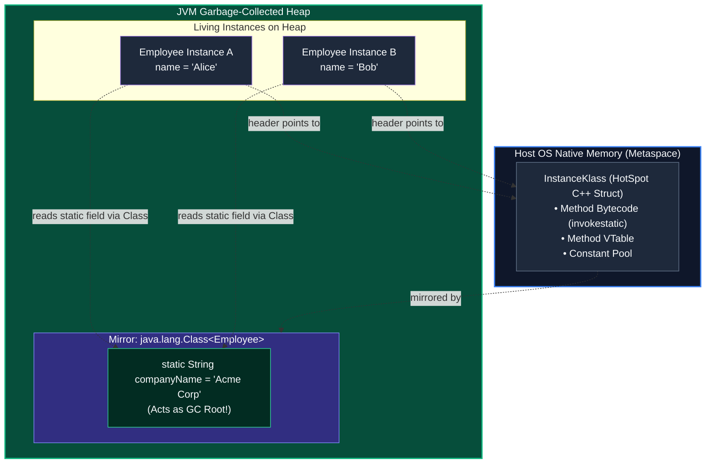
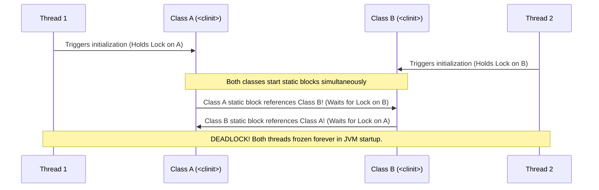

When newcomers learn Object-Oriented Programming, the first rule they are told is: *"Everything is an object."* You create a blueprint (the Class), instantiate it with `new`, and interact with its private state through methods.

Then, five minutes later, you see this:

```java
double squareRoot = Math.sqrt(144.0);
```

You pause. Nobody called `new Math()`. Where is the object? What created it? Where does `sqrt` live?

The answer is the **`static` keyword**. 

In Java, `static` is an architectural escape hatch from pure object instances. It declares: **"This field or method belongs to the Class itself across the entire JVM, rather than to any individual object instance on the Heap."**

When used thoughtfully, `static` gives you ultra-fast utility functions and global constants. When abused, it introduces thread-safety disasters, hidden memory leaks, and tightly-coupled architectures that make unit testing nearly impossible. 

Let's demystify `static` down to the JVM bytecode, examine where static state actually lives in modern memory, and master its production patterns.

---

## Memory Internals: Where Does `static` Truly Live?

A common myth among developers is that "static variables live in Metaspace." Let's set the record straight with modern HotSpot architecture:



Here is the exact division of responsibilities in Java 8+:
1. **Class Metadata (Metaspace):** The internal representation of the class (`InstanceKlass`) is allocated in native OS RAM. It holds raw bytecodes, symbol tables, and method definitions.
2. **Static Variables (Java Heap):** When a class is loaded, the JVM allocates a special instance of `java.lang.Class` on the **standard Garbage-Collected Heap**. **All static fields are stored directly as fields of this `Class` object!**

### Why This Memory Detail Matters: The Static Memory Leak Trap
Because the `java.lang.Class` object is referenced by its ClassLoader, it acts as an immortal **Garbage Collection Root (GC Root)**. 

If you write:
```java
public class CacheManager {
    // ❌ LETHAL ARCHITECTURAL TRAP: Immortal GC Root!
    public static final Map<String, byte[]> CACHE = new HashMap<>();
}
```
Every object you put into `CACHE` will **never be garbage collected** as long as the application runs. If background threads continuously put user sessions or image bytes into this static map without aggressive eviction, your production service will eventually crash with `java.lang.OutOfMemoryError: Java heap space`.

---

## Static Variables: One State to Rule Them All

When a field is marked `static`, only **one single copy** exists for the entire lifetime of that class in the classloader:

```java
public class ServerNode {
    // Instance field: Unique to each server instance
    private final String hostname;

    // Static field: Shared across ALL server instances in this JVM
    private static int totalActiveNodes = 0;

    public ServerNode(String hostname) {
        this.hostname = hostname;
        totalActiveNodes++;
    }

    public static int getTotalActiveNodes() {
        return totalActiveNodes;
    }
}
```

```java
ServerNode node1 = new ServerNode("node-us-east-1");
ServerNode node2 = new ServerNode("node-eu-west-1");

System.out.println(ServerNode.getTotalActiveNodes()); // Prints: 2
```

> [!CAUTION]
> **Always Access Statics via Class Name, Never via Object Reference!**
> Java syntactically permits accessing statics through an instance reference:
> ```java
> System.out.println(node1.totalActiveNodes); // ❌ Anti-pattern!
> ```
> This is misleading. It looks like `totalActiveNodes` belongs to `node1`, but the compiler simply replaces `node1` with `ServerNode` during bytecode compilation. In fact, if `ServerNode n = null;`, running `n.getTotalActiveNodes()` will still succeed without throwing a `NullPointerException`! Always write `ServerNode.getTotalActiveNodes()`.

---

## Static Methods: Pure Operations Without `this`

A static method is an operation bound to the class type. It executes independently of any heap instance.

```java
public final class MathOperations {
    private MathOperations() {
        // Enforce non-instantiability for pure utility classes
        throw new UnsupportedOperationException("Utility class cannot be instantiated.");
    }

    public static long clamp(long val, long min, long max) {
        return Math.max(min, Math.min(val, max));
    }
}
```

### The Bytecode Difference: `invokestatic` vs. `invokevirtual`
Why are static methods so fast?
- When you invoke a normal instance method (`user.getName()`), the JVM emits the **`invokevirtual`** opcode. At runtime, the CPU must look up the object's vtable (virtual method table) to check if a subclass overrode the method (Dynamic Method Dispatch).
- When you call a static method (`Math.max(a, b)`), the JVM emits the **`invokestatic`** opcode. The compiler binds the target method address directly at compile time (Static Binding). There is zero vtable dispatch overhead.

### The Golden Constraint: No `this`, No `super`
Inside a static method, **the `this` and `super` keywords do not exist**. 

Why? Because `this` is an implicit pointer to the instance at Local Variable Slot 0 (`aload_0`). Since a static method has no instance, attempting to reference instance fields or methods directly will fail compilation:

```java
public class User {
    private String name;

    public static void printName() {
        // COMPILE ERROR: Non-static field 'name' cannot be referenced from a static context
        // System.out.println(name);
    }
}
```

---

## Method Hiding vs. Method Overriding

Can a child class override a static method from its parent class? 

**No. Static methods cannot be overridden.** If a child class declares a static method with the exact same signature as a static method in its parent class, it is called **Method Hiding**, not overriding.

Let's prove this with a classic interview trap:

```java
class SuperService {
    public static void execute() {
        System.out.println("SuperService.execute()");
    }
}

class CustomService extends SuperService {
    // This HIDES SuperService.execute(), it does NOT override it!
    public static void execute() {
        System.out.println("CustomService.execute()");
    }
}

public class HidingDemo {
    public static void main(String[] args) {
        SuperService service = new CustomService();
        service.execute(); // What does this print?!
    }
}
```

**Output:**
```text
SuperService.execute()
```

If `execute()` were an instance method, dynamic polymorphism would have inspected the physical Heap object (`CustomService`) and printed `"CustomService.execute()"`. 

Because `execute()` is static, the compiler inspects the **reference type** (`SuperService`) and permanently binds the call to `SuperService.execute()` at compile time.

> [!TIP]
> If you place the `@Override` annotation above a static method in a subclass, the Java compiler will throw an error: *"Method does not override method from its superclass"*.

---

## Static Initializer Blocks & The `<clinit>` Method

When you need complex setup logic for static variables—such as reading environment variables or loading native C-libraries—a simple inline assignment isn't enough. 

Java provides **Static Initializer Blocks**:

```java
public class DatabaseConfiguration {
    public static final Map<String, String> SETTINGS;

    static {
        Map<String, String> map = new HashMap<>();
        String envPort = System.getenv("DB_PORT");
        map.put("port", envPort != null ? envPort : "5432");
        map.put("host", "prod-db.internal");
        
        // Wrap in unmodifiable map to prevent mutation
        SETTINGS = Collections.unmodifiableMap(map);
        System.out.println("DatabaseConfiguration static block executed.");
    }
}
```

### Under the Hood: The Synthetic `<clinit>`
When `javac` compiles this class, it gathers all static variable assignments and all `static { ... }` blocks into a single synthetic bytecode method called **`<clinit>`** (Class Initializer).

The JVM guarantees that `<clinit>` is executed:
1. **Lazily:** Only when the class is first actively referenced (e.g., calling a static method, instantiating an object, or accessing a static field).
2. **Thread-Safe:** The JVM internally acquires an initialization lock on the class. No two threads can ever run `<clinit>` concurrently.

### The Lethal Static Deadlock Trap
Because class initialization is synchronized by the JVM, circular references between static blocks will cause permanent **deadlocks**:



**Rule of Thumb:** Never make cross-class references to other uninitialized classes inside a `static { }` block.

---

## Senior Design Pattern: The Bill Pugh Singleton

Because the JVM's class initialization mechanism is guaranteed to be 100% thread-safe and completely lazy, senior Java architects invented the **Initialization-on-Demand Holder Idiom** (also known as the Bill Pugh Singleton).

It gives you lazy-loaded, thread-safe singletons with **zero synchronization locks**:

```java
public class ConnectionPool {

    // 1. Private constructor prevents outside instantiation
    private ConnectionPool() {
        System.out.println("Initializing heavy connection pool resources...");
    }

    // 2. Private static nested class: NOT loaded when ConnectionPool is loaded!
    private static class Holder {
        // Initialized ONLY when Holder is first referenced inside getInstance()!
        private static final ConnectionPool INSTANCE = new ConnectionPool();
    }

    // 3. Public accessor
    public static ConnectionPool getInstance() {
        return Holder.INSTANCE; // Triggers lazy, thread-safe loading of Holder!
    }
}
```

When `ConnectionPool` is loaded, `Holder` is completely ignored. The instance is only allocated when `getInstance()` is called for the very first time. The JVM guarantees that `Holder.<clinit>` completes atomically across all threads.

---

## Summary & Mental Model Checkpoint

1. **Class-Level Scope**: `static` ties state and behavior to the Class, not to instances on the Heap.
2. **Storage Location**: Static fields live inside the `java.lang.Class` instance on the Garbage-Collected Heap; class metadata lives in native Metaspace.
3. **No `this` Context**: Static methods are called via `invokestatic` with compile-time binding and have no access to `this` or instance members.
4. **Hiding, Not Overriding**: Static methods cannot be polymorphic. A static method in a subclass hides the parent version based on reference type.
5. **`<clinit>` & Thread Safety**: Static blocks compile into `<clinit>`, locked by the JVM during first active use.
6. **GC Roots**: Static collections are immortal roots. Never store unbounded data in static fields without eviction policies.

---

## 🎯 Senior Engineer Interview Questions

### Where are static variables stored in memory in Java 8 and beyond?
> **Answer:** In Java 8 and later, static variables are stored directly in the Java Heap inside the `java.lang.Class` mirror object representing that class. The class structural metadata (bytecodes, constant pool, method tables) is stored in the native memory region called Metaspace, but the actual static variable values and object references reside in heap memory and are subject to Garbage Collection if their ClassLoader is ever unloaded.

### Why does a static method in a subclass hide, rather than override, a static method of its superclass?
> **Answer:** Overriding relies on **Dynamic Method Dispatch** (runtime polymorphism via the `invokevirtual` opcode), where the JVM inspects the physical object header on the Heap to determine which method implementation to invoke. Static methods belong to the class definition and are invoked via `invokestatic` using **Static Binding** at compile time. The compiler binds the call based strictly on the compile-time type of the reference, not the runtime instance, resulting in method hiding.

### How can a circular dependency in static initializers cause a thread deadlock during JVM class loading?
> **Answer:** The JVM specifications mandate that every class has a unique initialization lock during the execution of its `<clinit>` method. If Thread 1 loads Class A (acquiring Lock A) and its static block references Class B, while Thread 2 simultaneously loads Class B (acquiring Lock B) and its static block references Class A, both threads will block waiting for the other thread's initialization lock to release, causing an unrecoverable JVM deadlock.

### Why is the Bill Pugh Singleton pattern considered superior to the Double-Checked Locking pattern in traditional Java?
> **Answer:** The Double-Checked Locking pattern requires explicit synchronization blocks and the use of the `volatile` keyword on the instance field to prevent instruction reordering bugs by the JIT compiler and CPU caches. In contrast, the Bill Pugh Singleton leverages the JVM's built-in class-loading specification: the static inner class is guaranteed to be loaded lazily on first access, and the JVM itself handles the synchronization lock during class initialization with zero performance overhead on subsequent reads.
