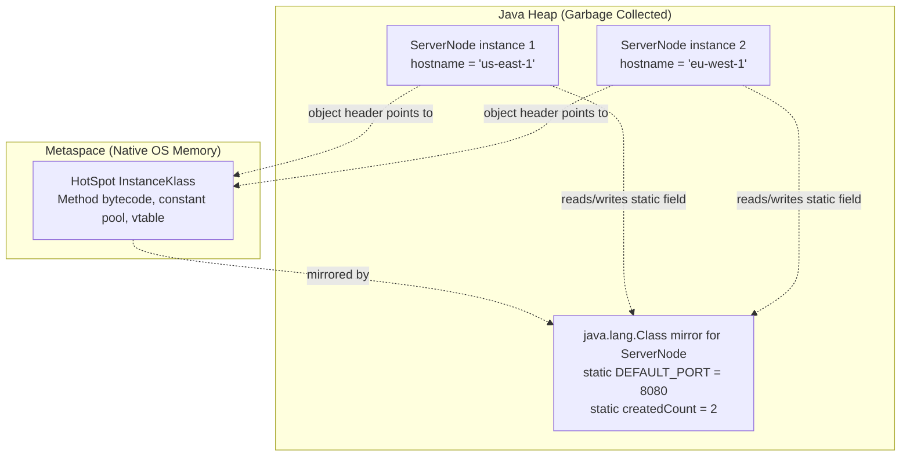
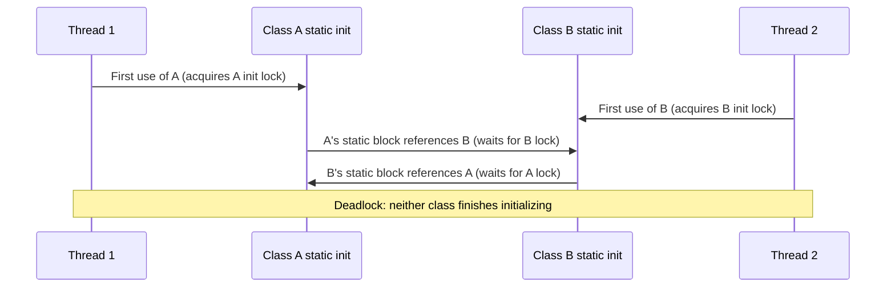

Early on in Java, you get used to creating an object before calling a method on it: `new BankAccount(...)`, then `account.deposit(...)`. Then you encounter code like `Math.sqrt(144.0)` or `Integer.parseInt("42")`, where nobody called `new` at all.

That is the role of the **`static`** keyword. Marking a field, method, or initializer block as `static` attaches it to the **class itself** rather than to individual instances created with `new`. There is one copy of a static field per class (per ClassLoader), and you can invoke a static method without constructing any object.

Used well, `static` gives you clean constants, pure utility functions, and controlled class-level initialization. Used carelessly, it creates shared mutable global state that is hard to test, prone to race conditions, and easy to turn into a memory leak.

## Static Variables and JVM Memory

A regular instance field is duplicated inside every object allocated on the Heap. A `static` field exists only once for that class, and every instance (as well as external code with visibility) reads and writes that same slot.

```java
public class ServerNode {
    // Instance field: unique to each ServerNode object
    private final String hostname;

    // Static constant: shared and immutable
    public static final int DEFAULT_PORT = 8080;

    // Static mutable field: one shared counter for the class
    private static int createdCount = 0;

    public ServerNode(String hostname) {
        this.hostname = hostname;
        createdCount++;
    }

    public String getHostname() {
        return hostname;
    }

    public static int getCreatedCount() {
        return createdCount;
    }
}
```

```java
ServerNode east = new ServerNode("us-east-1");
ServerNode west = new ServerNode("eu-west-1");

System.out.println(ServerNode.DEFAULT_PORT);       // 8080
System.out.println(ServerNode.getCreatedCount());  // 2
```

### Where Static Fields Actually Live in HotSpot (Java 8+)

You will often hear the shorthand claim that "static variables live in Metaspace." That is a common misconception left over from older discussions of PermGen.

In **HotSpot Java 8 and later**, class structure and static field values live in two different places:



1. **Class metadata lives in Metaspace (native memory):** HotSpot stores the internal class descriptor (`InstanceKlass`), method bytecode, symbol tables, and virtual method tables in Metaspace outside the Java Heap.
2. **Static field values live on the Java Heap:** When a class is loaded, HotSpot creates a `java.lang.Class` mirror object on the standard garbage-collected Heap. Static primitive values and static object references are stored inside that `Class` mirror object on the Heap, not in Metaspace.

### Why That Placement Matters: Static Memory Leaks

The `java.lang.Class` mirror is strongly referenced by the ClassLoader that loaded it, and in a typical application the Application ClassLoader stays alive until the JVM shuts down. That makes static fields act as long-lived **Garbage Collection roots**.

```java
import java.util.HashMap;
import java.util.Map;

public class NaiveCache {
    // Dangerous: unbounded static collection stays alive for the lifetime of the JVM
    private static final Map<String, byte[]> BYTES_BY_KEY = new HashMap<>();

    public static void put(String key, byte[] payload) {
        BYTES_BY_KEY.put(key, payload);
    }
}
```

Any object reachable from `BYTES_BY_KEY` cannot be collected by the GC unless it is explicitly removed or the entire ClassLoader is unloaded. Putting unbounded caches, request payloads, or user sessions into static collections is a classic source of `OutOfMemoryError: Java heap space`.

Mutable static fields also create concurrency bugs. In `ServerNode` above, `createdCount++` is not atomic: if two threads construct `ServerNode` instances concurrently, increments can be lost unless you synchronize or use an `AtomicInteger`. As a general habit, use `static` fields for immutable constants (`private static final` or `public static final`) and avoid shared mutable static state.

### Access Static Members Through the Class Name

Java syntax technically lets you access a static field or method through an instance variable, such as `east.getCreatedCount()`, but you should never write code that way. The compiler ignores the runtime object and resolves the call using the variable's **compile-time type**.

In fact, this compiles and runs without throwing a `NullPointerException`:

```java
ServerNode node = null;
System.out.println(node.getCreatedCount()); // Compiles and prints 2; very misleading
```

Always qualify static calls with the class name (`ServerNode.getCreatedCount()`) so readers immediately see that no instance is involved.

## Static Methods and Utility Classes

A **static method** belongs to the class and executes without any `this` reference. Because there is no current object instance, a static method cannot directly access non-static fields or call non-static methods of its class (unless it creates or receives an explicit object reference as a parameter).

```java
public class User {
    private String username;

    public static void printCurrent() {
        // Compile error: non-static variable username cannot be referenced from a static context
        // System.out.println(username);
    }

    public static void printUser(User user) {
        // Valid: accessing an instance field through an explicit parameter
        System.out.println(user.username);
    }
}
```

### Designing a Clean Utility Class

When a group of pure functions has no instance state of its own (like `java.lang.Math`, `java.util.Arrays`, or `java.util.Objects`), Java's standard idiom is a **utility class**:

```java
public final class NumberUtils {

    // Private constructor prevents accidental instantiation via new NumberUtils()
    private NumberUtils() {
        throw new AssertionError("Utility class should not be instantiated.");
    }

    public static long clamp(long value, long min, long max) {
        if (min > max) {
            throw new IllegalArgumentException("min (" + min + ") must be <= max (" + max + ")");
        }
        return Math.max(min, Math.min(value, max));
    }
}
```

Making the class `final` prevents pointless subclassing, and a `private` constructor stops callers from writing `new NumberUtils()`.

### Compile-Time Binding and Method Hiding

At the bytecode level, normal instance methods are invoked with `invokevirtual`, which looks up the actual runtime class of the object to support polymorphism. Static methods are invoked with `invokestatic`, which binds directly to a specific class at compile time.

Because static methods do not participate in runtime dispatch, **a subclass cannot override a static method**. Declaring a static method with the same signature in a subclass is called **method hiding**, not overriding:

```java
class BaseReport {
    public static String formatName() {
        return "BaseReport";
    }
}

class SalesReport extends BaseReport {
    // Hides BaseReport.formatName(); adding @Override here fails to compile
    public static String formatName() {
        return "SalesReport";
    }
}

public class HidingDemo {
    public static void main(String[] args) {
        BaseReport report = new SalesReport();
        System.out.println(report.formatName());      // Prints: BaseReport
        System.out.println(SalesReport.formatName()); // Prints: SalesReport
    }
}
```

Even though `report` points to a `SalesReport` instance on the Heap, `report.formatName()` prints `BaseReport` because the compiler binds the static call using the declared reference type (`BaseReport`). This is another strong reason never to call static methods through object references.

## Static Initialization Blocks

Sometimes a static field needs more than a one-line assignment: for example, populating an unmodifiable lookup map, reading an environment variable with a fallback, or loading a native library. A **static initialization block** (`static { ... }`) handles this setup.

```java
import java.util.HashMap;
import java.util.Map;

public class DbDefaults {
    public static final Map<String, String> PROPERTIES;

    static {
        Map<String, String> values = new HashMap<>();
        String envPort = System.getenv("DB_PORT");
        values.put("host", "localhost");
        values.put("port", envPort != null ? envPort : "5432");
        PROPERTIES = Map.copyOf(values);
    }
}
```

### How `<clinit>` Works Under the Hood

When `javac` compiles a class, it combines all static field initializers and all `static { ... }` blocks, in the exact top-to-bottom order they appear in source code, into a single class initialization method named `<clinit>`.

The JVM specification guarantees two useful properties for class initialization:

1. **Lazy execution:** A class's `<clinit>` runs only when the class is first actively used (such as instantiating it, invoking a static method, or reading/writing a non-compile-time-constant static field).
2. **Thread safety:** The JVM acquires an internal initialization lock per class so `<clinit>` runs at most once, and other threads waiting to use the class block until initialization completes.

Keep two pitfalls in mind when writing static blocks:

- **Uncaught exceptions poison the class:** If a static initializer throws an unchecked exception, the JVM wraps it in `ExceptionInInitializerError`. Any subsequent attempt to reference the class fails with `NoClassDefFoundError`.
- **Cross-class initialization deadlocks:** Because the JVM holds an initialization lock while running `<clinit>`, circular dependencies between two classes' static initializers can deadlock if two threads initialize them at the same time.



Avoid referencing other complex classes or spawning threads inside a `static { ... }` block.

### The Initialization-on-Demand Holder Idiom

Because JVM class initialization is both lazy and thread-safe, Java developers use a static nested class to implement a lazy singleton without explicit `synchronized` blocks (often called the **Bill Pugh Singleton**):

```java
public final class ConfigRegistry {

    private ConfigRegistry() {
        // Heavy one-time setup
    }

    private static final class Holder {
        private static final ConfigRegistry INSTANCE = new ConfigRegistry();
    }

    public static ConfigRegistry getInstance() {
        return Holder.INSTANCE;
    }
}
```

Loading `ConfigRegistry` does *not* initialize `Holder`. Only the first call to `getInstance()` triggers `Holder`'s initialization, and the JVM ensures `INSTANCE` is safely published to all threads with no locking overhead on subsequent calls. (In modern Spring or Guice applications, prefer dependency injection over manual singletons; the holder idiom is mainly useful in standalone libraries.)

## Why the `main` Method Is Static

Every standard Java application starts at a method with this signature:

```java
public class App {
    public static void main(String[] args) {
        System.out.println("Application started with " + args.length + " args.");
    }
}
```

When you run `java App`, the JVM has loaded the `App` class, **but zero instances of `App` exist yet**. Making `main` static solves three immediate startup problems:

1. **No object is needed to start the JVM:** The JVM can invoke `App.main(args)` directly on the class without having to allocate an `App` object first.
2. **No constructor ambiguity:** What if `App` only had a parameterized constructor `App(DatabaseConfig config)` or multiple overloaded constructors? If `main` were an instance method, the JVM would have no way to know which constructor to call or what arguments to pass before your program has even started running.
3. **Clear ownership of lifecycle:** Your `main` method decides how to parse command-line arguments, wire dependencies, and construct the actual application objects.

Each modifier in `public static void main(String[] args)` has a concrete reason:

- `public` so the JVM launcher outside your package can invoke it.
- `static` so the JVM can invoke it without creating an instance of the enclosing class.
- `void` because the JVM does not use a Java return value from `main` (process exit codes are returned via `System.exit(code)` when a non-zero exit status is needed).
- `String[] args` (or `String... args`) to receive command-line arguments passed after the class name.

> [!NOTE]
> Starting as a preview feature in Java 21 (JEP 445) and finalized in Java 25 (JEP 512, *Compact Source Files and Instance Main Methods*), Java added support for simplified `void main()` instance entry points when a class has an accessible no-args constructor. Under the hood, the launcher constructs the instance automatically for those learning/scripting cases, while production Java applications continue to use `public static void main(String[] args)` as the standard entry point.

## Practical Questions

### Where are static variables stored in HotSpot Java 8 and later?
In HotSpot Java 8+, class metadata (method bytecode, constant pool, vtables) lives in native memory called Metaspace, while static field values live on the **Java Heap** inside the class's `java.lang.Class` mirror object. Because that `Class` object stays reachable through its ClassLoader, objects referenced by static fields stay alive until the reference is cleared or the ClassLoader is unloaded.

### Why can't you use `this` or access instance fields directly inside a static method?
An instance method receives an implicit `this` reference pointing to the object on which it was called. A static method is called on the class itself (`ClassName.method()`), so no object instance is guaranteed to exist and there is no `this` reference in its stack frame. To access an instance field from a static method, you must pass or create an object reference explicitly.

### What happens if a subclass declares a static method with the same signature as a superclass static method?
It **hides** the superclass method rather than overriding it. Static methods are bound at compile time (`invokestatic`) based on the declared type of the reference, not the runtime type of the object. Adding `@Override` to a static method causes a compile-time error.

### Why is `public static void main(String[] args)` declared `static`?
When the JVM launches a program, no instances of the entry-point class exist yet. Declaring `main` as `static` lets the JVM invoke it directly on the class without having to guess how to construct an instance or require a parameterless constructor.
