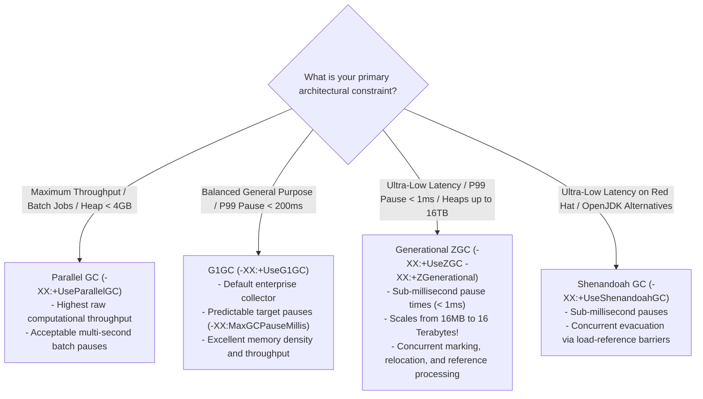
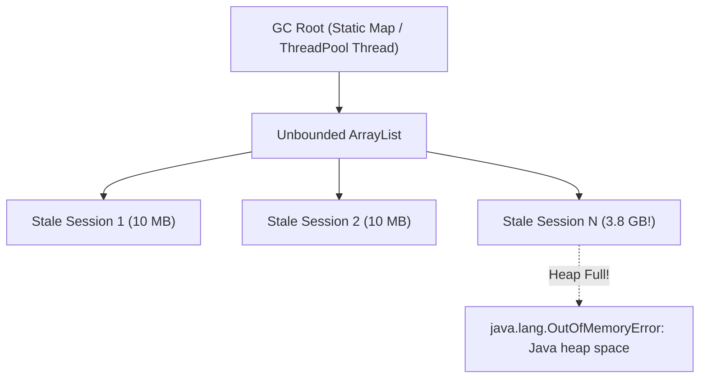
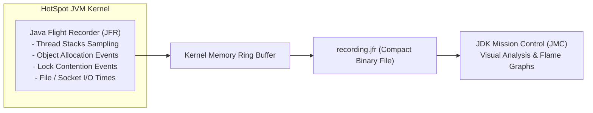

You have reached the summit of Java engineering. Anyone can write Java code that runs happily inside an IDE with 50 concurrent requests. But when your application handles 250,000 requests per second across 128 GB heap instances, the Java Virtual Machine ceases to be a gentle abstraction and becomes an intensely optimized C++ runtime engine where every CPU cache line, allocation rate, and pause phase dictates the success or failure of your business.

At cloud scale, poor JVM configuration costs millions of dollars in wasted cloud compute. A misconfigured Garbage Collector can freeze payment transactions for 12 seconds during a Stop-the-World pause, trigger Kubernetes liveness probe terminations, and cause cascading cluster failures.

In this guide, we will step into the HotSpot engine. We will decipher modern unified GC logs, conduct a head-to-head comparison between **G1GC**, **Generational ZGC**, and **Shenandoah**, diagnose memory leaks using Eclipse MAT heap dump forensics, and profile production bottlenecks with **Java Flight Recorder (JFR)** at near-zero overhead.

---

## Deciphering Modern GC Logs (Unified JVM Logging)

Gone are the days of `-XX:+PrintGCDetails`. Since Java 9, HotSpot uses the **Unified JVM Logging Framework** (`-Xlog`).

### Production Logging Flags
In modern production deployments, always enable detailed GC logging:

```bash
-Xlog:gc*,gc+age=trace,gc+phases=debug:file=/var/log/jvm/gc-%t.log:time,uptime,pid:filecount=5,filesize=100M
```
- `filecount=5,filesize=100M`: Enforces log rotation (keeps a maximum of 500 MB of logs, preventing disk exhaustion).
- `time,uptime,pid`: Timestamps every log line with ISO-8601 wall-clock time, JVM uptime in seconds, and Process ID.

### Anatomy of a Real G1GC Log Line
```text
[2026-10-29T14:22:01.412+0000][124.512s][14022][info][gc,start    ] GC(42) Pause Young (Normal) (G1 Evacuation Pause)
[2026-10-29T14:22:01.413+0000][124.513s][14022][debug][gc,phases   ] GC(42) Pre Evacuate Collection Set: 0.1ms
[2026-10-29T14:22:01.413+0000][124.513s][14022][debug][gc,phases   ] GC(42) Evacuate Collection Set: 3.4ms
[2026-10-29T14:22:01.417+0000][124.517s][14022][debug][gc,phases   ] GC(42) Post Evacuate Collection Set: 0.3ms
[2026-10-29T14:22:01.418+0000][124.518s][14022][info ][gc          ] GC(42) Pause Young (Normal) (G1 Evacuation Pause) 1842M->412M(4096M) 5.812ms
[2026-10-29T14:22:01.418+0000][124.518s][14022][info ][gc,cpu      ] GC(42) User=0.04s Sys=0.00s Real=0.01s
```

### How to Read This Diagnostic Data
- **`GC(42)`**: The 42nd GC event since JVM startup.
- **`Pause Young (Normal)`**: A Stop-the-World pause collecting the Young Generation.
- **`1842M->412M(4096M)`**: Heap occupancy before GC was 1,842 MB; heap occupancy after GC dropped to 412 MB; total committed heap size is 4,096 MB. Over 1.4 GB of short-lived garbage was successfully reclaimed.
- **`5.812ms`**: Total Stop-the-World pause duration. Application threads were frozen for only 5.8 milliseconds.
- **`User=0.04s Sys=0.00s Real=0.01s`**: CPU breakdown. `Real` is elapsed wall-clock time. `User` is total CPU time consumed across all parallel GC worker threads.

### Allocation Rate vs Promotion Rate
- **Allocation Rate**: The rate at which the application allocates new memory in Eden (e.g., 500 MB/sec). If your allocation rate spikes, GC pauses occur more frequently.
- **Promotion Rate**: The rate at which surviving objects escape the Young Generation and are copied into Old Gen. If your promotion rate equals your allocation rate, your young generation is too small, causing premature aging of objects and eventual Old Gen exhaustion!

---

## The Great Collector Battle: G1GC vs ZGC vs Shenandoah

In modern Java 21+, you have three primary production garbage collectors to choose from:



### Deep Dive Comparison Matrix
| Collector | Default Since | Target Pause Time | Heap Scaling | Key Architectural Mechanism |
|---|---|---|---|---|
| **G1GC** | Java 9 | 100ms - 200ms | 4 GB - 64 GB | Divides heap into 2,048 equal regions (1MB to 32MB). Evacuates regions with the most garbage first. |
| **Generational ZGC** | Java 21 | **< 1 millisecond** | 16 MB - **16 Terabytes** | **Colored Pointers** and **Load Barriers**. Relocates objects concurrently while application threads execute! |
| **Shenandoah GC** | Java 12 (Red Hat) | **< 10 milliseconds** | 4 GB - 100+ GB | Concurrent evacuation using **Brooks Pointers / Load-Reference Barriers**. |

### Generational ZGC in Java 21: The Game Changer
Before Java 21, ZGC was non-generational: it had to inspect the entire heap to reclaim memory. 
In Java 21 (JEP 439), **Generational ZGC** was introduced. It embraces the Weak Generational Hypothesis (most objects die young) while retaining ZGC's sub-millisecond concurrent pause times.

To activate Generational ZGC in Java 21:
```bash
java -XX:+UseZGC -XX:+ZGenerational -Xms32g -Xmx32g -jar app.jar
```

> [!NOTE]
> **When should you still use G1GC over ZGC?**  
> Throughput and CPU efficiency! Generational ZGC uses CPU load barriers on every pointer dereference. If your application is a compute-intensive batch processing service or memory-constrained container where a 50ms pause is completely harmless, G1GC will provide approximately 5% to 15% higher raw throughput and lower CPU utilization than ZGC.

---

## Memory Leak Forensics with Heap Dumps (`.hprof`)

In C++, a memory leak occurs when memory is allocated on the OS heap and never freed. In Java, memory is automatically reclaimed by garbage collection.

Therefore, a **Java Memory Leak** is an **Unintentional Object Retention**: an object that the application will never use again remains reachable from a **GC Root** (e.g., a static collection, an active thread stack, or a ThreadLocal), preventing the GC from ever reclaiming it.



### Essential Production Flags for Heap Dumps
When a JVM crashes with `OutOfMemoryError`, application state is lost forever unless you configured automatic heap dump generation:

```bash
-XX:+HeapDumpOnOutOfMemoryError
-XX:HeapDumpPath=/dumps/oom-crash.hprof
-XX:+CrashOnOutOfMemoryError
```
- `CrashOnOutOfMemoryError`: Immediately terminates the process on OOM. In Kubernetes, a pod that encounters an OOM error is often half-dead, holding locks and failing health checks. Crashing immediately allows Kubernetes to restart the pod cleanly.

### Capturing an On-Demand Heap Dump in Production
If memory usage is climbing steadily and you want to inspect memory *before* the application crashes, use the native `jcmd` utility:

```bash
# Step 1: Find the Java Process ID
jcmd

# Step 2: Trigger an immediate live heap dump (only dumps surviving objects)
jcmd <PID> GC.heap_dump -all=false /dumps/live-heap.hprof
```

### Analyzing with Eclipse Memory Analyzer Tool (MAT)
Open `/dumps/live-heap.hprof` in Eclipse MAT or VisualVM and inspect:
1. **Dominator Tree**: Identifies the largest individual objects in memory. If one single `ConcurrentHashMap` holds 85% of the total heap, you have identified the culprit data structure.
2. **Shallow Heap vs Retained Heap**:
   - **Shallow Heap**: The memory consumed by the object itself (its own primitive fields and reference pointers). Typically tiny (e.g., 32 bytes).
   - **Retained Heap**: The total memory that would be freed if this object were garbage collected (the object itself plus the entire transitive closure of objects reachable *only* through this object). A single root object can have a 32-byte shallow heap and a 6 GB retained heap!
3. **Path to GC Roots**: Right-click the suspect object and select *Path to GC Roots -> Exclude all phantom/weak/soft references*. This reveals the exact static field or live thread retaining the memory.

---

## Continuous Production Profiling: Java Flight Recorder (JFR)

Never attach an intrusive, bytecode-instrumenting development profiler to a production JVM. Traditional profilers can degrade performance by 50% to 200%, corrupting measurement accuracy and causing outages.

**Java Flight Recorder (JFR)** is a high-performance event-tracing framework built directly into the HotSpot C++ kernel. It incurs **less than 1% CPU overhead**, making it completely safe for 24/7 continuous production profiling.



### Starting JFR on JVM Boot
```bash
java -XX:StartFlightRecording=disk=true,dumponexit=true,filename=/dumps/profile.jfr,settings=profile -jar app.jar
```
- `settings=profile`: Captures detailed thread samples, lock contention events exceeding 10ms, and memory allocations outside Thread-Local Allocation Buffers (TLABs).

### Starting a Dynamic JFR Recording on a Running Pod
If a production pod suddenly spikes to 95% CPU, capture a 60-second diagnostic recording on the fly without restarting:

```bash
jcmd <PID> JFR.start name=cpu_investigation duration=60s filename=/dumps/cpu_spike.jfr settings=profile
```

### What JFR and JDK Mission Control (JMC) Reveal
- **Flame Graphs**: Pinpoints the exact Java method and line number consuming 80% of CPU cycles.
- **Lock Contention**: Identifies synchronization locks (`synchronized` blocks or `ReentrantLock`) where worker threads are blocked waiting for monitors.
- **Memory Allocation Hotspots**: Reveals which lines of code allocate the most objects, driving high GC allocation rates.
- **Socket I/O Latency**: Pinpoints slow remote HTTP or database socket reads that freeze threads.

---

## Architectural Traps and Real-World Outages

### The "Humongous Object G1GC Thrashing" Outage
A high-throughput document conversion service ran on G1GC with a 16 GB heap and default region size of 8 MB (`-XX:G1HeapRegionSize=8m`). 
In G1GC, any allocation exceeding **50% of the region size (4 MB)** is classified as a **Humongous Object**. 

The application converted PDF files into 5 MB byte arrays. Because these exceeded 4 MB, G1GC bypassed Eden entirely and allocated them directly into contiguous blocks of Old Generation regions! 
Under heavy load, Old Gen fragmented rapidly, forcing G1GC into continuous concurrent marking cycles and eventually triggering a catastrophic, 14-second Stop-the-World Full GC pause that caused the Kubernetes cluster to kill all pods.

**The Fix:** Increase the region size: `-XX:G1HeapRegionSize=16m` or stream byte buffers in smaller 64 KB chunks rather than giant monolithic byte arrays.

### The "ThreadLocal Connection Leak" in Tomcat
A development team implemented a security filter that stored user tenancy metadata and an active JDBC connection in a `ThreadLocal`:
```java
public class TenantContext {
    private static final ThreadLocal<Connection> connectionHolder = new ThreadLocal<>();
    // Forgot to call connectionHolder.remove()!
}
```
In servlet containers like Tomcat, worker threads are never destroyed; they are returned to an internal thread pool to serve future requests. 
Over the course of 3 days, worker threads retained thousands of open JDBC connection wrappers. The HikariCP connection pool exhausted, and the JVM slowly accumulated 12 GB of un-reclaimed session objects until the application crashed with an OOM.

---

## Senior Interview Questions

### Question 1: What is the purpose of Thread-Local Allocation Buffers (TLABs) in the HotSpot JVM, and how do they impact allocation performance?
**Answer:**  
In a multi-threaded application, if all threads allocated memory from a single shared Eden space, every allocation would require synchronizing a global heap pointer (via atomic Compare-And-Swap operations or mutex locks), creating a severe scalability bottleneck.

To eliminate this contention, HotSpot allocates a dedicated **Thread-Local Allocation Buffer (TLAB)** inside Eden for each thread. When a thread executes `new Object()`, it allocates memory from its private TLAB by simply incrementing an un-synchronized internal pointer (Bump-the-Pointer allocation), taking only a few CPU instructions. Only when a thread's TLAB becomes completely full does it synchronize with the global heap to claim a new TLAB.

### Question 2: How does Generational ZGC achieve sub-millisecond Stop-the-World pause times on heaps containing Terabytes of data?
**Answer:**  
Traditional collectors (like Parallel GC and CMS) perform object relocation (compacting memory to eliminate fragmentation) during Stop-the-World pauses because relocating an object changes its physical memory address, requiring all pointers referencing that object to be updated before application threads resume.

ZGC achieves sub-millisecond pauses by performing object relocation **concurrently while application threads are actively running**:
1. **Colored Pointers**: ZGC embeds metadata flags directly into the unused upper bits of 64-bit object reference pointers (marking whether an object is known good, remapped, or undergoing relocation).
2. **Load Barriers**: When an application thread dereferences an object pointer (`obj.field`), a JIT-compiled CPU load barrier intercepts the instruction. If the colored pointer indicates the object has been relocated, the load barrier consults ZGC's Forwarding Table, updates the reference to the new memory location (self-healing pointer), and returns the valid object without stalling the thread.

### Question 3: What is the difference between Shallow Heap and Retained Heap in Eclipse MAT heap dump analysis?
**Answer:**  
- **Shallow Heap**: The exact physical memory consumed by an object itself in the heap, accounting for its object header (12-16 bytes), primitive fields (int, long, boolean), and reference pointers (4-8 bytes per reference). It does not include the memory of any objects referenced by it.
- **Retained Heap**: The total sum of shallow heaps across all objects that are **transitively reachable exclusively through this object**. If this root object were garbage collected, the entire retained heap volume would be freed immediately. Identifying objects with high retained heaps is the primary technique for isolating memory leaks in production heap dumps.

### Question 4: Under what conditions does G1GC trigger a Full GC, and why is a G1GC Full GC dangerous?
**Answer:**  
G1GC is designed to perform incremental concurrent marking and mixed collections, ideally never needing a Full GC. However, G1GC triggers a Full GC when:
1. **To-Space Exhaustion / Evacuation Failure**: The survivor space or free regions run out of space while evacuating live objects from a Collection Set.
2. **Concurrent Marking Cycle Too Slow**: The application's allocation rate is faster than the concurrent marking threads can mark garbage (Allocation Stall).
3. **Humongous Allocation Fragmentation**: Massive objects (>50% region size) fragment the heap such that contiguous free regions cannot be found.

A G1GC Full GC is catastrophic because it halts all application threads and falls back to a single-threaded (or multi-threaded parallel) Mark-Sweep-Compact algorithm that scans and compacts the entire heap, frequently resulting in Stop-the-World pauses lasting anywhere from 5 to 60 seconds.
