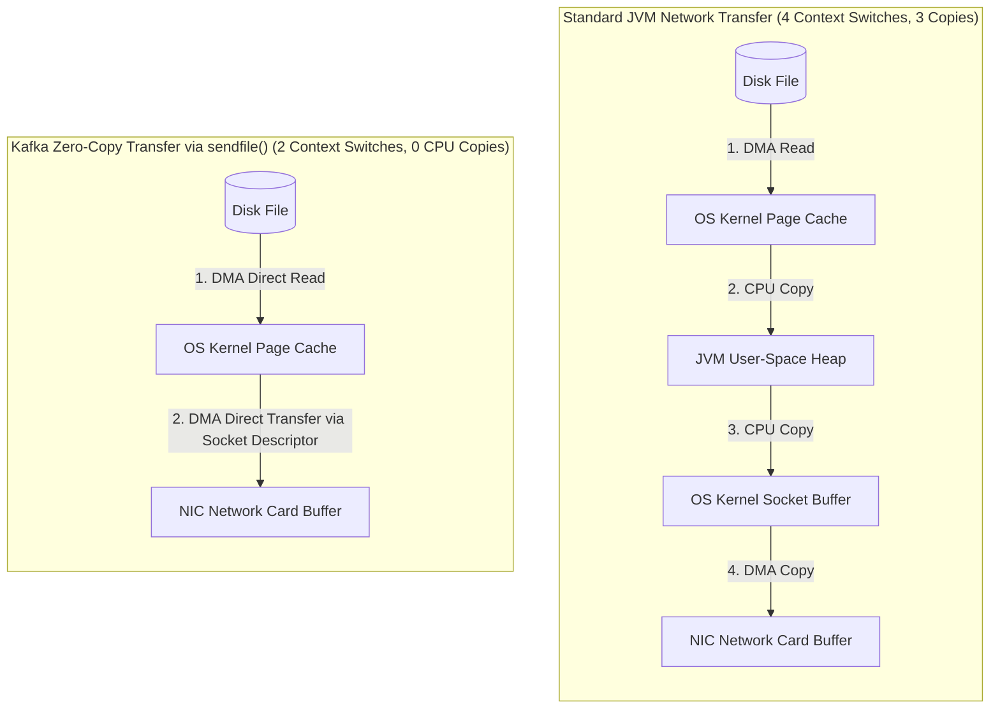
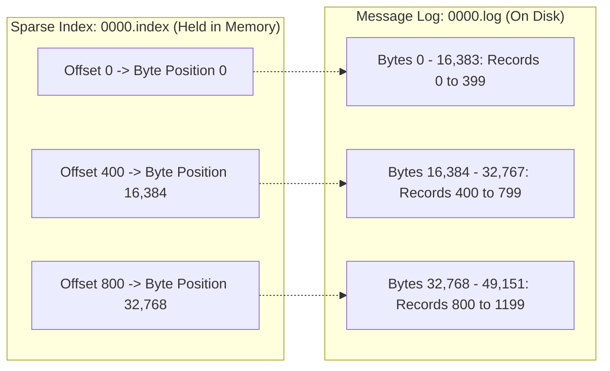
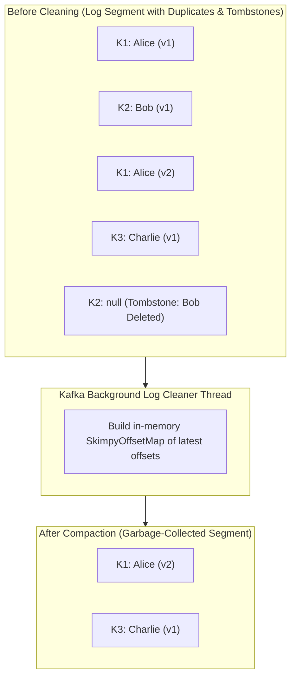
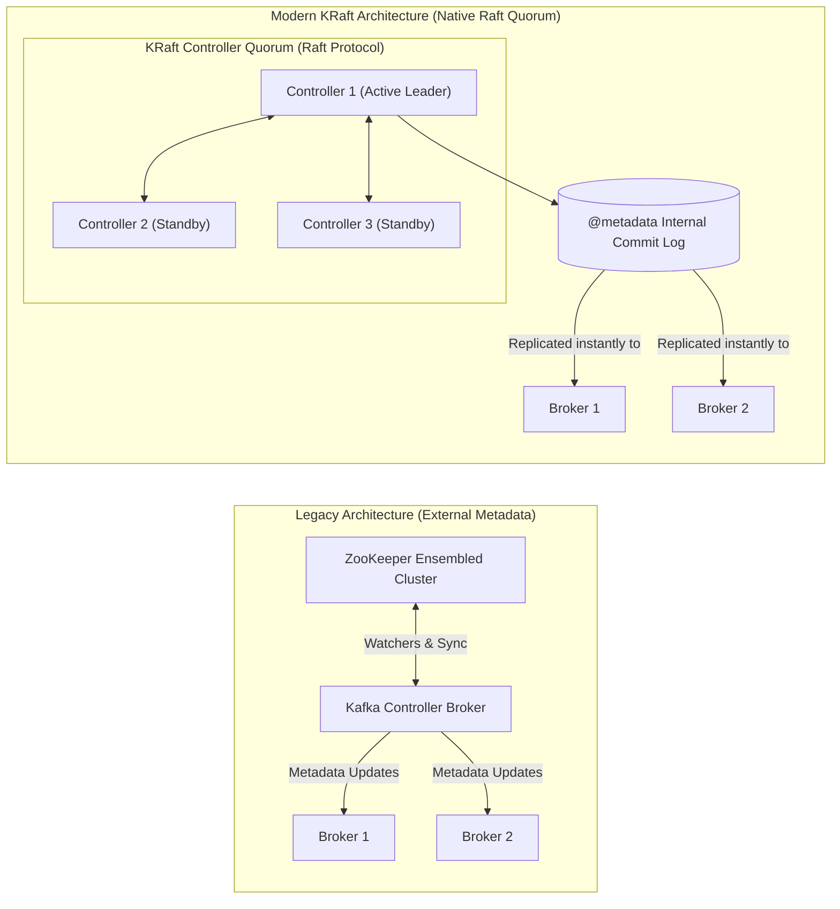

# Apache Kafka Internals

Many software engineers think of Apache Kafka as a high-speed message queue—a faster RabbitMQ. That mental model is fundamentally flawed.

In a traditional message broker, messages are transient objects held in memory. Once a consumer reads an acknowledgment, the broker deletes the message and updates its internal pointer. Under high load with thousands of consumers, message queues degrade because managing index state and random-access memory deletions consumes significant CPU cycles.

Kafka is not a queue. Kafka is a **distributed, partitioned, replicated, append-only commit log**. 

Messages are never deleted when read; consumers track their own positions via immutable sequence numbers called **offsets**. This allows thousands of independent consumers to read the same stream at their own pace without impacting each other.

By taking advantage of sequential disk I/O, OS page caching, and hardware-level **Zero-Copy** network transfers, a single Kafka cluster can process millions of messages per second with microsecond latencies.

In this deep dive, we will explore the low-level mechanical sympathy that makes Kafka fast, unpack log segments and sparse indexes, examine replication protocols, and explain how the modern **KRaft** consensus engine retired ZooKeeper.

---

## Mechanical Sympathy: Why Kafka is Fast

There is a widespread myth that "disk is slow and RAM is fast." While random disk seeks are slow (taking 5 to 10 milliseconds on mechanical HDDs and 0.1ms on SSDs), **sequential disk access is faster than random memory access**.

Sequential disk writes achieve throughputs of hundreds of megabytes per second, matching raw RAM speeds because modern operating systems read and write disks in continuous multi-megabyte physical blocks.



### The Power of OS Page Cache

Rather than maintaining an enormous in-memory cache on the Java heap, Kafka delegates caching entirely to the **Linux OS Page Cache**:

- **No JVM Garbage Collection Pauses:** If Kafka cached gigabytes of messages in Java heap memory, JVM garbage collection pauses would freeze the broker for seconds. By leaving messages in the OS page cache, Kafka runs with a tiny heap (typically 6-8 GB) while utilizing 128 GB of server RAM purely for OS disk caching.
- **Warm Reboots:** If the Kafka Java process restarts or crashes, the OS page cache remains intact in the kernel. The newly booted broker immediately serves reads from RAM without warming up.

### Zero-Copy Network Transfer (`sendfile()`)

In a typical web server, sending a file to the network requires:
1. Copying data from disk to OS kernel buffer.
2. Copying data from OS kernel buffer to JVM heap memory (Context switch to user space).
3. Copying data from JVM heap to OS socket buffer (Context switch back to kernel space).
4. Copying data from socket buffer to the Network Interface Card (NIC).

Kafka bypasses user space entirely using the Linux **`sendfile()` system call** (exposed via Java's `FileChannel.transferTo()`):
- The data is read from disk directly into the OS page cache via Direct Memory Access (DMA).
- The kernel transfers bytes **directly from the page cache to the NIC buffer** without copying data into JVM memory.
- Context switches drop from 4 to 2, and CPU utilization drops to near zero. Kafka's throughput is bounded solely by physical network card bandwidth.

---

## Log Segments and Sparse Indexing

In Kafka, a Topic is partitioned, and each **Partition** is physically represented as an append-only directory on the broker's local filesystem:

```text
/var/lib/kafka/data/orders-0/
  ├── 00000000000000000000.log
  ├── 00000000000000000000.index
  ├── 00000000000000000000.timeindex
  ├── 00000000000000500000.log
  ├── 00000000000000500000.index
  └── leader-epoch-checkpoint
```

A partition is not a single giant file. It is broken into smaller chunks called **Log Segments** (default size: 1 GB, configured via `segment.bytes`).



### Why Sparse Indexes?

Maintaining an index entry for every single message would consume tens of gigabytes of RAM. Kafka uses **Sparse Indexing**:

- It records an entry in the `.index` file only every `N` bytes (default: every 4 KB, configured via `index.interval.bytes`).
- When a consumer requests message offset `650`:
  1. Kafka performs a fast in-memory binary search on the sparse index to find the closest offset less than or equal to `650` (which is `offset 400` at physical file byte position `16,384`).
  2. The disk head seeks directly to byte `16,384` and scans sequentially through a small 16 KB window until it hits offset `650`.

This hybrid approach combines the speed of in-memory binary search with minimal RAM consumption.

---

## Log Cleanup Policies: Delete vs Compact

How does Kafka manage disk storage when producers continuously stream gigabytes of data?

### Delete Policy (`cleanup.policy=delete`)

Segments are discarded based on age or total partition size:
- `log.retention.hours=168` (Retains messages for 7 days).
- `log.retention.bytes=107374182400` (Retains at most 100 GB per partition).
- When a segment's newest message exceeds the retention threshold, the entire segment file is deleted from disk.

### Compact Policy (`cleanup.policy=compact`)

For stateful event-sourcing streams (e.g., account balances, user profiles, or database CDC feeds), discarding records based on age causes data loss.

**Log Compaction** guarantees that Kafka retains at least the **most recent value for each message key** across the entire lifetime of the topic:



- **Tombstones:** To delete a key under log compaction, a producer writes a message with the target key and a `null` payload. During the next cleaning cycle, the cleaner purges older values and eventually erases the tombstone after a configurable delay (`delete.retention.ms`).

---

## High Availability and Replication Internals

Every partition in Kafka has a configured **Replication Factor** (typically 3). One broker serves as the **Leader**, while the remaining brokers act as **Followers**.

```mermaid
flowchart TD
    Producer["Producer Client"] -->|"Produce Record (ack=all)"| Leader["Broker 1: Partition Leader<br/>LEO: 105, HW: 104"]

    subgraph Followers["Follower Replicas (In-Sync Replicas - ISR)"]
        F1["Broker 2: Follower (In-Sync)<br/>LEO: 105"]
        F2["Broker 3: Follower (Lagging / Out of ISR)<br/>LEO: 80"]
    end

    Leader -->|"Replication Fetch"| F1
    Leader -.->|"Slow / Paused"| F2

    Consumer["Consumer Client"] -->|"Fetch Committed Messages"| Leader
    Note over Consumer: Can ONLY read up to High Watermark (HW = 104)!
```

### Critical Replication Metrics

- **Log End Offset (LEO):** The offset of the next record to be written in that specific replica's local log.
- **High Watermark (HW):** The highest offset that has been successfully replicated across **all In-Sync Replicas (ISR)**.
- **Consumer Isolation Guarantee:** Consumers can **only read records up to the High Watermark**. Even if the Leader has written message 105 to its local disk, message 105 remains invisible to consumers until Broker 2 acknowledges that it has copied the record. This prevents dirty reads if the Leader crashes before replication.

### The In-Sync Replicas (ISR) Set

A follower is considered "in-sync" if it actively catches up with the leader within a specified window (`replica.lag.time.max.ms=30000`). If a follower undergoes a long GC pause, disk stall, or network blip exceeding 30 seconds, the leader ejects it from the ISR set.

---

## The KRaft Revolution: The Death of ZooKeeper

For more than a decade, Apache Kafka relied on **Apache ZooKeeper** for cluster coordination, broker registration, topic configuration, and partition leader election.

### Why ZooKeeper Was Removed (KIP-500)

1. **Metadata Bottleneck:** ZooKeeper stored cluster state externally. The single active Kafka broker designated as the **Controller** had to synchronize state between ZooKeeper and all other brokers. In clusters with 100,000+ partitions, controller failover took tens of minutes while millions of partition states were re-read from ZooKeeper.
2. **Dual-System Complexity:** Operators had to configure, monitor, secure, and maintain two completely separate distributed systems (ZooKeeper + Kafka).
3. **Split-Brain Desynchronization:** Differences in network partition handling occasionally caused ZooKeeper and the Kafka Controller to hold divergent cluster metadata.



### How KRaft (Kafka Raft Metadata Mode) Works

Introduced in production readiness in Kafka 3.3 and making ZooKeeper completely obsolete in Kafka 4.0:

- **Cluster Metadata as an Event Log:** Cluster metadata (topics, partitions, ACLs, configurations) is stored directly inside an internal, highly compacted Kafka topic named `@metadata`.
- **Raft Consensus Quorum:** A small subset of nodes run as **KRaft Controllers** using the Raft consensus protocol. One controller is elected Active Leader; the others are hot standbys.
- **Sub-Second Failover:** Because standby controllers continuously replicate the `@metadata` partition in real time, if the Active Controller crashes, a standby assumes leadership **in under 500 milliseconds**, regardless of whether the cluster has 10,000 or 1,000,000 partitions.

---

## Senior Engineer Interview Crucible

### How does Kafka achieve multi-gigabyte-per-second throughput using the Linux OS Page Cache and Zero-Copy I/O?

Kafka achieves extreme throughput by combining sequential disk access, OS page caching, and Zero-Copy transfers:

1. **Sequential Append-Only Writes:** By appending messages sequentially to partition log segments, Kafka avoids costly random disk head seeks, achieving physical disk write speeds that rival RAM.
2. **OS Page Cache Delegation:** Kafka leaves message caching to the operating system's kernel page cache rather than storing objects on the JVM heap. This avoids JVM garbage collection pauses, keeps heap requirements minimal (under 8 GB), and allows the cache to survive broker process restarts without warmup.
3. **Zero-Copy Network Transfers (`sendfile`):** When consumers fetch data, Kafka uses the Linux `sendfile()` system call. The OS reads bytes directly from disk into the kernel page cache via DMA and routes them straight to the network socket buffer, bypassing user-space JVM memory entirely. This reduces context switches from 4 to 2 and eliminates CPU memory copy overhead.

---

### Explain the relationship between Log End Offset (LEO) and High Watermark (HW). When is a message considered committed and safe for consumers?

- **Log End Offset (LEO):** The offset of the next record to be written in a specific replica's physical log. Every broker (both Leader and Followers) tracks its own individual LEO as it appends records to disk.
- **High Watermark (HW):** The minimum LEO among all brokers currently in the **In-Sync Replicas (ISR)** set. 

A message is considered **committed** only when its offset is strictly less than the High Watermark. Consumers are isolated and strictly prohibited from reading any message beyond the High Watermark. This guarantees that if the current partition leader suffers an abrupt hardware failure, every message that was exposed to consumers is already safely replicated on the remaining in-sync followers, preventing dirty reads and data loss.

---

### Walk through Kafka Log Compaction. When is a tombstone record required, and what happens to the physical disk files during log cleaning?

Log Compaction (`cleanup.policy=compact`) retains the most recent message value for each key within a partition, garbage-collecting older historical updates.

- **Tombstones:** To permanently delete a key in a compacted topic, a producer publishes a record with the key and a `null` payload (a tombstone). The tombstone acts as a marker informing the cleaner that the key is deleted.
- **Log Cleaning Process:** A background cleaner thread builds an in-memory hash map (`SkimpyOffsetMap`) of the latest offsets for all keys in the dirty portion of the log. It then iterates through older segments, copying only the records whose offsets match the latest known offset into a new segment file.
- **Physical Disk Reclamation:** Historical records with superseded keys are omitted from the new segment. Tombstone records are retained for a configurable grace period (`delete.retention.ms`, default 24 hours) to ensure slow consumers observe the deletion, after which the tombstone itself is physically purged during the next compaction pass.

---

### Why did Apache Kafka replace Apache ZooKeeper with KRaft (KIP-500), and how does KRaft eliminate metadata bottlenecks?

Under ZooKeeper, Kafka cluster metadata was managed outside Kafka. The single broker designated as the Kafka Controller had to watch ZooKeeper, read full metadata state into its local memory, and send RPC updates to all other brokers. This architecture suffered from severe limitations:
1. **Controller Failover Latency:** When the controller broker crashed in large clusters (100k+ partitions), the new controller had to reload the entire metadata tree from ZooKeeper, causing cluster management freezes lasting up to 10-20 minutes.
2. **Partition Scaling Limits:** Clusters were bounded around 200,000 partitions because ZooKeeper memory and watcher overhead degraded performance.

**How KRaft Solves This:**
KRaft stores cluster metadata directly inside an internal, append-only Kafka topic named `@metadata`. A Raft-based controller quorum manages state consensus. Hot-standby controllers continuously replicate the metadata log in real time. If the active leader fails, a standby takes over in under 500 milliseconds with zero state reloading. KRaft scales Kafka to tens of millions of partitions per cluster while removing the operational burden of managing external ZooKeeper infrastructure.
