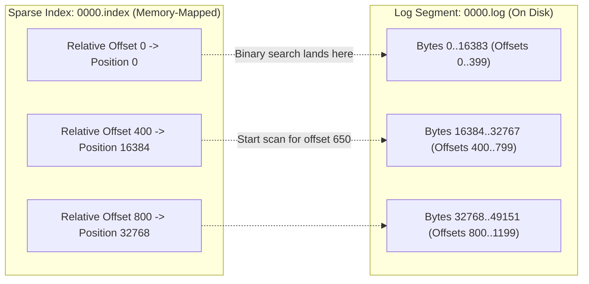
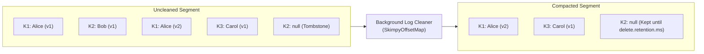
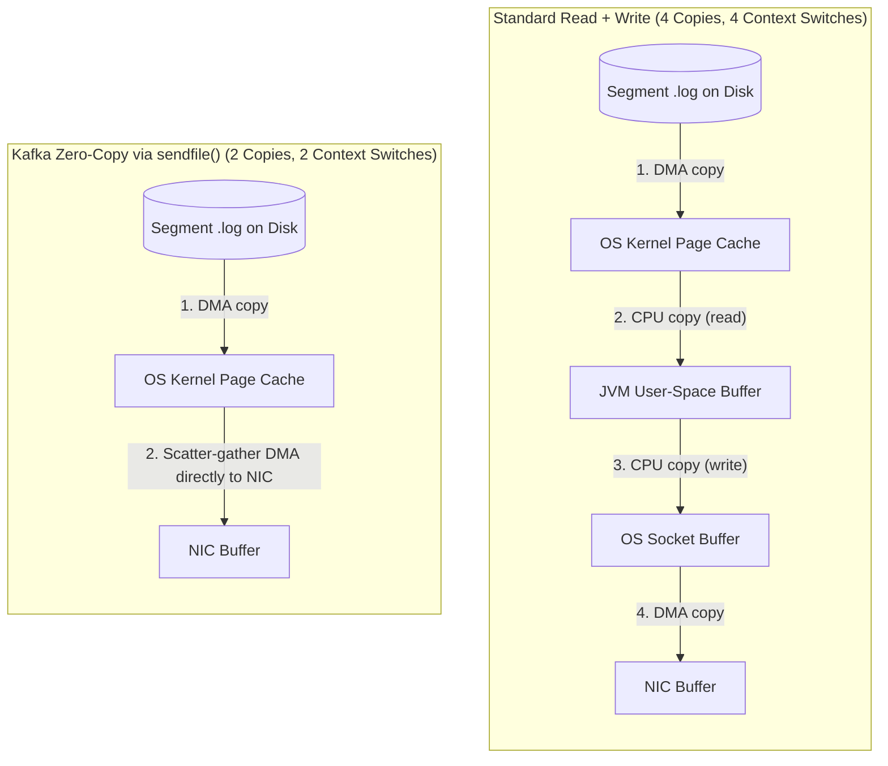
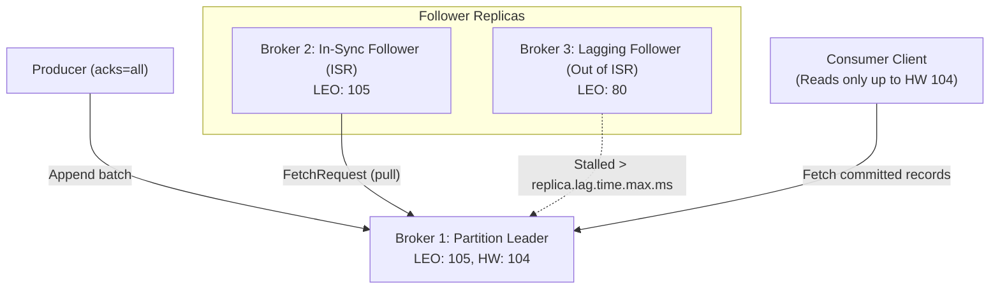

When engineers first run Apache Kafka in production, two things tend to surprise them. First, a Kafka broker usually runs with a modest JVM heap (often 6 to 8 GB) even on machines with 64 or 128 GB of RAM. Second, Kafka writes every single message to disk yet routinely sustains hundreds of megabytes per second per broker.

Both observations trace back to the same design choice: Kafka is not an in-memory message queue with a disk backup. It is a **distributed, partitioned, replicated, append-only commit log** built around how Linux file systems, page caches, and network stacks actually work.

Understanding what happens on disk and across replicas pays off immediately when you have to size disks, tune retention, diagnose under-replicated partitions, or explain why enabling TLS changed your broker CPU profile.

---

## Brokers, Topics, and Partitions

A Kafka cluster consists of multiple **Brokers** (JVM server processes). Producers and consumers organize events into logical streams called **Topics**.

Under the hood, a topic is split into one or more **Partitions**. A partition is the actual unit of storage, ordering, replication, and parallelism in Kafka:

- Each partition is an ordered, immutable sequence of records identified by a monotonically increasing 64-bit integer called an **offset**.
- Different partitions of the same topic are spread across different brokers so a single topic can scale beyond the disk, CPU, and network limits of one machine.
- For fault tolerance, every partition is replicated across multiple brokers according to its **replication factor** (typically 3 in production). One replica is elected the **Leader** (handling all client writes and, by default, client reads), and the others are **Followers** that continuously pull new records from the leader.

You can inspect how Kafka distributes partitions, leaders, and replicas directly with the CLI:

```bash
# Create a topic with 6 partitions and replication factor 3
kafka-topics.sh --bootstrap-server kafka-1:9092 \
  --create --topic orders.events.v1 \
  --partitions 6 \
  --replication-factor 3 \
  --config min.insync.replicas=2

# Inspect leader assignment and In-Sync Replicas (ISR)
kafka-topics.sh --bootstrap-server kafka-1:9092 \
  --describe --topic orders.events.v1
```

Typical output shows each partition's current leader, assigned replicas, and in-sync replicas:

```text
Topic: orders.events.v1  TopicId: 7kP9...  PartitionCount: 6  ReplicationFactor: 3  Configs: min.insync.replicas=2
  Topic: orders.events.v1  Partition: 0  Leader: 1  Replicas: 1,2,3  Isr: 1,2,3
  Topic: orders.events.v1  Partition: 1  Leader: 2  Replicas: 2,3,1  Isr: 2,3,1
  Topic: orders.events.v1  Partition: 2  Leader: 3  Replicas: 3,1,2  Isr: 3,1,2
```

---

## Disk Storage: Segment Files (`.log`) and Index Files (`.index`)

Every partition replica maps to a directory on the broker's local disk named `<topic>-<partition>`. Rather than appending forever to a single gigantic file, Kafka splits each partition into rolling **Log Segments**.

```text
/var/lib/kafka/data/orders.events.v1-0/
  ├── 00000000000000000000.log
  ├── 00000000000000000000.index
  ├── 00000000000000000000.timeindex
  ├── 00000000000000482150.log
  ├── 00000000000000482150.index
  ├── 00000000000000482150.timeindex
  ├── 00000000000000482150.snapshot
  └── leader-epoch-checkpoint
```

Each segment's filename is the 20-digit zero-padded **base offset** of the first record stored in that file. Only the newest segment (the **active segment**) receives writes. When it reaches `segment.bytes` (default 1 GB) or `segment.ms` (default 7 days), Kafka rolls a new segment and closes the old one. Breaking logs into immutable segments makes retention cleanup cheap: deleting expired data means unlinking old segment files rather than rewriting the middle of a file.

### How Sparse Indexing Works

To serve a consumer asking for offset `650`, Kafka needs the exact byte offset inside the `.log` file. Indexing every single message would consume too much memory, so Kafka uses a **sparse index** (`.index`) that records one entry roughly every 4 KB of log data (`index.interval.bytes=4096`).



Finding offset `650` takes three steps:
1. Locate the right segment file by comparing `650` against each segment's base offset in memory.
2. Run a binary search on that segment's memory-mapped `.index` file to find the largest indexed offset `<= 650` (here, offset `400` at byte position `16384`).
3. Seek to byte `16384` in the `.log` file and scan sequentially forward (at most a few kilobytes) until offset `650` is reached.

Each `.index` entry is only 8 bytes (a 4-byte relative offset from the segment's base offset plus a 4-byte physical file position), so the sparse index stays compact enough to remain cached in memory. The companion `.timeindex` file maps timestamps to offsets in a similar sparse layout, enabling `offsetsForTimes()` lookups when you want to replay from a specific clock time.

You can inspect raw segment and index files during incident debugging with `kafka-dump-log.sh`:

```bash
# Inspect record batches inside a log segment
kafka-dump-log.sh \
  --files /var/lib/kafka/data/orders.events.v1-0/00000000000000000000.log \
  --print-data-log

# Verify sparse index integrity against its segment
kafka-dump-log.sh \
  --files /var/lib/kafka/data/orders.events.v1-0/00000000000000000000.index \
  --verify-index-only
```

### Log Cleanup Policies: Delete vs Compact

Kafka reclaims disk space on closed segments using one of two cleanup policies (or both together via `compact,delete`):

- **`cleanup.policy=delete` (Default)**: Deletes entire closed segments once their newest record is older than `retention.ms` (default 7 days) or once the partition exceeds `retention.bytes`.
- **`cleanup.policy=compact`**: Retains at least the latest value for every message key in the partition. A background log cleaner thread builds an in-memory map (`SkimpyOffsetMap`) of the latest offset per key in the uncleaned ("dirty") tail of the log, then rewrites older segments while dropping superseded records.



To delete a key in a compacted topic, a producer writes a **tombstone**: a record with that key and a `null` value. Kafka keeps the tombstone for `delete.retention.ms` (default 24 hours) so lagging consumers can observe the deletion before the cleaner permanently removes the tombstone.

You can configure a compacted topic programmatically in Spring Boot using `TopicBuilder`:

```java
package com.javahub.kafka.config;

import org.apache.kafka.clients.admin.NewTopic;
import org.apache.kafka.common.config.TopicConfig;
import org.springframework.context.annotation.Bean;
import org.springframework.context.annotation.Configuration;
import org.springframework.kafka.config.TopicBuilder;

@Configuration
public class KafkaTopicConfig {

    @Bean
    public NewTopic customerProfilesCompactedTopic() {
        return TopicBuilder.name("customers.profiles.v1")
                .partitions(12)
                .replicas(3)
                .config(TopicConfig.CLEANUP_POLICY_CONFIG, TopicConfig.CLEANUP_POLICY_COMPACT)
                .config(TopicConfig.MIN_IN_SYNC_REPLICAS_CONFIG, "2")
                .config(TopicConfig.SEGMENT_BYTES_CONFIG, String.valueOf(256 * 1024 * 1024)) // 256 MB
                .config(TopicConfig.DELETE_RETENTION_MS_CONFIG, String.valueOf(86_400_000L)) // 24 hours
                .config(TopicConfig.MIN_CLEANABLE_DIRTY_RATIO_CONFIG, "0.5")
                .build();
    }
}
```

---

## Sequential I/O, OS Page Cache, and Zero-Copy (`sendfile`)

A common misconception is that Kafka is fast because "disk is faster than RAM." Strictly speaking, RAM latency and bandwidth still beat disk hardware. What actually makes Kafka fast is how **sequential I/O**, the **OS page cache**, and **zero-copy networking** eliminate the two biggest bottlenecks in JVM messaging servers: random disk seeks and JVM garbage collection.

### Sequential Appends and the OS Page Cache

Random reads and writes force disks to seek (milliseconds on HDDs, and fragmented I/O queues on SSDs). Because Kafka only appends to the end of active segment files and consumers usually read sequentially near the tail of the log, the Linux kernel aggressively optimizes both directions:
- **Writes** go straight into the **Linux OS Page Cache** in RAM and are flushed sequentially to disk in large background batches (unless you explicitly force `fsync` per message, which Kafka avoids by relying on multi-broker replication for durability).
- **Reads** from caught-up consumers almost always hit the OS page cache directly without ever touching the physical disk. Even lagging consumers benefit from OS read-ahead prefetching contiguous blocks.

Delegating caching to the OS kernel instead of the JVM heap gives Kafka three advantages:
1. **Small JVM heap, minimal GC pauses**: Keeping tens of gigabytes of messages in Java objects creates heavy object-header overhead and long GC pauses. Kafka brokers typically allocate only 6 to 8 GB to the JVM heap and leave the remaining host RAM to the OS page cache.
2. **No double caching**: If Kafka cached messages in the JVM heap, the OS would still cache the underlying `.log` file pages, wasting half of server memory.
3. **Warm restarts**: When a broker process restarts, the JVM heap disappears, but the OS page cache stays populated in kernel memory. Consumers continue reading from RAM immediately after the restart.

### Zero-Copy Data Transfer (`sendfile`)

In a conventional Java server, reading bytes from a file and writing them to a client socket takes four data copies and four user/kernel context switches:
1. DMA copies data from disk into the OS kernel page cache.
2. The CPU copies data from the kernel page cache into a JVM user-space buffer (`read()`).
3. The CPU copies data from the JVM buffer into the kernel socket buffer (`write()`).
4. DMA copies data from the socket buffer to the Network Interface Card (NIC).

Kafka avoids the middle two CPU copies on plaintext connections by calling Java's `FileChannel.transferTo()`, which delegates to the Linux **`sendfile()`** system call.



With scatter-gather DMA supported by modern NICs, the kernel passes only the memory descriptor and byte length to the socket buffer, and the NIC pulls the record bytes directly from the page cache. The bytes never enter the JVM heap.

Here is the minimal JDK mechanism Kafka's `FileRecords.writeTo()` uses under the hood:

```java
package com.javahub.kafka.internals;

import java.io.IOException;
import java.nio.channels.FileChannel;
import java.nio.channels.SocketChannel;
import java.nio.file.Path;
import java.nio.file.StandardOpenOption;

public class ZeroCopySegmentStreamer {

    public long streamSegmentSlice(
            Path segmentFile,
            long filePosition,
            long byteCount,
            SocketChannel clientSocket) throws IOException {
        try (FileChannel fileChannel = FileChannel.open(segmentFile, StandardOpenOption.READ)) {
            long transferred = 0;
            while (transferred < byteCount) {
                // Delegates to OS sendfile() on Linux; bypasses JVM user-space buffers
                long written = fileChannel.transferTo(
                        filePosition + transferred,
                        byteCount - transferred,
                        clientSocket
                );
                if (written == 0) {
                    break; // Socket send buffer is full; retry on next OP_WRITE readiness
                }
                transferred += written;
            }
            return transferred;
        }
    }
}
```

> [!IMPORTANT]
> **The TLS Caveat on Zero-Copy**
> When you enable TLS/SSL encryption on broker-to-consumer connections (standard in most production environments), `sendfile()` can no longer send raw page-cache bytes straight to the NIC because the broker must encrypt the payload first. Standard Java `SSLEngine` encryption happens in user space, which copies bytes back through the JVM and increases broker CPU usage unless Kernel TLS (kTLS) offload is explicitly supported and enabled in the OS/transport stack. Always benchmark broker CPU with TLS turned on before sizing production hardware.

---

## In-Sync Replicas (ISR) and Leader Election

Kafka achieves durability without forcing an expensive `fsync` on every message by replicating every partition across multiple brokers.



### LEO, High Watermark, and the ISR Set

Followers replicate by pulling records from the partition leader using internal `ReplicaFetcherThread` loops, much like regular consumers. Three concepts govern replication safety:

- **Log End Offset (LEO)**: The offset of the next record to be appended to a specific replica's local log. Leader and followers each track their own LEO.
- **In-Sync Replicas (ISR)**: The subset of replicas currently caught up with the leader. If a follower stops fetching or fails to catch up to the leader's LEO within `replica.lag.time.max.ms` (default 30 seconds), the leader removes it from the ISR set. Once the follower catches back up, it rejoins the ISR.
- **High Watermark (HW)**: The minimum LEO across all replicas in the ISR. A record is considered **committed** once its offset is strictly less than the High Watermark. Consumers can only read up to the High Watermark, preventing dirty reads if the leader crashes before a record reaches its followers.

### Leader Election and Leader Epochs

When a partition leader fails, the cluster controller elects a new leader from the remaining ISR brokers:
- **Clean Election (`unclean.leader.election.enable=false`, default)**: Only a broker in the ISR can become leader. Because every ISR broker has all committed records up to the High Watermark, no committed data is lost. If every ISR broker is down, the partition stays unavailable until one recovers.
- **Unclean Election (`unclean.leader.election.enable=true`)**: Allows an out-of-sync follower to become leader if the entire ISR is gone. This restores availability faster, but any committed records that the lagging follower never received are permanently lost. Financial and transactional workloads should keep this set to `false`.

Kafka also records a **Leader Epoch** in the `leader-epoch-checkpoint` file inside each partition directory. Each time leadership changes, the epoch increments. When a recovered former leader rejoins as a follower, it asks the current leader for the end offset of its last epoch and truncates any divergent uncommitted records cleanly, avoiding historical High Watermark truncation bugs.

### KRaft Mode: Replacing ZooKeeper

Historically, Kafka stored cluster metadata (broker lists, topic configs, ISR sets, leader elections) in an external **Apache ZooKeeper** ensemble. As clusters grew past 100,000 partitions, reloading metadata from ZooKeeper during controller failover caused long outages, and teams had to secure and operate two separate distributed systems.

**KRaft (KIP-500)** became production-ready in Kafka 3.3 and completely replaced ZooKeeper in Kafka 4.0:
- Cluster metadata is stored inside a single-partition, compacted internal Kafka topic named **`__cluster_metadata`**.
- A small quorum of **KRaft Controller** nodes (typically 3 or 5) replicates `__cluster_metadata` using a Raft-based consensus protocol.
- Standby controllers keep their in-memory metadata snapshots continuously synchronized. If the active controller crashes, a standby assumes leadership in milliseconds rather than minutes, and all brokers consume metadata updates as an event stream.

Here is a representative KRaft broker/controller configuration excerpt (`server.properties`) tying together segments, ISR, and clean leader election:

```properties
# KRaft node role and quorum configuration
process.roles=broker,controller
node.id=1
controller.quorum.voters=1@kafka-1:9093,2@kafka-2:9093,3@kafka-3:9093
controller.listener.names=CONTROLLER

# Segment storage and retention defaults
log.dirs=/var/lib/kafka/data
log.segment.bytes=1073741824
log.index.interval.bytes=4096
log.retention.hours=168
log.cleanup.policy=delete

# Replication durability and ISR safeguards
default.replication.factor=3
min.insync.replicas=2
replica.lag.time.max.ms=30000
unclean.leader.election.enable=false
```

---

## Practical Questions

### Why does Kafka run with a relatively small JVM heap while servers have 64 GB or more of RAM?

Kafka avoids storing message data on the JVM heap because large heaps lead to object-header memory bloat and long garbage collection pauses. Instead, Kafka relies on the Linux OS page cache to hold recently written and read `.log` segments in native RAM. Keeping the JVM heap around 6 to 8 GB leaves the rest of system memory to the kernel page cache, eliminates duplicate caching, and keeps hot data in memory even if the broker JVM restarts.

### How does Kafka locate a specific offset quickly inside gigabytes of segment files?

Kafka splits each partition into rolling `.log` segments named by their starting offset, paired with sparse `.index` files mapped into memory. To locate an offset, the broker selects the right segment by base offset, runs a binary search on that segment's `.index` file to find the nearest indexed byte position at or before the target offset, and then performs a short sequential scan (typically within 4 KB) in the `.log` file.

### When does Kafka's `sendfile()` zero-copy optimization stop applying?

Zero-copy via `FileChannel.transferTo()` works when the broker sends raw segment bytes straight from the OS page cache to the network socket without modifying them. If TLS/SSL encryption is enabled on broker-to-consumer connections and handled in user space by the JVM `SSLEngine`, the broker must read bytes into user space to encrypt them before writing to the socket. Compression changes do not break zero-copy as long as the broker stores batches compressed and serves them compressed to consumers (`compression.type=producer`).

### What is the relationship between Log End Offset (LEO), High Watermark (HW), and `unclean.leader.election.enable`?

Each replica tracks its own LEO (the next offset to write). The High Watermark is the minimum LEO across all brokers in the In-Sync Replicas (ISR) set, and consumers can only read committed records below the High Watermark. If the leader fails and `unclean.leader.election.enable=false`, Kafka only elects a new leader from the ISR, guaranteeing that every record previously visible to consumers is preserved. Enabling unclean leader election lets an out-of-sync broker take over if the entire ISR is down, trading committed data durability for availability.
