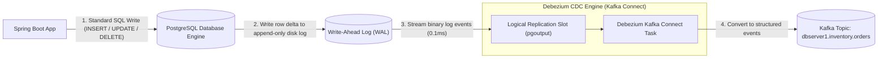
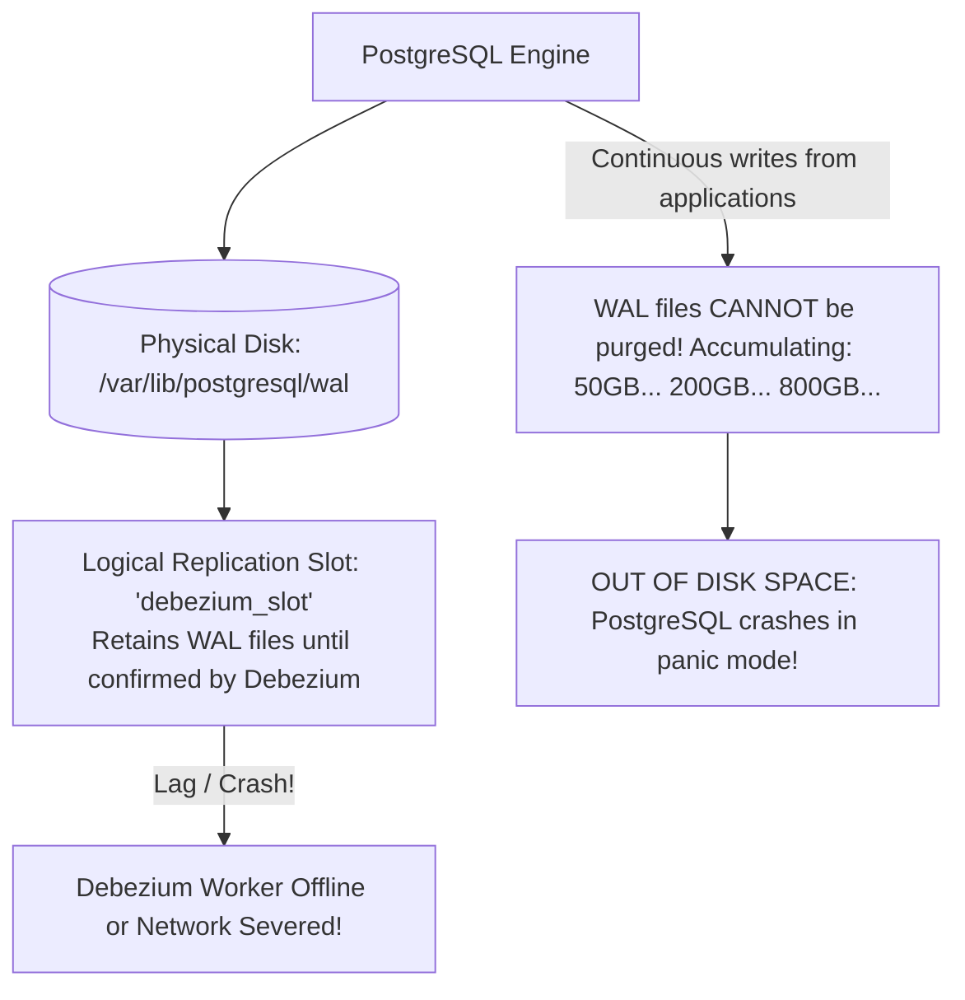

# Change Data Capture with Debezium

In data-intensive distributed systems, keeping downstream systems synchronized with your primary database is a constant challenge. Search indexes (Elasticsearch), caches (Redis), analytics data warehouses (Snowflake, BigQuery), and microservice replicas all need to know when records in your PostgreSQL or MySQL databases change.

The naive approach is **Timestamp Polling**:
```sql
SELECT * FROM orders WHERE updated_at > :last_sync_timestamp;
```

In production, polling fails in three catastrophic ways:
1. **Missed Deletes:** If an application executes `DELETE FROM orders WHERE id = 100`, the row physically vanishes. Polling `updated_at` has no way of knowing a record was deleted, leaving stale ghost records in Elasticsearch and Redis forever.
2. **Intermediate State Loss:** If an order transitions from `PENDING` to `PROCESSING` to `SHIPPED` within two seconds, and your poller runs every five seconds, downstream systems only observe `SHIPPED`. The intermediate state transitions are permanently lost.
3. **Database Resource Depletion:** Repeatedly polling multi-million row tables forces frequent full-index scans, causing CPU spikes and I/O thrashing.

The enterprise solution is **Change Data Capture (CDC)**. Instead of querying the database engine with SQL, CDC taps directly into the database engine's low-level **transaction log** (PostgreSQL WAL, MySQL binlog). 

In the Java and distributed systems ecosystem, the gold standard for CDC is **Debezium**.

---

## How Debezium Works: Log-Based CDC

Every relational database writes every insert, update, and delete to an append-only transaction log on disk *before* modifying table data pages. In PostgreSQL, this is the **Write-Ahead Log (WAL)**; in MySQL, it is the **Binary Log (binlog)**.



### The Architectural Advantage of Log-Based CDC

- **Zero Query Overhead:** The database engine executes zero SQL queries. The log stream is pushed asynchronously from the database engine to Debezium using native replication protocols.
- **Sub-Millisecond Latency:** As soon as an ACID transaction commits to the database log, the change event is dispatched to Kafka within milliseconds.
- **100% Fidelity:** Every single intermediate update is captured. Nothing is lost, even if updates occur microseconds apart.
- **Native Delete Capture:** Physical deletions are recorded as explicit deletion events, followed optionally by a Kafka tombstone record to support log compaction.

---

## Debezium Event Structure: The Envelope

When a row changes, Debezium constructs a rich, schema-validated event payload containing the exact state before and after the modification:

```json
{
  "before": {
    "id": 101,
    "customer_id": "cust-42",
    "status": "PENDING",
    "total_amount": 149.50
  },
  "after": {
    "id": 101,
    "customer_id": "cust-42",
    "status": "PAID",
    "total_amount": 149.50
  },
  "source": {
    "version": "2.6.1.Final",
    "connector": "postgresql",
    "name": "dbserver1",
    "ts_ms": 1793261200000,
    "db": "production_db",
    "schema": "public",
    "table": "orders",
    "txId": 98452,
    "lsn": 248901248
  },
  "op": "u",
  "ts_ms": 1793261200450
}
```

### The Operation Field (`op`)

- `c` (Create): Insert operation. The `before` block is `null`; `after` contains the new row.
- `u` (Update): Update operation. Both `before` and `after` blocks are populated, showing the exact delta.
- `d` (Delete): Delete operation. The `before` block contains the deleted state; `after` is `null`.
- `r` (Read): Snapshot operation. Emitted during the initial table scan when the connector first boots.

---

## Debezium Deployment Topologies

There are three architectural ways to run Debezium:

```mermaid
flowchart TD
    subgraph Topo1["1. Debezium with Kafka Connect (Enterprise Standard)"]
        KC["Distributed Kafka Connect Cluster"]
        KC -->|"Managed by Kafka Connect API"| K1["Apache Kafka Topics"]
    end

    subgraph Topo2["2. Debezium Server (Standalone Go/Java Process)"]
        DS["Debezium Server"]
        DS -->|"Direct stream without Kafka Connect"| Cloud["AWS Kinesis / GCP PubSub / Redis Streams"]
    end

    subgraph Topo3["3. Debezium Embedded Engine (Inside Spring Boot)"]
        SB["Spring Boot JVM Process"]
        Embedded["EmbeddedEngine Bean"]
        SB --> Embedded
        Embedded -->|"Consumes changes via Java Callback"| Memory["Direct In-Memory Handlers"]
    end
```



### Kafka Connect (The Recommended Standard)
Runs inside a distributed **Kafka Connect** cluster. Kafka Connect automatically manages high availability, distributed failover, worker rebalancing, and persistent offset storage inside internal Kafka topics.

### Debezium Server
A lightweight standalone application that streams change events directly to alternative message buses (like AWS Kinesis, Google Cloud Pub/Sub, or Redis Streams) without requiring Apache Kafka or Kafka Connect.

### Debezium Embedded Engine
Runs as a lightweight Java library embedded directly inside your Spring Boot application JVM. Useful when you want CDC capabilities within a single microservice without deploying Kafka Connect infrastructure.

---

## Production Kafka Connect Configuration for PostgreSQL

Let's configure a production Debezium connector for PostgreSQL using its REST API.

### Step 1: PostgreSQL Prerequisites (`postgresql.conf`)

PostgreSQL must be configured for logical replication:

```properties
wal_level = logical
max_wal_senders = 10
max_replication_slots = 10
```

Grant the replication user necessary privileges:

```sql
CREATE ROLE debezium_user WITH REPLICATION LOGIN PASSWORD 'SuperSecretPassword!';
GRANT CONNECT ON DATABASE production_db TO debezium_user;
GRANT USAGE ON SCHEMA public TO debezium_user;
GRANT SELECT ON ALL TABLES IN SCHEMA public TO debezium_user;
ALTER DEFAULT PRIVILEGES IN SCHEMA public GRANT SELECT ON TABLES TO debezium_user;
```

### Step 2: Register Connector via Kafka Connect REST API

Post this JSON payload to `POST http://kafka-connect:8083/connectors`:

```json
{
  "name": "postgres-inventory-connector",
  "config": {
    "connector.class": "io.debezium.connector.postgresql.PostgresConnector",
    "tasks.max": "1",
    "plugin.name": "pgoutput",
    "database.hostname": "postgres-primary.internal",
    "database.port": "5432",
    "database.user": "debezium_user",
    "database.password": "SuperSecretPassword!",
    "database.dbname": "production_db",
    "database.server.name": "dbserver1",
    
    "table.include.list": "public.orders,public.customers",
    "publication.autocreate.mode": "filtered",
    "slot.name": "debezium_orders_slot",
    "snapshot.mode": "initial",
    
    "tombstones.on.delete": "true",
    
    "transforms": "unwrap,reroute",
    "transforms.unwrap.type": "io.debezium.transforms.ExtractNewRecordState",
    "transforms.unwrap.drop.tombstones": "false",
    "transforms.reroute.type": "io.debezium.transforms.ByLogicalTableRouter",
    "transforms.reroute.topic.regex": ".*public.(.*)",
    "transforms.reroute.topic.replacement": "cdc.inventory.$1"
  }
}
```

---

## Single Message Transforms (SMTs): Unwrapping and Routing

By default, Debezium produces an extensive envelope containing `before`, `after`, and `source` metadata. For standard event consumers that only care about the latest state of the entity, parsing this nested envelope is tedious.

### `ExtractNewRecordState` (Unwrapping SMT)

The `ExtractNewRecordState` transform automatically flattens the message:
- For `CREATE` and `UPDATE` operations: It extracts the `after` block and promotes it to the root of the message payload.
- For `DELETE` operations: It automatically emits a message with a `null` payload (a Kafka **Tombstone**), allowing downstream consumers on compacted topics to delete the record from their local state store or cache.

### The Debezium Outbox Event Router

Debezium provides a specialized SMT (`io.debezium.transforms.outbox.EventRouter`) designed specifically for the **Transactional Outbox Pattern**:
- It monitors an `outbox_table` in your database.
- It automatically routes the event to a dynamic Kafka topic defined by the `aggregate_type` column (e.g., `Order` records go to `orders-topic`, `Customer` records go to `customers-topic`).
- It extracts the `payload` JSON column and sets it as the Kafka value, and uses `aggregate_id` as the Kafka message key.
- It deletes or marks processed rows automatically.

---

## Production Pitfalls: The Replication Slot Disk Disaster

The most dangerous operational hazard with PostgreSQL CDC is **Replication Slot Disk Saturation**:



### The Failure Mechanism:
1. When you create a logical replication slot, PostgreSQL guarantees that it **will never delete any WAL file** until the replication client (Debezium) confirms it has consumed and processed it.
2. If Debezium crashes, is misconfigured, or Kafka Connect runs out of memory and stays down for 12 hours while your production application continues handling orders, PostgreSQL continues accumulating WAL files on disk.
3. Once the database disk hits 100% capacity, **PostgreSQL halts immediately in panic mode**. The primary database crashes and refuses to restart until disk space is reclaimed.

### The Defensive Remedies:

1. **Configure `max_slot_wal_keep_size` (PostgreSQL 13+):**
   ```properties
   # Cap the maximum amount of WAL files a replication slot can hold (e.g., 50 GB)
   max_slot_wal_keep_size = 51200MB
   ```
   If Debezium lags beyond 50 GB, PostgreSQL automatically invalidates the slot and purges the WAL files to save the primary database from crashing. Debezium will require a full snapshot re-sync upon restart, but production remains online.
2. **Alert on Replication Lag:** Monitor `pg_replication_slots.wal_status` and Prometheus metrics for `debezium_metrics_MilliSecondsBehindSource`. Trigger PagerDuty alerts if lag exceeds 15 minutes.

---

## Consuming Debezium CDC Events in Spring Boot

Here is how a downstream microservice consumes unwrapped Debezium CDC events to update an in-memory cache or search index:

```java
package com.javahub.cdc.consumer;

import com.fasterxml.jackson.databind.JsonNode;
import com.fasterxml.jackson.databind.ObjectMapper;
import org.apache.kafka.clients.consumer.ConsumerRecord;
import org.slf4j.Logger;
import org.slf4j.LoggerFactory;
import org.springframework.kafka.annotation.KafkaListener;
import org.springframework.kafka.support.Acknowledgment;
import org.springframework.stereotype.Service;

@Service
public class OrderCdcConsumer {

    private static final Logger log = LoggerFactory.getLogger(OrderCdcConsumer.class);
    private final ObjectMapper objectMapper;
    private final SearchIndexService searchIndexService;

    public OrderCdcConsumer(ObjectMapper objectMapper, SearchIndexService searchIndexService) {
        this.objectMapper = objectMapper;
        this.searchIndexService = searchIndexService;
    }

    @KafkaListener(topics = "cdc.inventory.orders", groupId = "search-indexing-service")
    public void handleOrderChange(ConsumerRecord<String, String> record, Acknowledgment ack) {
        String orderId = record.key();
        String jsonPayload = record.value();

        try {
            // 1. Handle Kafka Tombstones (Delete operations)
            if (jsonPayload == null) {
                log.info("Received CDC Tombstone for Order ID: {}. Removing from Elasticsearch.", orderId);
                searchIndexService.deleteFromIndex(orderId);
                ack.acknowledge();
                return;
            }

            // 2. Parse the unwrapped record state
            JsonNode rootNode = objectMapper.readTree(jsonPayload);
            String status = rootNode.path("status").asText();
            double totalAmount = rootNode.path("total_amount").asDouble();

            log.info("CDC Event applied for Order ID: {} -> New Status: {}, Amount: {}", orderId, status, totalAmount);

            // 3. Update downstream read-model / search index idempotently
            searchIndexService.upsertOrderIndex(orderId, status, totalAmount);

            // 4. Commit offset
            ack.acknowledge();

        } catch (Exception e) {
            log.error("Failed to process CDC event for order ID: {}", orderId, e);
            throw new RuntimeException("CDC processing failure", e);
        }
    }
}
```

---

## Senior Engineer Interview Crucible

### How does Debezium capture hard deletes (`DELETE FROM customers WHERE id = 1`), and how does it represent deletions in Kafka for compacted topics?

When a hard `DELETE` is executed in the database, the database engine logs the deletion of that row tuple in its transaction log (WAL/binlog). 

Debezium reads the WAL stream, identifies the deletion, and emits a structured event where `op = "d"`:
- The `before` block contains the values of the row right before it was deleted (allowing downstream consumers to perform audit logging or cleanup).
- The `after` block is `null`.

When configured with `tombstones.on.delete=true` (the default), Debezium immediately follows the delete event by emitting a second message containing the same key but a completely **`null` payload** (a Kafka **Tombstone**). 

For Kafka topics configured with `cleanup.policy=compact`, this tombstone informs Kafka's background log cleaner thread that the key is dead. After a configurable retention window (`delete.retention.ms`), the cleaner physically removes the key and all previous historical updates for that ID from disk.

---

### What catastrophic failure occurs if a Debezium connector stops reading from a PostgreSQL database with an active replication slot, and how do you monitor/mitigate it?

In PostgreSQL, a **Logical Replication Slot** acts as a safety bookmark informing the database engine which WAL records have been safely consumed by the client. PostgreSQL guarantees that it will **never delete any WAL file** required by an active replication slot, regardless of standard checkpointing or retention rules.

If the Debezium connector crashes, loses network connectivity, or stalls, PostgreSQL continues saving every single WAL segment generated by production traffic without purging older segments. Within hours or days, the database server's physical disk fills to 100% capacity. Once the disk is full, PostgreSQL halts immediately with a fatal panic error, causing a total application outage.

**Mitigation Strategies:**
1. **Set `max_slot_wal_keep_size` (PostgreSQL 13+):** Set a hard cap on the maximum WAL retention allowed per slot (e.g., 50 GB). If Debezium falls behind by more than 50 GB, PostgreSQL automatically invalidates the slot and frees disk space, keeping the primary database online.
2. **Prometheus Monitoring & Alerting:** Continuously scrape `pg_replication_slots` and alert on `pg_wal_lsn_diff(pg_current_wal_lsn(), confirmed_flush_lsn)`. If replication lag exceeds a threshold (e.g., 10 GB or 15 minutes of traffic), alert on-call engineers immediately.

---

### Compare Debezium running in Kafka Connect vs the Debezium Embedded Engine in a Spring Boot application. When would you use Embedded Debezium?

- **Debezium on Kafka Connect (Distributed):**
  - Runs as an independent cluster. Kafka Connect automatically handles distributed leader election, worker failover, task scaling, and persists connector offsets reliably in internal Kafka topics.
  - *When to use:* Standard enterprise microservice architectures where multiple services consume change events, high availability is required, and Kafka is already deployed.
- **Debezium Embedded Engine:**
  - Runs as an in-memory Java library inside your Spring Boot JVM process. It hooks directly into the database WAL and dispatches events via Java callback functions (`ChangeEvent<EmbeddedEngine>`) without requiring Kafka or Kafka Connect.
  - *When to use:* Lightweight point-to-point synchronization (e.g., streaming changes directly from PostgreSQL to a local Redis cache or Elasticsearch cluster within a single service), edge computing deployments, or architectures where introducing Apache Kafka and Kafka Connect adds unacceptable operational complexity.

---

### Walk through the Debezium event envelope structure. What information do the `before`, `after`, and `source` blocks provide, and how does the `ExtractNewRecordState` SMT simplify it?

The standard Debezium event envelope contains:
- **`before`:** The state of the row before the SQL transaction executed. Populated during `UPDATE` and `DELETE` operations (requires `REPLICA IDENTITY FULL` in PostgreSQL to capture all columns; otherwise captures only primary keys).
- **`after`:** The state of the row after the transaction committed. Populated during `CREATE` and `UPDATE` operations; `null` on `DELETE`.
- **`source`:** Comprehensive transaction metadata: database name, table name, transaction ID (`txId`), log sequence number (`lsn`), and the physical commit timestamp (`ts_ms`).
- **`op`:** The operation type indicator: `c` (create), `u` (update), `d` (delete), or `r` (snapshot read).

The **`ExtractNewRecordState` SMT (Single Message Transform)** simplifies this structure at the Kafka Connect level before publishing to Kafka. It strips away the metadata envelope, unwrapping the `after` block directly as the root payload for creates and updates, and producing clean null tombstones for deletes. This allows downstream consumers to deserialize plain domain POJOs/JSON without writing custom boilerplate to navigate Debezium's nested envelope.
