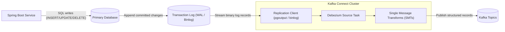
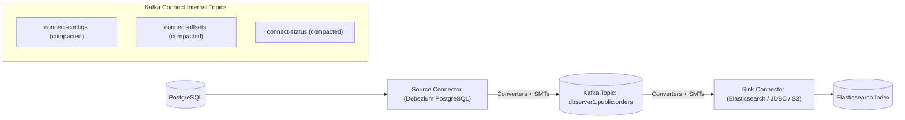
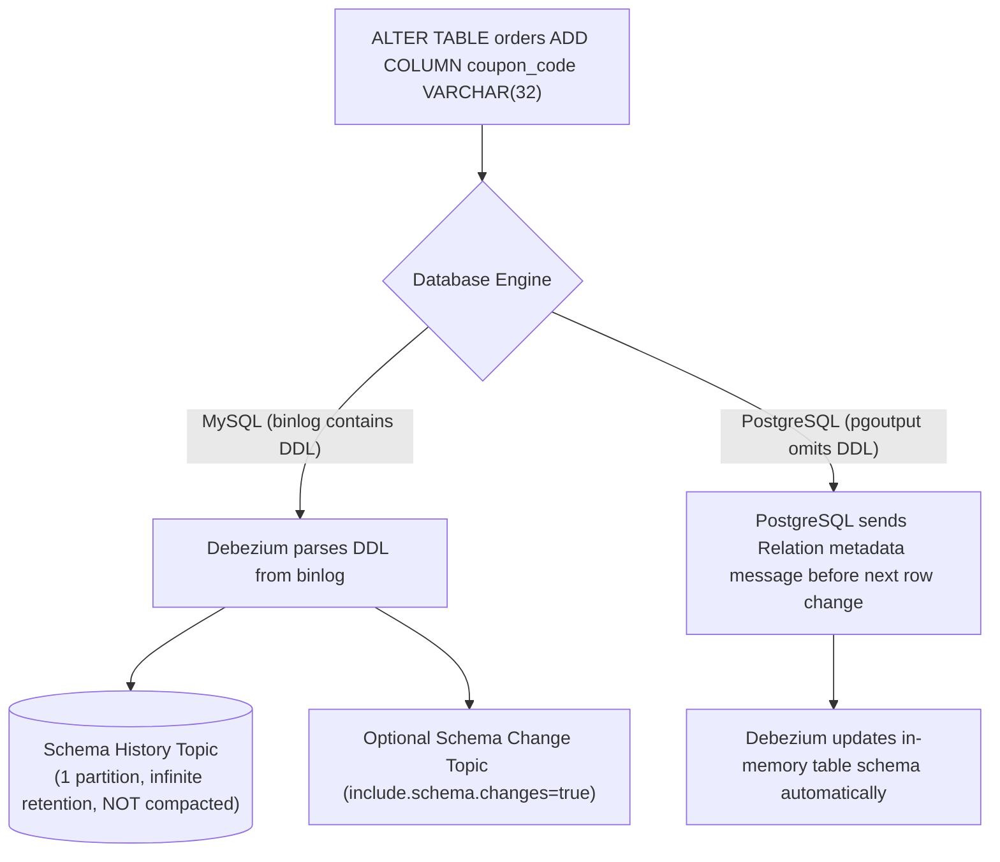
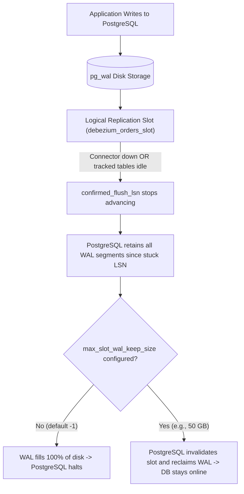

Keeping a relational database in sync with search indexes, caches, read replicas, and downstream microservices is one of the oldest integration problems in backend engineering. Many teams start by scheduling a job that polls a timestamp column:

```sql
SELECT * FROM orders WHERE updated_at > :last_sync_timestamp;
```

Timestamp polling works on day one, then quietly breaks as traffic and schema complexity grow. Hard `DELETE` statements vanish from the table before the next poll runs, leaving ghost records in Elasticsearch or Redis. Rapid updates between polling intervals collapse into the final state, so downstream consumers never see intermediate transitions like `PENDING` to `AUTHORIZED` to `CAPTURED`. Worse, frequent scans over large tables compete directly with customer-facing queries for buffer cache and I/O.

**Change Data Capture (CDC)** solves this by reading the database's own transaction log rather than querying tables with SQL. Every committed insert, update, and delete is already written sequentially to disk for crash recovery and replication. **Debezium** taps into that log stream and turns row-level changes into structured Kafka events with low latency and minimal query overhead.

## CDC Concepts and Database Transaction Log Mining

Relational databases rely on an append-only log to guarantee durability. Before dirty data pages are flushed to disk, the engine records each mutation in its transaction log: the **Write-Ahead Log (WAL)** in PostgreSQL and the **Binary Log (binlog)** in MySQL.

Log-based CDC attaches to the same replication interface that standby database replicas use. Instead of running periodic `SELECT` queries, the database streams committed row changes to Debezium as they occur.



Moving from SQL polling to log mining changes three properties of the pipeline:

- **Complete fidelity:** Every committed state transition appears in commit order, even if a row changes ten times within a single second.
- **Native delete visibility:** Hard `DELETE` statements appear as explicit delete events in the log, and Debezium can follow them with a `null`-valued Kafka tombstone so compacted topics drop the deleted key.
- **No dual-write race conditions:** Application code writes only to the database inside a normal ACID transaction. It does not have to coordinate a database commit with a separate `kafkaTemplate.send()` call.

### How PostgreSQL and MySQL Expose Row Changes

The underlying mechanics differ between database engines, and those differences affect how you configure and operate Debezium:

- **PostgreSQL** uses **logical decoding** through a logical replication slot. Modern deployments use the built-in `pgoutput` plugin (available since PostgreSQL 10) rather than third-party plugins like `wal2json` or `decoderbufs`. By default (`REPLICA IDENTITY DEFAULT`), PostgreSQL logs only the primary key of a deleted or updated row in the old tuple, so Debezium's `before` block is `null` on updates and contains only the primary key on deletes. If downstream consumers need the full previous row state on updates or deletes, you must alter the table with `ALTER TABLE orders REPLICA IDENTITY FULL;` (which increases WAL volume).
- **MySQL** streams row changes from the binlog when configured with `binlog_format=ROW` and `binlog_row_image=FULL`. With full row images enabled, both the before and after images of every column are present in the binlog by default, and GTIDs (`gtid_mode=ON`) let Debezium track its exact position reliably across primary failovers.

## Debezium Event Envelope Structure

Out of the box, Debezium wraps each database change in an envelope containing the row state before the change, the row state after the change, transaction metadata, and an operation code:

```json
{
  "before": {
    "id": 101,
    "customer_id": "cust-42",
    "status": "PENDING",
    "total_amount": 149.50
  },
  "after": {
    "id": 101,
    "customer_id": "cust-42",
    "status": "PAID",
    "total_amount": 149.50
  },
  "source": {
    "version": "2.7.3.Final",
    "connector": "postgresql",
    "name": "dbserver1",
    "ts_ms": 1793261200000,
    "db": "production_db",
    "schema": "public",
    "table": "orders",
    "txId": 98452,
    "lsn": 248901248
  },
  "op": "u",
  "ts_ms": 1793261200450
}
```

The `op` field tells consumers what happened:

- `c` (create): An `INSERT`. `before` is `null`; `after` contains the new row.
- `u` (update): An `UPDATE`. `after` holds the new row, and `before` holds the old row (subject to `REPLICA IDENTITY` in PostgreSQL).
- `d` (delete): A `DELETE`. `before` holds the deleted row; `after` is `null`.
- `r` (read): A row read during the initial consistent snapshot when the connector first starts.
- `t` (truncate): A `TRUNCATE TABLE` event (when enabled).

When `tombstones.on.delete` is `true` (the default), every `d` event is immediately followed by a second Kafka record with the same key and a `null` value. That tombstone lets Kafka's log cleaner remove the key from compacted topics after `delete.retention.ms` elapses.

## Kafka Connect Architecture: Source and Sink Connectors

Debezium connectors are typically deployed as plugins inside **Apache Kafka Connect**, a distributed runtime built specifically for streaming data into and out of Kafka without writing custom producer or consumer boilerplate.



A distributed Kafka Connect cluster consists of worker JVMs that coordinate using Kafka's group membership protocol and three internal compacted topics:

- **`connect-configs`**: Stores connector definitions submitted via the REST API.
- **`connect-offsets`**: Stores each source connector's last committed position (such as PostgreSQL LSN or MySQL binlog file/position/GTID).
- **`connect-status`**: Tracks whether each connector and task is `RUNNING`, `PAUSED`, or `FAILED`.

Inside each worker, data moves through three pluggable stages:

1. **Connectors and Tasks:** **Source connectors** (like Debezium) pull data from an external system and write `SourceRecord` objects into Kafka. **Sink connectors** (like Elasticsearch Sink, OpenSearch Sink, JDBC Sink, or S3 Sink) read from Kafka topics and write to downstream datastores. Note that a single database log is strictly ordered, so Debezium PostgreSQL and MySQL source connectors run with `tasks.max = 1`. Sink connectors, by contrast, can run multiple parallel tasks up to the input topic's partition count.
2. **Single Message Transforms (SMTs):** Lightweight, stateless transformations applied record-by-record inside Connect before serialization (for sources) or after deserialization (for sinks).
3. **Converters:** Serialize and deserialize record keys and values to and from Kafka bytes (`JsonConverter`, Confluent `AvroConverter`, or `ProtobufConverter`).

### Alternative Deployment Topologies

While distributed Kafka Connect is the standard setup when Kafka is already part of your stack, Debezium also offers two lighter options:

- **Debezium Server:** A standalone Quarkus-based runtime that streams changes directly to non-Kafka targets such as AWS Kinesis, Google Cloud Pub/Sub, Pulsar, NATS, or Redis Streams.
- **Debezium Engine (Embedded):** A Java library (`io.debezium.engine.DebeziumEngine`) you embed directly in a Spring Boot JVM. Your code supplies a callback to process change events in-process without running Kafka or Kafka Connect. It works for single-service point-to-point sync, though you become responsible for offset storage, leader election, and failover.

## Debezium PostgreSQL and MySQL Connector Configuration

Configuring CDC safely starts at the database level before you post a single JSON document to Kafka Connect.

### PostgreSQL Setup and Connector Config

In `postgresql.conf`, enable logical replication and cap how much WAL an inactive slot can retain:

```properties
wal_level = logical
max_wal_senders = 10
max_replication_slots = 10
# Cap WAL retention per slot so a dead connector cannot fill the disk (PostgreSQL 13+)
max_slot_wal_keep_size = 51200MB
```

Create a dedicated replication role with least-privilege access, and create a filtered publication (especially if you do not want Debezium to need superuser rights to auto-create publications):

```sql
CREATE ROLE debezium_user WITH REPLICATION LOGIN PASSWORD 'change-me-strong-secret';
GRANT CONNECT ON DATABASE production_db TO debezium_user;
GRANT USAGE ON SCHEMA public TO debezium_user;
GRANT SELECT ON TABLE public.orders, public.customers, public.debezium_heartbeat TO debezium_user;

-- Required only if downstream consumers need full 'before' payloads on UPDATE/DELETE
ALTER TABLE public.orders REPLICA IDENTITY FULL;

-- Small table used to advance the replication slot during quiet periods
CREATE TABLE public.debezium_heartbeat (
    id INT PRIMARY KEY,
    updated_at TIMESTAMPTZ NOT NULL
);
INSERT INTO public.debezium_heartbeat (id, updated_at) VALUES (1, NOW());
GRANT INSERT, UPDATE ON TABLE public.debezium_heartbeat TO debezium_user;

CREATE PUBLICATION dbz_orders_pub FOR TABLE
    public.orders,
    public.customers,
    public.debezium_heartbeat;
```

Next, register the PostgreSQL connector with Kafka Connect via `POST http://kafka-connect:8083/connectors`. In Debezium 2.x, `topic.prefix` replaces the legacy `database.server.name` property:

```json
{
  "name": "postgres-orders-connector",
  "config": {
    "connector.class": "io.debezium.connector.postgresql.PostgresConnector",
    "tasks.max": "1",
    "plugin.name": "pgoutput",
    "database.hostname": "postgres-primary.internal",
    "database.port": "5432",
    "database.user": "debezium_user",
    "database.password": "${file:/secrets/db.properties:debezium_password}",
    "database.dbname": "production_db",
    "topic.prefix": "prod.pg",

    "table.include.list": "public.orders,public.customers",
    "publication.name": "dbz_orders_pub",
    "publication.autocreate.mode": "disabled",
    "slot.name": "debezium_orders_slot",
    "snapshot.mode": "initial",
    "tombstones.on.delete": "true",

    "heartbeat.interval.ms": "30000",
    "heartbeat.action.query": "UPDATE public.debezium_heartbeat SET updated_at = NOW() WHERE id = 1",

    "transforms": "unwrap,reroute",
    "transforms.unwrap.type": "io.debezium.transforms.ExtractNewRecordState",
    "transforms.unwrap.delete.tombstone.handling.mode": "tombstone",
    "transforms.unwrap.add.fields": "op,source.ts_ms",
    "transforms.reroute.type": "io.debezium.transforms.ByLogicalTableRouter",
    "transforms.reroute.topic.regex": "prod\\.pg\\.public\\.(.*)",
    "transforms.reroute.topic.replacement": "cdc.inventory.$1"
  }
}
```

### MySQL Setup and Connector Config

For MySQL 8.x, enable row-based binlogging with full row images and GTIDs in `my.cnf`:

```ini
[mysqld]
server-id = 223344
log_bin = mysql-bin
binlog_format = ROW
binlog_row_image = FULL
binlog_expire_logs_seconds = 259200
gtid_mode = ON
enforce_gtid_consistency = ON
```

Grant the Debezium user replication and read permissions (`SELECT, RELOAD, SHOW DATABASES, REPLICATION SLAVE, REPLICATION CLIENT`). Then register the MySQL connector. Notice the `schema.history.internal.*` properties (which replaced `database.history.*` in Debezium 2.x) and the numeric `database.server.id` that must be unique across all MySQL replicas:

```json
{
  "name": "mysql-orders-connector",
  "config": {
    "connector.class": "io.debezium.connector.mysql.MySqlConnector",
    "tasks.max": "1",
    "database.hostname": "mysql-primary.internal",
    "database.port": "3306",
    "database.user": "debezium_user",
    "database.password": "${file:/secrets/db.properties:mysql_password}",
    "database.server.id": "184054",
    "topic.prefix": "prod.mysql",

    "database.include.list": "inventory",
    "table.include.list": "inventory.orders,inventory.customers",
    "snapshot.mode": "initial",

    "schema.history.internal.kafka.bootstrap.servers": "kafka-1:9092,kafka-2:9092",
    "schema.history.internal.kafka.topic": "schemahistory.inventory",
    "include.schema.changes": "true"
  }
}
```

## Transformations (SMTs): Unwrapping and Outbox Routing

Raw Debezium envelopes are useful for audit trails, but many downstream services only want a flat domain payload or a clean business event rather than raw table mirrors. Single Message Transforms reshape records inside Kafka Connect before they hit the topic.

### Flattening Envelopes with `ExtractNewRecordState`

`io.debezium.transforms.ExtractNewRecordState` promotes the `after` struct to the top level of the Kafka value:

- On `c`, `u`, and `r` events, consumers receive the flat row fields directly (`{"id": 101, "status": "PAID", ...}`).
- With `add.fields = op,source.ts_ms`, Debezium appends `__op` and `__source_ts_ms` so consumers can still distinguish snapshot reads from live updates without carrying the full envelope.
- On `d` events, `delete.tombstone.handling.mode` controls whether Debezium drops deletes (`drop`), emits a `null` tombstone (`tombstone`), or rewrites the deleted row with `__deleted: "true"` (`rewrite`) for sinks that cannot handle `null` payloads.

### Publishing Domain Events with the Outbox `EventRouter`

Exposing internal database tables directly as Kafka topics couples downstream services to your internal schema. The **Transactional Outbox Pattern** avoids that coupling while keeping database updates and event publishing atomic.

In the same database transaction that updates `orders`, your Spring Boot service inserts a row into an `outbox_events` table:

```sql
CREATE TABLE public.outbox_events (
    id UUID PRIMARY KEY,
    aggregatetype VARCHAR(128) NOT NULL,
    aggregateid VARCHAR(128) NOT NULL,
    eventtype VARCHAR(128) NOT NULL,
    payload JSONB NOT NULL,
    created_at TIMESTAMPTZ NOT NULL DEFAULT NOW()
);
```

Debezium's `io.debezium.transforms.outbox.EventRouter` SMT reads inserts on `outbox_events` and reshapes them into domain-level Kafka messages:

```json
{
  "table.include.list": "public.outbox_events",
  "transforms": "outbox",
  "transforms.outbox.type": "io.debezium.transforms.outbox.EventRouter",
  "transforms.outbox.table.field.event.id": "id",
  "transforms.outbox.table.field.event.key": "aggregateid",
  "transforms.outbox.table.field.event.payload": "payload",
  "transforms.outbox.route.by.field": "aggregatetype",
  "transforms.outbox.route.topic.replacement": "domain.events.${routedByValue}",
  "transforms.outbox.table.fields.additional.placement": "eventtype:header:eventType",
  "transforms.outbox.table.expand.json.payload": "true"
}
```

When your service inserts an outbox row with `aggregatetype = "order"`, `aggregateid = "ord-901"`, and `eventtype = "OrderPaid"`, `EventRouter` routes the unwrapped JSON payload to `domain.events.order` with key `ord-901` and an `eventType` Kafka header.

> [!NOTE]
> `EventRouter` does **not** delete rows from your database; Debezium only reads the transaction log. Because `EventRouter` ignores `DELETE` events on the outbox table, your application can either `DELETE` the outbox row immediately after `INSERT` inside the same transaction (the WAL still captures the insert, and the table stays near-empty) or prune old rows with a scheduled cleanup job.

## Schema Evolution Events

Production schemas do not stay frozen. Columns get added, types get widened, and legacy columns get dropped. How Debezium tracks `ALTER TABLE` statements depends heavily on the database engine.

### MySQL Schema History Topic vs PostgreSQL `pgoutput`



- **MySQL** writes DDL statements directly into the binlog. Debezium parses each `ALTER TABLE` statement as it passes through the stream and appends it to an internal **schema history topic** (`schema.history.internal.kafka.topic`). If the connector restarts and resumes from an older binlog position, it replays the schema history topic first so it knows the exact column layout that existed at that historical offset. That topic **must** have a single partition, infinite retention (`retention.ms=-1`, `retention.bytes=-1`), and `cleanup.policy=delete` (never `compact`). If Kafka deletes old segments from the schema history topic, Debezium will fail on restart with a schema recovery error. Setting `include.schema.changes=true` also emits structured DDL audit events to a separate `<topic.prefix>` topic so downstream teams can monitor schema changes.
- **PostgreSQL** does not include raw DDL statements in the `pgoutput` logical replication stream. Instead, whenever a table's definition changes, PostgreSQL automatically emits a `Relation` metadata message describing the new columns immediately before streaming the next row event for that table. Debezium updates its internal table schema on the fly without requiring a schema history topic.

### Interaction with Schema Registry

When Kafka Connect uses Confluent's `AvroConverter` or `ProtobufConverter`, every column change in the database becomes a new event schema version in Schema Registry:

- **Adding a nullable column** (or a column with a default) is backward-compatible and registers smoothly.
- **Dropping a non-defaulted column** or **changing a column type** (for example, `INT` to `VARCHAR`) violates `BACKWARD` or `FULL` compatibility. Schema Registry rejects the new schema, and the Debezium Kafka Connect task enters a `FAILED` state until you reconcile the schema change or coordinate a new topic version.

Treat DDL migrations on CDC-tracked tables with the same discipline you apply to public REST APIs. Adding nullable columns first, backfilling, migrating consumers, and dropping old columns in a later release keeps the connector running cleanly.

## Operational Risks: Replication Slots and Heartbeats

Running Debezium in production comes with two PostgreSQL-specific failure modes that catch almost every team at least once.



### Inactive Slots Filling Disk

PostgreSQL will not recycle any WAL segment still needed by a logical replication slot. If Kafka Connect crashes or gets paused during an incident and stays down for hours while the primary database continues taking writes, `pg_wal` grows until the disk fills and PostgreSQL shuts down.

Setting `max_slot_wal_keep_size` (PostgreSQL 13+) puts a hard ceiling on how much WAL any single slot can pin. If Debezium falls further behind than that limit, PostgreSQL invalidates the slot and frees disk space. You will have to re-snapshot Debezium when it comes back, which is inconvenient, but your primary database stays alive.

### The Idle-Table Slot Trap and `heartbeat.interval.ms`

Even when Debezium is running and healthy, `confirmed_flush_lsn` can stall on a busy database. Suppose `production_db` handles 5,000 writes per second on an untracked `audit_logs` table, while your tracked `orders` table receives zero writes overnight. PostgreSQL filters out `audit_logs` before sending changes to Debezium, so Debezium never receives an event and never sends a feedback LSN back to PostgreSQL. Meanwhile, WAL files for `audit_logs` keep piling up behind the slot!

Enabling `heartbeat.interval.ms` together with `heartbeat.action.query` fixes this cleanly. Every 30 seconds, Debezium runs the tiny `UPDATE` against `public.debezium_heartbeat` (which is included in the publication). PostgreSQL streams that heartbeat change back to Debezium, Debezium acknowledges the new LSN, and PostgreSQL safely recycles old WAL segments.

Monitor slot lag directly in PostgreSQL and alert well before hitting `max_slot_wal_keep_size`:

```sql
SELECT
    slot_name,
    active,
    wal_status,
    pg_size_pretty(pg_wal_lsn_diff(pg_current_wal_lsn(), restart_lsn)) AS retained_wal,
    pg_size_pretty(pg_wal_lsn_diff(pg_current_wal_lsn(), confirmed_flush_lsn)) AS flush_lag
FROM pg_replication_slots;
```

## Consuming Unwrapped CDC Events in Spring Boot

With `ExtractNewRecordState` enabled and tombstones preserved, a downstream Spring Boot service can keep a search index or read model synchronized with very little boilerplate:

```java
package com.javahub.cdc.consumer;

import com.fasterxml.jackson.databind.JsonNode;
import com.fasterxml.jackson.databind.ObjectMapper;
import org.apache.kafka.clients.consumer.ConsumerRecord;
import org.slf4j.Logger;
import org.slf4j.LoggerFactory;
import org.springframework.kafka.annotation.KafkaListener;
import org.springframework.kafka.support.Acknowledgment;
import org.springframework.stereotype.Service;

import java.math.BigDecimal;

@Service
public class OrderCdcConsumer {

    private static final Logger log = LoggerFactory.getLogger(OrderCdcConsumer.class);
    private final ObjectMapper objectMapper;
    private final SearchIndexService searchIndexService;

    public OrderCdcConsumer(ObjectMapper objectMapper, SearchIndexService searchIndexService) {
        this.objectMapper = objectMapper;
        this.searchIndexService = searchIndexService;
    }

    @KafkaListener(topics = "cdc.inventory.orders", groupId = "search-indexing-service")
    public void handleOrderChange(ConsumerRecord<String, String> record, Acknowledgment ack) throws Exception {
        String orderId = record.key();
        String jsonPayload = record.value();

        // Tombstone record produced after a DELETE
        if (jsonPayload == null) {
            log.info("Tombstone received for orderId={}, removing from search index", orderId);
            searchIndexService.deleteFromIndex(orderId);
            ack.acknowledge();
            return;
        }

        JsonNode root = objectMapper.readTree(jsonPayload);
        String status = root.path("status").asText();
        BigDecimal totalAmount = root.path("total_amount").decimalValue();
        long sourceTsMs = root.path("__source_ts_ms").asLong();

        // Upsert idempotently; pass sourceTsMs to guard against stale overwrites during snapshots/replays
        searchIndexService.upsertOrderIndex(orderId, status, totalAmount, sourceTsMs);
        ack.acknowledge();
    }
}
```

Notice two practical details in this consumer: it checks `jsonPayload == null` before parsing so delete tombstones do not trigger `NullPointerException`, and it forwards `__source_ts_ms` to the search index so an idempotent version check prevents older replayed events from overwriting newer state.

## Interview Questions

### How does Debezium capture hard deletes, and why does it emit a tombstone afterward?

When a row is deleted, the database writes the deletion to its WAL or binlog. Debezium emits a change event with `op = "d"`, where `before` contains the deleted row (or primary key, depending on `REPLICA IDENTITY` in PostgreSQL) and `after` is `null`. When `tombstones.on.delete=true`, Debezium immediately emits a second message with the same record key and a `null` payload. On compacted Kafka topics (`cleanup.policy=compact`), that `null` tombstone signals Kafka's log cleaner to purge the key and all prior updates after `delete.retention.ms` passes. Without the tombstone, the `op = "d"` record itself would remain in the compacted topic forever because its payload is non-null.

### Why can a healthy, running PostgreSQL Debezium connector still cause `pg_wal` disk growth, and how do you fix it?

A PostgreSQL logical replication slot tracks `confirmed_flush_lsn` across the entire database cluster, not just one table. If your database handles heavy write traffic on tables that are *excluded* from Debezium's `table.include.list`, while the *included* tables receive no writes for hours, PostgreSQL filters out the untracked changes and sends nothing to Debezium. Because Debezium receives no events, it does not advance `confirmed_flush_lsn`, and WAL segments accumulate on disk. Configuring `heartbeat.interval.ms` with a `heartbeat.action.query` that updates a tiny included heartbeat table forces periodic traffic through the slot so `confirmed_flush_lsn` advances steadily. Pair this with `max_slot_wal_keep_size` as a hard safety cap.

### How does schema evolution differ between the Debezium MySQL connector and the PostgreSQL connector?

MySQL writes DDL statements (`ALTER TABLE`, `CREATE TABLE`) directly into the binlog. Debezium parses those DDL events and records them in a single-partition, non-compacted Kafka **schema history topic** with infinite retention so it can reconstruct historical table layouts on restart. PostgreSQL's `pgoutput` logical replication protocol does not emit DDL statements at all. Instead, PostgreSQL sends an updated `Relation` metadata message right before streaming row changes for an altered table, and Debezium updates its schema representation dynamically without maintaining a schema history topic.

### When should you use the Outbox `EventRouter` SMT instead of streaming your main domain tables directly?

Streaming core tables directly with `ExtractNewRecordState` works well for mirroring data into search indexes, caches, or analytics warehouses owned by the same team. For cross-service domain events, however, mirroring internal tables exposes your private database schema as a public contract, making table refactoring painful. Writing explicit domain event payloads into an `outbox_events` table inside the same ACID transaction and routing them with `EventRouter` keeps internal schema refactoring decoupled from public Kafka contracts while still avoiding dual-write inconsistencies.
