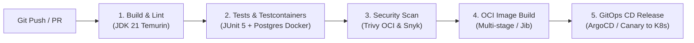
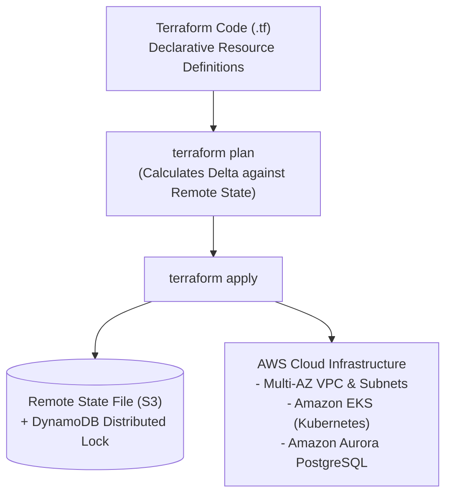
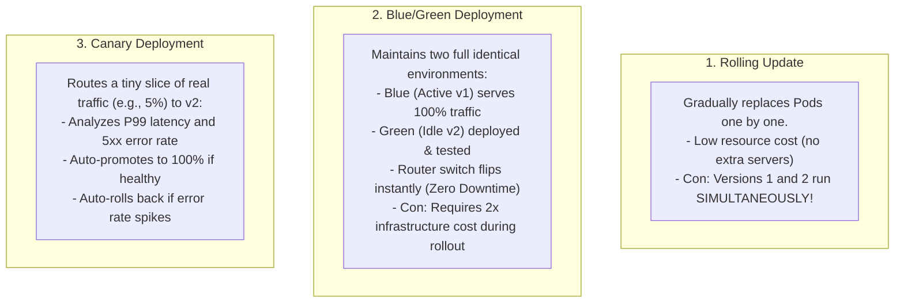
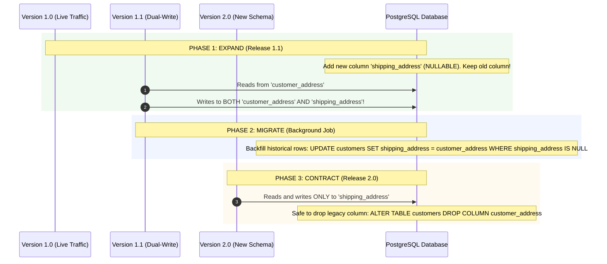

In the dark ages of software engineering, shipping code to production was an excruciating, high-anxiety ritual. A developer built a `.war` file on their local laptop, opened an FTP or SCP terminal, copied the binary directly onto a live production server, and manually restarted Tomcat at 2:00 AM on a Saturday while praying that nothing broke.

High-performing cloud-native engineering teams operate in a completely different universe. Following the **DORA (DevOps Research and Assessment)** metrics, elite engineering organizations deploy multiple times per day with lead times under one hour, near-zero change failure rates, and zero customer downtime.

This speed and safety are enabled by two fundamental disciplines: **Continuous Integration / Continuous Delivery (CI/CD)**—automating the build, verification, and deployment lifecycle—and **Infrastructure as Code (IaC)**—managing cloud infrastructure through version-controlled, declarative code.

In this capstone guide, we will engineer a production **GitHub Actions** pipeline for Java 21, provision cloud environments using **Terraform**, execute **Blue/Green and Canary deployments**, and master the **Expand/Contract Pattern** for zero-downtime database migrations.

---

## The Production CI/CD Pipeline for Modern Java

A production CI/CD pipeline is an automated quality gauntlet. Every pull request must pass compilation, static analysis, unit tests, containerized integration tests, and security scans before code can be merged.



### Production GitHub Actions Workflow (`.github/workflows/pipeline.yml`)

```yaml
name: Production Java CI/CD Pipeline

on:
  push:
    branches: [ master, main ]
  pull_request:
    branches: [ master, main ]

permissions:
  contents: read
  packages: write

jobs:
  build-and-verify:
    name: Build, Test, and Scan
    runs-on: ubuntu-latest
    timeout-minutes: 15

    steps:
      # Step 1: Check out repository
      - name: Check out source code
        uses: actions/checkout@v4

      # Step 2: Set up JDK 21 with Maven Dependency Caching
      - name: Set up JDK 21
        uses: actions/setup-java@v4
        with:
          java-version: '21'
          distribution: 'temurin'
          cache: 'maven' # Automatically caches ~/.m2/repository across runs!

      # Step 3: Run Unit Tests and Containerized Integration Tests
      - name: Run Tests with Maven
        run: ./mvnw clean verify -B
        env:
          TESTCONTAINERS_RYUK_DISABLED: false

      # Step 4: Container Security Vulnerability Scan (Trivy)
      - name: Build Container Image Locally for Scanning
        run: |
          docker build -t app:scan .
      
      - name: Run Trivy Vulnerability Scanner
        uses: aquasecurity/trivy-action@master
        with:
          image-ref: 'app:scan'
          format: 'table'
          exit-code: '1' # Fails the pipeline if CRITICAL CVEs are detected!
          ignore-unfixed: true
          severity: 'CRITICAL,HIGH'

      # Step 5: Publish Container to GitHub Container Registry (Main branch only)
      - name: Log in to GitHub Container Registry
        if: github.ref == 'refs/heads/master' && github.event_name == 'push'
        uses: docker/login-action@v3
        with:
          registry: ghcr.io
          username: ${{ github.actor }}
          password: ${{ secrets.GITHUB_TOKEN }}

      - name: Push Production Container Image
        if: github.ref == 'refs/heads/master' && github.event_name == 'push'
        run: |
          IMAGE_NAME="ghcr.io/${{ github.repository }}"
          docker tag app:scan "${IMAGE_NAME}:latest"
          docker push "${IMAGE_NAME}:latest"
```

---

## Infrastructure as Code (IaC) with Terraform

Managing cloud resources (VPCs, subnets, EKS clusters, RDS databases) through the AWS web console is known as **ClickOps**. ClickOps is error-prone, untracked, un-versioned, and impossible to replicate across regions.

**Terraform** allows you to declare desired cloud infrastructure in HashiCorp Configuration Language (`.tf`). Terraform calculates the delta between your code and reality, generating an execution plan before applying changes.



### Production Terraform Remote State Configuration
Never store your Terraform state file (`terraform.tfstate`) in Git! It contains sensitive database passwords and infrastructure secrets in plain text. Always configure a secure remote backend with distributed state locking:

```hcl
terraform {
  required_version = ">= 1.7.0"
  required_providers {
    aws = {
      source  = "hashicorp/aws"
      version = "~> 5.40"
    }
  }

  # Production S3 Backend with DynamoDB Distributed Lock
  backend "s3" {
    bucket         = "company-terraform-state-prod"
    key            = "ecommerce/infrastructure.tfstate"
    region         = "us-east-1"
    encrypt        = true
    dynamodb_table = "terraform-state-lock" # Prevents concurrent applies!
  }
}

provider "aws" {
  region = var.aws_region

  default_tags {
    tags = {
      Environment = "production"
      ManagedBy   = "Terraform"
      Project     = "ecommerce-platform"
    }
  }
}
```

### Provisioning an Aurora PostgreSQL Cluster for Java Microservices
```hcl
resource "aws_rds_cluster" "postgresql" {
  cluster_identifier      = "ecommerce-db-cluster"
  engine                  = "aurora-postgresql"
  engine_version          = "16.1"
  database_name           = "ecommerce_prod"
  master_username         = "db_admin"
  master_password         = var.db_master_password
  backup_retention_period = 30
  preferred_backup_window = "02:00-03:00"
  storage_encrypted       = true
  deletion_protection     = true # Prevents accidental terraform destroy disaster!

  vpc_security_group_ids = [aws_security_group.db_sg.id]
  db_subnet_group_name   = aws_db_subnet_group.private_db_subnets.name
}

resource "aws_rds_cluster_instance" "cluster_instances" {
  count              = 2 # 1 Primary Writer + 1 Read Replica in separate AZ!
  identifier         = "ecommerce-db-node-${count.index}"
  cluster_identifier = aws_rds_cluster.postgresql.id
  instance_class     = "db.r6g.xlarge"
  engine             = aws_rds_cluster.postgresql.engine
}
```

---

## Zero-Downtime Deployment Strategies

When deploying Version 2.0 of an active microservice, how do you prevent users from experiencing failed HTTP requests or connection drops?



### Strategy Comparison
| Strategy | Downtime | Resource Overhead | Rollback Speed | Risk Level |
|---|---|---|---|---|
| **Recreate** | Several minutes (Stop all v1, then start v2) | **1x (Lowest)** | Slow (Must redeploy v1) | High |
| **Rolling Update** | Zero | **1.25x** (`maxSurge: 25%`) | Moderate (Must roll back pod by pod) | Medium (v1 and v2 run concurrently) |
| **Blue / Green** | **Zero (Instant router switch)** | **2x (Highest)** | **Instant** (Flip router back to Blue) | Low |
| **Canary (Argo Rollouts)** | **Zero** | **1.1x** | **Instant & Automated** | **Lowest (Safest in industry)** |

---

## Zero-Downtime Database Migrations: The Expand / Contract Pattern

The biggest myth in software engineering is that Blue/Green deployments provide zero downtime. 

If your application connects to a relational database, **code is easy to roll back; database schema changes are NOT**.

Suppose Version 1 of your code expects a column named `customer_address`. In Version 2, you write a Flyway migration that renames the column to `shipping_address`:

```sql
-- FATAL MIGRATION: DESTROYS BLUE/GREEN DEPLOYMENTS!
ALTER TABLE customers RENAME COLUMN customer_address TO shipping_address;
```

The instant this SQL executes on your shared database, **Version 1 (which is currently serving 100% of live customer traffic) immediately crashes with an `InvalidColumnNameException`!**

### The Solution: The Three-Phase Expand / Contract Pattern

To achieve true zero-downtime database migrations, all schema changes must be broken down into three backward-compatible phases spanning multiple releases:



### The Three Golden Rules of Zero-Downtime Migrations
1. **Never rename or delete a column in a single release**: Always add the new column first (Expand), transition code to dual-write, backfill historical data, and drop the legacy column in a subsequent release (Contract).
2. **New columns must always be `NULLABLE`** (or have a safe static default): Adding a `NOT NULL` column without a default will lock the table and break older running application instances.
3. **Database migrations must always be backward-compatible with the PREVIOUS code version**: If Version 2 fails smoke tests and you flip the load balancer back to Version 1, Version 1 must still work with the database!

---

## Architectural Traps and Real-World Outages

### The "Missing DynamoDB State Lock" Catastrophe
A high-growth fintech startup used Terraform to manage AWS resources. 
Two developers opened pull requests simultaneously, and two GitHub Actions runners ran `terraform apply` concurrently because DynamoDB distributed locking was not enabled in their S3 backend. 

Both runners updated the shared state file concurrently, corrupting the JSON structure. Terraform lost track of the managed AWS Aurora PostgreSQL database cluster. On the next CI run, Terraform concluded that the database cluster was an un-managed orphan resource and issued an automated `DELETE` command, destroying the production financial ledger.

**The Fix:** Always enforce a DynamoDB lock table (`dynamodb_table = "terraform-state-lock"`) and set `deletion_protection = true` on all production databases!

### The "Canary Probe False Positive" Outage
A streaming platform configured an Argo Rollouts Canary deployment that routed 5% of traffic to a new version. The canary metric analysis monitored HTTP error rates (`5xx`). 
A bug in Version 2 caused an authorization bypass where all unauthorized requests returned `200 OK` with an empty payload instead of `403 Forbidden`. 

Because the error rate was 0.00%, the automated Canary analysis concluded the release was 100% healthy and promoted Version 2 to all 200 Kubernetes pods globally, exposing internal administrative panels to the public internet. 

**The Fix:** Canary analysis must monitor multiple complementary signals: error rate, P99 latency, business conversion rates (e.g., successful checkout transactions/sec), and synthetic smoke test verification.

---

## Senior Interview Questions

### Question 1: What is GitOps, and how does a tool like ArgoCD or Flux fundamentally change Kubernetes deployments compared to traditional CI push pipelines?
**Answer:**  
- **Traditional CI Push Model**: A CI runner (like GitHub Actions) builds a container image and directly executes `kubectl apply -f deployment.yaml` or `helm upgrade` against the remote production Kubernetes cluster. 
  - *Disadvantages:* The CI runner must be granted administrative, cluster-level credentials (security risk); configuration drift occurs if someone manually edits a pod with `kubectl edit`.
- **GitOps Pull Model (ArgoCD)**: The Git repository is the **single source of truth** for both application code and declared infrastructure state. An in-cluster GitOps controller (ArgoCD) continuously monitors the Git repository. 
  - *Advantages:* No external CI runner needs credentials to the production cluster. If reality deviates from Git (due to manual intervention or failure), ArgoCD automatically detects the drift and syncs the cluster back to the exact declared Git state. Rollbacks are as simple as running `git revert`.

### Question 2: Why should database schema migrations (Flyway / Liquibase) be executed in a dedicated Kubernetes Job or Init Container rather than in the Spring Boot application bootstrap?
**Answer:**  
In Spring Boot, setting `spring.flyway.enabled=true` runs migrations during `ApplicationContext` initialization. 
In Kubernetes with multiple replicas (e.g., 10 pods):
1. **Migration Race Conditions**: When 10 pods start up simultaneously during a rolling update, all 10 pods attempt to acquire the Flyway schema lock table concurrently. In high-contention scenarios or distributed databases, this can cause migration deadlocks.
2. **Premature Startup Failures**: If a migration takes 45 seconds to alter a 50-million-row table, all 10 pods stall in their startup phase, triggering Kubernetes `startupProbe` timeouts and killing the pods mid-migration, leaving the schema corrupted.
**Senior Architecture:** Execute Flyway as an isolated, single-instance **Kubernetes Job** in your CI/CD pipeline *before* the new Deployment rollout begins.

### Question 3: How does the "Expand and Contract" pattern handle constraints like `NOT NULL` and `UNIQUE` on new columns without downtime?
**Answer:**  
1. **`NOT NULL` Constraint**: In Phase 1 (Expand), the new column must be created as `NULLABLE`. Once the application code is deployed and writes to both columns, and a background batch job backfills historical rows with valid data, an `ALTER TABLE ... ADD CONSTRAINT ... CHECK (new_col IS NOT NULL) NOT VALID` is issued (which does not lock the table). Once verified, the constraint is validated asynchronously.
2. **`UNIQUE` Constraint**: Creating a unique index on a multi-million-row table locks writes. In PostgreSQL, use `CREATE UNIQUE INDEX CONCURRENTLY idx_unique ON table(new_col)`. This builds the index in the background without acquiring exclusive table write locks, ensuring zero downtime.

### Question 4: What is the difference between Immutable Infrastructure and Mutable Infrastructure, and why is Immutable Infrastructure preferred in the cloud?
**Answer:**  
- **Mutable Infrastructure**: Servers are updated in-place (e.g., SSHing into an EC2 instance, running `apt-get upgrade`, and patching configuration files). Over time, differences accumulate across servers, creating **Configuration Drift** and "Snowflake Servers" that cannot be replicated.
- **Immutable Infrastructure**: Servers and containers are **never modified in-place**. When a change or security patch is needed, a completely new container image or VM AMI is built, tested in CI, and deployed to replace the old instances. 
  - *Benefits:* Predictable, deterministic, repeatable deployments; zero configuration drift; trivial rollbacks by simply redeploying the previous immutable image digest.
