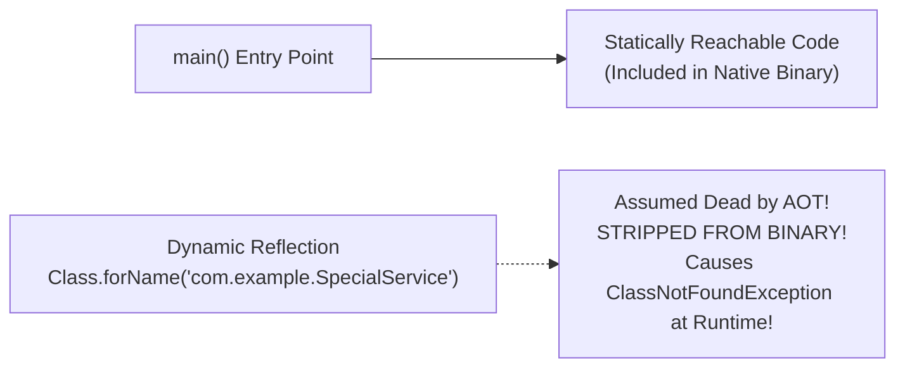
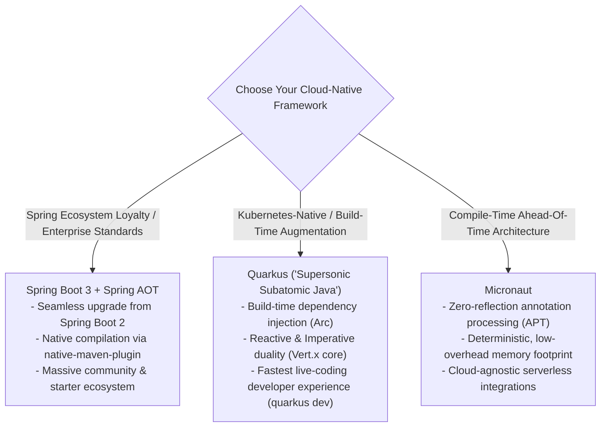
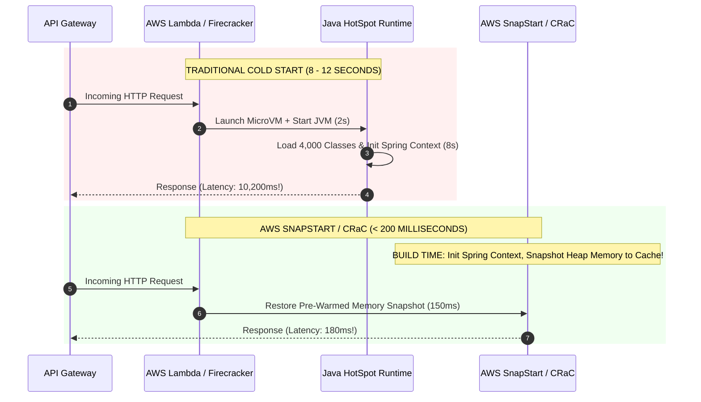

For two decades, the Java Virtual Machine was engineered under a single guiding philosophy: **optimize for long-running server processes**. 

The HotSpot runtime was designed to boot up slowly, load thousands of classes dynamically, let the Tiered Compilation engine (C1 and C2 JIT compilers) observe running code, inline hot method calls, and gradually reach blistering peak throughput after several minutes of steady load.

However, in the cloud-native serverless era of AWS Lambda, Google Cloud Run, and Kubernetes horizontal pod autoscalers (KEDA), this traditional model breaks down:
- A 15-second container startup time means your users wait 15 seconds during auto-scaling spikes.
- A 450 MB baseline JVM memory footprint inflates cloud bills by tens of thousands of dollars per month.
- An AWS Lambda function that encounters a 10-second cold start causes upstream webhooks and API gateways to time out.

Java has adapted. In this guide, we will step into the world of **GraalVM Ahead-of-Time (AOT) compilation**, benchmark **Spring Boot 3 Native against Quarkus and Micronaut**, conquer AWS Lambda cold starts with **SnapStart and CRaC**, and build lean, multi-layer container images using **Google Jib** and **Buildpacks**.

---

## Ahead-Of-Time (AOT) Compilation with GraalVM

Traditional Java compiles source code (`.java`) into intermediate bytecode (`.class`). At runtime, the JVM interprets the bytecode and uses the C2 Just-In-Time (JIT) compiler to compile hot code into machine instructions.

**GraalVM Native Image** flips this paradigm entirely: it compiles your Java application directly into a standalone, platform-specific native machine executable (an ELF binary on Linux or PE executable on Windows) **at build time**.

```mermaid
flowchart TD
    subgraph TraditionalJIT ["Traditional HotSpot JIT (Runtime Compilation)"]
        Java1[".java Source"] --> Bytecode1[".class Bytecode"]
        Bytecode1 --> JVM["HotSpot JVM Startup (Classloading, Reflection, JIT warmup)"]
        JVM --> Peak["Peak JIT Throughput (after 5-10 minutes)"]
    end

    subgraph GraalVMAOT ["GraalVM Native Image (Ahead-Of-Time Build)"]
        Java2[".java Source"] --> Bytecode2[".class Bytecode"]
        Bytecode2 --> NativeBuilder["native-image Builder
(Static Analysis & Points-To Analysis)"]
        NativeBuilder --> NativeExec["Standalone Native Binary
(Includes SubstrateVM + Compiled Machine Code)"]
        NativeExec --> InstantRun["Instant Startup (< 20ms) & Low RAM (< 35MB)"]
    end
```



### The SubstrateVM
The generated native binary does not require a pre-installed JVM. Instead, it embeds **SubstrateVM**—a stripped-down, non-JIT runtime that handles thread scheduling, stack management, and a lightweight garbage collector (Serial GC or G1GC) directly inside the native binary.

### Key Performance Differences
| Metric | HotSpot JVM (JIT) | GraalVM Native Image (AOT) |
|---|---|---|
| **Startup Time** | 2 to 15 seconds | **10 to 50 milliseconds** |
| **First-Request Latency** | High (JIT compilation overhead) | **Microseconds (Instantly fast)** |
| **Memory Footprint (RSS)** | 300 MB - 1 GB+ | **25 MB - 60 MB** |
| **Artifact Packaging** | Heavy Docker image (JDK + JAR) | Tiny container (Scratch / Distroless + Binary) |
| **Build Duration** | 10 - 30 seconds | **3 to 10 minutes** (Heavy CPU & RAM during build) |
| **Peak Throughput** | Extremely High (dynamic runtime inlining) | Near-equivalent (can match JIT using PGO) |

---

## The Closed-World Assumption and Reachability Metadata

Why can't every Java library compile into a GraalVM native image out-of-the-box?
The answer lies in the **Closed-World Assumption**:

During native image compilation, GraalVM performs a rigorous **Points-To Analysis**, tracing code execution starting from `public static void main` to determine every class, method, and field that could ever possibly be invoked. Anything that is unreachable is stripped out to keep the binary small.



### What Breaks Under the Closed-World Assumption
1. Dynamic class loading (`Class.forName()`).
2. Reflection without metadata (`Method.invoke()`).
3. JDK Dynamic Proxies created at runtime.
4. Dynamic resources loaded via `getResourceAsStream()`.
5. JNI (Java Native Interface) calls.

### The Solution: Reachability Metadata
If a library relies on reflection (like Jackson deserializing an untyped JSON payload into an entity), you must provide **Reachability Metadata** JSON files (`reflect-config.json`, `proxy-config.json`) informing the compiler:

```json
[
  {
    "name": "com.example.ecommerce.dto.PaymentPayload",
    "allDeclaredConstructors": true,
    "allDeclaredMethods": true,
    "allDeclaredFields": true
  }
]
```

Modern Spring Boot 3 automatically generates this metadata at build time using the Spring AOT engine (`@RegisterReflectionForBinding`).

---

## Framework Shootout: Spring Boot 3 AOT vs Quarkus vs Micronaut

In the cloud-native ecosystem, three frameworks dominate:



### Architectural Philosophies
- **Spring Boot 3**: Retains the beloved Spring programming model and DI container, but adds a pre-compilation AOT phase (`process-aot`) that evaluates `@Configuration` classes, flattens conditional beans (`@ConditionalOnClass`), and generates reflection configuration ahead of time.
- **Quarkus**: Developed by Red Hat from the ground up for Kubernetes. It shifts class scanning, annotation parsing, and proxy generation from runtime to **build time** (Build-Time Augmentation).
- **Micronaut**: Uses Java Annotation Processors (APT) at compile-time to generate strongly-typed dependency injection classes. Because it uses zero reflection even in standard JVM mode, it boots faster than traditional frameworks even without GraalVM.

---

## Conquering AWS Lambda Cold Starts: SnapStart and CRaC

Serverless functions (like AWS Lambda) scale to zero when idle. When an incoming HTTP request arrives:
1. AWS allocates a Firecracker MicroVM container.
2. The runtime starts the JVM.
3. The JVM loads hundreds of classes and Spring beans.
4. The handler method executes and returns.

Steps 1 through 3 constitute the **Cold Start**. In standard Java, this takes **6 to 12 seconds**!



### Coordinated Restore at Checkpoint (CRaC) and AWS SnapStart
To solve cold starts without GraalVM's long build times, OpenJDK created **Project CRaC (Coordinated Restore at Checkpoint)**, adopted by AWS as **Lambda SnapStart**:
1. During deployment, Lambda initializes your Java application, runs all Spring Boot component scans, connects to caches, and warms up the JVM.
2. Lambda takes a complete cryptographic snapshot of the running Firecracker MicroVM's memory and disk state, caching it in a high-speed multi-tier cache.
3. When real traffic arrives, Lambda simply **restores the pre-initialized memory snapshot in under 150 milliseconds**!

### The SnapStart Trap: Ephemeral State Uniqueness
Because a single snapshot image is restored across hundreds of concurrent Lambda instances, **state that must be unique per instance (e.g., random seeds, cryptographic nonces, unique database connections) will be duplicated across all instances unless reset!**

Use Spring's CRaC lifecycle hooks to re-seed or reconnect on restore:

```java
package com.example.serverless;

import org.crac.Context;
import org.crac.Core;
import org.crac.Resource;
import org.springframework.stereotype.Component;

import java.security.SecureRandom;

@Component
public class SecurityTokenGenerator implements Resource {

    private SecureRandom secureRandom;

    public SecurityTokenGenerator() {
        Core.getGlobalContext().register(this);
        this.secureRandom = new SecureRandom();
    }

    @Override
    public void beforeCheckpoint(Context<? extends Resource> context) {
        // Clear sensitive credentials and close open sockets before snapshotting
        this.secureRandom = null;
    }

    @Override
    public void afterRestore(Context<? extends Resource> context) {
        // Re-seed secure random with fresh OS entropy upon container restore!
        this.secureRandom = new SecureRandom();
    }
}
```

---

## Cloud-Native Container Packaging: Jib and Buildpacks

Writing naive Dockerfiles with `FROM openjdk:21` and `COPY target/app.jar app.jar` creates bloated, insecure, single-layer images that take minutes to push and pull across CI/CD pipelines.

### Cloud Native Buildpacks (Paketo)
Spring Boot includes native support for Cloud Native Buildpacks out-of-the-box:

```bash
./mvnw spring-boot:build-image
```
This inspects your project, automatically selects a minimal BellSoft Liberica JRE base image, configures optimized JVM memory calculation scripts, and packages your application into an OCI-compliant container **without requiring a Dockerfile**.

### Google Jib: Fast Container Builds Without Docker Daemon
**Google Jib** integrates directly into Maven and Gradle. It separates your application into distinct, optimized layers:
1. Dependencies (rarely changes - cached permanently).
2. Resources (changes occasionally).
3. Compiled Application Classes (changes constantly - tiny 500 KB layer).

```xml
<plugin>
    <groupId>com.google.cloud.tools</groupId>
    <artifactId>jib-maven-plugin</artifactId>
    <version>3.4.1</version>
    <configuration>
        <to>
            <image>registry.company.com/ecommerce/order-service:1.0.0</image>
        </to>
        <container>
            <jvmFlags>
                <jvmFlag>-XX:+UseZGC</jvmFlag>
                <jvmFlag>-XX:+ZGenerational</jvmFlag>
                <jvmFlag>-XshowSettings:system</jvmFlag>
            </jvmFlags>
        </container>
    </configuration>
</plugin>
```
With Jib, when you change one line of Java code, Jib rebuilds and pushes *only* the 500 KB application layer in 3 seconds, skipping redundant multi-gigabyte layer uploads.

---

## Architectural Traps and Real-World Outages

### The "Missing Reflection Metadata at 3:00 AM" Native Crash
A financial services firm migrated a microservice to a GraalVM native binary. All standard integration tests passed in staging. 
At 3:00 AM in production, a rare banking network error triggered an obscure exception: `BankingGatewayTimeoutException`. 
The application attempted to serialize the error payload into JSON using Jackson. 

Because `BankingGatewayTimeoutException` was never encountered during the automated AOT metadata generation trace, GraalVM had stripped out its reflection metadata. Jackson failed with `ClassNotFoundException`, the unhandled native crash terminated the Linux process, and 4,000 pending transactions were stranded in an indeterminate state.

### The "SnapStart Duplicate Random Nonce" Cryptographic Flaw
A serverless authentication service generated one-time MFA codes using `new java.util.Random()` initialized in a static field. 
The team enabled AWS Lambda SnapStart to drop cold starts. Because the pseudo-random generator was initialized *before* the checkpoint snapshot was captured, every single restored Lambda instance across the planet generated the **exact same sequence of random numbers**. Attackers were able to predict two-factor authentication codes with 100% accuracy.

---

## Senior Interview Questions

### Question 1: What is Profile-Guided Optimization (PGO) in GraalVM, and why is it necessary to match HotSpot JIT peak performance?
**Answer:**  
In standard Ahead-Of-Time (AOT) compilation, the compiler must generate machine code statically without knowing the runtime execution characteristics of the production workload (e.g., branch probabilities, hot loop counts, polymorphic call sites). Consequently, default native images sometimes achieve 5% to 15% lower peak throughput than HotSpot's C2 JIT compiler, which continuously recompiles code based on live runtime profiling.

**Profile-Guided Optimization (PGO)** bridges this gap:
1. The application is compiled into an instrumented native binary that records execution statistics.
2. The instrumented binary is run under realistic production-grade traffic, generating a profile file (`default.iprof`).
3. The native image builder recompiles the application using the recorded profile data, allowing the AOT compiler to aggressively inline hot methods, optimize branch predictions, and achieve peak throughput on par with or exceeding HotSpot JIT.

### Question 2: How does the Spring AOT engine in Spring Boot 3 prepare an application for GraalVM compilation?
**Answer:**  
During the Maven/Gradle build phase, the Spring AOT engine evaluates the application's configuration classes ahead of time:
1. **Flattens Conditional Beans**: Evaluates `@Conditional` annotations against build-time classpath conditions, removing unused bean definitions.
2. **Generates Java Source Code**: Replaces dynamic runtime reflection with pre-compiled Java code that directly calls bean constructors and injection methods (`InstanceSupplier`).
3. **Generates Reachability Hints**: Automatically registers reflection, proxy, resource, and serialization metadata for all Spring-managed components and Jakarta validation annotations, producing standard JSON configuration files consumed by the GraalVM `native-image` compiler.

### Question 3: What is the difference between AWS Lambda SnapStart and GraalVM Native Image for eliminating cold starts?
**Answer:**  
- **GraalVM Native Image**: Compiles Java into a standalone binary at build time. 
  - *Pros:* Ultra-fast startup (<20ms), tiny memory footprint (<35MB), runs in any custom container or minimal OS runtime.
  - *Cons:* Extremely long build times (5-10 minutes), requires strict reachability metadata for reflection, incompatible with certain legacy Java libraries.
- **AWS Lambda SnapStart (CRaC)**: Runs standard HotSpot Java and takes a Firecracker MicroVM memory snapshot after the JVM boots and Spring initializes.
  - *Pros:* 100% compatibility with standard Java, standard reflection, fast build times (normal `mvn package`), restores in <150ms.
  - *Cons:* Higher memory footprint than GraalVM (still runs full JVM in memory), requires careful handling of post-restore state (resetting random seeds, network sockets).

### Question 4: Why is Google Jib considered superior to writing standard Dockerfiles for Java applications?
**Answer:**  
1. **No Docker Daemon Required**: Jib can build and push container images directly from Maven/Gradle without requiring a local Docker daemon or root privileges, making it ideal for locked-down CI/CD runners.
2. **Intelligent Layering**: Standard Dockerfiles typically package the entire fat JAR (`app.jar`) into a single image layer. Even changing one character of code invalidates the entire 100 MB layer. Jib automatically decomposes the application into separate layers (Dependencies, Resources, Compiled Classes). When code changes, Jib uploads only the tiny application class layer (a few hundred kilobytes), drastically reducing CI/CD build and push times.
3. **Reproducible Builds**: Jib strips out non-deterministic metadata (such as timestamps), ensuring that identical source code produces the exact same bit-for-bit container image digest.

