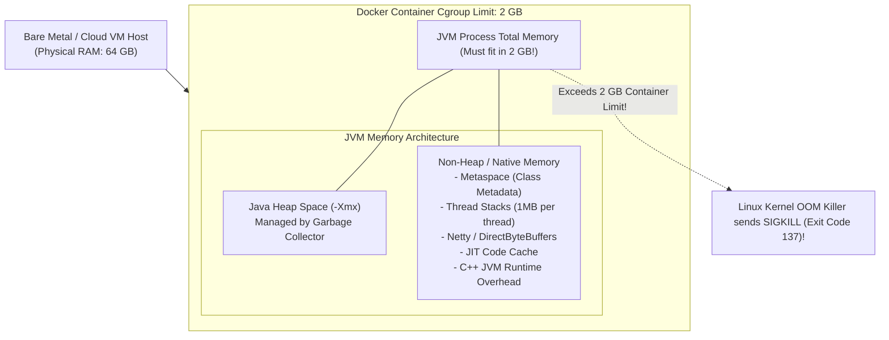
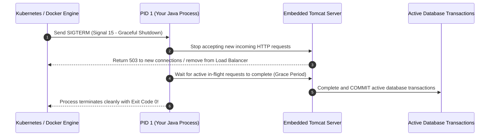

Before Docker, software engineers uttered the most infamous excuse in computing: *"Well, it worked on my machine!"* To which operations engineers sarcastically replied: *"Then we will ship your laptop to production!"*

Docker revolutionized application delivery by packaging code, libraries, and runtime dependencies into immutable, portable Open Container Initiative (OCI) images.

However, running the Java Virtual Machine inside a Linux container is fraught with subtle, high-severity traps. If you do not understand how the Linux kernel enforces **Control Groups (cgroups)**, how the **OOM Killer** strikes with Exit Code 137, or why shell-form entrypoints swallow `SIGTERM` signals, your containerized Spring Boot applications will crash mysteriously under peak traffic.

In this guide, we will engineer production-grade multi-stage Dockerfiles, master JVM-to-container memory alignment, configure local multi-service Docker Compose environments, and implement zero-downtime graceful shutdowns.

---

## The Production Multi-Stage Dockerfile

A naive Dockerfile starts with `FROM maven:3.9` and leaves the entire JDK, source code, build cache, and compilers inside the final production container. This creates 1.2 GB bloated images with massive CVE attack surfaces.

A production-grade Dockerfile uses **Multi-Stage Builds** and runs as a **non-root user** on top of a minimal JRE or Distroless base image:

```dockerfile
# -----------------------------------------------------------------------------
# Stage 1: Build & Dependency Resolution
# -----------------------------------------------------------------------------
FROM eclipse-temurin:21-jdk-jammy AS builder
WORKDIR /workspace

# Step 1: Copy build descriptors first (Layer Caching Optimization)
COPY pom.xml mvnw ./
COPY .mvn .mvn

# Step 2: Download dependencies into Docker cache (skips re-downloading if pom.xml didn't change)
RUN ./mvnw dependency:go-offline -B

# Step 3: Copy source code and compile fat JAR
COPY src src
RUN ./mvnw clean package -DskipTests -B

# Step 4: Extract JAR layers using Spring Boot layertools for fast layer caching
RUN java -Djarmode=tools -jar target/*.jar extract --layers --destination extracted

# -----------------------------------------------------------------------------
# Stage 2: Minimal Runtime Environment
# -----------------------------------------------------------------------------
FROM eclipse-temurin:21-jre-jammy AS runtime
WORKDIR /application

# Security: Create a dedicated non-root service account
RUN groupadd -r spring && useradd -r -g spring spring
USER spring:spring

# Copy extracted layers in order of change frequency (least frequent to most frequent)
COPY --from=builder /workspace/extracted/dependencies/ ./
COPY --from=builder /workspace/extracted/spring-boot-loader/ ./
COPY --from=builder /workspace/extracted/snapshot-dependencies/ ./
COPY --from=builder /workspace/extracted/application/ ./

# Expose HTTP port
EXPOSE 8080

# Environment variables for JVM container alignment
ENV JAVA_TOOL_OPTIONS="-XX:MaxRAMPercentage=75.0 -XX:+UseG1GC -XX:+ExitOnOutOfMemoryError"

# EXEC FORM ENTRYPOINT: Mandatory for PID 1 signal forwarding!
ENTRYPOINT ["java", "org.springframework.boot.loader.launch.JarLauncher"]
```

### Key Engineering Details in This Dockerfile
1. **Layer Caching**: By copying `pom.xml` and running `dependency:go-offline` before copying `src/`, Docker caches all downloaded Maven artifacts. Subsequent code changes rebuild in 4 seconds instead of 4 minutes!
2. **Layered JAR Extraction**: Spring Boot 3's `JarLauncher` separates third-party dependencies from your business application classes. When you update one line of Java code, only the final 500 KB layer changes.
3. **Non-Root User (`USER spring:spring`)**: If an attacker discovers an arbitrary remote code execution vulnerability (e.g., Log4Shell), running as a non-root user prevents them from installing rootkits, modifying container filesystems, or escaping to the host kernel.
4. **Exec Form `ENTRYPOINT`**: Always use JSON array syntax `["java", "-jar", "..."]`, never shell syntax `java -jar ...`.

---

## Container Resource Limits vs JVM Memory Alignment

The single most common production outage in containerized Java is the **Exit Code 137 Mystery** (Linux OOMKiller).



### The Cgroups History and The Legacy Bug
In the early days of Docker (Java 8u121 and older), the JVM was completely blind to container resource limits. When HotSpot inspected system memory, it queried `/proc/meminfo` on the underlying Linux host (e.g., a 64 GB cloud server). 

HotSpot automatically allocated 25% of physical host memory (16 GB) as its default maximum heap. When placed inside a 2 GB Docker container, the JVM eagerly allocated memory past 2 GB. The Linux kernel's **OOM Killer** detected the container exceeding its cgroup limit and instantly terminated the container with a lethal `SIGKILL` (signal 9, exit code 128 + 9 = 137).

### Modern Container Awareness: `-XX:MaxRAMPercentage`
Modern Java (Java 17, 21+) is fully cgroup-aware (supporting both cgroups v1 and cgroups v2). It reads the container's memory limit directly.

Never configure static heap sizes like `-Xmx2g` inside a 2 GB container! 
The Java process requires significant **Off-Heap / Native Memory**:
- **Metaspace**: Stores loaded class definitions (typically 100 MB to 250 MB).
- **Thread Stacks**: Each thread allocates a 1 MB stack outside the heap. 200 Tomcat threads consume 200 MB of native RAM!
- **Direct Byte Buffers**: Netty and NIO socket buffers allocate native memory for zero-copy I/O.
- **JIT Code Cache**: Stores compiled machine instructions (up to 240 MB).

### The Golden Production Formula
Set `-XX:MaxRAMPercentage=75.0`:

```bash
-XX:MaxRAMPercentage=75.0 -XX:InitialRAMPercentage=75.0
```
If your container limit is set to **2 GB**, the JVM automatically calculates:
`Max Heap (-Xmx) = 75% x 2048 MB = 1536 MB`
This leaves **512 MB of headroom** for thread stacks, Metaspace, DirectByteBuffers, and native C++ allocations, completely immunizing your container from the Linux OOM Killer!

---

## PID 1 and Graceful Shutdown: `SIGTERM` vs `SIGKILL`

When Kubernetes or Docker stops a container (e.g., during a rolling deployment), it sends a **`SIGTERM` (Signal 15)** to Process ID 1 (PID 1). It gives the process a graceful shutdown period (typically 30 seconds). If the process is still running after 30 seconds, it sends a **`SIGKILL` (Signal 9)** to force-kill it.



### The Shell Form Anti-Pattern
If you write your Dockerfile entrypoint like this:
```dockerfile
# ANTI-PATTERN: DO NOT USE SHELL FORM
ENTRYPOINT java -jar app.jar
```
Docker executes `/bin/sh -c "java -jar app.jar"`. 
The shell (`/bin/sh`) becomes PID 1, and Java runs as a child process (PID 2). 

Standard Linux shells **do not forward `SIGTERM` signals to child processes**! 
When Kubernetes issues `SIGTERM`, `/bin/sh` absorbs and ignores it. The JVM continues processing requests, completely unaware that it is being shut down. After 30 seconds, Kubernetes loses patience and sends `SIGKILL`, abruptly severing database connections, dropping customer HTTP requests, and leaving transactions uncommitted.

### The Fix: Exec Form and Spring Boot Configuration
Always use Exec Form in your Dockerfile:
```dockerfile
ENTRYPOINT ["java", "-jar", "app.jar"]
```

And configure Spring Boot for graceful shutdown in `application.yml`:
```yaml
server:
  shutdown: graceful

spring:
  lifecycle:
    timeout-per-shutdown-phase: 25s # Allow 25s for in-flight HTTP requests to drain
```

---

## Local Development Ecosystems with Docker Compose

Modern microservices depend on databases, caches, and message brokers. Relying on developers to manually install PostgreSQL, Redis, and Kafka natively on their laptops creates inconsistent environments and installation nightmares.

Docker Compose provisions an entire production-like local development topology with a single command:

```yaml
version: '3.8'

services:
  # 1. PostgreSQL Relational Database
  postgres:
    image: postgres:16-alpine
    container_name: local-postgres
    environment:
      POSTGRES_DB: ecommerce_db
      POSTGRES_USER: dev_user
      POSTGRES_PASSWORD: dev_password
    ports:
      - "5432:5432"
    volumes:
      - postgres_data:/var/lib/postgresql/data
    healthcheck:
      test: ["CMD-SHELL", "pg_isready -U dev_user -d ecommerce_db"]
      interval: 5s
      timeout: 5s
      retries: 5

  # 2. Redis Cache
  redis:
    image: redis:7-alpine
    container_name: local-redis
    ports:
      - "6379:6379"
    healthcheck:
      test: ["CMD", "redis-cli", "ping"]
      interval: 5s
      timeout: 3s
      retries: 5

  # 3. Apache Kafka (Kraft Mode - No ZooKeeper required!)
  kafka:
    image: bashj79/kafka-kraft:latest
    container_name: local-kafka
    ports:
      - "9092:9092"
    environment:
      KAFKA_CFG_NODE_ID: 1
      KAFKA_CFG_PROCESS_ROLES: broker,controller
      KAFKA_CFG_CONTROLLER_QUORUM_VOTERS: 1@127.0.0.1:9093
      KAFKA_CFG_LISTENERS: PLAINTEXT://:9092,CONTROLLER://:9093
      KAFKA_CFG_ADVERTISED_LISTENERS: PLAINTEXT://localhost:9092
      KAFKA_CFG_LISTENER_SECURITY_PROTOCOL_MAP: CONTROLLER:PLAINTEXT,PLAINTEXT:PLAINTEXT
      KAFKA_CFG_CONTROLLER_LISTENER_NAMES: CONTROLLER
      KAFKA_CFG_INTER_BROKER_LISTENER_NAME: PLAINTEXT

  # 4. Spring Boot Order Service
  order-service:
    build:
      context: .
      dockerfile: Dockerfile
    container_name: local-order-service
    ports:
      - "8080:8080"
    environment:
      SPRING_DATASOURCE_URL: jdbc:postgresql://postgres:5432/ecommerce_db
      SPRING_DATASOURCE_USERNAME: dev_user
      SPRING_DATASOURCE_PASSWORD: dev_password
      SPRING_DATA_REDIS_HOST: redis
      SPRING_KAFKA_BOOTSTRAP_SERVERS: kafka:9092
    depends_on:
      postgres:
        condition: service_healthy # Waits for DB to be 100% ready before starting Spring Boot!
      redis:
        condition: service_healthy

volumes:
  postgres_data:
```

---

## Architectural Traps and Real-World Outages

### The "OOMKilled at Peak Traffic" Disaster
An e-commerce team deployed a Spring Boot inventory service to Kubernetes with container memory limits set to `limits.memory: 2Gi`. The deployment engineer set JVM arguments to `-Xmx2g -Xms2g`. 

During normal traffic, the service ran fine because heap occupancy stayed around 600 MB. During a Black Friday flash sale, 10,000 requests/second arrived. Tomcat spawned 200 worker threads (200 MB native RAM), Metaspace loaded dynamic proxy classes, and Netty allocated 300 MB of off-heap direct buffers. Total process memory crossed 2,050 MB. 

The Linux kernel immediately killed the pod with `Exit Code 137`. The pod crashed and restarted. The new pod was instantly slammed with the backlog of traffic, exceeded 2 GB, and crashed again, creating a catastrophic crash loop that lasted 45 minutes until the memory limit was increased and `-XX:MaxRAMPercentage=75.0` was applied.

### The "Uncached Maven Dependencies" CI/CD Bottleneck
A development team copied their entire application directory before downloading dependencies in their Dockerfile:
```dockerfile
COPY . .
RUN mvn clean package
```
Every time a developer fixed a typo in a markdown README or CSS file, Docker invalidated the layer cache. The CI pipeline had to download all 1,200 Maven dependencies from Maven Central on every single commit, turning a 30-second build into a 12-minute build and generating a USD 4,000 monthly AWS data transfer bill.

---

## Senior Interview Questions

### Question 1: What is the exact difference between `cgroups v1` and `cgroups v2` in how Linux manages container memory for Java?
**Answer:**  
- **Cgroups v1**: Managed resource limits in isolated, orthogonal hierarchies (`/sys/fs/cgroup/memory`, `/sys/fs/cgroup/cpu`). It had major flaws in accounting for buffered page cache memory and swap, often causing misleading memory reporting and premature OOMKilled events.
- **Cgroups v2**: Implemented a unified, single hierarchy where all resource controllers are coordinated per process group. It introduced superior memory management metrics (`memory.current`, `memory.min`, `memory.low`, `memory.high`) and accurately tracks kernel memory, socket memory, and page caches. 

Modern Java (Java 17, 21+) natively detects whether the host runs cgroups v1 or v2 and configures its internal `OSContainer` subsystem accordingly.

### Question 2: Why does a Java container process terminate with Exit Code 137, and how can you distinguish between an internal Java OutOfMemoryError and an external Linux OOMKill?
**Answer:**  
Exit Code 137 is calculated as `128 + N`, where `N` is the Linux signal number. Signal 9 is `SIGKILL` (`128 + 9 = 137`).
- **Internal Java `OutOfMemoryError`**: Occurs when the JVM's Heap, Metaspace, or DirectByteBuffers exceed their configured internal limits (`-Xmx`). The JVM throws `java.lang.OutOfMemoryError`, prints a stack trace to stdout/stderr, and (if configured) generates a `.hprof` heap dump file before exiting.
- **External Linux OOMKill**: Occurs when the total physical memory consumed by the entire Linux process (Heap + Off-Heap + Native C++ libraries + Thread Stacks + JVM runtime overhead) exceeds the Docker/Kubernetes container memory limit (`limits.memory`). The Linux kernel terminates the process immediately with `SIGKILL`. **No stack trace, no OutOfMemoryError message, and no heap dump is generated in application logs!** You can confirm an external OOMKill by inspecting `kubectl describe pod` (checking for `OOMKilled: true`) or running `dmesg -T | grep -i oom`.

### Question 3: Why should you use Spring Boot's Layered JAR feature (`JarLauncher`) when building container images?
**Answer:**  
In a standard fat JAR, all application classes and third-party dependencies are zipped into a single monolithic `.jar` file (typically 80 MB to 150 MB). In Docker, modifying a single line of Java code invalidates the entire layer, forcing Docker to upload and store a full 150 MB layer on every build.

Spring Boot's **Layered JAR** decomposes the fat JAR into distinct physical layers based on how frequently they change:
1. `dependencies`: Third-party release dependencies (Spring, Hibernate, Jackson) - changes almost never.
2. `spring-boot-loader`: Spring Boot runtime launcher - changes only on framework upgrades.
3. `snapshot-dependencies`: Internal organization snapshot libraries - changes occasionally.
4. `application`: Your compiled business classes and resources - changes on every commit.

Because Docker reuses cached layers, rebuilding a container after a code change only builds and transfers the final 500 KB `application` layer, saving gigabytes of CI/CD network bandwidth and reducing deployment times from minutes to seconds.

### Question 4: What is the purpose of the Distroless base image (`gcr.io/distroless/java`), and what are its trade-offs?
**Answer:**  
**Distroless** container images contain *only* the application and its runtime dependencies (the JRE and minimal glibc/openssl shared libraries). They contain **no package managers (apt, apk), no shells (/bin/sh, /bin/bash), and no standard Linux utilities (curl, wget, ls)**.
- **Advantages:**
  1. **Minimal Attack Surface**: Vulnerabilities in shell utilities or system libraries (e.g., Shellshock) cannot be exploited. Attackers who gain remote execution cannot spawn a shell or download malicious binaries via `curl`.
  2. **Zero CVE Clutter**: Security scanners (Trivy, Snyk) report virtually zero operating system vulnerabilities.
- **Trade-offs:**
  - **Debugging Friction**: You cannot run `docker exec -it <container> /bin/sh` to inspect files or test network connectivity with `curl`. Debugging requires Kubernetes ephemeral debug containers (`kubectl debug`) or JFR/APM tools.
