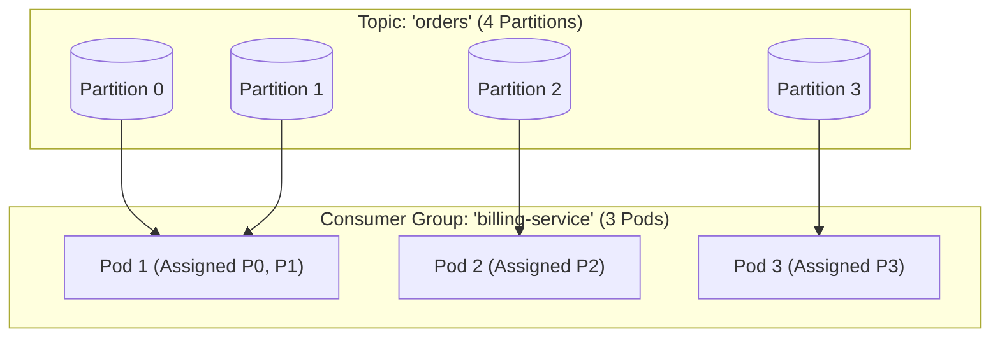
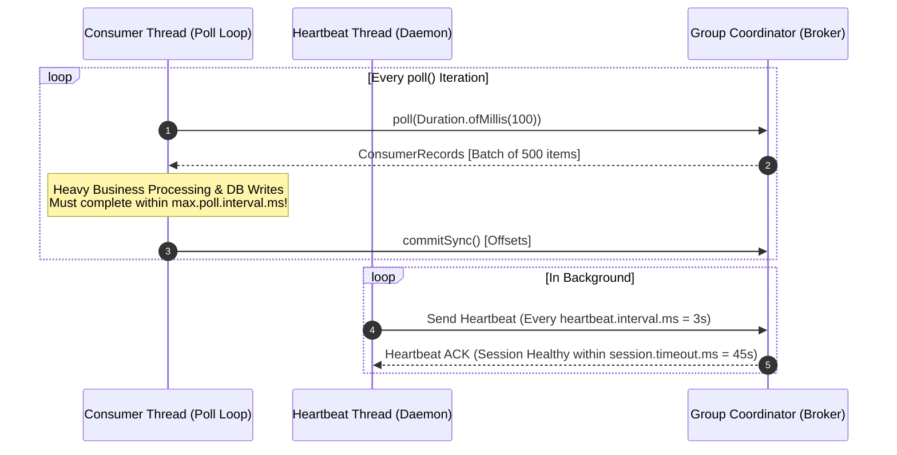
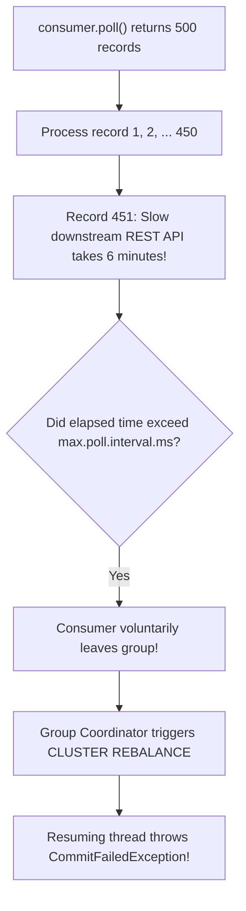
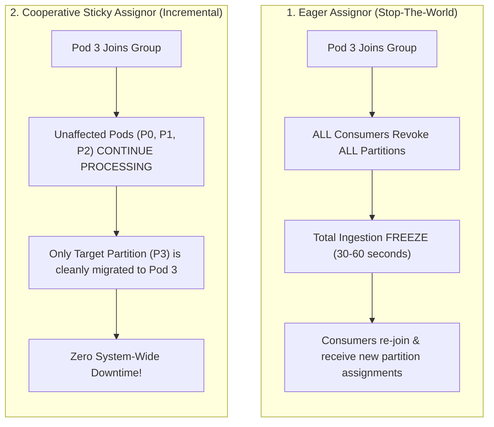
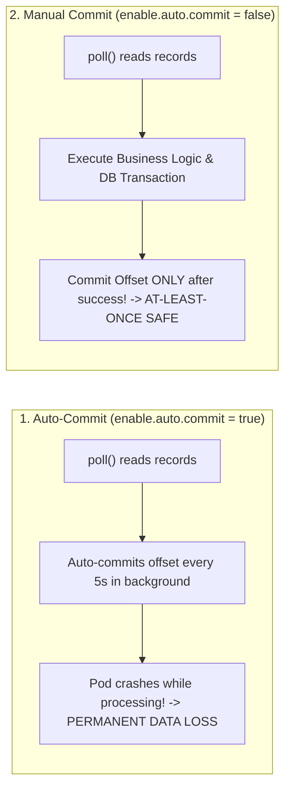

# Kafka Consumer Groups and Rebalances

On the surface, consuming messages from Apache Kafka looks like a simple background worker task: annotate a method with `@KafkaListener` and process incoming events.

In production environments running dozens of Kubernetes pods, consuming from Kafka introduces complex distributed systems challenges:
- What happens when a slow database query causes your consumer's processing loop to take 5 minutes and 1 second, exceeding `max.poll.interval.ms`? Kafka marks your pod as dead, revokes all its partitions, and triggers a cluster-wide **Rebalance Storm**, freezing message consumption across every other pod.
- What happens when you do a rolling restart of 20 microservice pods during a production deployment? If using legacy rebalance protocols, your consumers spend 15 minutes revoking and re-acquiring partitions instead of processing orders.
- What happens if you enable auto-commit (`enable.auto.commit=true`)? If your pod crashes mid-execution, messages are silently lost because the offset was committed before your database transaction completed.

To build resilient, high-throughput consumer services, you must master the mechanics of the poll loop, offset commit strategies, and modern **Cooperative Sticky** rebalancing.

---

## Consumer Groups and Partition Assignment Mechanics

Kafka coordinates horizontal consumer scaling through the **Consumer Group** abstraction:



### The Golden Partitioning Rule

Within a single Consumer Group, **each partition is assigned to exactly one consumer at any given time**.

- **Parallelism Ceiling:** The maximum number of active consumers in a group is strictly equal to the number of partitions on the topic. If a topic has 4 partitions and you deploy 6 consumer pods, 2 pods will sit completely idle, consuming zero messages.
- **Multiple Consumer Groups (Pub/Sub):** Different consumer groups (e.g., `billing-service` and `fraud-detection-service`) maintain independent offsets. Both groups read 100% of the messages independently without interfering with each other.

### The Group Coordinator and Group Leader

1. **Group Coordinator (Broker):** One of the Kafka brokers is designated as the Group Coordinator for a consumer group (determined by hashing the group ID to a partition of the internal `__consumer_offsets` topic).
2. **Group Leader (Consumer):** When consumers join the group, the Coordinator elects the first consumer as the **Group Leader**. The Leader is responsible for running the partition assignment algorithm (e.g., Cooperative Sticky) and reporting the assignments back to the Coordinator, which informs all members.

---

## The Poll Loop Internals and the Two Critical Timeouts

A fundamental constraint of the official Java `KafkaConsumer` is that **it is strictly NOT thread-safe**. All methods (except `wakeup()`) must be invoked from the exact same thread.



To determine consumer health, Kafka separates network health from application processing health using two distinct timeouts:

### Network Liveness: `session.timeout.ms` and `heartbeat.interval.ms`

A background daemon thread sends periodic heartbeats (default: every 3 seconds via `heartbeat.interval.ms`) to the Group Coordinator. If the broker does not receive a heartbeat within **`session.timeout.ms`** (default: 45 seconds), it assumes the consumer suffered a hard crash or network severance and evicts it from the group.

### Processing Liveness: `max.poll.interval.ms`

This timeout tracks application execution. If your worker thread is alive and sending heartbeats, but business processing or a blocked database call prevents it from calling `poll()` again within **`max.poll.interval.ms`** (default: 300,000ms / 5 minutes), the consumer voluntarily leaves the group.



> **The Classic Production Outage:**
> A batch of 500 records takes 5 minutes and 10 seconds to process due to database contention. The consumer exceeds `max.poll.interval.ms`. The broker evicts the pod and reassigns its partitions to Pod 2. When Pod 1 finally finishes and calls `commitSync()`, Kafka throws `CommitFailedException`. Pod 2 now starts reprocessing the exact same 500 records from the last committed offset, leading to duplicate processing and compounding lag.

**The Fix:** Never allow processing to exceed `max.poll.interval.ms`. Either reduce `max.poll.records` (e.g., from 500 down to 50), increase `max.poll.interval.ms`, or offload heavy processing to a worker thread pool.

---

## The Rebalance Storm: Eager vs Cooperative Sticky Assignors

When a consumer joins, crashes, or leaves a group, Kafka triggers a **Rebalance** to redistribute partitions. How that rebalance executes has a massive impact on system availability.



### The Flaw of Eager Rebalancing (`RangeAssignor` / `RoundRobinAssignor`)

Historically, Kafka used **Eager Rebalancing**. When a single pod restarted:
1. Every consumer in the group was forced to immediately **revoke all assigned partitions**.
2. All message processing across the entire enterprise stopped completely (a Stop-The-World pause).
3. All consumers sent `JoinGroup` requests to the Coordinator.
4. The Group Leader recalculated assignments and sent `SyncGroup` responses.
5. In large microservice clusters, an eager rebalance could take 30 to 90 seconds. If another pod crashed during the rebalance, the process restarted, creating an endless **Rebalance Storm**.

### The Modern Standard: Cooperative Sticky Assignor (KIP-429)

Introduced in Kafka 2.4 and the default in modern Spring Boot:

```properties
partition.assignment.strategy=org.apache.kafka.clients.consumer.CooperativeStickyAssignor
```

The Cooperative Sticky Assignor executes rebalances **incrementally**:
1. When Pod 3 joins, consumers that hold partitions that do not need to move **never stop processing**.
2. Only the specific partition being migrated is revoked and reassigned in a fast, targeted two-phase protocol.
3. Cluster throughput remains uninterrupted.

### Static Membership: Eliminating Rebalances During Rolling Restarts

During continuous deployment (CI/CD) pipelines, Kubernetes sequentially terminates and restarts pods. Under standard dynamic membership, each pod restart triggers two rebalances (one when the pod dies, one when it restarts).

By configuring **Static Membership** via `group.instance.id`:

```properties
group.instance.id=billing-service-pod-prod-1
session.timeout.ms=60000 # 60 seconds
```

When a pod restarts, the broker recognizes its unique `group.instance.id`. Instead of triggering an immediate rebalance, the Coordinator grants a grace period (equal to `session.timeout.ms`). If the pod restarts within 60 seconds and reconnects with the same instance ID, it **retains its existing partition assignments with zero rebalances**.

---

## Offset Commit Strategies: Preventing Data Loss and Duplicates

How and when you commit offsets determines your system's processing semantics.



### Why Auto-Commit is Dangerous in Production

With `enable.auto.commit=true`, the consumer commits the highest offset returned by `poll()` on a timer (default: every 5 seconds via `auto.commit.interval.ms`).

If `poll()` returns records 100 to 200, and at second 5 the background timer commits offset 200 while your thread is still processing record 120, a crash at record 125 means **records 126 through 200 will never be processed**. They are permanently lost.

### Production Standard: Manual Commit After Processing

In enterprise Spring Boot applications, always disable auto-commit and commit manually only after the business transaction succeeds:

```yaml
spring:
  kafka:
    consumer:
      enable-auto-commit: false
    listener:
      ack-mode: manual_immediate # Spring commits immediately when Acknowledgment.acknowledge() is invoked
```

---

## Production Spring Boot `@KafkaListener` Implementation

Here is a resilient, enterprise-grade consumer implementation using Spring Boot 3:

### Step 1: Configuration (`application.yml`)

```yaml
spring:
  kafka:
    bootstrap-servers: kafka-broker-1:9092,kafka-broker-2:9092,kafka-broker-3:9092
    consumer:
      group-id: payment-processing-service
      enable-auto-commit: false
      auto-offset-reset: earliest # Read from beginning if no committed offset exists
      key-deserializer: org.apache.kafka.common.serialization.StringDeserializer
      value-deserializer: org.springframework.kafka.support.serializer.JsonDeserializer
      properties:
        # Incremental Cooperative Rebalancing
        partition.assignment.strategy: org.apache.kafka.clients.consumer.CooperativeStickyAssignor
        
        # Batching & Timeout Tuning
        max.poll.records: 100 # Keep batches small to avoid exceeding poll interval
        max.poll.interval.ms: 300000 # 5 minutes
        session.timeout.ms: 45000     # 45 seconds
        heartbeat.interval.ms: 10000  # 10 seconds
        
        # Trust package for JSON deserialization
        spring.json.trusted.packages: "com.javahub.*"
    listener:
      ack-mode: MANUAL_IMMEDIATE
      concurrency: 3 # Spawns 3 independent consumer threads
```

### Step 2: The Resilient Consumer Service

```java
package com.javahub.kafka.consumer;

import org.apache.kafka.clients.consumer.ConsumerRecord;
import org.slf4j.Logger;
import org.slf4j.LoggerFactory;
import org.slf4j.MDC;
import org.springframework.kafka.annotation.KafkaListener;
import org.springframework.kafka.support.Acknowledgment;
import org.springframework.stereotype.Service;
import org.springframework.transaction.annotation.Transactional;

import java.nio.charset.StandardCharsets;

@Service
public class OrderEventConsumer {

    private static final Logger log = LoggerFactory.getLogger(OrderEventConsumer.class);
    private final PaymentProcessingService paymentProcessingService;

    public OrderEventConsumer(PaymentProcessingService paymentProcessingService) {
        this.paymentProcessingService = paymentProcessingService;
    }

    @KafkaListener(
        topics = "fintech.orders.v1",
        groupId = "payment-processing-service",
        concurrency = "3"
    )
    @Transactional
    public void consumeOrderEvent(ConsumerRecord<String, OrderEventPayload> record, 
                                  Acknowledgment acknowledgment) {
        // 1. Extract Correlation ID from Kafka Headers for Distributed Tracing
        byte[] correlationIdBytes = record.headers().lastHeader("x-correlation-id") != null 
                ? record.headers().lastHeader("x-correlation-id").value() 
                : null;
        
        String correlationId = correlationIdBytes != null 
                ? new String(correlationIdBytes, StandardCharsets.UTF_8) 
                : "unknown";

        MDC.put("correlationId", correlationId);

        try {
            log.info("Processing order event from Partition: {}, Offset: {}, Key: {}",
                    record.partition(), record.offset(), record.key());

            OrderEventPayload payload = record.value();

            // 2. Business Logic Execution (Idempotent Database Write)
            paymentProcessingService.processPayment(record.key(), payload);

            // 3. CRITICAL: Commit offset ONLY after business transaction succeeds!
            acknowledgment.acknowledge();

            log.info("Successfully committed offset: {} for order: {}", record.offset(), record.key());

        } catch (Exception e) {
            log.error("Failed to process order event at offset: {}. Message will be retried.", record.offset(), e);
            // DO NOT ACKNOWLEDGE! Let Spring Kafka error handler retry or route to Dead Letter Topic
            throw e;
        } finally {
            MDC.remove("correlationId");
        }
    }

    public record OrderEventPayload(String orderId, double amount, String currency, String customerId) {}
}
```

---

## Senior Engineer Interview Crucible

### Explain how the Cooperative Sticky Assignor eliminates "Stop-The-World" consumer rebalance storms compared to eager assignors (Range / RoundRobin).

Eager assignment strategies (such as `RangeAssignor` or `RoundRobinAssignor`) operate under an "all-or-nothing" paradigm. When a single consumer joins or leaves the group, **every active consumer must revoke all of its assigned partitions** before the rebalance can begin. During this window, all message processing across the entire consumer group halts completely. In large clusters, this causes severe latency spikes and can trigger cascading rebalances if heartbeats time out during the pause.

The **Cooperative Sticky Assignor (KIP-429)** uses an incremental, non-blocking protocol:
1. When a membership change occurs, consumers continue reading from their currently assigned partitions without interruption.
2. The assignor calculates the minimal set of partitions that actually need to move.
3. In Phase 1, only the consumers holding the partitions scheduled for reassignment revoke those specific partitions, while all other partitions continue processing.
4. In Phase 2, the newly available partitions are assigned to their new owners.

This eliminates cluster-wide processing freezes and reduces rebalance downtime from tens of seconds to milliseconds.

---

### What is Static Membership (`group.instance.id`), and how does it prevent unnecessary rebalances during Kubernetes rolling deployments?

Under standard dynamic consumer group membership, whenever a consumer pod stops or restarts, the coordinator detects the closure of its connection and immediately triggers a group-wide rebalance. During a Kubernetes rolling update of 10 pods, this causes 20 consecutive rebalances (one when each pod terminates, and one when its replacement starts).

**Static Membership (KIP-345)** resolves this by assigning a unique, persistent identifier to each consumer pod via `group.instance.id` (e.g., mapped to the Kubernetes StatefulSet pod hostname):
1. When a static consumer pod shuts down, it does not send a `LeaveGroup` request to the coordinator.
2. The coordinator grants a grace period equal to `session.timeout.ms` (e.g., 60-90 seconds) before declaring the instance dead.
3. When the new pod boots up and rejoins using the **exact same `group.instance.id`**, the coordinator immediately restores its previous partition assignments **without triggering a rebalance**.

---

### What is the root cause of a `CommitFailedException` in a Kafka consumer, and how do you resolve it by tuning `max.poll.interval.ms` and `max.poll.records`?

A `CommitFailedException` occurs when a consumer attempts to commit offsets (via `commitSync()` or manual acknowledgment), but the Group Coordinator rejects the commit because it has already evicted the consumer from the group and reassigned its partitions.

**The Root Cause:**
The time elapsed between two consecutive calls to `poll()` exceeded **`max.poll.interval.ms`**. This occurs when the consumer thread spends too much time processing a batch of records (e.g., due to slow third-party REST calls, database locks, or large payload deserialization). Even though the background heartbeat thread was keeping the TCP session alive, Kafka assumed the consumer thread had deadlocked and ejected it.

**The Resolution:**
1. **Reduce `max.poll.records`:** Lower the batch size returned by `poll()` (e.g., from 500 down to 50 or 20) so the consumer can process the entire batch well within the timeout.
2. **Increase `max.poll.interval.ms`:** If individual records genuinely require long processing times, raise the interval (e.g., from 5 minutes to 15 minutes).
3. **Decouple Polling from Processing:** Offload heavy processing to an internal worker thread pool (or Java 21 Virtual Threads) so the main consumer thread can immediately invoke `poll()` again, while managing offset commits safely as worker tasks complete.

---

### Why is `KafkaConsumer` strictly not thread-safe, and what is the recommended architecture for processing messages in parallel without violating offset commit ordering?

`KafkaConsumer` is strictly single-threaded because its internal state—including TCP network sockets, buffer allocations, offset tracking structures, and subscription state—was deliberately engineered without synchronization locks to maximize single-thread CPU cache locality and throughput. Calling any method on `KafkaConsumer` (other than `wakeup()`) from another thread immediately throws `ConcurrentModificationException`.

**Parallel Processing Architecture:**
To scale processing beyond the partition limit while preserving thread safety and offset commit integrity:
1. **One Consumer Thread per Core/Partition:** Use Spring Kafka's `concurrency` setting, which instantiates multiple independent `KafkaConsumer` instances, each running on its own dedicated thread.
2. **Worker Pool with Pausing / Offsets Map:** The single consumer thread polls batches of records and dispatches individual records to an internal executor pool (such as `Executors.newVirtualThreadPerTaskExecutor()`). 
3. **Offset Commit Ordering Guarantee:** Offsets cannot be committed out of order. If worker thread 2 finishes record 102 before worker thread 1 finishes record 101, committing 102 would implicitly mark 101 as processed. The system must maintain an in-memory tracking structure (like an offset acknowledgment window) and commit only the highest **contiguous** successfully processed offset back to Kafka.
