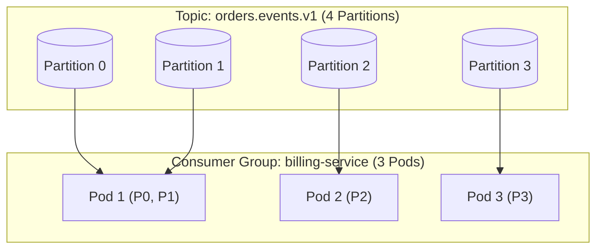
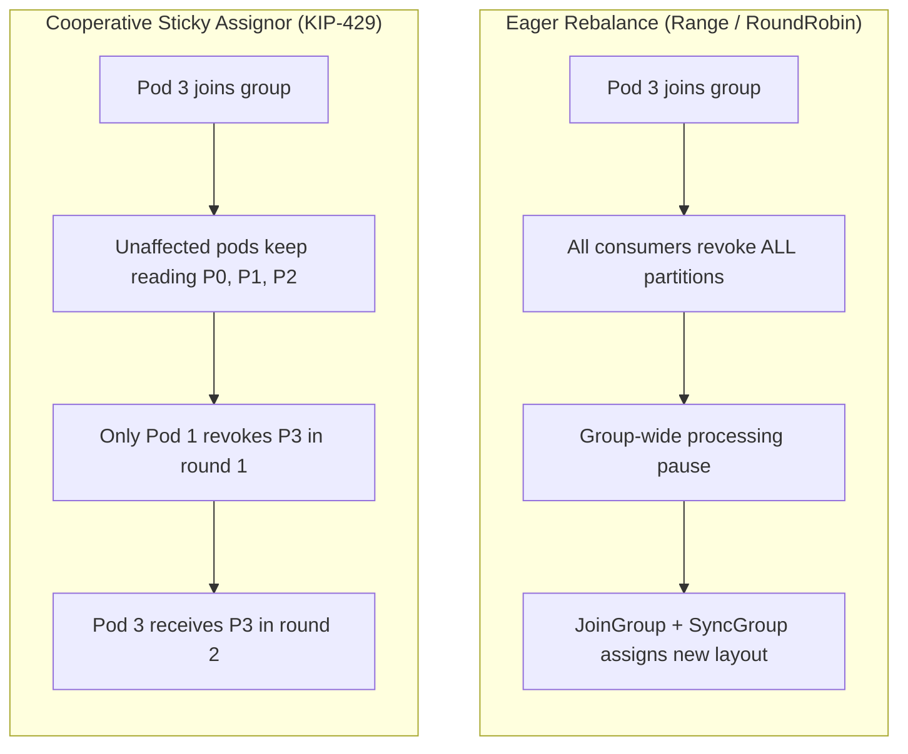
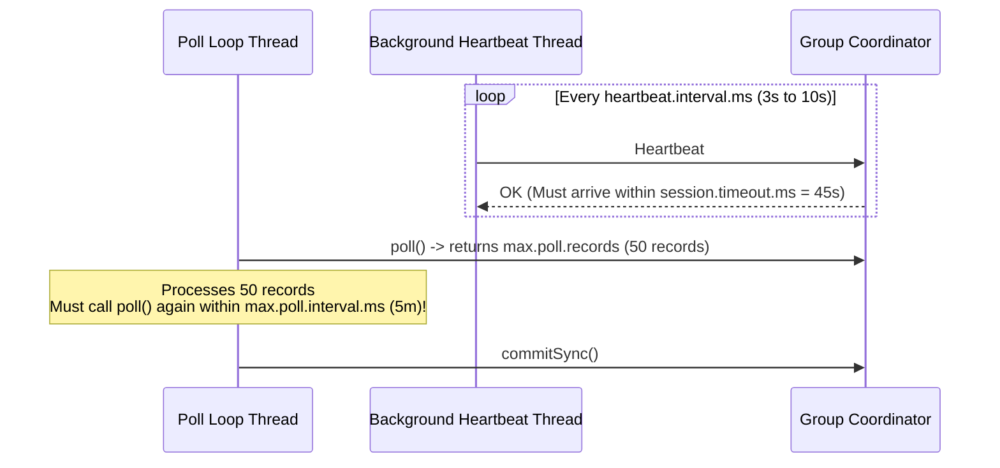

Reading from Kafka looks straightforward when you annotate a Spring method with `@KafkaListener`. The hard parts show up in production: a rolling Kubernetes deployment stalls throughput for two minutes, a malformed JSON event traps a partition in an infinite retry loop, or a slow database call triggers `CommitFailedException` and sends the same batch through a second consumer.

Every one of those incidents traces back to three mechanisms in the Kafka consumer client: how consumer groups assign partitions, how offsets are committed, and how the poll loop signals liveness to the Group Coordinator.

---

## Consumer Group Mechanics and Partition Assignment

Kafka scales message consumption horizontally through **Consumer Groups**. Every consumer instance configures a `group.id` identifying the logical service it belongs to (for example, `billing-service`).



Two rules govern how partitions map to consumers:
- **Within one consumer group**, each partition is assigned to **at most one consumer** at any moment. That preserves strict per-partition ordering and caps maximum active consumer instances at the topic's partition count. If a topic has 4 partitions and you scale `billing-service` to 6 pods, 2 pods sit idle as hot standbys.
- **Across different consumer groups**, each group tracks its own offsets independently in Kafka's internal `__consumer_offsets` topic. Both `billing-service` and `fraud-detection-service` receive every record from the topic without interfering with each other.

### Group Coordinator and Threading Model

For each `group.id`, Kafka assigns one broker as the **Group Coordinator** (determined by hashing `group.id` onto a partition of `__consumer_offsets`). The coordinator handles membership, heartbeats, offset commits, and rebalance coordination.

On the client side, remember a strict rule of the official Java client: **`KafkaConsumer` is not thread-safe**. All calls except `consumer.wakeup()` must execute on the same thread. Calling `poll()` or `commitSync()` from a second thread throws `ConcurrentModificationException`. When you set `concurrency = 3` in Spring Kafka, the framework does not share one `KafkaConsumer` across three threads; it creates three separate `KafkaConsumer` instances, each owned by its own dedicated listener thread.

---

## Commit Strategies: Auto-Commit, `commitSync`, and `commitAsync`

Kafka tracks consumer progress by storing the next offset to read for each `(group.id, topic, partition)` tuple. When and how you commit those offsets determines whether failures lose data or produce duplicates.

### Why Auto-Commit Risks Data Loss

With `enable.auto.commit=true` (the raw client default), `poll()` periodically commits the highest offset returned by the *previous* `poll()` every `auto.commit.interval.ms` (default 5 seconds).

If `poll()` returns offsets `100..199`, and your application crashes while processing record `125` right after an auto-commit fires (or if you hand records off to an async executor before `poll()` runs again), Kafka now believes offset `200` is done. Records `126..199` are skipped on restart. For business-critical workloads, set `enable.auto.commit=false` and commit manually after your side effects succeed.

### Comparing `commitSync()` and `commitAsync()`

When you manage commits manually on `KafkaConsumer`, you have two APIs:

| Method | Blocking? | Retries on Transient Errors? | Main Trade-off |
| :--- | :--- | :--- | :--- |
| **`commitSync()`** | Yes, blocks the poll thread until the broker acknowledges | Yes, retries recoverable errors until success or unrecoverable failure | Strongest commit guarantee before continuing, but adds one network round-trip per commit |
| **`commitAsync()`** | No, sends the commit request and returns immediately | **No**, never retries automatically | Higher throughput, but a failed commit can leave stale offsets until the next poll commits a higher offset |

Why doesn't `commitAsync()` retry automatically? Imagine async commit #1 (for offset `100`) fails transiently and gets queued for retry. Meanwhile, the poll loop keeps moving and async commit #2 (for offset `200`) succeeds. If commit #1 retried later and succeeded, it would silently roll the committed offset *backward* from `200` to `100`, causing duplicate processing on the next rebalance.

### The Production Hybrid Commit Pattern

With the raw `KafkaConsumer` API, the standard production pattern combines both methods:
- Call **`commitAsync()`** inside the normal poll loop for high throughput (if one async commit drops, the next loop's higher offset supersedes it).
- Call **`commitSync()`** inside `ConsumerRebalanceListener.onPartitionsRevoked()` (so you commit completed work right before losing a partition) and inside the `finally` block during shutdown.

```java
package com.javahub.kafka.consumer;

import org.apache.kafka.clients.consumer.ConsumerRebalanceListener;
import org.apache.kafka.clients.consumer.ConsumerRecord;
import org.apache.kafka.clients.consumer.ConsumerRecords;
import org.apache.kafka.clients.consumer.KafkaConsumer;
import org.apache.kafka.clients.consumer.OffsetAndMetadata;
import org.apache.kafka.common.TopicPartition;
import org.apache.kafka.common.errors.WakeupException;
import org.slf4j.Logger;
import org.slf4j.LoggerFactory;

import java.time.Duration;
import java.util.Collection;
import java.util.HashMap;
import java.util.List;
import java.util.Map;

public class HybridCommitConsumerLoop {

    private static final Logger log = LoggerFactory.getLogger(HybridCommitConsumerLoop.class);

    private final KafkaConsumer<String, String> consumer;
    private final Map<TopicPartition, OffsetAndMetadata> processedOffsets = new HashMap<>();

    public HybridCommitConsumerLoop(KafkaConsumer<String, String> consumer) {
        this.consumer = consumer;
    }

    public void run(String topic, RecordProcessor processor) {
        ConsumerRebalanceListener rebalanceListener = new ConsumerRebalanceListener() {
            @Override
            public void onPartitionsRevoked(Collection<TopicPartition> partitions) {
                // Commit synchronously before handing these partitions to another consumer
                if (!processedOffsets.isEmpty()) {
                    consumer.commitSync(processedOffsets);
                    partitions.forEach(processedOffsets::remove);
                }
            }

            @Override
            public void onPartitionsAssigned(Collection<TopicPartition> partitions) {
                log.info("Assigned partitions: {}", partitions);
            }
        };

        consumer.subscribe(List.of(topic), rebalanceListener);

        try {
            while (true) {
                ConsumerRecords<String, String> records = consumer.poll(Duration.ofMillis(250));
                if (records.isEmpty()) {
                    continue;
                }

                for (ConsumerRecord<String, String> record : records) {
                    processor.process(record);
                    // Record the NEXT offset to read for this partition
                    processedOffsets.put(
                            new TopicPartition(record.topic(), record.partition()),
                            new OffsetAndMetadata(record.offset() + 1)
                    );
                }

                // Non-blocking commit during steady state for throughput
                consumer.commitAsync(new HashMap<>(processedOffsets), (offsets, exception) -> {
                    if (exception != null) {
                        log.warn("Async offset commit failed for offsets {}", offsets, exception);
                    }
                });
            }
        } catch (WakeupException expected) {
            log.info("Shutdown signal received via consumer.wakeup()");
        } finally {
            try {
                if (!processedOffsets.isEmpty()) {
                    // Blocking final commit before closing the consumer
                    consumer.commitSync(processedOffsets);
                }
            } finally {
                consumer.close();
            }
        }
    }

    @FunctionalInterface
    public interface RecordProcessor {
        void process(ConsumerRecord<String, String> record);
    }
}
```

In Spring Kafka, the listener container manages this poll loop for you. Setting `spring.kafka.listener.ack-mode` to `manual_immediate` commits when you call `acknowledgment.acknowledge()` (using `commitSync` by default unless `syncCommits` is disabled on the container), while `batch` commits once per `poll()` batch after all records in the batch succeed.

---

## Rebalance Protocol, Cooperative Sticky Assignor, and KIP-848

Whenever a consumer joins, shuts down cleanly, crashes, or misses a timeout, Kafka triggers a **rebalance** to redistribute partitions across the remaining group members.



### Eager vs Cooperative Sticky Rebalancing

Legacy assignors (`RangeAssignor`, `RoundRobinAssignor`) use the **Eager** protocol. Every time one pod restarts, every consumer in the group revokes all of its partitions before rejoining. Consumption stops completely across the entire group until the Group Leader computes a fresh assignment and every member syncs. During a rolling deployment of 20 pods, eager rebalances can stall processing repeatedly.

The **`CooperativeStickyAssignor`** (KIP-429) switches to **incremental rebalancing**:
1. Consumers keep processing their current partitions during the rebalance calculation.
2. The assignor keeps existing partition ownership as sticky as possible and identifies only the minimal partitions that need to move.
3. Only the consumers losing those specific partitions revoke them; unaffected partitions never pause.
4. In a quick follow-up round, the newly free partitions are assigned to the joining consumer.

Configure it explicitly on consumers running the classic group protocol:

```properties
partition.assignment.strategy=org.apache.kafka.clients.consumer.CooperativeStickyAssignor
```

### Static Group Membership (`group.instance.id`)

Even with cooperative rebalancing, rolling restarts in Kubernetes cause two membership events per pod: one when the old pod terminates, and one when the replacement pod starts.

**Static Membership (KIP-345)** eliminates those unnecessary rebalances for StatefulSets or fixed-identity pods:

```properties
group.instance.id=billing-service-pod-0
session.timeout.ms=60000
```

When a static member shuts down, it does not send a `LeaveGroup` request. The coordinator holds its partition assignments for up to `session.timeout.ms`. If the replacement pod boots within 60 seconds using the exact same `group.instance.id`, it immediately resumes its old partitions with zero rebalance overhead.

### Next-Generation Rebalance Protocol (KIP-848)

In classic Kafka, the client-side **Group Leader** runs the partition assignment logic, which requires synchronizing all clients through `JoinGroup` and `SyncGroup` waves. **KIP-848** (early access in Kafka 3.7, preview in 3.8, production-ready in Kafka 4.0) redesigns rebalancing from the ground up:
- Clients opt in with `group.protocol=consumer`.
- Partition assignment moves to the **server-side Group Coordinator** (`group.remote.assignor=uniform` or `range`), removing the client-side Group Leader completely.
- Rebalances become continuous, per-member, and non-blocking via lightweight heartbeats, cutting rebalance latency dramatically in large consumer groups without needing `partition.assignment.strategy` on every client.

---

## Handling Poison Pills and Slow Consumers

Two failure modes account for the majority of Kafka consumer pages in production: **poison pills** (records that can never be deserialized or processed) and **slow consumers** (processing that exceeds liveness timeouts).

### Poison Pills and `ErrorHandlingDeserializer`

A poison pill happens when a producer writes malformed JSON, corrupted bytes, or an incompatible schema version into a partition.

If you configure Spring Kafka directly with `JsonDeserializer`, deserialization runs **inside `consumer.poll()`** before your `@KafkaListener` method is ever invoked. The deserializer throws `RecordDeserializationException`, the offset never advances, and the next `poll()` immediately fetches the exact same broken offset again. Your partition is now wedged in an infinite exception loop while valid records pile up behind it.

The fix is to wrap your real deserializer inside Spring Kafka's **`ErrorHandlingDeserializer`** and pair it with a **`DefaultErrorHandler`** backed by a **`DeadLetterPublishingRecoverer`**:
1. When a record fails to deserialize, `ErrorHandlingDeserializer` catches the exception, attaches it to the record headers (`springDeserializerExceptionValue`), and passes a record with a `null` payload to the error handler.
2. `DefaultErrorHandler` recognizes `DeserializationException` as non-retryable, invokes `DeadLetterPublishingRecoverer` to copy the raw bytes and error stack trace to `<topic>.DLT`, and advances the offset so the partition keeps moving.

```yaml
spring:
  kafka:
    bootstrap-servers: kafka-1:9092,kafka-2:9092,kafka-3:9092
    consumer:
      group-id: payment-processing-service
      enable-auto-commit: false
      auto-offset-reset: earliest
      key-deserializer: org.springframework.kafka.support.serializer.ErrorHandlingDeserializer
      value-deserializer: org.springframework.kafka.support.serializer.ErrorHandlingDeserializer
      properties:
        spring.deserializer.key.delegate.class: org.apache.kafka.common.serialization.StringDeserializer
        spring.deserializer.value.delegate.class: org.springframework.kafka.support.serializer.JsonDeserializer
        spring.json.value.default.type: com.javahub.kafka.consumer.OrderEventPayload
        spring.json.trusted.packages: "com.javahub.kafka.consumer"
        partition.assignment.strategy: org.apache.kafka.clients.consumer.CooperativeStickyAssignor
        max.poll.records: 50
        max.poll.interval.ms: 300000
        session.timeout.ms: 45000
        heartbeat.interval.ms: 10000
    listener:
      ack-mode: manual_immediate
      concurrency: 3
```

Wire the `DefaultErrorHandler` and `DeadLetterPublishingRecoverer` in Java so transient failures retry with backoff while poison pills go straight to the Dead Letter Topic:

```java
package com.javahub.kafka.consumer;

import org.apache.kafka.common.TopicPartition;
import org.springframework.context.annotation.Bean;
import org.springframework.context.annotation.Configuration;
import org.springframework.kafka.core.KafkaTemplate;
import org.springframework.kafka.listener.DeadLetterPublishingRecoverer;
import org.springframework.kafka.listener.DefaultErrorHandler;
import org.springframework.kafka.support.serializer.DeserializationException;
import org.springframework.util.backoff.ExponentialBackOff;

@Configuration
public class KafkaConsumerErrorConfig {

    @Bean
    public DefaultErrorHandler kafkaErrorHandler(KafkaTemplate<Object, Object> dltTemplate) {
        // Route poison pills and exhausted retries to <original-topic>.DLT on the same partition
        DeadLetterPublishingRecoverer recoverer = new DeadLetterPublishingRecoverer(
                dltTemplate,
                (record, ex) -> new TopicPartition(record.topic() + ".DLT", record.partition())
        );

        ExponentialBackOff backOff = new ExponentialBackOff(1_000L, 2.0);
        backOff.setMaxElapsedTime(15_000L); // Retry transient errors up to ~15 seconds total

        DefaultErrorHandler errorHandler = new DefaultErrorHandler(recoverer, backOff);
        // Never retry permanent poison pills
        errorHandler.addNotRetryableExceptions(
                DeserializationException.class,
                IllegalArgumentException.class
        );
        return errorHandler;
    }
}
```

### Slow Consumers: `session.timeout.ms` vs `max.poll.interval.ms`

Kafka separates network health from application processing health using two independent timeouts:



- **`session.timeout.ms`** (default 45s) and **`heartbeat.interval.ms`** (default 3s): Managed by a background daemon thread. If the JVM crashes or loses network connectivity, heartbeats stop and the coordinator evicts the consumer after `session.timeout.ms`.
- **`max.poll.interval.ms`** (default 300,000 ms / 5 minutes): Tracks the maximum gap between two `poll()` calls on your main consumer thread. Even if heartbeats are completely healthy, if a batch takes 5 minutes and 10 seconds to process, the consumer leaves the group, triggers a rebalance, and throws **`CommitFailedException`** when it tries to commit. Another pod then picks up those partitions and reprocesses the exact same slow records, creating a repeating rebalance loop.

### Mitigating Slow Consumers (Tuning and `pause()` / `resume()`)

Use three levers to keep slow consumers out of rebalance loops:
1. **Shrink `max.poll.records`**: Default is `500`. If each record makes a 500 ms database or REST call, 500 records take 250 seconds, dangerously close to the 300-second `max.poll.interval.ms`. Dropping `max.poll.records` to `50` caps worst-case batch duration at 25 seconds.
2. **Adjust `max.poll.interval.ms`**: If individual records legitimately require long processing (such as media encoding or ML inference), raise `max.poll.interval.ms` above the p99 batch duration, or offload the long job to a separate task queue or workflow engine.
3. **Apply Backpressure with `pause()` and `resume()`**: If a downstream dependency hits a rate limit or an internal bounded worker queue fills up, do **not** call `Thread.sleep()` for minutes inside the poll thread. Instead, call `consumer.pause(partitions)` and keep calling `consumer.poll(Duration.ofMillis(100))`. Calling `poll()` on paused partitions returns zero records while keeping `max.poll.interval.ms` satisfied and maintaining group membership. Once downstream capacity recovers, call `consumer.resume(partitions)`.

```java
package com.javahub.kafka.consumer;

import org.apache.kafka.clients.consumer.ConsumerRecords;
import org.apache.kafka.clients.consumer.KafkaConsumer;
import org.apache.kafka.common.TopicPartition;

import java.time.Duration;
import java.util.Set;
import java.util.function.BooleanSupplier;

public class BackpressureAwareConsumer {

    public void pollWithBackpressure(
            KafkaConsumer<String, String> consumer,
            BooleanSupplier downstreamOverloaded,
            java.util.function.Consumer<ConsumerRecords<String, String>> batchHandler) {

        while (true) {
            Set<TopicPartition> assigned = consumer.assignment();

            if (!assigned.isEmpty() && downstreamOverloaded.getAsBoolean()) {
                if (consumer.paused().isEmpty()) {
                    consumer.pause(assigned);
                }
            } else if (!consumer.paused().isEmpty()) {
                consumer.resume(consumer.paused());
            }

            // Always call poll() promptly so max.poll.interval.ms never expires
            ConsumerRecords<String, String> records = consumer.poll(Duration.ofMillis(200));
            if (!records.isEmpty()) {
                batchHandler.accept(records);
                consumer.commitAsync();
            }
        }
    }
}
```

In Spring Kafka, you can apply the same pattern programmatically via `MessageListenerContainer.pause()` and `resume()` (for example, triggered by a Resilience4j circuit breaker state transition).

---

## Interview Questions

### Why does `commitAsync()` not retry failed offset commits automatically, and how do you use it safely?

If `commitAsync()` retried a failed commit for offset `100` after a later commit for offset `200` had already succeeded, the retry would roll the group's committed offset backward to `100`, causing duplicate processing on the next rebalance. To use it safely, call `commitAsync()` during the regular poll loop (letting the next batch's higher commit cover a dropped async commit) and call `commitSync()` inside `ConsumerRebalanceListener.onPartitionsRevoked()` and during graceful shutdown.

### What happens if a consumer receives a malformed JSON message without `ErrorHandlingDeserializer`?

Deserialization happens inside `poll()` before the listener method runs. A standard `JsonDeserializer` throws `RecordDeserializationException` on the broken offset, preventing the consumer from ever advancing past it. Every subsequent `poll()` fetches the same bad record in an infinite loop, stalling the entire partition. Wrapping the delegate deserializer in `ErrorHandlingDeserializer` captures the deserialization failure so `DefaultErrorHandler` and `DeadLetterPublishingRecoverer` can route the raw record to a Dead Letter Topic and move the offset forward.

### What is the difference between `session.timeout.ms` and `max.poll.interval.ms`?

`session.timeout.ms` governs background heartbeat liveness; it detects crashed processes or dead network connections when heartbeats stop arriving at the Group Coordinator. `max.poll.interval.ms` governs processing liveness on the main poll thread; if the time between two `poll()` calls exceeds it, the consumer leaves the group even though its heartbeat thread is healthy, triggering a rebalance and causing `CommitFailedException` on the slow consumer.

### How does KIP-848 improve on the Cooperative Sticky Assignor?

`CooperativeStickyAssignor` (KIP-429) eliminated stop-the-world revocations, but it still relied on a client-side Group Leader and multi-round `JoinGroup` / `SyncGroup` synchronization barriers across the group. KIP-848 (`group.protocol=consumer`, production-ready in Kafka 4.0) moves partition assignment to the broker-side Group Coordinator and reconciles assignments incrementally via heartbeats, allowing individual consumers to transition partitions independently without waiting on slow peers.
