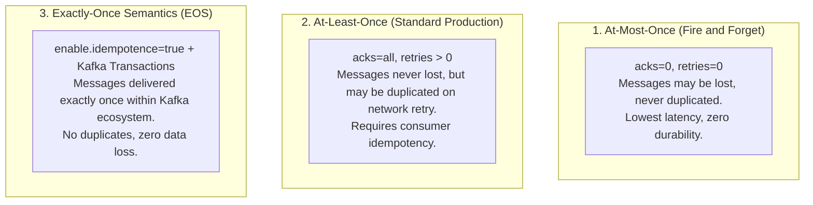
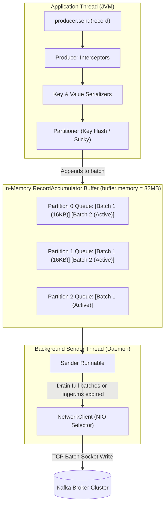
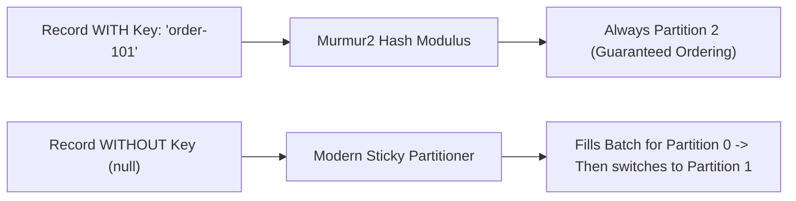
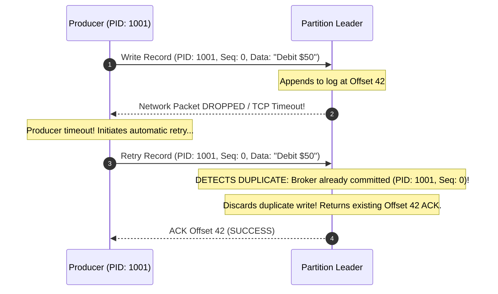

# Kafka Producers and Delivery Guarantees

In event-driven architectures, producing a message to Kafka looks deceptively simple: you instantiate a `KafkaTemplate` and call `kafkaTemplate.send("orders", order)`.

In a production banking or payment platform, that naive line of code hides serious concurrency and reliability hazards:
- What happens if the network cable to the broker blips after the broker writes the message to disk but before the TCP acknowledgment reaches your application? Your application retries, and now your customer is billed twice.
- What happens if your application crashes while 5,000 messages sit in the producer's in-memory accumulator buffer? Those messages are permanently lost.
- What happens if you repartition a topic while using default partitioning logic? Strict message ordering for customer transactions is immediately scrambled across partitions.

To design mission-critical event pipelines, senior engineers must master the producer's internal queuing mechanics, configure bulletproof **Zero Data Loss** durability, and implement **Idempotent** and **Transactional** publishing.

---

## The Delivery Guarantee Spectrum

Every distributed messaging system operates within one of three delivery guarantees:



### At-Most-Once
The producer sends the message and does not wait for an acknowledgment (`acks=0`). If the broker crashes or the network packet drops, the message is lost forever. Useful only for non-critical high-frequency telemetry (e.g., mouse movement coordinates, IoT temperature readings).

### At-Least-Once
The producer waits for an acknowledgment from the broker (`acks=1` or `acks=all`). If an acknowledgment is not received within a timeout window, the producer retries. If the broker received the write but the acknowledgment packet was dropped by the network, the retry causes the broker to record the message a second time. **Duplicates can occur.**

### Exactly-Once Semantics (EOS)
The message is processed and recorded exactly once, even in the event of producer retries, broker failovers, or network partitions. Within Kafka, this is achieved through **Idempotent Producers** and the **Transactional API**.

---

## Anatomy of the Kafka Producer: The Accumulator and Sender Thread

A fundamental architectural reality of the Java `KafkaProducer` is that **`producer.send()` does not write to the network**. It writes to an in-memory buffer.



### The Two-Stage Architecture

1. **The Application Thread (Fast Path):**
   - The application invokes `send()`.
   - The record passes through configured **Interceptors**, **Serializers** (converting objects to byte arrays), and the **Partitioner** (determining the destination partition).
   - The serialized bytes are appended to a batch inside the **`RecordAccumulator`**. This in-memory pool (default: 32 MB, configured via `buffer.memory`) allocates memory in chunks (default: 16 KB, configured via `batch.size`).
   - `send()` returns immediately with a `CompletableFuture<RecordMetadata>`.
2. **The Background Sender Thread (I/O Path):**
   - A dedicated daemon thread continuously monitors the `RecordAccumulator`.
   - When a batch fills to `batch.size` OR when **`linger.ms`** has elapsed, the Sender thread drains the batches, groups them by target broker node, and transmits them in a single pipelined TCP request via Java NIO.

### The Power of `linger.ms`

By default, `linger.ms=0`, meaning the Sender thread transmits batches immediately as soon as a sender thread is available. Under high load, setting:

```properties
linger.ms=10
batch.size=65536 # 64 KB
```

forces the producer to wait up to 10 milliseconds before transmitting, allowing concurrent application threads to coalesce thousands of individual records into a single 64 KB compressed batch. This simple configuration often **increases producer throughput by 400% to 700%** while reducing broker CPU and network packet overhead dramatically.

---

## Partitioning Strategies: Keys and the Sticky Partitioner

How does Kafka decide which partition receives a message?



### Strategy 1: Partitioning by Key (Entity Ordering)

If a record includes a key (e.g., `userId`, `orderId`, `accountId`), Kafka runs the key through the **Murmur2 hashing algorithm**:

```text
partition = toPositive(Utils.murmur2(keyBytes)) % numPartitions
```

- **Strict Ordering Guarantee:** All records sharing the exact same key are guaranteed to land on the **exact same partition**. Because Kafka guarantees total order within an individual partition, consumers are guaranteed to process that entity's events in the exact sequence they occurred.
- **The Topic Repartitioning Trap:** If you increase the number of partitions on a live topic (e.g., scaling from 6 to 12 partitions), the modulus formula changes. Future records for `order-101` will hash to a completely different partition, immediately breaking sequential processing order for existing entities.

### Strategy 2: Null Keys and the Modern Sticky Partitioner

If a record has no key (`key = null`):
- **Legacy Behavior (Round-Robin):** In older Kafka versions, records were distributed across partitions round-robin. This resulted in fragmented 1-message batches across all partitions, destroying batching efficiency and CPU cache locality.
- **Modern Behavior (Sticky Partitioner - KIP-480):** In modern Kafka, when a key is null, the producer sticks to a single partition until its batch fills to `batch.size` or `linger.ms` elapses. Once transmitted, it selects another partition. This produces full batches, maximizes compression ratios, and reduces end-to-end latency.

---

## Achieving Zero Data Loss and Idempotence

To prevent both data loss and message duplication in production, you must configure the producer and broker in unison.

### The Producer Idempotence Mechanism (`enable.idempotence=true`)

What happens when a network error occurs during acknowledgment?



1. When `enable.idempotence=true` (enabled by default since Kafka 3.0), the broker assigns the producer a unique 64-bit **Producer ID (PID)** during initialization.
2. For each partition, the producer tracks a monotonically increasing **Sequence Number** starting at `0`.
3. When the broker receives a record, it checks the sequence number against its in-memory tracker for that PID.
4. If the broker receives sequence number `N` when it has already committed `N`, it acknowledges the write but **silently discards the duplicate record from the log**.
5. Duplicates caused by network retries are eliminated without requiring database transactions.

### The Zero Data Loss Configuration Matrix

To guarantee that no message is ever lost, apply these parameters across your producer and broker configs:

| Configuration | Recommended Value | Why It Is Mandatory |
| :--- | :--- | :--- |
| **`acks`** | **`all` (or `-1`)** | The partition leader will not send success until the message is written to all replicas in the current ISR set. |
| **`enable.idempotence`** | **`true`** | Guarantees that producer retries do not introduce duplicate records or out-of-order writes. |
| **`retries`** | **`Integer.MAX_VALUE`** | Producer retries transient failures indefinitely until `delivery.timeout.ms` is reached. |
| **`max.in.flight.requests`** | **`<= 5`** | When idempotence is enabled, up to 5 concurrent in-flight requests are allowed while maintaining strict ordering guarantees. |
| **`min.insync.replicas`** (Broker) | **`2`** | Enforces that at least 2 replicas (Leader + 1 Follower) must acknowledge the write when `acks=all`. |

> **Critical Production Rule:**
> If `acks=all` is configured on the producer, but the topic's `min.insync.replicas` is left at the default of `1`, **you do not have zero data loss protection**. If two followers crash, the leader accepts the write alone. If the leader crashes immediately afterward, the message is permanently destroyed. In production, always set `replication.factor=3` and `min.insync.replicas=2`.

---

## Spring Boot Producer Implementation

Let's build a resilient, production-grade Kafka producer using Spring Boot 3 and `KafkaTemplate`.

### Step 1: Configuration (`application.yml`)

```yaml
spring:
  kafka:
    bootstrap-servers: kafka-broker-1:9092,kafka-broker-2:9092,kafka-broker-3:9092
    producer:
      # Key and Value Serializers
      key-serializer: org.apache.kafka.common.serialization.StringSerializer
      value-serializer: org.springframework.kafka.support.serializer.JsonSerializer
      
      # Durability & Zero Data Loss Settings
      acks: all
      retries: 2147483647 # Integer.MAX_VALUE
      properties:
        enable.idempotence: true
        max.in.flight.requests.per.connection: 5
        
        # Batching & Throughput Optimization
        linger.ms: 10
        batch.size: 65536 # 64 KB
        compression.type: lz4 # Fast, low CPU overhead compression
        
        # Timeout Settings
        delivery.timeout.ms: 120000 # 2 minutes total timeout
        request.timeout.ms: 30000    # 30 seconds per request
```

### Step 2: The Production Event Publisher Service

```java
package com.javahub.kafka.producer;

import org.apache.kafka.clients.producer.ProducerRecord;
import org.apache.kafka.clients.producer.RecordMetadata;
import org.apache.kafka.common.header.internals.RecordHeader;
import org.slf4j.Logger;
import org.slf4j.LoggerFactory;
import org.slf4j.MDC;
import org.springframework.kafka.core.KafkaTemplate;
import org.springframework.kafka.support.SendResult;
import org.springframework.stereotype.Service;

import java.nio.charset.StandardCharsets;
import java.time.Instant;
import java.util.UUID;
import java.util.concurrent.CompletableFuture;

@Service
public class OrderEventProducer {

    private static final Logger log = LoggerFactory.getLogger(OrderEventProducer.class);
    private static final String ORDERS_TOPIC = "fintech.orders.v1";

    private final KafkaTemplate<String, OrderEvent> kafkaTemplate;

    public OrderEventProducer(KafkaTemplate<String, OrderEvent> kafkaTemplate) {
        this.kafkaTemplate = kafkaTemplate;
    }

    public CompletableFuture<RecordMetadata> publishOrderCreated(OrderEvent event) {
        String correlationId = MDC.get("correlationId");
        if (correlationId == null) {
            correlationId = UUID.randomUUID().toString();
        }

        // 1. Construct ProducerRecord with Explicit Partitioning Key (orderId)
        ProducerRecord<String, OrderEvent> record = new ProducerRecord<>(
                ORDERS_TOPIC,
                event.orderId(), // Key: Ensures all events for this specific order land on the same partition
                event
        );

        // 2. Propagate Distributed Tracing Correlation ID in Kafka Headers
        record.headers().add(new RecordHeader("x-correlation-id", correlationId.getBytes(StandardCharsets.UTF_8)));
        record.headers().add(new RecordHeader("x-produced-timestamp", Instant.now().toString().getBytes(StandardCharsets.UTF_8)));

        // 3. Asynchronous Send with Non-Blocking Callbacks
        CompletableFuture<SendResult<String, OrderEvent>> future = kafkaTemplate.send(record);

        return future.handle((result, ex) -> {
            if (ex != null) {
                log.error("CRITICAL: Failed to publish OrderEvent for orderId: {} to topic: {}", 
                        event.orderId(), ORDERS_TOPIC, ex);
                // Trigger alerting, dead-letter fallback, or circuit breaker
                throw new IllegalStateException("Failed to publish order event to Kafka", ex);
            }

            RecordMetadata metadata = result.getRecordMetadata();
            log.info("OrderEvent successfully published for orderId: {} -> Partition: {}, Offset: {}, Timestamp: {}",
                    event.orderId(), metadata.partition(), metadata.offset(), metadata.timestamp());
            
            return metadata;
        });
    }

    public record OrderEvent(String orderId, String accountId, double amount, String currency, String status) {}
}
```

---

## Kafka Transactions: Atomic Multi-Partition Writes

What happens if an application must publish to the `orders` topic AND the `audit-log` topic atomically? If the second write fails, the two topics diverge.

Kafka supports **Atomic Multi-Partition Transactions** using a two-phase commit coordinator:

```java
@Service
public class TransactionalOrderService {

    private final KafkaTemplate<String, Object> kafkaTemplate;

    public TransactionalOrderService(KafkaTemplate<String, Object> kafkaTemplate) {
        this.kafkaTemplate = kafkaTemplate;
    }

    public void processOrderTransactionally(OrderEvent order, AuditEvent audit) {
        // Executes atomic two-phase commit across multiple topics and partitions
        kafkaTemplate.executeInTransaction(operations -> {
            operations.send("fintech.orders.v1", order.orderId(), order);
            operations.send("fintech.audit.v1", order.orderId(), audit);
            return true;
        });
    }
}
```

Under the hood:
1. The producer registers its `transactional.id` with the **Transaction Coordinator** broker.
2. The coordinator writes an `uncommitted` marker to the transaction log.
3. The messages are appended to their target partitions with a transaction marker.
4. When `executeInTransaction` finishes without exception, the coordinator appends a `COMMIT` marker to all partitions.
5. Consumers configured with `isolation.level=read_committed` skip uncommitted or aborted messages, guaranteeing end-to-end atomicity.

---

## Senior Engineer Interview Crucible

### How does Kafka's Idempotent Producer eliminate duplicate messages during network retries without persisting transaction logs?

When `enable.idempotence=true`, the broker assigns the producer a unique 64-bit **Producer ID (PID)** via an `InitProducerId` request. For each partition, the producer maintains an internal monotonic **Sequence Number** starting at zero.

Every batch sent across the network includes the PID and the starting sequence number. The partition leader broker stores the latest sequence number for each active PID in volatile memory and checkpoints it to local disk (`leader-epoch-checkpoint`). 

When a network timeout occurs and the producer retries sending batch `N`, the broker inspects the sequence number:
- If `incomingSequence == committedSequence + 1`: The message is accepted and appended to the log.
- If `incomingSequence <= committedSequence`: The broker recognizes the message as an in-flight network duplicate. It discards the record from physical storage to prevent duplication and immediately returns a successful ACK containing the existing offset to the producer.

---

### Explain the relationship between `acks=all` and `min.insync.replicas`. What catastrophic failure mode occurs if `min.insync.replicas=1` while `acks=all`?

The `acks=all` (or `-1`) configuration is a producer-side setting instructing the partition leader not to send a success acknowledgment until the write has been replicated to all brokers currently in the **In-Sync Replicas (ISR)** set.

The `min.insync.replicas` setting is a broker/topic-side constraint defining the *minimum number of in-sync replicas that must acknowledge a write* for it to be accepted.

**The Catastrophic Failure Mode:**
If a topic has a replication factor of 3, but `min.insync.replicas` is left at the default value of `1`:
1. If two follower brokers crash or suffer a network partition, the leader ejects them from the ISR.
2. The ISR set now contains **only the leader itself** (1 node).
3. Because the ISR size is 1, a producer sending with `acks=all` is satisfied by the leader writing to its own disk alone!
4. If that leader broker experiences a hardware crash or power loss 10 milliseconds later, **all of those acknowledged messages are permanently lost**, violating the zero-data-loss guarantee.

To prevent this, production topics must always configure `replication.factor=3` and `min.insync.replicas=2`. If fewer than 2 replicas are available, the leader rejects writes with `NotEnoughReplicasException`, prioritizing consistency and durability over availability.

---

### Why is `max.in.flight.requests.per.connection` limited to 5 when `enable.idempotence=true` is enabled, and what happened before Kafka 0.11?

Before Kafka 0.11 (before idempotent producers existed), if a producer sent two concurrent in-flight requests (Batch 1 followed by Batch 2) over a single TCP connection, and Batch 1 encountered a transient failure while Batch 2 succeeded, the producer would retry Batch 1. Batch 1 would append to the log *after* Batch 2, silently **violating message ordering**. To guarantee ordering before Kafka 0.11, engineers were forced to set `max.in.flight.requests.per.connection=1`, severely limiting throughput.

With `enable.idempotence=true`, Kafka supports `max.in.flight.requests.per.connection <= 5`. The broker maintains a sliding window of the last 5 sequence numbers for each PID. If Batch 2 arrives before Batch 1, the broker buffers Batch 2 in memory and waits for Batch 1 to arrive. Once Batch 1 lands, the broker appends them in their correct sequence order, maintaining total order without sacrificing network pipelining throughput.

---

### How does the Sticky Partitioner improve producer throughput and compression over traditional round-robin partitioning when keys are null?

When producing messages without keys (`key = null`), the goal is to distribute records evenly across all partitions.

In older Kafka versions, this was implemented as strict round-robin: Message 1 went to Partition 0, Message 2 to Partition 1, and Message 3 to Partition 2. As a result, the producer created numerous tiny, fragmented batches across every partition. Because compression algorithms (like LZ4, Zstandard, or Snappy) require repetitive text patterns across multi-kilobyte blocks to achieve high compression ratios, round-robin resulted in high network packet overhead and poor compression.

The **Sticky Partitioner (KIP-480)** solves this by "sticking" to a single partition until its batch reaches `batch.size` or `linger.ms` elapses. Once that batch is submitted to the Sender thread, the partitioner switches to another partition. This produces full 16 KB or 64 KB batches per partition, maximizing compression efficiency, reducing CPU serialization overhead, and decreasing end-to-end publish latency.
