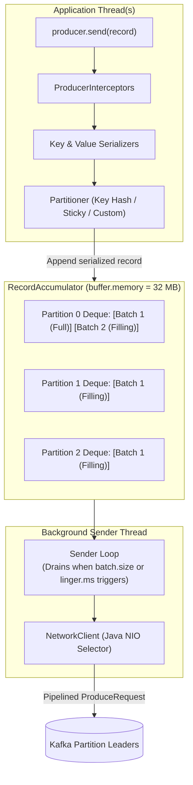
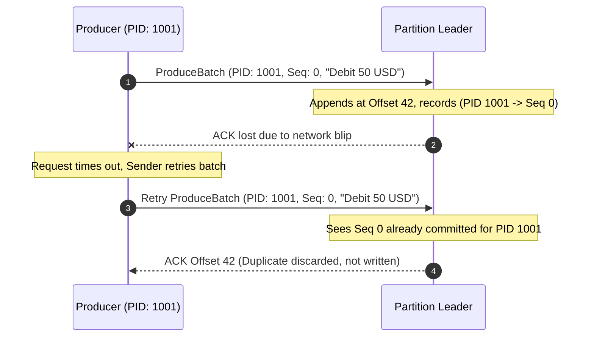

Calling `kafkaTemplate.send("orders", order)` looks like a one-line RPC, which is why producer bugs often go unnoticed until traffic spikes or a broker restarts.

In reality, `send()` does not write directly to a TCP socket. It serializes your record, chooses a partition, and drops the bytes into an in-memory batch buffer. A background thread drains those batches, compresses them, pipelines them across the network, retries transient errors, and waits for broker acknowledgments. Every delivery guarantee, throughput number, and ordering constraint comes directly from how you configure that pipeline.

---

## Producer Architecture and `RecordAccumulator`

The Java `KafkaProducer` splits work cleanly between your calling application thread and a single dedicated background **`Sender`** I/O thread.



### Step-by-Step Execution

1. **Application Thread (Fast Path)**:
   - Your code calls `send(record)` (or `send(record, callback)`).
   - The record passes through any configured `ProducerInterceptor` hooks, then key and value `Serializer` implementations convert objects into byte arrays.
   - The `Partitioner` selects the destination partition (unless you specified an explicit partition number on the `ProducerRecord`).
   - The producer appends the serialized bytes to a `ProducerBatch` inside the **`RecordAccumulator`**, which maintains one `Deque<ProducerBatch>` per topic-partition.
   - `send()` returns a `Future<RecordMetadata>` immediately without waiting for network I/O.
2. **Backpressure via `buffer.memory` and `max.block.ms`**:
   - The `RecordAccumulator` draws memory from a fixed pool (`buffer.memory`, default 32 MB). If brokers fall behind and the buffer fills up, `send()` blocks for up to `max.block.ms` (default 60 seconds) before throwing `TimeoutException`.
3. **Background `Sender` Thread (I/O Path)**:
   - The `Sender` thread groups ready batches by their destination broker node (partition leader) and sends them in pipelined `ProduceRequest` frames over Java NIO.
   - A batch becomes ready as soon as it reaches **`batch.size`** (default 16 KB), or once **`linger.ms`** has elapsed since the batch was created.
   - When the broker responds, the `Sender` thread completes the future and invokes your callback.

### Tuning Batching and Timeouts

By default, `linger.ms=0`, so the `Sender` thread transmits batches as soon as the network connection is free. Under moderate to heavy load, raising `linger.ms` slightly (for example, `5` to `20` ms) and increasing `batch.size` (for example, `65536` bytes / 64 KB) lets concurrent application threads pack many records into a single compressed batch. You trade a few milliseconds of producer-side latency for substantially higher throughput, better compression ratios, and lower broker CPU overhead.

Also pay close attention to `delivery.timeout.ms` (default 120,000 ms / 2 minutes). It caps the total wall-clock time from when `send()` returns until the record is acknowledged or fails permanently, including lingering, network transit, and all retries. Kafka enforces the invariant:

```text
delivery.timeout.ms >= linger.ms + request.timeout.ms
```

If a broker stays unreachable longer than `delivery.timeout.ms`, the producer stops retrying and fails the future with a `TimeoutException`.

---

## Delivery Guarantees: At-Most-Once, At-Least-Once, and Exactly-Once

Distributed messaging systems trade off latency, availability, and duplicate risk along three delivery levels:

| Guarantee | Core Producer Settings | What Can Happen on Failure | Typical Use Case |
| :--- | :--- | :--- | :--- |
| **At-Most-Once** | `acks=0` | Messages can be lost if the broker crashes or packets drop; never retried, so no retry duplicates | Non-critical metrics, clickstream telemetry |
| **At-Least-Once** | `acks=all` (or `acks=1`), retries enabled | Messages are not lost once acknowledged by ISR, but retries can produce duplicates if idempotence is off, and consumers can see duplicates on restart | Standard business events paired with idempotent consumers |
| **Exactly-Once (EOS)** | `enable.idempotence=true` + `transactional.id` + consumer `read_committed` | Atomic read-process-write inside Kafka with no retry duplicates and no partial multi-topic writes | Kafka-to-Kafka financial pipelines and Kafka Streams |

### At-Most-Once (`acks=0`)
The producer considers a record sent the moment bytes hit the local socket buffer. It never waits for a broker response, so retries never trigger. Latency is minimal, and you cannot even read a real offset from `RecordMetadata`, because the broker never replied.

### At-Least-Once
The producer waits for broker acknowledgment (`acks=1` for leader only, or `acks=all` for the full ISR) and retries transient failures (`NetworkException`, `NotLeaderOrFollowerException`, `NotEnoughReplicasException`). With `acks=1`, if the leader writes the record locally, acknowledges it, and then crashes before followers replicate it, the record is still lost. That is why durability-sensitive systems use `acks=all`.

### Exactly-Once Semantics (EOS) Context
Within Kafka, EOS combines two mechanisms:
- **Idempotent Producer**: Eliminates duplicates caused by producer retries on a single partition during a producer session.
- **Kafka Transactions**: Writes to multiple topics/partitions and commits consumer offsets (`sendOffsetsToTransaction`) atomically so downstream consumers configured with `isolation.level=read_committed` see either all records in the transaction or none.

Keep the boundary clear: Kafka transactions coordinate Kafka partitions and Kafka consumer offsets. They do **not** make a PostgreSQL write and a Kafka publish atomic; for that boundary, use the Transactional Outbox and Inbox patterns.

---

## `acks=all` and `enable.idempotence=true`

Since **Kafka 3.0** (KIP-679), safe defaults are enabled out of the box:
- `enable.idempotence=true`
- `acks=all`
- `retries=Integer.MAX_VALUE` (bounded by `delivery.timeout.ms`)
- `max.in.flight.requests.per.connection=5`

Even though Kafka 3+ sets these by default, production teams still declare them explicitly in configuration so an accidental override fails fast at startup. For example, if someone sets `acks=1` while `enable.idempotence=true`, `KafkaProducer` throws a `ConfigException` immediately rather than silently weakening durability.

### How Producer Idempotence Works

Without idempotence, a dropped TCP acknowledgment packet causes the producer to retry a batch the broker already wrote, appending a duplicate record to the log.



1. On startup, the producer sends an `InitProducerId` request and receives a unique 64-bit **Producer ID (PID)** from the cluster.
2. For each partition, the producer attaches a monotonically increasing **sequence number** (`0, 1, 2, ...`) to every batch.
3. The partition leader tracks the last 5 sequence numbers per PID in memory and checkpoints producer state to `.snapshot` files on disk.
4. If the leader receives a sequence number it has already committed, it discards the duplicate write and returns the original offset ACK. If a later batch arrives out of order (for example, Seq 2 arrives while Seq 1 is being retried), the broker rejects it with `OutOfOrderSequenceException` until Seq 1 lands, preserving strict per-partition ordering even with `max.in.flight.requests.per.connection=5`.

> [!NOTE]
> **Scope of Producer Idempotence**
> Idempotence deduplicates network retries within a single producer session (one PID). If your JVM crashes, restarts with a fresh PID, and your application code re-reads an event and calls `send()` again, Kafka sees a brand-new PID and appends a second record. Consumer-side idempotency is still required for end-to-end deduplication.

### Pairing `acks=all` with `min.insync.replicas`

`acks=all` on the producer is only half of the durability equation. It tells the leader to wait for every replica currently in the **In-Sync Replicas (ISR)** set.

If a topic has `replication.factor=3` but leaves `min.insync.replicas` at its default of `1`, and both followers fail, the ISR shrinks to just the leader. With `min.insync.replicas=1`, the leader happily accepts `acks=all` writes alone. If that leader then loses its disk before followers recover, those acknowledged records are gone.

In production, pair producer and topic settings together:
- **Topic / Broker**: `replication.factor=3` and `min.insync.replicas=2`
- **Producer**: `acks=all` and `enable.idempotence=true`

With `min.insync.replicas=2`, the cluster keeps accepting writes through a single broker outage. If 2 brokers go down simultaneously, the leader rejects writes with `NotEnoughReplicasException` rather than risking data loss.

---

## Partitioning, Custom Partitioners, and Batch Compression

### Built-in Partitioning Behavior

When a `ProducerRecord` has a **non-null key**, the default partitioner computes:

```text
partition = Utils.toPositive(Utils.murmur2(keyBytes)) % numPartitions
```

Every record with the same key lands on the same partition, preserving entity-level order. Be cautious when increasing partition counts on an active topic: changing `numPartitions` changes the modulo result for existing keys, temporarily breaking ordering for in-flight entities.

When a record has a **null key**, older Kafka versions used round-robin partitioning, which scattered single records across every partition and produced tiny, poorly compressed batches. Modern Kafka (since KIP-480 and refined in Kafka 3.3+ via KIP-794's built-in sticky partitioner) sticks to one partition until its batch fills or `linger.ms` expires, then switches to another partition. This fills batches faster and improves compression without sacrificing long-term balance.

### Writing a Custom `Partitioner`

Sometimes default key hashing causes **hot partitions**. For example, if one enterprise tenant generates 40% of your platform's order volume and you hash by `tenantId`, that single tenant's partition falls behind while other partitions sit underutilized. Or you may want priority tenants isolated on dedicated partitions so noisy neighbors cannot delay them.

You can implement Kafka's `org.apache.kafka.clients.producer.Partitioner` interface:

```java
package com.javahub.kafka.producer;

import org.apache.kafka.clients.producer.Partitioner;
import org.apache.kafka.common.Cluster;
import org.apache.kafka.common.PartitionInfo;
import org.apache.kafka.common.utils.Utils;

import java.util.List;
import java.util.Map;
import java.util.Set;
import java.util.concurrent.ThreadLocalRandom;

public class TenantAwarePartitioner implements Partitioner {

    private Set<String> dedicatedTenants = Set.of();

    @Override
    public void configure(Map<String, ?> configs) {
        Object configured = configs.get("app.partitioner.dedicated.tenants");
        if (configured instanceof String csv && !csv.isBlank()) {
            this.dedicatedTenants = Set.of(csv.split(","));
        }
    }

    @Override
    public int partition(
            String topic,
            Object key,
            byte[] keyBytes,
            Object value,
            byte[] valueBytes,
            Cluster cluster) {
        List<PartitionInfo> partitions = cluster.partitionsForTopic(topic);
        int totalPartitions = partitions.size();

        if (totalPartitions == 1) {
            return 0;
        }
        if (keyBytes == null || !(key instanceof String keyStr)) {
            return ThreadLocalRandom.current().nextInt(totalPartitions);
        }

        // Reserve the last partition for dedicated VIP tenant traffic; hash all others across [0..N-2]
        if (dedicatedTenants.contains(keyStr)) {
            return totalPartitions - 1;
        }
        return Utils.toPositive(Utils.murmur2(keyBytes)) % (totalPartitions - 1);
    }

    @Override
    public void close() {
        // No resources to release
    }
}
```

Register it in producer properties via `partitioner.class: com.javahub.kafka.producer.TenantAwarePartitioner`. Note that Kafka 3.3+ defaults `partitioner.class` to `null` (activating the internal broker-load-aware sticky partitioner); setting `partitioner.class` overrides it cleanly.

### Batch Compression (`lz4`, `zstd`, `snappy`, `gzip`)

Kafka compresses entire **`ProducerBatch`** blocks rather than individual messages. Larger batches (via `batch.size` and `linger.ms`) give the compressor repeated JSON keys, UUID prefixes, and schema structures to collapse, shrinking network traffic, replication traffic, and broker disk usage all at once.

When the broker's `compression.type` is left at its default (`producer`), the broker stores the compressed batch bytes as-is without decompressing and recompressing them; the consumer decompresses the batch on read.

| Codec | Compression Ratio | CPU Overhead | Latency Impact | When to Pick It |
| :--- | :--- | :--- | :--- | :--- |
| **`none`** | None | Lowest | Lowest | Payloads are already compressed (encrypted blobs, images, protobuf with tiny batches) |
| **`lz4`** | Good | Very low | Very low | Default high-throughput choice when latency and CPU budgets are tight |
| **`zstd`** | Highest (close to or better than gzip) | Moderate | Low to moderate | Best all-around choice for JSON/text logs and cross-AZ network cost savings (Kafka 2.1+) |
| **`snappy`** | Moderate | Low | Low | Solid general-purpose option, often used for legacy compatibility with older Spark/Hadoop pipelines |
| **`gzip`** | High | Highest | Higher | Rarely preferred over `zstd` today because `zstd` achieves similar ratios with far less CPU |

---

## Spring Boot 3 Producer Implementation

### Configuration (`application.yml`)

```yaml
spring:
  kafka:
    bootstrap-servers: kafka-1:9092,kafka-2:9092,kafka-3:9092
    producer:
      key-serializer: org.apache.kafka.common.serialization.StringSerializer
      value-serializer: org.springframework.kafka.support.serializer.JsonSerializer
      acks: all
      properties:
        enable.idempotence: true
        max.in.flight.requests.per.connection: 5
        linger.ms: 10
        batch.size: 65536
        compression.type: zstd
        delivery.timeout.ms: 120000
        request.timeout.ms: 30000
        buffer.memory: 67108864 # 64 MB
        max.block.ms: 10000
```

### Asynchronous Publisher with Tracing Headers

```java
package com.javahub.kafka.producer;

import org.apache.kafka.clients.producer.ProducerRecord;
import org.apache.kafka.clients.producer.RecordMetadata;
import org.apache.kafka.common.header.internals.RecordHeader;
import org.slf4j.Logger;
import org.slf4j.LoggerFactory;
import org.slf4j.MDC;
import org.springframework.kafka.core.KafkaTemplate;
import org.springframework.kafka.support.SendResult;
import org.springframework.stereotype.Service;

import java.math.BigDecimal;
import java.nio.charset.StandardCharsets;
import java.time.Instant;
import java.util.UUID;
import java.util.concurrent.CompletableFuture;

@Service
public class OrderEventProducer {

    private static final Logger log = LoggerFactory.getLogger(OrderEventProducer.class);
    private static final String ORDERS_TOPIC = "fintech.orders.v1";

    private final KafkaTemplate<String, OrderEvent> kafkaTemplate;

    public OrderEventProducer(KafkaTemplate<String, OrderEvent> kafkaTemplate) {
        this.kafkaTemplate = kafkaTemplate;
    }

    public CompletableFuture<RecordMetadata> publishOrderCreated(OrderEvent event) {
        String correlationId = MDC.get("correlationId");
        if (correlationId == null) {
            correlationId = UUID.randomUUID().toString();
        }

        ProducerRecord<String, OrderEvent> record = new ProducerRecord<>(
                ORDERS_TOPIC,
                event.orderId(),
                event
        );
        record.headers().add(new RecordHeader("x-event-id", event.eventId().getBytes(StandardCharsets.UTF_8)));
        record.headers().add(new RecordHeader("x-correlation-id", correlationId.getBytes(StandardCharsets.UTF_8)));
        record.headers().add(new RecordHeader("x-produced-at", Instant.now().toString().getBytes(StandardCharsets.UTF_8)));

        CompletableFuture<SendResult<String, OrderEvent>> future = kafkaTemplate.send(record);

        return future.handle((result, ex) -> {
            if (ex != null) {
                log.error("Failed to publish OrderEvent eventId={} orderId={}",
                        event.eventId(), event.orderId(), ex);
                throw new IllegalStateException("Kafka publish failed for order " + event.orderId(), ex);
            }
            RecordMetadata meta = result.getRecordMetadata();
            log.info("Published OrderEvent orderId={} partition={} offset={}",
                    event.orderId(), meta.partition(), meta.offset());
            return meta;
        });
    }

    public record OrderEvent(
            String eventId,
            String orderId,
            String accountId,
            BigDecimal amount,
            String currency,
            String status) {}
}
```

### Atomic Multi-Topic Publishing with Kafka Transactions

When a service must write to two Kafka topics together (such as `fintech.orders.v1` and `fintech.audit.v1`) so consumers see either both records or neither, enable `spring.kafka.producer.transaction-id-prefix` and wrap the sends in `executeInTransaction`:

```java
package com.javahub.kafka.producer;

import org.springframework.kafka.core.KafkaTemplate;
import org.springframework.stereotype.Service;

@Service
public class TransactionalOrderPublisher {

    private final KafkaTemplate<String, Object> kafkaTemplate;

    public TransactionalOrderPublisher(KafkaTemplate<String, Object> kafkaTemplate) {
        this.kafkaTemplate = kafkaTemplate;
    }

    public void publishOrderAndAudit(OrderEventProducer.OrderEvent order, AuditRecord audit) {
        kafkaTemplate.executeInTransaction(ops -> {
            ops.send("fintech.orders.v1", order.orderId(), order);
            ops.send("fintech.audit.v1", order.orderId(), audit);
            return null;
        });
    }

    public record AuditRecord(String eventId, String orderId, String actor, String action) {}
}
```

Under the hood, the producer registers its `transactional.id` with a Transaction Coordinator broker, writes records with a transaction marker, and appends a final `COMMIT` (or `ABORT`) control record to every involved partition. Downstream consumers must set `isolation.level=read_committed` to hide uncommitted and aborted records.

---

## Interview Questions

### What actually happens when you call `producer.send()`, and why can it still block?

`send()` runs on the calling application thread: it executes interceptors, serializes the key and value, picks a partition, and appends the bytes into a `ProducerBatch` in the `RecordAccumulator`. It does not perform network I/O itself; a background `Sender` thread drains batches to brokers. However, `send()` can still block in two cases: if topic metadata is not yet fetched, or if the `RecordAccumulator` buffer (`buffer.memory`) is full because brokers are slower than your application. In either case, it blocks up to `max.block.ms` before throwing `TimeoutException`.

### Why is `acks=all` alone not enough to prevent data loss?

`acks=all` only instructs the partition leader to wait for all brokers currently in the In-Sync Replicas (ISR) set. If the topic leaves `min.insync.replicas=1`, a failure of two followers shrinks the ISR down to just the leader. The leader still satisfies `acks=all` with a single local write, and if that leader then fails before recovering followers, the acknowledged data is lost. Production topics need `replication.factor=3` and `min.insync.replicas=2` alongside `acks=all`.

### How does `enable.idempotence=true` preserve ordering while allowing up to 5 in-flight requests per connection?

Before idempotence existed, setting `max.in.flight.requests.per.connection > 1` with retries enabled could reorder batches: if Batch 1 failed and Batch 2 succeeded, retrying Batch 1 appended it after Batch 2. With idempotence enabled, every batch carries a Producer ID (PID) and a monotonic per-partition sequence number. The partition leader tracks a sliding window of up to 5 sequence numbers per PID and enforces sequential acceptance, rejecting out-of-order batches with `OutOfOrderSequenceException` until the earlier sequence number succeeds.

### Why does increasing `linger.ms` improve compression effectiveness?

Kafka compresses data at the `ProducerBatch` level, not per individual message. When `linger.ms=0`, batches often contain only one or two records, giving `lz4`, `snappy`, or `zstd` very little repeated structure to compress. Adding a small linger window (such as 5 to 20 ms) allows the `RecordAccumulator` to pack dozens or hundreds of records into one batch, yielding far better compression ratios while reducing broker request rates.
