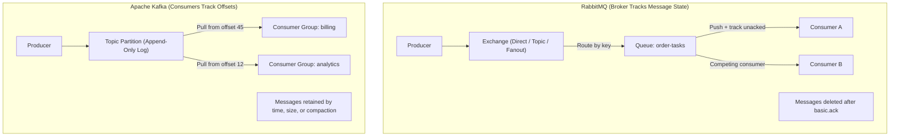
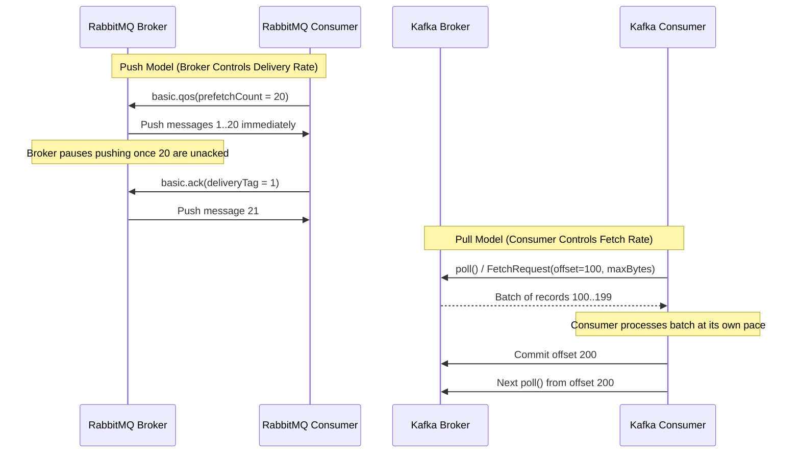

When services stop talking over synchronous HTTP and start communicating asynchronously, the first infrastructure decision is almost always the same: do we put RabbitMQ or Apache Kafka between them?

Teams often treat both tools as interchangeable pipes that move JSON from Service A to Service B. In practice, they are built on completely different storage models and delivery contracts. A traditional message broker behaves like a smart post office that routes individual letters, tracks who acknowledged each one, and discards letters as soon as they are delivered. An event streaming platform behaves like an append-only ledger on disk that keeps every record for a retention window and lets any number of readers walk through it at their own speed.

Picking the wrong one creates friction that shows up months later. Using a broker when you need event replay forces you to build custom audit tables and backfill scripts. Using Kafka when you need complex per-message routing, priority queues, or competing workers processing slow individual jobs forces you to work around partition ownership rules.

---

## RabbitMQ (AMQP) vs Apache Kafka (Commit Log)

The clearest way to contrast RabbitMQ and Apache Kafka is to look at where state lives.

In RabbitMQ (implementing AMQP 0-9-1), the broker holds the routing intelligence and the delivery state. Producers never send messages straight to a queue. They publish to an **Exchange**, which evaluates bindings and routing keys to copy the message into one or more **Queues**. The broker tracks which consumer received which message, waits for an acknowledgment (`basic.ack`), and removes the message once acknowledged.

In Apache Kafka, the broker stays deliberately simple. Producers append records to a **Topic**, which is split into ordered, append-only **Partitions** stored on disk. Reading a record does not delete it. Instead, each consumer group tracks its own position (an **offset**) per partition. Multiple independent services can read the same stream from different positions without slowing each other down or copying the underlying data.



### Side-by-Side Comparison

| Dimension | Traditional Message Brokers (RabbitMQ, ActiveMQ) | Event Streaming Platforms (Apache Kafka, Redpanda) |
| :--- | :--- | :--- |
| **Core Data Structure** | Queues fronted by routing exchanges (classic or Raft-based quorum queues) | Distributed, partitioned, append-only commit log on disk |
| **Read Semantics** | Destructive read on classic/quorum queues; message is removed after `basic.ack` | Non-destructive read; records stay on disk for the configured retention period |
| **Consumption Model** | Broker pushes messages to consumers (bounded by `basic.qos` prefetch) | Consumers pull batches on demand via `poll()` |
| **Routing Flexibility** | Rich broker-side routing (Direct, Topic wildcards, Fanout, Headers) | Simple topic + partition key routing; filtering happens in consumers or stream processors |
| **Ordering Guarantee** | FIFO within a single queue with a single consumer (breaks with competing consumers or requeues) | Strict FIFO within a single partition; no ordering guarantee across partitions |
| **Replayability** | Not supported on standard AMQP queues (RabbitMQ 3.9+ added opt-in Streams for log replay) | Native replay by resetting a consumer group's offset to an earlier offset or timestamp |
| **Typical Throughput** | Tens of thousands of messages/sec per node, depending on persistence and routing | Hundreds of thousands to millions of messages/sec across partitions using batching and page cache |
| **Best Fit** | Work queues, complex routing, per-message TTL/priorities, RPC workflows | High-volume event streams, multi-consumer fan-out, CDC pipelines, audit logs, stream processing |

> [!NOTE]
> RabbitMQ 3.9 introduced **RabbitMQ Streams**, an append-only log queue type with non-destructive reads and replay. Even with Streams available, most teams reach for RabbitMQ for its AMQP routing and work-queue semantics, and choose Kafka when log retention, partitioning, and the Kafka Connect/Streams ecosystem are the primary requirements.

### RabbitMQ Exchanges and Dead-Lettering

AMQP separates publishing from queuing through four exchange types:

1. **Direct Exchange**: Routes a message to queues whose binding key matches the message routing key exactly (for example, `payment.captured`).
2. **Topic Exchange**: Routes using dot-delimited wildcard patterns. `*` matches one word (`order.*.eu` matches `order.created.eu`), and `#` matches zero or more words (`order.#` matches `order.created` and `order.refund.approved.eu`).
3. **Fanout Exchange**: Ignores routing keys and copies every message to every bound queue.
4. **Headers Exchange**: Routes by matching key-value pairs in the AMQP message headers instead of a routing key string.

When a consumer rejects a message (`basic.nack` or `basic.reject` with `requeue=false`), a message expires via TTL, or a queue hits its max length, RabbitMQ can forward it to a **Dead-Letter Exchange (DLX)**. Always configure `x-max-length` or `x-message-ttl` on dead-letter queues. Without bounds, a downstream outage can fill a DLQ with millions of messages, push RabbitMQ past its memory high watermark (40% of host RAM by default), and block every producer on the broker.

---

## Push vs Pull Consumption Models

The delivery direction between broker and consumer shapes how backpressure, latency, and batching behave under load.



### Broker Push with Prefetch Backpressure (RabbitMQ)

In AMQP, a consumer subscribes with `basic.consume`, and the broker immediately pushes messages down the TCP connection as soon as they enter the queue.

Push delivery keeps idle-queue latency very low because the consumer does not have to poll. The danger is that a fast broker can flood a slow JVM consumer. If you leave prefetch unbounded (`prefetch = 0`), RabbitMQ will push thousands of messages into the consumer's local memory buffer, triggering GC thrashing or `OutOfMemoryError` while starving other consumers on the same queue.

To control backpressure, RabbitMQ uses **`basic.qos` prefetch**:
- Setting `prefetch = 20` tells the broker: "Never have more than 20 unacknowledged messages in flight to this consumer at once."
- Once the consumer holds 20 unacked messages, the broker stops pushing to it and routes new messages to other consumers on the queue that still have capacity.
- Setting `prefetch = 1` gives the fairest load distribution for slow, uneven jobs (like PDF generation or video transcoding), while values like `20` to `100` reduce network round-trip waiting for fast tasks.

### Consumer Pull with Batching (Kafka)

Kafka uses a **pull** model. Brokers never push records to consumers. Instead, each consumer runs a loop calling `poll()`, requesting records starting from its current offset.

Pull delivery gives you two practical advantages at scale:
- **Natural backpressure**: If a downstream database slows down, the consumer takes longer to process its current batch and simply calls `poll()` later. The broker never floods the client's heap; unconsumed records stay safely in the broker's disk log and OS page cache.
- **Efficient batching**: A consumer can wait until enough data is available (`fetch.min.bytes` and `fetch.max.wait.ms`) and cap how many records it pulls per cycle (`max.poll.records`).

The trade-off with Kafka's pull model is liveness tracking. If a consumer pulls a batch and spends longer processing it than `max.poll.interval.ms` (5 minutes by default), the broker assumes the consumer is stuck, evicts it from the consumer group, and triggers a rebalance. You also give up per-message work stealing: because one partition belongs to one consumer in a group, a slow record on Partition 0 blocks later records on Partition 0 even if other consumer instances are idle.

---

## Message Persistence and Ordering Guarantees

Durability and ordering are the two areas where teams most often discover surprises in production.

### Persistence Behavior

In **RabbitMQ**, persistence is opt-in and layered:
- The queue must be declared **durable** so its definition survives a broker restart.
- Individual messages must be published with `delivery_mode = 2` (persistent) so RabbitMQ writes them to disk. (Spring AMQP sets `MessageDeliveryMode.PERSISTENT` by default.)
- For high availability across nodes, use **Quorum Queues** (replicated via Raft) rather than legacy mirrored classic queues, which were removed in RabbitMQ 4.0.
- Even with durable queues and persistent messages, RabbitMQ deletes each message once all target queues have acknowledged it. It is a transient buffer, not a system of record.

In **Kafka**, every message is written to an append-only partition log on disk and replicated across broker nodes (`replication.factor = 3`, `min.insync.replicas = 2`, `acks = all`). Consumers reading a record do not delete it. Retention is governed by topic policy:
- **Time or size retention** (`cleanup.policy=delete`): Segments expire after `retention.ms` (7 days by default) or `retention.bytes`.
- **Key compaction** (`cleanup.policy=compact`): Kafka retains the latest value per key indefinitely, which makes a topic usable as a replayable state changelog.

### Ordering Guarantees

In **RabbitMQ**, FIFO ordering holds only under narrow conditions: a single queue, a single consumer, and no requeued failures. As soon as you attach two competing consumers to speed up processing, Consumer 2 can finish Message 2 before Consumer 1 finishes Message 1. If Consumer 1 crashes and RabbitMQ requeues Message 1, ordering breaks further. (RabbitMQ does offer a `x-single-active-consumer` flag for strict failover ordering, at the cost of limiting concurrency to one active consumer per queue.)

In **Kafka**, ordering is guaranteed **strictly within a single partition**, never across the whole topic. When a producer supplies a partition key (such as `orderId` or `customerId`), Kafka hashes the key (`murmur2(key) % partitionCount`) so every event for that entity lands on the same partition in sequence. Within a consumer group, only one consumer reads that partition at a time, preserving per-entity order while still scaling horizontally across other partitions.

Keep two caveats in mind with Kafka ordering:
1. Increasing a topic's partition count changes the hash modulo result, so new events for an existing key may route to a different partition while older events are still being processed.
2. Dispatching records from a Kafka consumer into a multi-threaded worker pool breaks partition ordering unless you shard the worker pool by key as well.

---

## Implementing RabbitMQ and Kafka in Spring Boot 3

Seeing both models in Spring Boot makes their mechanical differences concrete.

### RabbitMQ: Exchange Topology, Prefetch, and Manual Acknowledgment

First, configure prefetch and manual acknowledgments in `application.yml`:

```yaml
spring:
  rabbitmq:
    host: rabbitmq.internal
    port: 5672
    publisher-confirm-type: correlated
    publisher-returns: true
    listener:
      simple:
        acknowledge-mode: manual
        prefetch: 20
        concurrency: 4
        max-concurrency: 8
        default-requeue-rejected: false
```

Next, declare a durable `DirectExchange`, a main work queue wired to a bounded dead-letter queue, and the bindings:

```java
package com.javahub.messaging.rabbit;

import org.springframework.amqp.core.Binding;
import org.springframework.amqp.core.BindingBuilder;
import org.springframework.amqp.core.DirectExchange;
import org.springframework.amqp.core.Queue;
import org.springframework.amqp.core.QueueBuilder;
import org.springframework.context.annotation.Bean;
import org.springframework.context.annotation.Configuration;

@Configuration
public class RabbitTopologyConfig {

    public static final String ORDERS_EXCHANGE = "orders.direct";
    public static final String ORDERS_QUEUE = "fulfillment.orders.queue";
    public static final String ORDERS_ROUTING_KEY = "order.fulfill";

    public static final String ORDERS_DLX = "orders.dlx";
    public static final String ORDERS_DLQ = "fulfillment.orders.dlq";

    @Bean
    DirectExchange ordersExchange() {
        return new DirectExchange(ORDERS_EXCHANGE, true, false);
    }

    @Bean
    DirectExchange ordersDeadLetterExchange() {
        return new DirectExchange(ORDERS_DLX, true, false);
    }

    @Bean
    Queue ordersQueue() {
        return QueueBuilder.durable(ORDERS_QUEUE)
                .quorum()
                .deadLetterExchange(ORDERS_DLX)
                .deadLetterRoutingKey(ORDERS_ROUTING_KEY)
                .build();
    }

    @Bean
    Queue ordersDeadLetterQueue() {
        return QueueBuilder.durable(ORDERS_DLQ)
                .maxLength(100_000)
                .ttl(604_800_000) // 7 days in milliseconds
                .build();
    }

    @Bean
    Binding ordersBinding(Queue ordersQueue, DirectExchange ordersExchange) {
        return BindingBuilder.bind(ordersQueue).to(ordersExchange).with(ORDERS_ROUTING_KEY);
    }

    @Bean
    Binding dlqBinding(Queue ordersDeadLetterQueue, DirectExchange ordersDeadLetterExchange) {
        return BindingBuilder.bind(ordersDeadLetterQueue)
                .to(ordersDeadLetterExchange)
                .with(ORDERS_ROUTING_KEY);
    }
}
```

Now look at the RabbitMQ producer and consumer. Because the broker pushes messages up to the `prefetch: 20` limit, the consumer explicitly acknowledges or dead-letters each delivery tag on the AMQP `Channel`:

```java
package com.javahub.messaging.rabbit;

import com.rabbitmq.client.Channel;
import org.springframework.amqp.rabbit.annotation.RabbitListener;
import org.springframework.amqp.rabbit.core.RabbitTemplate;
import org.springframework.amqp.support.AmqpHeaders;
import org.springframework.messaging.handler.annotation.Header;
import org.springframework.stereotype.Service;

import java.io.IOException;

@Service
public class FulfillmentRabbitWorker {

    private final RabbitTemplate rabbitTemplate;
    private final WarehouseClient warehouseClient;

    public FulfillmentRabbitWorker(RabbitTemplate rabbitTemplate, WarehouseClient warehouseClient) {
        this.rabbitTemplate = rabbitTemplate;
        this.warehouseClient = warehouseClient;
    }

    public void enqueueFulfillment(FulfillmentTask task) {
        // Published to the exchange; RabbitMQ routes to bound queues
        rabbitTemplate.convertAndSend(
                RabbitTopologyConfig.ORDERS_EXCHANGE,
                RabbitTopologyConfig.ORDERS_ROUTING_KEY,
                task
        );
    }

    @RabbitListener(queues = RabbitTopologyConfig.ORDERS_QUEUE)
    public void handleFulfillment(
            FulfillmentTask task,
            Channel channel,
            @Header(AmqpHeaders.DELIVERY_TAG) long deliveryTag) throws IOException {
        try {
            warehouseClient.reserveStock(task.orderId(), task.sku(), task.quantity());
            // Removes the message from the queue and opens capacity in the prefetch window
            channel.basicAck(deliveryTag, false);
        } catch (TransientWarehouseException ex) {
            // Requeue for another worker to retry (or route to a delayed retry queue in production)
            channel.basicNack(deliveryTag, false, true);
        } catch (InvalidOrderException ex) {
            // Permanent failure: requeue=false routes the message to the Dead-Letter Exchange
            channel.basicNack(deliveryTag, false, false);
        }
    }

    public record FulfillmentTask(String orderId, String sku, int quantity) {}
}
```

### Apache Kafka: Partition Keys, Pull Batching, and Manual Offset Commits

Compare that to Spring Kafka. Here, `application.yml` tunes consumer pull batching (`fetch-min-size`, `max.poll.records`) and disables auto-commit:

```yaml
spring:
  kafka:
    bootstrap-servers: kafka-1:9092,kafka-2:9092,kafka-3:9092
    producer:
      key-serializer: org.apache.kafka.common.serialization.StringSerializer
      value-serializer: org.springframework.kafka.support.serializer.JsonSerializer
      acks: all
    consumer:
      group-id: billing-ledger-service
      enable-auto-commit: false
      auto-offset-reset: earliest
      fetch-min-size: 10240
      fetch-max-wait: 200ms
      key-deserializer: org.apache.kafka.common.serialization.StringDeserializer
      value-deserializer: org.springframework.kafka.support.serializer.JsonDeserializer
      properties:
        max.poll.records: 100
        spring.json.trusted.packages: "com.javahub.messaging.kafka"
    listener:
      ack-mode: manual_immediate
      concurrency: 3
```

The producer sets `orderId` as the partition key to guarantee per-order FIFO ordering, and the consumer pulls records and advances its group's offset without deleting the event from Kafka:

```java
package com.javahub.messaging.kafka;

import org.apache.kafka.clients.consumer.ConsumerRecord;
import org.springframework.kafka.annotation.KafkaListener;
import org.springframework.kafka.core.KafkaTemplate;
import org.springframework.kafka.support.Acknowledgment;
import org.springframework.stereotype.Service;

import java.math.BigDecimal;
import java.time.Instant;
import java.util.concurrent.CompletableFuture;

@Service
public class OrderEventStreamService {

    private static final String ORDERS_TOPIC = "orders.events.v1";

    private final KafkaTemplate<String, OrderPlacedEvent> kafkaTemplate;
    private final LedgerRepository ledgerRepository;

    public OrderEventStreamService(
            KafkaTemplate<String, OrderPlacedEvent> kafkaTemplate,
            LedgerRepository ledgerRepository) {
        this.kafkaTemplate = kafkaTemplate;
        this.ledgerRepository = ledgerRepository;
    }

    public CompletableFuture<?> publishOrderPlaced(OrderPlacedEvent event) {
        // Key = orderId ensures all events for this order land on the same partition
        return kafkaTemplate.send(ORDERS_TOPIC, event.orderId(), event);
    }

    @KafkaListener(topics = ORDERS_TOPIC, groupId = "billing-ledger-service")
    public void onOrderPlaced(ConsumerRecord<String, OrderPlacedEvent> record, Acknowledgment ack) {
        OrderPlacedEvent event = record.value();
        // Record remains in Kafka for analytics, fraud, and future replay
        ledgerRepository.recordChargeIfAbsent(event.eventId(), event.orderId(), event.amount());
        // Advances offset for billing-ledger-service only
        ack.acknowledge();
    }

    public record OrderPlacedEvent(
            String eventId,
            String orderId,
            String customerId,
            BigDecimal amount,
            Instant occurredAt) {}
}
```

Notice the structural difference: in the RabbitMQ consumer, `basicAck` tells the broker to delete the task. In the Kafka consumer, `ack.acknowledge()` only advances the offset bookmark for `billing-ledger-service`; another service such as `fraud-scoring-service` can join tomorrow, start at offset `0`, and replay the past 7 days of `OrderPlacedEvent` records.

---

## Choosing Between Brokers and Streaming Platforms

Neither system is universally superior. Many mature companies run both, using each where its mechanics fit naturally.

### Choose a Message Broker (RabbitMQ) When:
- **You need competing task queues**: Multiple workers should pull independent jobs (sending emails, generating invoices, resizing images) where per-item retries and individual message acknowledgments matter more than strict ordering.
- **Routing rules are complex**: Messages must fan out dynamically based on wildcard routing keys or headers without every consumer downloading and filtering the entire stream.
- **You need per-message features**: Per-message TTL, priority queues (`x-max-priority`), delayed delivery, or transient request-reply RPC patterns are built directly into AMQP brokers.
- **Operational footprint matters**: For moderate throughput (hundreds to low tens of thousands of messages per second) without replay or stream-processing needs, RabbitMQ is simpler to operate and reason about.

### Choose an Event Streaming Platform (Apache Kafka) When:
- **Multiple independent consumers need the same data**: Orders, payments, or clickstreams feed billing, search indexing, analytics, and ML pipelines independently without publishers knowing who is listening.
- **Replay and auditability are required**: New services need to backfill historical state, or you need to reprocess the last 48 hours after fixing a consumer bug.
- **Per-entity ordering at scale matters**: You need strict ordering for every `accountId` or `orderId` while still scaling horizontally across dozens of consumers.
- **You are building CDC or stream-processing pipelines**: Tools like Debezium, Kafka Connect, Kafka Streams, and Apache Flink integrate natively with Kafka's partitioned log model.

### Common Mistakes When Choosing

- **Using Kafka as a per-item priority work queue**: Kafka cannot acknowledge message 105 while leaving message 102 unacknowledged on the same partition. If individual jobs take unpredictable amounts of time and must be retried independently without blocking later items, a queue-based broker (or a workflow engine like Temporal) is a much cleaner fit.
- **Using RabbitMQ as a long-term event store**: Letting millions of messages accumulate in standard RabbitMQ queues increases RAM pressure and hurts broker stability. Keep RabbitMQ queues short; if you need multi-day retention and replay, use Kafka (or RabbitMQ Streams if you are already standardized on RabbitMQ).

---

## Interview Questions

### How does backpressure differ between RabbitMQ's push model and Kafka's pull model?

In RabbitMQ, the broker actively pushes messages to consumers. Backpressure is enforced via `basic.qos` prefetch, which caps the number of unacknowledged messages a consumer can hold at once. If prefetch is left unbounded, a fast producer can exhaust consumer memory. In Kafka, consumers pull batches via `poll()` only when they are ready for more work, so slow consumers naturally exert backpressure without buffering unbounded data in memory. The trade-off in Kafka is that the consumer must still finish processing and call `poll()` within `max.poll.interval.ms` to stay in its consumer group.

### Why can't you simply scale competing consumers on a single Kafka partition the way you do on a RabbitMQ queue?

A RabbitMQ queue tracks individual message delivery tags, so ten workers can pull and acknowledge messages from the same queue concurrently. A Kafka partition is an ordered log tracked by a single committed offset per consumer group. Allowing two consumers in the same group to read the same partition simultaneously would break per-partition ordering and make offset commits ambiguous. In Kafka, consumer parallelism is bounded by the topic's partition count.

### Under what conditions does message ordering break in RabbitMQ vs Apache Kafka?

In RabbitMQ, FIFO ordering holds only for a single queue with a single consumer and no requeued failures. Adding competing consumers or requeuing failed messages breaks strict order. In Kafka, strict FIFO ordering is guaranteed within a single partition, so events sharing a partition key arrive in order. Ordering in Kafka breaks if events for the same entity have no key (or different keys), if you increase the partition count on an active topic (changing the key hash mapping), if a producer disables idempotence while allowing multiple in-flight retried batches, or if a consumer hands records off to an unsharded thread pool.

### If a service must notify five downstream systems whenever an order is placed, and new consumers will be added next quarter that need historical data, would you pick RabbitMQ or Kafka?

Kafka is the better fit. With RabbitMQ, you would need to bind a new queue to a fanout or topic exchange for every new consumer, and any consumer added next quarter would only see events published after its queue was created. With Kafka, the order service publishes once to an `orders` topic, each downstream service joins with its own consumer group ID, and a new service added later can start from offset `0` (or from a compacted topic) to catch up on historical events without any changes to the producer.
