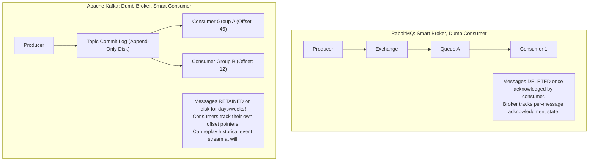
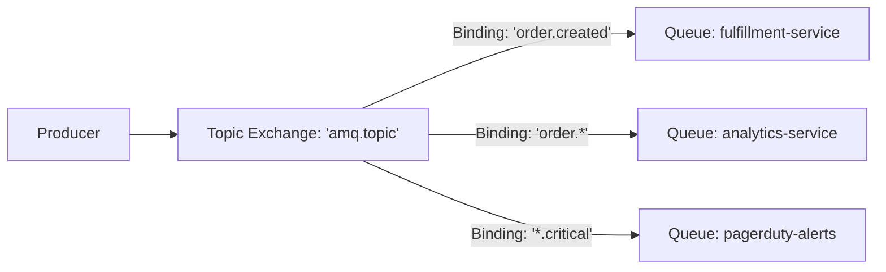
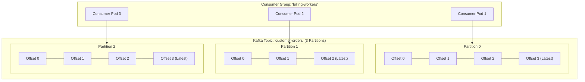
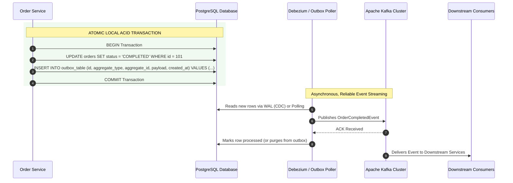
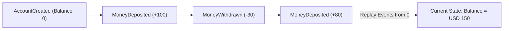

If synchronous REST calls are like telephone conversations—where both parties must be available and listening simultaneously—Event-Driven Architecture (EDA) is like a high-speed logistical postal network. A service publishes an immutable fact about what just occurred (*"Order 402 has been placed"*), and any number of interested downstream systems consume that fact and react at their own pace.

By replacing synchronous request-response chains with asynchronous event streams, you gain massive advantages: spatial and temporal decoupling, traffic spike buffering, extreme throughput, and independent failure isolation.

However, event-driven architectures introduce complex distributed systems challenges: out-of-order delivery, duplicate messages, consumer group rebalance storms, and the notorious **Dual-Write Problem**.

In this guide, we will compare traditional message brokers against distributed commit logs, master RabbitMQ exchanges and Kafka partition mechanics, and implement the gold standard for reliable messaging: **The Transactional Outbox Pattern**.

---

## Message Brokers vs Event Streaming: RabbitMQ vs Apache Kafka

A common architectural mistake is treating all messaging systems identically. While both RabbitMQ and Apache Kafka pass messages between services, their core storage engines and mental models are fundamentally different:



### Architectural Comparison
| Dimension | Traditional Message Brokers (RabbitMQ, ActiveMQ) | Distributed Event Streaming (Apache Kafka, Redpanda) |
|---|---|---|
| **Underlying Architecture** | In-memory queues with optional disk paging | Distributed, partitioned, append-only **Commit Log** on disk |
| **Message Consumption** | **Destructive Read**: Messages are purged from the queue as soon as the consumer acknowledges receipt (`basicAck`). | **Non-Destructive Read**: Messages persist on disk until a retention window expires (e.g., 7 days). Multiple independent consumers can read the same stream. |
| **Ordering Guarantees** | FIFO guaranteed within a single queue without competing consumers. | **Strict FIFO ordering guaranteed strictly within a single Partition**. |
| **Throughput Capacity** | 10,000 to 50,000 messages/sec per node (bound by CPU and in-memory routing). | **1,000,000+ messages/sec** (utilizes OS page cache and zero-copy `sendfile` kernel transfers). |
| **Message Replay** | Not natively supported. Once consumed, data is gone. | **Native Replay**: Move the consumer group offset back to offset 0 and re-process the entire history of the topic. |
| **Best Used For** | Complex routing, task queues, RPC workflows, transient pub/sub. | High-throughput telemetry, financial ledgers, event sourcing, distributed change data capture (CDC). |

---

## RabbitMQ (AMQP) Core Concepts

Advanced Message Queuing Protocol (AMQP 0-9-1) uses a flexible, decoupled model where producers **never publish directly to a queue**. Instead, producers publish to an **Exchange**, which routes messages to one or more bound **Queues** using routing keys.



### The Four Exchange Types
1. **Direct Exchange**: Routes messages based on an exact match between the message routing key and the queue binding key (e.g., routing key `payment.success` routes only to queues bound to `payment.success`).
2. **Topic Exchange**: Performs wildcard routing:
   - `*` (asterisk) matches **exactly one** word (e.g., `order.*.europe` matches `order.created.europe` but not `order.created.germany.europe`).
   - `#` (hash) matches **zero or more** words (e.g., `order.#` matches `order.created`, `order.cancelled.refund.processed`).
3. **Fanout Exchange**: Ignores routing keys entirely; broadcasts every message to **all queues** bound to it (ideal for notification broadcasts).
4. **Headers Exchange**: Routes based on attributes in the AMQP message headers map rather than routing key strings.

### Dead-Letter Exchanges (DLX) and Retries
When a consumer rejects a message (`basicNack` or `basicReject` with `requeue = false`) or a message's Time-To-Live (TTL) expires, RabbitMQ routes it to a configured **Dead-Letter Exchange (DLX)**. This prevents poisoned or malformed messages from blocking the main queue while ensuring failed events are retained for engineering triage.

---

## Apache Kafka Architecture: Partitions, Offsets, and Consumer Groups

Kafka does not have queues. A Kafka topic is divided into one or more **Partitions**.



### Partitions as the Unit of Scalability
- Partitions allow a topic to be distributed across multiple physical broker disks and servers.
- **Strict Ordering Guarantee**: Kafka guarantees message ordering **only within a single partition**, never across different partitions!
- **Partition Keys**: When a producer publishes an event, it includes a key (e.g., `customerId` or `orderId`). Kafka hashes the key (`murmur2(key) % num_partitions`) to determine the target partition. All events sharing the exact same key always land on the **same partition**, ensuring sequential, ordered processing for that specific entity.

### Consumer Groups and Horizontal Scaling
A **Consumer Group** represents a single logical application service (e.g., `billing-service`).
- Each partition in a topic is assigned to **exactly one consumer instance** within that group.
- If you have a topic with **4 partitions** and a consumer group with **2 pods**, each pod processes 2 partitions.
- If you scale that consumer group out to **4 pods**, each pod processes 1 partition.
- If you scale that consumer group to **6 pods**, 2 pods will sit **completely idle**, because a single partition cannot be split across multiple consumers in the same group!

> [!TIP]
> **Partition Rule of Thumb**  
> Set your topic partition count based on your maximum anticipated consumer parallelism (e.g., 16, 32, or 64 partitions). You can easily scale consumer pods up to the partition count to increase processing throughput.

---

## The Dual-Write Problem

Consider this common service method:

```java
// ANTI-PATTERN: THE DUAL-WRITE DISASTER
@Transactional
public void completeOrder(UUID orderId) {
    // 1. Update relational database
    Order order = orderRepository.findById(orderId).orElseThrow();
    order.setStatus(OrderStatus.COMPLETED);
    orderRepository.save(order);

    // 2. Publish to Kafka
    kafkaTemplate.send("orders-topic", order.getId().toString(), new OrderCompletedEvent(order));
}
```

### Why This Code Is a Production Landmine
What happens if the database transaction commits successfully, but the network to the Kafka broker times out or crashes during `kafkaTemplate.send()`?
- The database record says the order is completed.
- The downstream billing and shipping microservices never receive the event. The customer is never charged, and the item never ships.

What happens if you reverse the order (publish to Kafka first, then commit to database)?
- The Kafka event is sent to the cluster.
- The subsequent database commit fails due to a unique constraint violation or deadlocked database connection.
- The downstream services receive a phantom event and charge the customer for an order that never existed in the database!

You cannot coordinate a standard relational database and a Kafka cluster in a single atomic ACID transaction without horribly slow Two-Phase Commit protocols.

---

## The Solution: The Transactional Outbox Pattern

The **Transactional Outbox Pattern** guarantees **At-Least-Once event delivery** without distributed transactions:



### How the Outbox Pattern Works
1. In the same local database transaction where you update your domain entity (`orders`), you insert an event record into an `outbox` table. Because both writes happen in the same local database transaction, it is **100% atomic**: either both writes succeed or both roll back.
2. A separate background process (such as a polling scheduler or **Debezium Change Data Capture** reading the PostgreSQL Write-Ahead Log) reads unprocessed rows from `outbox`.
3. The outbox processor publishes the event to Kafka and only acknowledges/deletes the outbox record once Kafka confirms receipt.

### Production Outbox Table Schema
```sql
CREATE TABLE outbox_events (
    id UUID PRIMARY KEY,
    aggregate_type VARCHAR(100) NOT NULL,
    aggregate_id VARCHAR(100) NOT NULL,
    event_type VARCHAR(100) NOT NULL,
    payload JSONB NOT NULL,
    created_at TIMESTAMP WITH TIME ZONE NOT NULL,
    processed BOOLEAN DEFAULT FALSE
);

CREATE INDEX idx_outbox_unprocessed ON outbox_events(created_at) WHERE processed = FALSE;
```

---

## Event Sourcing: State as a Sequence of Facts

In traditional relational design, databases only store the **current snapshot** of state. When an account balance changes from USD 100 to USD 150, the database executes `UPDATE accounts SET balance = 150 WHERE id = 1`. The history of how that balance was reached is lost forever.

In **Event Sourcing**, an entity's state is stored as an immutable, append-only append log of domain events:



### Benefits of Event Sourcing
1. **Perfect Audit Trail**: Unalterable historical record of every business event (essential for banking, healthcare, and compliance).
2. **Temporal Querying**: Reconstruct the exact state of any entity at any point in history (*"What was this user's balance on March 14 at 2:00 PM?"*).
3. **No Update Locks**: Eliminates database deadlocks caused by concurrent `UPDATE` statements; writes are pure appends.

---

## Architectural Traps and Real-World Outages

### The "Infinite Rebalance Storm" Meltdown
A video processing platform consumed task events from a Kafka topic using Spring for Apache Kafka (`@KafkaListener`). 
One day, users submitted large 4K video files. The consumer thread spent 8 minutes transcoding a video before calling `consumer.poll()` again. 

Because Kafka's default `max.poll.interval.ms` was set to 5 minutes (300,000ms), the Kafka broker assumed the consumer had died and triggered a **Consumer Group Rebalance**. 
All other 15 worker pods were halted while partitions were reassigned. The newly assigned pod picked up the exact same video, hung for 8 minutes, and triggered *another* rebalance. The entire fleet entered an infinite rebalance storm where zero video processing took place for 6 hours!

**The Fix:** Never perform long-running blocking tasks directly inside the Kafka consumer thread! Hand the payload off to an internal `ThreadPoolExecutor` or increase `max.poll.interval.ms` to exceed worst-case processing times.

### The "Unbounded Dead-Letter Queue" Memory Crash
A development team configured a RabbitMQ Dead-Letter Exchange (DLX) for failed payment webhooks. A bug in a third-party webhook provider caused 100,000 requests to fail each hour. 
Because the DLQ had no `x-max-length` or `x-message-ttl` configured, RabbitMQ accumulated 8 million un-consumed messages. RabbitMQ's RAM usage crossed its high-watermark threshold (40% of host RAM), triggering its alarm and completely blocking all producers across the entire cluster.

---

## Senior Interview Questions

### Question 1: How does Kafka guarantee message ordering, and under what conditions can message ordering be broken?
**Answer:**  
Kafka guarantees strict FIFO message ordering **only within a single partition**. Messages with the same partition key (e.g., `userId`) are hashed to the same partition and appended sequentially.

Ordering can be broken if:
1. **Producer Retries without Idempotence**: If the producer has `retries > 0` and `max.in.flight.requests.per.connection > 1`. If Batch 1 fails transiently and Batch 2 succeeds while Batch 1 is being retried, Batch 2 is committed before Batch 1! (Fix: Enable `enable.idempotence = true`, which enforces `max.in.flight.requests.per.connection <= 5` with sequence numbers).
2. **Multiple Consumer Threads**: If a single consumer thread reads from a partition and dispatches messages to a multi-threaded thread pool, the worker threads will finish processing out of order.
3. **Increasing Partitions**: Changing the partition count of an existing topic alters the key hash modulo calculation (`murmur2(key) % new_partitions`), causing subsequent messages for the same key to land on a different partition.

### Question 2: What is the difference between At-Least-Once, At-Most-Once, and Exactly-Once delivery semantics in distributed messaging?
**Answer:**  
- **At-Most-Once**: Messages are acknowledged **before** processing begins. If the consumer crashes during processing, the message is lost forever. Zero duplicate processing, but data loss is possible.
- **At-Least-Once**: Messages are acknowledged **after** processing and side effects complete successfully. If the consumer crashes after processing but before committing the offset, the message will be delivered again upon restart. No message loss, but consumers must be **idempotent** to handle duplicates safely.
- **Exactly-Once (EOS)**: Guarantees that even in the event of failures, message side effects are applied exactly once end-to-end. In Kafka, EOS is achieved using the **Transactional API** (`sendOffsetsToTransaction`) within a "read-process-write" Kafka-to-Kafka pipeline. For external sink systems (databases), true exactly-once requires either distributed 2PC or At-Least-Once messaging coupled with an idempotent consumer.

### Question 3: Why are Idempotent Consumers mandatory in an Event-Driven Architecture, and how do you implement one?
**Answer:**  
In distributed networks, transient network timeouts can cause a producer to retry sending an event that was already written to the broker, or cause a consumer to re-read an uncommitted offset after a pod crash. Therefore, **duplicate messages will inevitably arrive**.

To implement an Idempotent Consumer:
1. **Unique Message ID**: Producers tag every message with a unique UUID (`eventId`).
2. **Idempotency Deduplication Table**: When the consumer processes the message, it inserts the `eventId` into a database table with a primary key constraint inside the same transaction as the business operation.
3. If a duplicate message arrives, the database throws a duplicate key violation, and the consumer acknowledges the message immediately without re-executing the business logic.

### Question 4: How does Debezium Change Data Capture (CDC) improve upon database polling for the Transactional Outbox Pattern?
**Answer:**  
- **Polling Publisher**: Uses a scheduled task (e.g., `@Scheduled(fixedDelay = 1000)`) executing `SELECT * FROM outbox_events WHERE processed = FALSE FOR UPDATE SKIP LOCKED LIMIT 100`. 
  - *Disadvantages:* Periodic polling adds latency, constantly queries the database (creating CPU/IO overhead), and table row deletions can cause table bloat and index fragmentation in relational databases.
- **Debezium CDC**: Connects directly to the database's internal transaction log (PostgreSQL Write-Ahead Log / MySQL Binlog). 
  - *Advantages:* Zero polling queries touching the database buffer pool; near-zero latency (captures events in milliseconds); reads every single committed transaction change stream directly from disk with virtually zero performance overhead on the primary application.
