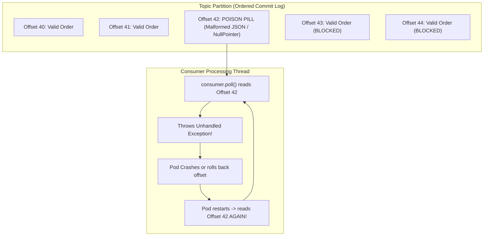
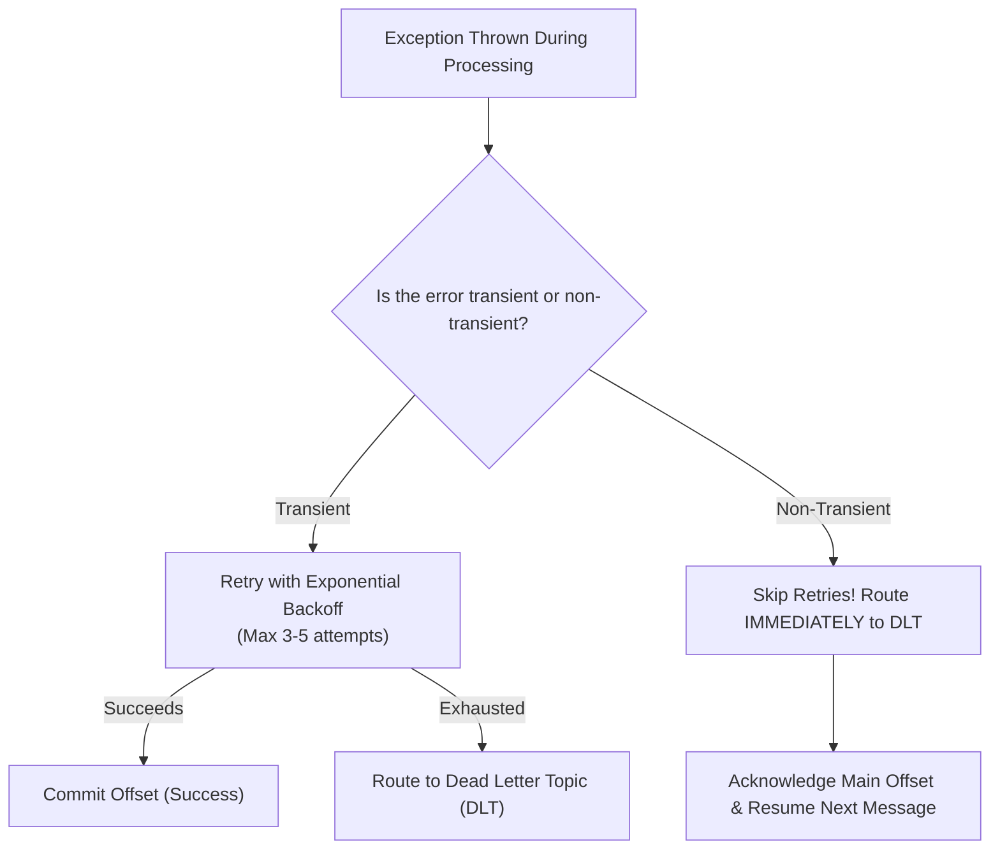
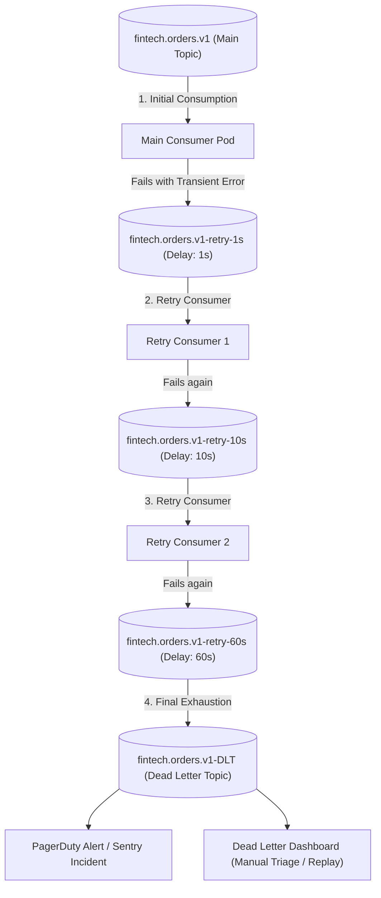

# Resilient Event Processing and Dead Letter Queues

In synchronous REST APIs, when an unexpected exception occurs, handling it is straightforward: catch the exception, log the stack trace, and return an HTTP `500 Internal Server Error` to the caller. The calling client handles the error, and the server thread is immediately returned to the pool to process other requests.

In asynchronous event streaming with Apache Kafka, errors are significantly more dangerous.

Because a Kafka partition is a strictly ordered commit log, **a consumer cannot simply "skip" offset 42 without committing it**. If a consumer encounters a malformed message, throws an unhandled exception, and crashes, it rolls back its offset. Upon restarting, it reads offset 42 again. It crashes again.

This creates an infinite **Poison Pill Crash Loop**: a single corrupted message completely halts all event processing on that partition, starving all subsequent valid messages indefinitely.

To build production-grade event streaming systems, you must classify errors into **transient** vs **non-transient**, implement **non-blocking retry topics**, and route unprocessable records into **Dead Letter Queues (DLT / DLQ)** with rich debugging context.

---

## Anatomy of the Poison Pill Problem



When a poison pill lands in a partition:
1. The consumer crashes and restarts repeatedly, creating continuous group rebalances.
2. Partition lag increases relentlessly as new orders arrive at offsets 43, 44, and beyond, completely blocked behind the poison pill.
3. If an engineer attempts to solve this by adding a naive `try { Thread.sleep(5000); } catch (...)` retry loop inside the consumer, the time between `poll()` calls exceeds `max.poll.interval.ms`. The Kafka broker evicts the pod from the group, triggering a cluster-wide **Rebalance Storm**.

---

## Error Categorization: Transient vs Non-Transient

Resilient architecture begins by categorizing errors into two distinct categories:



### Transient Failures (Retryable)
Temporary environmental or network blips that are likely to resolve themselves within seconds:
- Downstream database connection pool timeouts (`TransientDataAccessException`).
- Remote HTTP microservice returning `503 Service Unavailable` or `429 Too Many Requests`.
- Optimistic locking failures (`OptimisticLockException`).

**Remedy:** Retry with exponential backoff and randomized jitter.

### Non-Transient Failures (Fatal / Poison Pills)
Defects in data structure, logic, or schema that will **never succeed**, regardless of how many times they are retried:
- JSON deserialization errors (`DeserializationException`).
- Schema validation failures (e.g., negative payment amount, missing mandatory fields).
- Business invariant violations (e.g., referencing a non-existent customer ID).

**Remedy:** Do NOT retry. Retrying burns CPU cycles and delays the pipeline. Route the record immediately to the Dead Letter Topic and commit the main partition offset to unblock subsequent traffic.

---

## The Non-Blocking Multi-Tier Retry Architecture

Why can't we simply sleep inside the consumer thread between retries?

If you sleep for 10 seconds to wait for a database to recover, you block the entire partition. Worse, if multiple messages fail, the accumulated sleep time will exceed `max.poll.interval.ms`, causing the Kafka broker to evict your consumer and reassign the partition to another pod.

The enterprise solution is **Non-Blocking Multi-Tier Retry Topics**:



### How Non-Blocking Retries Work:
1. When a transient failure occurs on `orders.v1`, the consumer publishes the failed event to a dedicated retry topic (`orders.v1-retry-1s`) and **commits the offset on the main topic immediately**.
2. The main consumer instantly moves on to process offset 43. No partition blocking occurs.
3. A separate consumer listens to `orders.v1-retry-1s` with a configured delay of 1 second.
4. If it fails again, it promotes the message to `orders.v1-retry-10s`.
5. If all retries are exhausted, the message is routed to the final **Dead Letter Topic (`.DLT`)**.

> **Trade-Off Warning:** Non-blocking retries sacrifice strict ordering for failed records. While message 42 is being delayed on the retry topic, message 43 is processed on the main topic. If strict causal ordering is mandatory for that entity, you must use **blocking retries with an in-memory buffer** or quarantine the specific entity ID.

---

## Implementing `@RetryableTopic` in Spring Boot 3

Spring for Apache Kafka provides turnkey non-blocking retries and dead letter queuing via the `@RetryableTopic` annotation:

### Step 1: Configuration (`application.yml`)

```yaml
spring:
  kafka:
    bootstrap-servers: kafka-broker:9092
    consumer:
      group-id: payment-billing-consumer
      enable-auto-commit: false
      auto-offset-reset: earliest
    listener:
      ack-mode: MANUAL_IMMEDIATE
```

### Step 2: The Production `@RetryableTopic` Consumer

```java
package com.javahub.kafka.resilience;

import org.apache.kafka.clients.consumer.ConsumerRecord;
import org.apache.kafka.common.errors.SerializationException;
import org.slf4j.Logger;
import org.slf4j.LoggerFactory;
import org.springframework.dao.TransientDataAccessException;
import org.springframework.kafka.annotation.DltHandler;
import org.springframework.kafka.annotation.KafkaListener;
import org.springframework.kafka.annotation.RetryableTopic;
import org.springframework.kafka.retrytopic.DltStrategy;
import org.springframework.kafka.retrytopic.TopicSuffixingStrategy;
import org.springframework.kafka.support.Acknowledgment;
import org.springframework.kafka.support.KafkaHeaders;
import org.springframework.messaging.handler.annotation.Header;
import org.springframework.retry.annotation.Backoff;
import org.springframework.stereotype.Service;

import java.net.SocketTimeoutException;

@Service
public class ResilientPaymentConsumer {

    private static final Logger log = LoggerFactory.getLogger(ResilientPaymentConsumer.class);
    private final PaymentBillingService billingService;

    public ResilientPaymentConsumer(PaymentBillingService billingService) {
        this.billingService = billingService;
    }

    @RetryableTopic(
        attempts = "4", // 1 initial attempt + 3 retries
        backoff = @Backoff(delay = 1000, multiplier = 2.0, maxDelay = 10000), // 1s, 2s, 4s exponential backoff
        topicSuffixingStrategy = TopicSuffixingStrategy.SUFFIX_WITH_INDEX_VALUE, // orders-retry-0, orders-retry-1...
        dltStrategy = DltStrategy.FAIL_ON_ERROR,
        include = {
            TransientDataAccessException.class,
            SocketTimeoutException.class
        },
        exclude = {
            IllegalArgumentException.class,
            SerializationException.class,
            NullPointerException.class
        }
    )
    @KafkaListener(topics = "fintech.orders.v1", groupId = "payment-billing-consumer")
    public void processPayment(ConsumerRecord<String, PaymentEvent> record, Acknowledgment ack) {
        log.info("Processing payment from Topic: {}, Partition: {}, Offset: {}, OrderId: {}",
                record.topic(), record.partition(), record.offset(), record.key());

        PaymentEvent event = record.value();

        // Fatal validation: routed immediately to DLT without retries
        if (event.amount() <= 0) {
            throw new IllegalArgumentException("Invalid payment amount: " + event.amount());
        }

        // Business execution (may throw transient network/db exceptions)
        billingService.executeTransaction(event);

        ack.acknowledge();
    }

    // Handles messages that have exhausted all retries and landed in the DLT
    @DltHandler
    public void handleDeadLetterMessage(ConsumerRecord<String, PaymentEvent> record,
                                        @Header(KafkaHeaders.ORIGINAL_TOPIC) String originalTopic,
                                        @Header(KafkaHeaders.ORIGINAL_OFFSET) long originalOffset,
                                        @Header(KafkaHeaders.EXCEPTION_FQCN) String exceptionClass,
                                        @Header(KafkaHeaders.EXCEPTION_MESSAGE) String exceptionMessage,
                                        Acknowledgment ack) {
        log.error("CRITICAL: Message permanently failed and landed in DLT! OriginalTopic: {}, OriginalOffset: {}, " +
                  "Key: {}, Exception: {} - {}", 
                originalTopic, originalOffset, record.key(), exceptionClass, exceptionMessage);

        // 1. Publish metrics / trigger PagerDuty alert
        // 2. Persist failure record into dead-letter audit store
        
        ack.acknowledge();
    }

    public record PaymentEvent(String orderId, String customerId, double amount, String currency) {}
}
```

---

## Anatomy of Dead Letter Context Headers

When Spring Kafka's `DeadLetterPublishingRecoverer` routes a message to a DLT, it automatically injects diagnostic metadata into the Kafka headers:

```text
kafka_original-topic:      fintech.orders.v1
kafka_original-partition:  2
kafka_original-offset:     42
kafka_original-timestamp:  1793261500000
kafka_exception-fqcn:      org.springframework.dao.DataIntegrityViolationException
kafka_exception-message:   duplicate key value violates unique constraint "orders_pkey"
kafka_exception-stacktrace: org.springframework.dao.DataIntegrityViolationException: ...
```

This diagnostic payload is essential for triage:
- On-call engineers can see the exact root cause without digging through gigabytes of distributed application logs.
- The original offset and partition are preserved, allowing automated scripts to verify whether the source record was committed.

---

## The DLQ Reprocessing and Replay Pattern

Moving poisoned messages to a Dead Letter Topic prevents system outages, but the business problem remains: **those transactions were not processed**.

Once engineers identify the root cause (e.g., deploying a hotfix for a bug or resolving a third-party API outage), how do you reprocess the 20,000 messages sitting in the Dead Letter Topic?


### Production Replay Rules:
1. **Never Replay into Production Before Fixing the Bug:** Replaying unhandled records before deploying the bugfix merely causes them to fail again, flooding the retry topics and creating duplicate alerts.
2. **Strip Error Headers Before Replay:** When republishing records from the DLT back to the main topic, strip the `kafka_exception-*` headers to prevent confusion during downstream monitoring.
3. **Enforce Consumer Idempotency:** Because messages in the DLT may have partially completed some side-effects before failing, your consumer must implement the **Transactional Inbox** or idempotent check before replaying messages at scale.

---

## Senior Engineer Interview Crucible

### Why is using `Thread.sleep()` to implement retry backoff inside a Kafka consumer a fatal anti-pattern, and how do multi-tier retry topics resolve it?

Using `Thread.sleep()` inside a Kafka consumer poll loop halts the consumer thread from performing subsequent work. 

This introduces two catastrophic failure modes:
1. **Head-of-Line Blocking:** While the thread sleeps, all subsequent valid messages queued in that partition are blocked, inflating consumer lag.
2. **Rebalance Storms via `max.poll.interval.ms`:** If multiple transient errors occur in succession, the accumulated sleep duration easily exceeds the configured `max.poll.interval.ms`. The Kafka broker assumes the consumer thread has deadlocked or crashed, evicts it from the group, and triggers a Stop-The-World rebalance across all other consumer pods.

**Multi-tier retry topics** resolve this by offloading failed records immediately to delayed topics (e.g., `orders-retry-1s`, `orders-retry-10s`). The consumer commits the main topic offset instantly, allowing the worker thread to immediately invoke `poll()` and process subsequent healthy messages without delay.

---

### Explain the difference between blocking retries and non-blocking retries in Spring for Apache Kafka (`@RetryableTopic`). When would you still use blocking retries?

- **Non-Blocking Retries (`@RetryableTopic`):** Failed messages are forwarded to separate delay topics, allowing the main consumer to proceed with the next record.
  - *Advantage:* High throughput; one failing record never blocks valid records.
  - *Trade-off:* **Message ordering is broken**. If record 1 fails and is moved to a retry topic, record 2 is processed on the main topic immediately.
- **Blocking Retries (`DefaultErrorHandler` with BackOff):** The consumer retries the record locally in memory on the same thread before advancing the offset.
  - *Advantage:* **Strict message ordering is preserved**. Record 2 will never be processed until record 1 either succeeds or is exhausted and moved to the DLT.
  - *Trade-off:* Throughput drops to zero for that partition while retrying.

**When to use Blocking Retries:** In domains where strict sequential ordering per partition is an absolute business invariant (e.g., financial balance ledgers, inventory decrement logs, or state-machine transitions). If event B depends on event A having succeeded first, you must use blocking retries (with careful tuning of backoff limits) to prevent out-of-order execution.

---

### Walk through the headers added to a message by Spring Kafka's `DeadLetterPublishingRecoverer`. Why are these headers critical for triage?

When `DeadLetterPublishingRecoverer` routes an unprocessable message to a Dead Letter Topic, it enriches the record with diagnostic metadata in the Kafka record headers:
- `kafka_original-topic`: The name of the topic where the record originated.
- `kafka_original-partition`: The specific partition number.
- `kafka_original-offset`: The offset in the source topic.
- `kafka_exception-fqcn`: The fully qualified class name of the exception that caused the failure (e.g., `org.hibernate.exception.ConstraintViolationException`).
- `kafka_exception-message`: The detailed exception message.
- `kafka_exception-stacktrace`: The complete root-cause stack trace.

These headers are critical because they decouple operational debugging from application log aggregation. An engineer or automated triage dashboard can inspect the DLT directly and immediately identify which service failed, the exact line of code that threw the error, and the original transaction offset without querying gigabytes of distributed Datadog or ELK logs.

---

### How do you safely replay thousands of messages from a Dead Letter Topic back into the primary processing pipeline after deploying a bug fix?

Safely replaying records from a DLT requires a structured, multi-step operational procedure:

1. **Verify Bugfix Deployment:** Confirm via automated tests and staging verification that the root-cause bug has been resolved in production.
2. **Throttle Replay Throughput:** Never dump 50,000 DLT records into the main topic simultaneously. Rapidly dumping a huge backlog can overwhelm downstream databases, saturate connection pools, and trigger rate-limiting. Use a throttled batch tool or script (e.g., 200 records per second).
3. **Strip Error Headers:** Remove the `kafka_exception-*` headers prior to re-publishing to ensure metrics and monitoring treat the replayed records as fresh traffic.
4. **Rely on Consumer Idempotency:** The consumer must use an idempotent mechanism (such as the **Transactional Inbox Pattern**) to ensure that records that may have partially succeeded before dying do not execute duplicate side-effects (e.g., double-charging credit cards).
5. **Monitor DLT Lag:** Continuously observe the DLT during replay. If any records fail again and bounce straight back to the DLT, immediately abort the replay job to investigate unpredicted edge cases.
