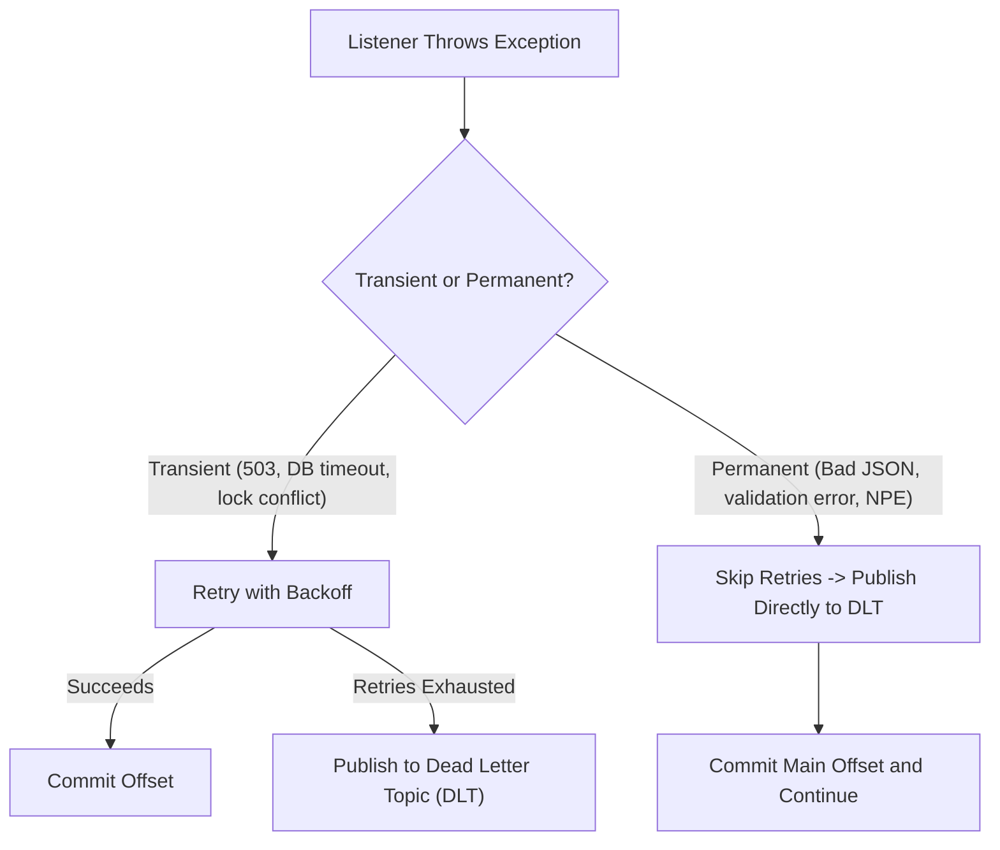
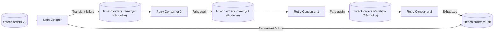
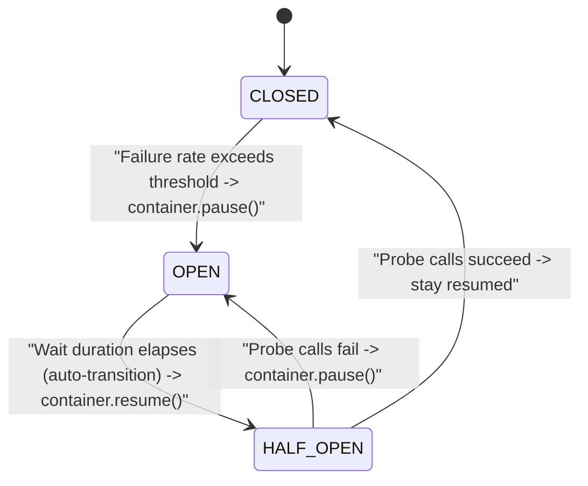

In a synchronous REST API, an unhandled exception has a small blast radius: the controller logs the error, returns HTTP `500` to the caller, and hands the thread back to Tomcat or Jetty for the next request.

In an Apache Kafka consumer, an unhandled exception behaves very differently. Because a Kafka partition is an ordered commit log, a consumer cannot silently skip offset `42` without committing it. If offset `42` contains malformed JSON or triggers a `NullPointerException`, the consumer aborts, never commits the offset, and restarts. On the next `poll()`, Kafka serves offset `42` again. The consumer fails again.

Left unhandled, a single bad message locks up an entire partition in an endless **poison pill loop**, stalling every healthy event behind it. Worse, if you try to work around transient outages with a naive `Thread.sleep()` inside your listener, the consumer stops calling `poll()`, crosses `max.poll.interval.ms`, gets evicted by the group coordinator, and triggers repeated rebalances across every pod in the consumer group.

Resilient Kafka consumers separate transient failures from permanent ones, handle retries without destabilizing the consumer group, route unprocessable records to a **Dead Letter Topic (DLT)** with diagnostic headers, and pause consumption cleanly when a downstream dependency goes down.

## Classifying Failures: Transient vs Permanent

Before choosing a retry mechanism, classify the exceptions your consumer can encounter into two buckets:



- **Transient failures** are temporary infrastructure issues that often clear up within seconds: database connection pool exhaustion (`TransientDataAccessException`), downstream HTTP `503 Service Unavailable` or `429 Too Many Requests`, socket timeouts, or optimistic locking conflicts. These deserve bounded retries with backoff.
- **Permanent failures (poison pills)** will fail on every attempt no matter how long you wait: broken serialization (`DeserializationException`), invalid business fields (`ConstraintViolationException`, `IllegalArgumentException`), or missing required attributes. Retrying them wastes time and blocks the partition; they should go straight to the DLT so the partition moves forward.

## Error Handling in Spring Kafka: Blocking Retries with `DefaultErrorHandler`

Spring Kafka's default error handler is `DefaultErrorHandler`. When a listener throws an exception, `DefaultErrorHandler` seeks the partition back to the failed offset and retries locally on the same consumer thread according to a configured `BackOff`. Once attempts are exhausted, it delegates the record to a `ConsumerRecordRecoverer`, typically `DeadLetterPublishingRecoverer`.

There is one subtle prerequisite: **deserialization failures happen inside `KafkaConsumer.poll()`, before your listener method is ever called.** If you use raw `JsonDeserializer` or `KafkaAvroDeserializer`, a corrupted payload throws an exception during polling and never reaches `DefaultErrorHandler` unless you wrap the deserializer with `ErrorHandlingDeserializer`. `ErrorHandlingDeserializer` catches the exception, sets the record value to `null`, attaches the raw bytes and exception details in Kafka headers, and hands the record to `DefaultErrorHandler`, which recognizes `DeserializationException` as non-retryable and routes it directly to the DLT.

```yaml
spring:
  kafka:
    bootstrap-servers: kafka-broker:9092
    consumer:
      group-id: ledger-posting-service
      enable-auto-commit: false
      auto-offset-reset: earliest
      key-deserializer: org.springframework.kafka.support.serializer.ErrorHandlingDeserializer
      value-deserializer: org.springframework.kafka.support.serializer.ErrorHandlingDeserializer
      properties:
        spring.deserializer.key.delegate.class: org.apache.kafka.common.serialization.StringDeserializer
        spring.deserializer.value.delegate.class: org.springframework.kafka.support.serializer.JsonDeserializer
        spring.json.trusted.packages: "com.javahub.ledger.events"
    listener:
      ack-mode: RECORD
```

Here is a Spring Kafka 3.x configuration that pairs `DefaultErrorHandler` with exponential backoff, a custom DLT routing destination, and an explicit list of non-retryable exceptions:

```java
package com.javahub.kafka.resilience;

import jakarta.validation.ValidationException;
import org.apache.kafka.common.TopicPartition;
import org.springframework.context.annotation.Bean;
import org.springframework.context.annotation.Configuration;
import org.springframework.kafka.core.KafkaTemplate;
import org.springframework.kafka.listener.DeadLetterPublishingRecoverer;
import org.springframework.kafka.listener.DefaultErrorHandler;
import org.springframework.kafka.support.ExponentialBackOffWithMaxRetries;
import org.springframework.kafka.support.serializer.DeserializationException;
import org.springframework.messaging.converter.MessageConversionException;

@Configuration
public class BlockingRetryKafkaConfig {

    @Bean
    public DefaultErrorHandler defaultErrorHandler(KafkaTemplate<Object, Object> kafkaTemplate) {
        // Route failed records to <original-topic>.DLT, preserving the partition number
        // (ensure the DLT has at least as many partitions as the source topic)
        DeadLetterPublishingRecoverer recoverer = new DeadLetterPublishingRecoverer(
                kafkaTemplate,
                (record, ex) -> new TopicPartition(record.topic() + ".DLT", record.partition())
        );

        // 3 retries with exponential backoff: 500ms, 1000ms, 2000ms
        ExponentialBackOffWithMaxRetries backOff = new ExponentialBackOffWithMaxRetries(3);
        backOff.setInitialInterval(500L);
        backOff.setMultiplier(2.0);
        backOff.setMaxInterval(5_000L);

        DefaultErrorHandler errorHandler = new DefaultErrorHandler(recoverer, backOff);

        // Route permanent errors straight to the DLT without burning retry attempts
        errorHandler.addNotRetryableExceptions(
                DeserializationException.class,
                MessageConversionException.class,
                ValidationException.class,
                IllegalArgumentException.class
        );

        // Commit the offset after the recoverer successfully publishes to the DLT
        errorHandler.setCommitRecovered(true);
        return errorHandler;
    }
}
```

### When Blocking Retries Are the Right Choice

Blocking retries with `DefaultErrorHandler` preserve **strict per-partition ordering**. Record `43` will never be processed while record `42` is still retrying. That makes `DefaultErrorHandler` the right default for short backoff windows (hundreds of milliseconds to a few seconds) and domains where state transitions for the same entity must stay strictly ordered, such as account ledgers or inventory reservations.

The catch is headroom against `max.poll.interval.ms`. If `max.poll.records` is 500 and many records in a batch trigger multi-second blocking retries, total retry time can exceed `max.poll.interval.ms` and force a rebalance. When you need retry delays measured in tens of seconds or minutes, switch to non-blocking retry topics.

## Non-Blocking Retries with `@RetryableTopic`

Non-blocking retry topics move failed records off the main topic onto dedicated delayed retry topics, then commit the main partition offset immediately so healthy records continue flowing at full speed.



Spring Kafka 3.x implements this pattern through `@RetryableTopic` and `@DltHandler`. Behind the scenes, Spring creates separate listener containers for each retry topic; each retry consumer checks the scheduled execution timestamp header (`retry_topic-backoff-timestamp`) and pauses that retry partition briefly until the delay elapses, without blocking the main topic or starving `poll()`.

```java
package com.javahub.kafka.resilience;

import jakarta.validation.ValidationException;
import org.apache.kafka.clients.consumer.ConsumerRecord;
import org.slf4j.Logger;
import org.slf4j.LoggerFactory;
import org.springframework.dao.TransientDataAccessException;
import org.springframework.kafka.annotation.DltHandler;
import org.springframework.kafka.annotation.KafkaListener;
import org.springframework.kafka.annotation.RetryableTopic;
import org.springframework.kafka.retrytopic.DltStrategy;
import org.springframework.kafka.retrytopic.TopicSuffixingStrategy;
import org.springframework.kafka.support.KafkaHeaders;
import org.springframework.messaging.handler.annotation.Header;
import org.springframework.retry.annotation.Backoff;
import org.springframework.stereotype.Service;
import org.springframework.web.client.ResourceAccessException;

import java.math.BigDecimal;

@Service
public class ResilientPaymentConsumer {

    private static final Logger log = LoggerFactory.getLogger(ResilientPaymentConsumer.class);
    private final PaymentBillingService billingService;
    private final DeadLetterAuditRepository auditRepository;

    public ResilientPaymentConsumer(PaymentBillingService billingService,
                                    DeadLetterAuditRepository auditRepository) {
        this.billingService = billingService;
        this.auditRepository = auditRepository;
    }

    @RetryableTopic(
            attempts = "4", // 1 initial attempt + 3 non-blocking retry topics
            backoff = @Backoff(delay = 1_000, multiplier = 5.0, maxDelay = 30_000),
            topicSuffixingStrategy = TopicSuffixingStrategy.SUFFIX_WITH_INDEX_VALUE,
            dltStrategy = DltStrategy.FAIL_ON_ERROR,
            autoCreateTopics = "false", // Provision retry and DLT topics via Terraform/IaC in prod
            include = {
                    TransientDataAccessException.class,
                    ResourceAccessException.class
            }
    )
    @KafkaListener(
            id = "payment-billing-listener",
            topics = "fintech.orders.v1",
            groupId = "payment-billing-consumer"
    )
    public void processPayment(ConsumerRecord<String, PaymentEvent> record) {
        PaymentEvent event = record.value();
        if (event == null || event.amount().compareTo(BigDecimal.ZERO) <= 0) {
            // Not in 'include', so Spring sends it directly to fintech.orders.v1-dlt
            throw new ValidationException("Invalid payment payload for key=" + record.key());
        }

        billingService.executeTransaction(event);
    }

    @DltHandler
    public void handleDeadLetter(
            ConsumerRecord<String, PaymentEvent> record,
            @Header(KafkaHeaders.RECEIVED_TOPIC) String dltTopic,
            @Header(KafkaHeaders.ORIGINAL_TOPIC) String originalTopic,
            @Header(KafkaHeaders.ORIGINAL_PARTITION) int originalPartition,
            @Header(KafkaHeaders.ORIGINAL_OFFSET) long originalOffset,
            @Header(KafkaHeaders.EXCEPTION_FQCN) String exceptionClass,
            @Header(KafkaHeaders.EXCEPTION_MESSAGE) String exceptionMessage) {

        log.error("Payment event moved to {} from {}[{}:{}] key={} cause={} ({})",
                dltTopic, originalTopic, originalPartition, originalOffset,
                record.key(), exceptionClass, exceptionMessage);

        auditRepository.saveFailure(
                originalTopic, originalPartition, originalOffset,
                record.key(), exceptionClass, exceptionMessage
        );
    }

    public record PaymentEvent(String orderId, String customerId, BigDecimal amount, String currency) {}
}
```

> [!WARNING]
> **Ordering Trade-Off of Non-Blocking Retries:** Non-blocking retry topics break strict per-key ordering for failed records. If `OrderCreated` (offset 42) fails temporarily and moves to `orders-retry-0`, `OrderCancelled` (offset 43) for the same `orderId` will be processed on the main topic right away, before `OrderCreated` retries. If your consumer cannot tolerate out-of-order events for the same key (for example, through version checks or idempotent state machines), use blocking retries or route related events through an ordered state store.

## Dead Letter Topic Routing and Safe Reprocessing

When `DeadLetterPublishingRecoverer` (or `@RetryableTopic`) publishes a failed record to a DLT, it preserves the original key and value bytes and attaches diagnostic Kafka headers. Depending on whether you use `DeadLetterPublishingRecoverer` directly (`kafka_dlt-*` headers) or `@RetryableTopic` (`kafka_original-*` / `kafka_exception-*` headers), the metadata includes:

- Original topic, partition, offset, and timestamp
- Consumer group ID
- Exception fully qualified class name (`EXCEPTION_FQCN`), message (`EXCEPTION_MESSAGE`), and stack trace (`EXCEPTION_STACKTRACE`)

These headers let operators triage incidents straight from the DLT without hunting through log aggregators.

### Replaying DLT Messages Safely

Moving records to a DLT protects partition throughput, but those business transactions still need to be recovered once the underlying bug or vendor outage is resolved. Blindly piping a DLT back into the main topic is risky: if the bug is not actually fixed, records loop straight back into the DLT and create an infinite replay loop; if 50,000 records are replayed at once, they can overload your database.

A controlled replay job follows four rules:

1. **Bound the replay to a snapshot of current end offsets** so any record that fails again and lands back in the DLT during replay is not re-read in the same run.
2. **Strip exception and DLT metadata headers** before republishing to the main topic.
3. **Throttle publish rate** so downstream databases and rate-limited APIs absorb the backlog smoothly.
4. **Rely on idempotent consumers** (such as a processed-event table or natural unique key) in case a record partially executed side effects before originally failing.

```java
package com.javahub.kafka.resilience;

import org.apache.kafka.clients.consumer.Consumer;
import org.apache.kafka.clients.consumer.ConsumerRecord;
import org.apache.kafka.clients.consumer.ConsumerRecords;
import org.apache.kafka.clients.producer.ProducerRecord;
import org.apache.kafka.common.TopicPartition;
import org.apache.kafka.common.header.Header;
import org.slf4j.Logger;
import org.slf4j.LoggerFactory;
import org.springframework.kafka.core.ConsumerFactory;
import org.springframework.kafka.core.KafkaTemplate;
import org.springframework.stereotype.Service;

import java.time.Duration;
import java.util.List;
import java.util.Map;

@Service
public class DeadLetterReplayService {

    private static final Logger log = LoggerFactory.getLogger(DeadLetterReplayService.class);

    private final ConsumerFactory<byte[], byte[]> rawConsumerFactory;
    private final KafkaTemplate<byte[], byte[]> rawKafkaTemplate;

    public DeadLetterReplayService(ConsumerFactory<byte[], byte[]> rawConsumerFactory,
                                   KafkaTemplate<byte[], byte[]> rawKafkaTemplate) {
        this.rawConsumerFactory = rawConsumerFactory;
        this.rawKafkaTemplate = rawKafkaTemplate;
    }

    public int replayBounded(String dltTopic, String targetTopic, int maxRecordsPerSecond) {
        int replayed = 0;
        long delayMs = Math.max(1L, 1_000L / maxRecordsPerSecond);

        try (Consumer<byte[], byte[]> consumer = rawConsumerFactory.createConsumer("dlt-replay-job", "manual")) {
            List<TopicPartition> partitions = consumer.partitionsFor(dltTopic).stream()
                    .map(info -> new TopicPartition(dltTopic, info.partition()))
                    .toList();
            consumer.assign(partitions);

            // Snapshot the end offsets up front so newly failed records are not re-read infinitely
            Map<TopicPartition, Long> endOffsets = consumer.endOffsets(partitions);
            consumer.seekToBeginning(partitions);

            while (hasRemaining(consumer, endOffsets)) {
                ConsumerRecords<byte[], byte[]> batch = consumer.poll(Duration.ofSeconds(1));
                for (ConsumerRecord<byte[], byte[]> record : batch) {
                    long endOffset = endOffsets.getOrDefault(
                            new TopicPartition(record.topic(), record.partition()), 0L);
                    if (record.offset() >= endOffset) {
                        continue;
                    }

                    ProducerRecord<byte[], byte[]> cleanRecord =
                            new ProducerRecord<>(targetTopic, null, record.key(), record.value());

                    // Keep business headers (e.g., correlationId), drop Spring DLT/retry error headers
                    for (Header header : record.headers()) {
                        String key = header.key();
                        if (!key.startsWith("kafka_dlt-")
                                && !key.startsWith("kafka_exception-")
                                && !key.startsWith("retry_topic-")) {
                            cleanRecord.headers().add(header);
                        }
                    }

                    rawKafkaTemplate.send(cleanRecord).join();
                    replayed++;
                    throttle(delayMs);
                }
            }
        }

        log.info("Replayed {} records from {} to {}", replayed, dltTopic, targetTopic);
        return replayed;
    }

    private boolean hasRemaining(Consumer<byte[], byte[]> consumer, Map<TopicPartition, Long> endOffsets) {
        return endOffsets.entrySet().stream()
                .anyMatch(entry -> consumer.position(entry.getKey()) < entry.getValue());
    }

    private void throttle(long delayMs) {
        try {
            Thread.sleep(delayMs);
        } catch (InterruptedException e) {
            Thread.currentThread().interrupt();
            throw new IllegalStateException("DLT replay interrupted", e);
        }
    }
}
```

Using raw `byte[]` serializers for replay avoids deserializing and re-serializing domain payloads (which also lets you replay records even when the replay tool does not carry every domain class or Avro schema on its classpath).

## Backpressure and Circuit Breakers for Event Consumers

Retry topics and DLTs solve **message-level** errors, but they behave poorly during a **system-level** outage.

Suppose your downstream payment processor goes completely offline for 15 minutes. If your Kafka consumer keeps polling at 2,000 messages per second, every valid order hits the dead gateway, fails, floods the retry topics, exhausts attempts, and lands in the DLT. When the payment processor recovers 15 minutes later, you now have 500,000 perfectly valid orders sitting in the DLT waiting for manual replay.

You do not want to send healthy orders to a DLT just because a downstream API is down. You want the consumer to **apply backpressure and pause consumption** until the dependency recovers, leaving unread messages safely buffered in Kafka where they belong.

### Tuning Kafka Consumer Backpressure Controls

Before adding a circuit breaker, make sure the consumer's poll batch matches the downstream service's realistic processing latency:

- **`max.poll.records`** (default `500`): Lower this (for example, to `25` or `50`) when each event triggers an external HTTP or database call. Smaller batches keep processing time per poll predictable and far below `max.poll.interval.ms`.
- **`max.poll.interval.ms`** (default `300000` / 5 minutes): The maximum wall-clock time allowed between `poll()` calls before Kafka evicts the consumer. Ensure `max.poll.records * worst_case_record_time < max.poll.interval.ms`.
- **`fetch.max.bytes` and `max.partition.fetch.bytes`**: Cap memory held in-flight inside the consumer buffer.

### Pausing a `@KafkaListener` Container with Resilience4j

To stop pulling messages during a downstream outage without losing consumer group membership, connect a **Resilience4j `CircuitBreaker`** to Spring Kafka's **`KafkaListenerEndpointRegistry`**.



Why is `MessageListenerContainer.pause()` safe in Kafka? Under the hood, Spring Kafka invokes `KafkaConsumer.pause(assignedPartitions)`. A paused `KafkaConsumer` **keeps calling `poll()` on every loop iteration**, returning zero records while continuing to send group heartbeats and reset the `max.poll.interval.ms` timer. The consumer stays a healthy member of the group with zero rebalances, and partition lag simply builds up in Kafka until the container resumes.

> [!IMPORTANT]
> Set `automaticTransitionFromOpenToHalfOpenEnabled(true)` on your Resilience4j `CircuitBreakerConfig`. By default, Resilience4j transitions from `OPEN` to `HALF_OPEN` lazily when the *next* call arrives. When the Kafka listener container is paused, no calls arrive, so without automatic transition enabled, the circuit breaker would stay `OPEN` and the consumer would stay paused forever.

```java
package com.javahub.kafka.resilience;

import io.github.resilience4j.circuitbreaker.CircuitBreaker;
import io.github.resilience4j.circuitbreaker.CircuitBreakerConfig;
import io.github.resilience4j.circuitbreaker.CircuitBreakerRegistry;
import org.slf4j.Logger;
import org.slf4j.LoggerFactory;
import org.springframework.context.annotation.Bean;
import org.springframework.context.annotation.Configuration;
import org.springframework.kafka.config.KafkaListenerEndpointRegistry;
import org.springframework.kafka.listener.MessageListenerContainer;

import java.time.Duration;

@Configuration
public class CircuitBreakerBackpressureConfig {

    private static final Logger log = LoggerFactory.getLogger(CircuitBreakerBackpressureConfig.class);
    public static final String LISTENER_ID = "payment-billing-listener";

    @Bean
    public CircuitBreaker paymentGatewayCircuitBreaker(
            CircuitBreakerRegistry registry,
            KafkaListenerEndpointRegistry listenerRegistry) {

        CircuitBreakerConfig config = CircuitBreakerConfig.custom()
                .slidingWindowSize(20)
                .minimumNumberOfCalls(10)
                .failureRateThreshold(50.0f)
                .waitDurationInOpenState(Duration.ofSeconds(30))
                .permittedNumberOfCallsInHalfOpenState(5)
                // Critical: triggers OPEN -> HALF_OPEN on a background timer while listener is paused
                .automaticTransitionFromOpenToHalfOpenEnabled(true)
                .build();

        CircuitBreaker cb = registry.circuitBreaker("paymentGateway", config);

        cb.getEventPublisher().onStateTransition(event -> {
            MessageListenerContainer container = listenerRegistry.getListenerContainer(LISTENER_ID);
            if (container == null) {
                return;
            }

            CircuitBreaker.State nextState = event.getStateTransition().getToState();
            if (nextState == CircuitBreaker.State.OPEN) {
                log.warn("Circuit breaker OPEN; pausing Kafka listener {}", LISTENER_ID);
                container.pause();
            } else if (nextState == CircuitBreaker.State.HALF_OPEN
                    || nextState == CircuitBreaker.State.CLOSED) {
                if (container.isContainerPaused()) {
                    log.info("Circuit breaker {}; resuming Kafka listener {}", nextState, LISTENER_ID);
                    container.resume();
                }
            }
        });

        return cb;
    }
}
```

Inside `PaymentBillingService`, decorate the downstream HTTP or database call with `circuitBreaker.executeRunnable(...)` (or `@CircuitBreaker(name = "paymentGateway")`), and treat `CallNotPermittedException` as a retryable exception (never route it straight to the DLT). That way, the few in-flight records from the current poll batch that arrive right as the breaker trips are retried cleanly, while the container immediately pauses so thousands of subsequent orders remain untouched on the broker until the downstream gateway recovers.

## Interview Questions

### Why does `Thread.sleep()` inside a `@KafkaListener` cause rebalance storms, and how do non-blocking retry topics avoid that?

A Kafka consumer runs heartbeats on a background thread, but the broker also enforces `max.poll.interval.ms` on the application poll loop to detect livelocked listeners. Sleeping inside the listener blocks the thread from returning to `poll()`. If a few failing records accumulate enough sleep time to exceed `max.poll.interval.ms`, the broker evicts the consumer and triggers a consumer group rebalance, reassigning partitions across pods (which may then hit the exact same failing records). Non-blocking retry topics avoid this by offloading failed records to delayed retry topics and committing the main offset immediately so the main consumer returns to `poll()` right away.

### When should you choose `DefaultErrorHandler` blocking retries over `@RetryableTopic` non-blocking retries?

Use `DefaultErrorHandler` with short blocking backoffs when strict per-partition ordering is required (for example, when processing sequential state transitions like `Created -> Authorized -> Captured -> Refunded` for the same account or order key). Non-blocking retry topics move a failing record onto a separate topic while allowing subsequent records for the same key to proceed on the main topic, which breaks causal order. Choose `@RetryableTopic` when throughput matters more than strict ordering across failed records, or when your consumer handles out-of-order delivery via entity versions or idempotent checks.

### Why is `ErrorHandlingDeserializer` required even if you already configured a `DefaultErrorHandler` with a `DeadLetterPublishingRecoverer`?

Deserialization runs inside `KafkaConsumer.poll()`, before Spring Kafka invokes your `@KafkaListener` method. Without `ErrorHandlingDeserializer`, a malformed record causes `poll()` itself to throw a `SerializationException` repeatedly at the same offset, and the listener container's record-level `DefaultErrorHandler` cannot extract the raw bytes to publish them to the DLT. `ErrorHandlingDeserializer` traps the deserialization error, attaches the raw bytes and stack trace in record headers, and passes the failed record into `DefaultErrorHandler`, which treats `DeserializationException` as non-retryable and sends it straight to the DLT.

### Why should you pause a Kafka listener container via `KafkaListenerEndpointRegistry` when a circuit breaker opens instead of letting all records fail into the DLT?

A Dead Letter Topic is meant for isolated, unprocessable messages, not for buffering 15 minutes of healthy production traffic during a downstream outage. Letting records fail into the DLT creates unnecessary broker traffic, triggers false alerts, and forces an operational replay afterward. Calling `container.pause()` triggers `KafkaConsumer.pause()`, which stops fetching new records while continuing to call `poll()` so heartbeats stay alive and no consumer group rebalance occurs. Combined with Resilience4j's `automaticTransitionFromOpenToHalfOpenEnabled(true)`, the consumer resumes automatically once the wait window elapses to probe whether the downstream dependency has recovered.
